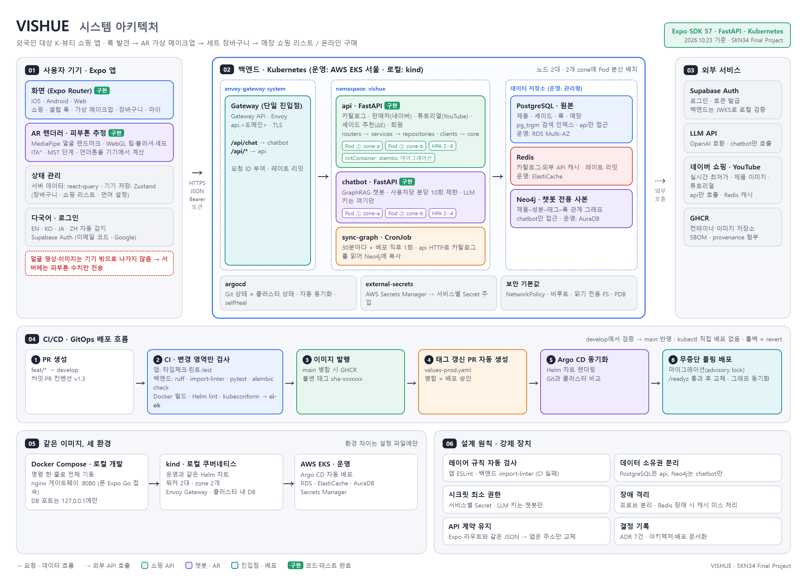
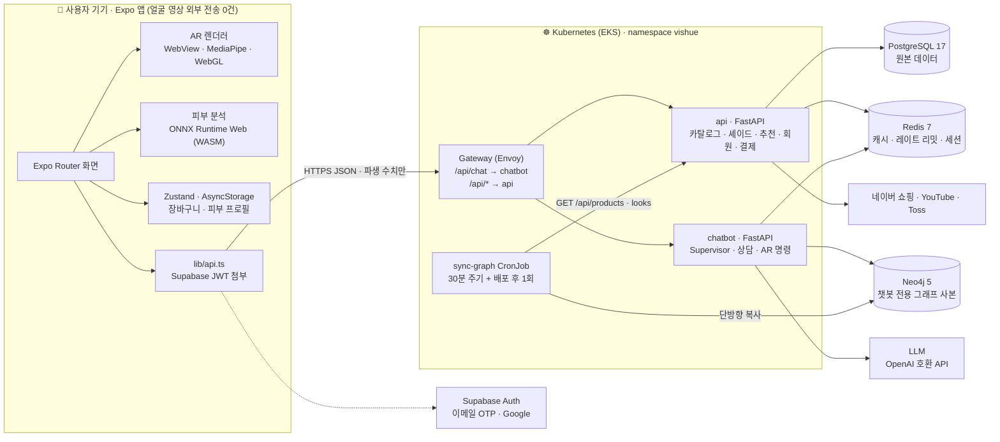
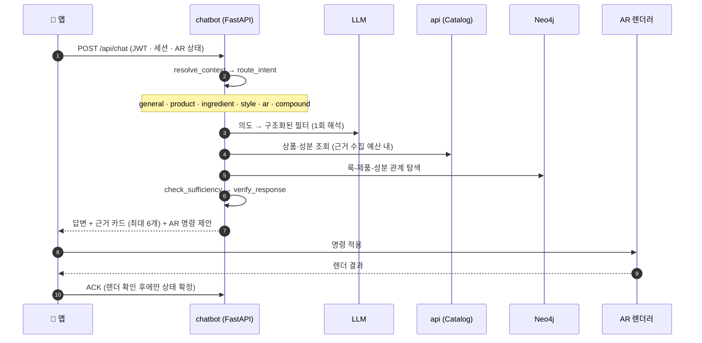

# 💄 VISHUE

### 피부 분석부터 AR 메이크업, 제품 추천까지 한 번에 해 주는 K-뷰티 플랫폼

**Vision + Hue** — SNS에서 발견한 K-뷰티를 *내 피부*에서 이해하고, *내 얼굴*에서 확인한 뒤, *실제 제품*으로 고르게 합니다.


**SK Networks Family AI Camp 34기 · 최종 프로젝트**
김대호 · 이홍규 · 황호순 · 김현지 · 전진영


---

## 📑 Table of Contents

1. [프로젝트 개요](#-1-프로젝트-개요-overview--background)
2. [서비스 전체 구조](#-2-서비스-전체-구조-architecture--user-journey)
3. [데이터 및 AI 아키텍처](#-3-데이터-및-ai-아키텍처-data--ai-engine)
4. [핵심 파이프라인 및 구현](#-4-핵심-파이프라인-및-구현-implementation--pipelines)
5. [기술 스택](#-5-기술-스택-comprehensive-tech-stack)
6. [빠른 실행](#-6-빠른-실행-getting-started)
7. [결론 및 향후 계획](#-7-결론-및-향후-계획-conclusion--roadmap)
8. [Team Members & Repository Links](#-8-team-members--repository-links)

---

## 🌏 1. 프로젝트 개요 (Overview & Background)

### 1-1. 개발 배경 및 동기

K-뷰티는 숏폼·유튜브·SNS를 통해 전 세계에서 **쉽게 발견**됩니다. 하지만 발견한 다음 단계에서 막힙니다.
아이돌 메이크업 영상을 보고 "나도 해 보고 싶다"고 생각해도, 그 룩이 내 피부와 얼굴에 맞는지, 어떤 제품을 사야 하는지, 사면 정말 만족할지는 알 수 없습니다.

VISHUE는 이 **"발견 이후의 불확실성"**을 줄이기 위해 시작했습니다. 처음에는 외국인을 위한 AR 쇼핑 앱(Look-to-Cart)으로 기획했습니다. 멘토링과 사용자 조사를 거치면서 AR만으로는 구매 판단을 끝낼 수 없다는 결론에 이르렀고, 서비스를 **피부 이해 → 제품·성분 확인 → AR 체험 → 제품 선택**으로 이어지는 하나의 경험으로 다시 설계했습니다.

> 💡 **설계 원칙 3가지**
>
> 1. **얼굴 영상·사진은 기기 밖으로 나가지 않습니다.** AR과 피부 분석은 모두 기기에서 실행하고, 서버에는 ITA°·MST 단계·언더톤 같은 파생 수치만 보냅니다.
> 2. **보정하지 않습니다.** 피부를 매끈하게 만들거나 얼굴형을 깎는 미화 필터 없이, 카메라에 찍힌 실제 주름·명암 위에 제품 색만 올립니다.
> 3. **색과 사실은 AI가 지어내지 않습니다.** LLM과 VLM은 의도 해석과 레시피 구조화에만 쓰고, 색 계산(CIEDE2000)과 상품·성분 사실은 결정적 로직과 카탈로그 DB에서 가져옵니다.

### 1-2. 문제 정의 — 소비자가 마주하는 3대 장벽

| # | 소비자 질문 | 실제로 겪는 문제 (팀 조사 사례) |
|:-:|---|---|
| ① | **유행하는 K-뷰티, 내 피부에도 맞을까?** | 같은 세럼도 건성·지성에 따라 평가가 갈림. 피부 상태와 사용 조건에 따라 경험이 달라짐 |
| ② | **어떤 제품을 골라야 할까?** | 브랜드·성분·제품이 너무 많고 후기는 서로 상반됨. 해외 판매 제품은 같은 이름이라도 버전·성분이 다른 경우가 있음 |
| ③ | **실제로 사용해도 만족할까?** | 구매 전에 발색·사용감·제품 조합을 확인하기 어려움. 가상 색상 필터가 추천한 호수와 실제 구매 호수가 다른 사례가 있음 |

> ⚠️ 위 사례는 팀 시장조사와 후기 분석에서 확인한 **탐색적 정성 근거**이며, 전체 소비자 비율을 뜻하지 않습니다.

### 1-3. 기존 방식 vs VISHUE

| 구분 | 기존 방식 | VISHUE의 해결책 |
|---|---|---|
| **AR 메이크업** | 2D 단색을 입술 위에 덮는 "스티커" 방식, 또는 얼굴 전체를 매끈하게 다시 그리는 생성형 필터 | 카메라 픽셀을 조명 × 명암 × 맨입술 색으로 분해한 뒤 **물리 기반 층 쌓기**(`1-(1-a₁)ⁿ`)로 제품 색을 올림. 7종 제형별 질감과 윤기 표현 |
| **피부 이해** | 매장 측정기, 또는 사진을 서버로 올리는 분석 앱 | **기기 내 ONNX 추론**(MobileNetV3 4종)과 설문 보정. 사진·ROI·텐서를 외부로 보내지 않음 |
| **제품·성분 정보** | 전성분 텍스트 나열, 검색 키워드 의존 | 올리브영 원본 9,185종 성분을 **식약처 표준명에 매핑**(상품-성분 커버리지 97.95%). 성분 조건을 근거와 함께 판정하는 상담 챗봇 |
| **K-스타일 탐색** | 영상 시청 후 제품명을 따로 검색 | K-연예인·K-스타일 **영상 107개와 제품 후보 1,617건**을 연결하고, 영상 상세에서 바로 AR 시착 |
| **조정 방식** | 슬라이더·버튼 위주 | "오버립으로 해줘", "강아지 아이라인으로" 같은 **자연어 명령**을 닫힌 스타일 ID로 변환해 즉시 반영 |
| **구매 연결** | 외부 쇼핑몰로 이탈 | ΔE2000 기반 **유사 셰이드 추천**, 장바구니, Toss 테스트 결제, 네이버 쇼핑 판매처 연결 |

---

## 🧭 2. 서비스 전체 구조 (Architecture & User Journey)

### 2-1. 핵심 기능 개요 — 시스템의 5개 축

| 축 | 기능 | 주요 구현 위치 |
|---|---|---|
| 🔬 **Skin** | 기기 내 피부 분석(모공·색소침착·주름 이진 판정 + 피부 타입), 설문 보정, 피부 리포트, 기초화장품 추천 | `app/skin-analysis.tsx`, `modules/skin-analysis/`, `backend/api/.../recommendation_service.py` |
| 🪞 **AR** | 9개 부위 실시간 가상 메이크업, 조명 추정, 가림 처리, 전후 비교, 카메라 위 드로잉 가이드 | `components/ar/faceTrackerHtml.ts`, `app/(tabs)/ar.tsx` |
| ✨ **K-Style** | K-연예인·K-스타일 영상 큐레이션, 룩 레시피 원클릭 시착, 단계별 메이크업 일러스트 | `app/celebrities/`, `app/style-look/`, `backend/api/.../jobs/` |
| 💬 **AI 상담** | 상품·성분 상담, 멀티턴 가격 조회, AR 명령 제안과 렌더 확인(ACK) | `backend/chatbot/app/services/` |
| 🛍️ **Commerce** | 검색·탐색, 장바구니, 유사 셰이드, Toss 테스트 결제, 회원(약관·탈퇴) | `app/search.tsx`, `app/cart.tsx`, `backend/api/.../payment_service.py` |

### 2-2. 전체 시스템 아키텍처





**데이터 흐름의 핵심 규칙**

- **단일 진입점.** 앱은 Gateway 주소 하나만 압니다. 서비스가 늘거나 나뉘어도 앱 코드는 바뀌지 않습니다.
- **데이터 소유권 분리.** PostgreSQL은 `api`만, Neo4j는 `chatbot`만 접근합니다. 챗봇은 카탈로그를 DB에서 직접 읽지 않고 `api`의 HTTP 계약으로 받습니다([ADR-0001](docs/adr/0001-two-backend-services.md), [ADR-0002](docs/adr/0002-postgres-source-neo4j-copy.md)).
- **장애 격리.** LLM 호출은 느리고 비용이 들기 때문에 챗봇을 별도 서비스로 분리했습니다. 챗봇 장애가 쇼핑 기능으로 번지지 않고, LLM 키는 챗봇 Pod에만 있습니다.
- **API 계약 일치.** 응답 형태는 앱의 `types/index.ts`와 같은 camelCase JSON이고, 에러는 항상 `{ error, code }`입니다.

### 2-3. 사용자 여정 (User Journey)

> 아래는 발표용 대표 흐름입니다. 실제 앱에서는 각 기능에 독립적으로 들어갈 수 있습니다.

| 단계 | 사용자 행동 | VISHUE가 하는 일 | 해소하는 장벽 |
|:-:|---|---|:-:|
| **1. 발견** | 홈에서 K-연예인·K-스타일 영상을 둘러봄 | 영상별 메이크업 부위와 연결된 제품 후보를 보여 주고 내장 플레이어로 재생 | — |
| **2. 피부 이해** | 마이페이지에서 피부 정보 등록 | 전면 카메라 자동 촬영 → 기기 내 4개 모델 추론 → 설문 보정 → 피부 리포트 | ① |
| **3. 제품·성분 확인** | 검색하거나 챗봇에게 "무향료 수분크림 찾아줘"라고 질문 | 카탈로그 검색, 식약처 매핑 성분으로 조건 판정, 판정 근거와 미확인 항목을 함께 표시 | ② |
| **4. AR 체험 · 조정** | 룩이나 제품을 골라 AR로 입어 보고 "아이라인 더 길게"라고 말함 | 9개 부위 실시간 렌더링, 자연어 → 스타일 파라미터 변환, 카메라 위 점선 가이드 | ③ |
| **5. 선택 · 구매** | 마음에 드는 색을 장바구니에 담고 결제 | ΔE2000 유사 셰이드, 룩 세트 담기, 네이버 판매처, Toss 테스트 결제 | ③ |

---

## 🧠 3. 데이터 및 AI 아키텍처 (Data & AI Engine)

### 3-1. 데이터베이스 선정 이유

| 저장소 | 역할 | 선정 이유 |
|---|---|---|
| **PostgreSQL 17** (Relational) | 카탈로그·셰이드·룩·회원·주문, 올리브영 원본 22개 테이블, 식약처 성분, AI-Hub, 추천 매핑 | 상품-셰이드-룩-성분 관계에 무결성 제약이 필요. `pg_trgm` GIN 인덱스로 한·영 부분 검색. SQLAlchemy 2 async + Alembic(마이그레이션 14개) |
| **Neo4j 5** (Graph) | `(:Product)-[:HAS_SHADE\|CONTAINS\|TAGGED]->`, `(:Look)-[:USES]->(:Product)` | 챗봇이 "이 룩에 쓰인 제품 중 이 성분이 없는 것" 같은 다단계 관계를 탐색. PostgreSQL에서 **단방향 복사**만 하고 직접 쓰지 않음 |
| **Redis 7** (Cache) | API 응답 캐시, IP·사용자별 레이트 리밋, 챗봇 대화 세션 | Redis가 없으면 캐시 없이 동작하고 레이트 리밋은 프로세스 메모리로 대체(장애 격리). 운영에서는 ElastiCache |
| **AsyncStorage** (On-device) | 장바구니, 피부 프로필, 측정 기록 | 개인 피부 데이터는 서버가 아닌 기기에 둠. 쓰기 성공을 확인한 뒤 완료 처리 |

> 🔎 **왜 Vector DB를 쓰지 않았나?**
> VISHUE의 질문 대부분("이 성분이 들어 있나", "이 색과 가장 가까운 셰이드는")은 **정답이 DB에 있는 사실 질의**입니다. 임베딩 유사도로 찾으면 근거 없는 상품을 섞어 보여 줄 위험이 있습니다. 그래서 LLM은 질문을 구조화된 필터로 바꾸는 데만 쓰고, 결과는 카탈로그 API와 Neo4j 그래프에서 결정적으로 가져옵니다. 문서 청킹 대신 **근거 수집 예산**(요청 상한·시간 제한)으로 응답 범위를 통제합니다.

### 3-2. AI 모델 구성

| 영역 | 모델 / 기법 | 실행 위치 | 선정 이유 |
|---|---|---|---|
| 얼굴 추적 | **MediaPipe Face Landmarker** (478점 3D 메시) | 기기 · WebView | Expo Go에서 추가 네이티브 모듈 없이 동작하고 JS·WASM·GPU를 지원 |
| 가림 분할 | MediaPipe `selfie_multiclass` | 기기 · WebView | 앞머리·손·컵 가림을 부위별로 마스킹 |
| 피부 분석 | **MobileNetV3-Large × 4** (모공·색소침착·주름 이진 + 피부 타입 softmax) | 기기 · ONNX Runtime Web (WASM CPU) | 백본 비교에서 Macro-F1 최고, 온디바이스에 적합 |
| 대화 의도 해석 | OpenAI 호환 LLM (`LLM_MODEL` 환경 변수) | chatbot 서비스 | 모델을 교체할 수 있게 하고, 평가 세트로 선정할 수 있게 함 |
| 영상 레시피 추출 | Gemini VLM **3회 독립 추론 + 과반 다수결** | 오프라인 배치 | 단일 추론의 환각을 다수결로 줄이고, 결과는 사람 검수 후에만 반영 |
| AR 품질 평가 | VLM Judge (OpenAI API) | 오프라인 도구 | 렌더 결과의 자연스러움을 사람 설문 전에 빠르게 선별 |
| 입술 경계 검증 | BiSeNet (ResNet18) | 오프라인 비교 전용 | LaPa 200장에서 IoU 0.714로 얼굴 점(0.736)보다 낫지 않아 런타임에서 제외 |

### 3-3. 피부 분석 모델 실험

**① 백본 비교** (모공, 동일 분할·학습 조건)

| 백본 | Validation Macro-F1 | Test Macro-F1 | Test 정확도 |
|---|---:|---:|---:|
| ResNet-50 | 0.3483 | 0.3197 | **0.5031** |
| EfficientNet-B3 | 0.3253 | 0.3219 | 0.4408 |
| **MobileNetV3-Large** ✅ | **0.3524** | **0.3471** | 0.4908 |

**② 클래스 불균형 대응 — 손실과 최적화 비교** (모공, ResNet-50, batch 16, 2 seed 평균)

| 학습법 | Macro-F1 | 고등급 정확 Recall |
|---|---:|---:|
| 일반 CE + AdamW | 28.69 ± 2.41% | 3.00% |
| 제곱근 WCE(α=0.5) + AdamW | 31.62 ± 1.11% | 22.00% |
| **제곱근 WCE(α=0.5) + SAM(ρ=0.05)** ✅ | **36.16 ± 0.17%** | 20.00% |
| 역빈도 WCE(α=1) + AdamW | 28.54 ± 0.42% | 20.00% |

> 제곱근 WCE는 CE 대비 **+2.93%p**, 같은 조건에 SAM을 더하면 **+4.54%p** 올랐습니다. 역빈도 가중은 세 항목 모두에서 제곱근보다 낮았습니다.

**③ 등급 모델 성능** (v3, 실제 스마트폰 ROI)

| 항목 | 출력 | Test Macro-F1 | Test 정확도 | Test ±1등급 정확도 |
|---|---|---:|---:|---:|
| 모공 | sigmoid×5 → 0~5등급 | 0.3471 | 0.4908 | **0.9206** |
| 색소침착 | sigmoid×5 → 0~5등급 | 0.4248 | 0.5049 | **0.9398** |
| 주름 | sigmoid×6 → 0~6등급 | 0.3931 | 0.4120 | **0.9004** |
| 피부 타입 | softmax×3 (건성·중성·지성) | 0.4698 | 0.4977 | — |

> ⚠️ 위 Test 수치는 모델 선택 논의에 반복 참고한 **탐색용**이며, 새로운 인물에 대한 최종 성능이 아닙니다. 모공 5등급 Recall은 0으로 미해결입니다. 이 한계 때문에 앱 기본값인 **v4는 세밀한 등급 대신 양호/유의 이진 판정**(원본 0~2등급 = 양호, 3등급 이상 = 유의, sigmoid ≥ 0.5)을 사용합니다.

### 3-4. AR 렌더링 품질 개선 실험

| 지표 | 개선 전 | 현재 | 변화 |
|---|---:|---:|---:|
| 입술 발색 색차 (CIEDE2000 ΔE 중앙값, 화장 전후 20쌍) | 7.21 (맨입술) | **3.86** | −46.5% |
| 글로시 립 미세 주름 결(L*) 보존율 | 0.87 | **0.99** | +0.12 |
| 벌린 입에서 칠해진 치아 비율 | 25% | **1%** | −24%p |
| 고개 2Hz 흔들림 최대 추적 오차 | 20.8px | **2.2px** | −89.4% |
| 눈 깜박임 시 아이라인 지연 | 6.2px | **1.2px** | −80.6% |
| 0.5px 이동 시 아이섀도 펄 유지율 (쉬머 / 글리터) | 21% / 37% | **91% / 97%** | +70%p / +60%p |
| 파운데이션 앞머리 침범 | 73,054px | **242px** | −99.7% |
| 고개 회전 시 볼·턱 맨살 띠 | 18.7% | **1.3%** | −17.4%p |
| 블라인드 설문 자연스러움 (5점 만점) | — | **4.07** | 판별 균형정확도 86.7% |

> ⚠️ **측정 조건.** PC Headless Chrome(WebGL) 오프라인 하네스에서 같은 얼굴·같은 셰이드로 비교한 값이며, 스마트폰 카메라 경로와는 다릅니다. 설문은 평가자 5명·쌍 사진 30장 파일럿(v4)입니다. 공개 데이터에서는 **화장하지 않은 입 주변 피부끼리도 ΔE 중앙값이 2.90**이라 ΔE ≤ 1.5 목표는 판정할 수 없는(`not_valid`) 상태이고, 통제 촬영 프로토콜로 확인할 예정입니다.

### 3-5. 데이터 자산 규모

| 데이터 | 규모 | 비고 |
|---|---:|---|
| 앱 서빙 상품 | **7,688개** | 메이크업 1,983 · 스킨케어 4,919 · 선케어 786 |
| 셰이드 / AR 시착 가능 상품 | 10,160개 / 1,308개 | 립·아이·베이스·치크 |
| 올리브영 성분 → 식약처 매핑 | 4,801 / 9,185종 (52.27%) | 상품-성분 조합 기준 **커버리지 97.95%**. 수동 검수 151건 |
| AI-Hub 문제성 피부 QA | 9,031건 · 고민 13종 | 파싱 오류 0, 3축 교차검증 일치 |
| 큐레이션 영상 / 제품 후보 | 107개 / 1,617건 | K-연예인 34(711) · K-스타일 73(906). 사람 검수 후 반영 |
| AR 오프라인 평가셋 | LaPa 1,840장 + 화장 전후 20쌍 | IoU · ΔE2000 · SSIM 자동 채점 |
| LLM 평가 사례 | 359건 | 대표 35건 검수 완료(승인 후보 25 · 보류 10) |

---

## ⚙️ 4. 핵심 파이프라인 및 구현 (Implementation & Pipelines)

### 4-1. 실시간 AR 렌더링 파이프라인

```text
전면 카메라 프레임 (requestVideoFrameCallback, 같은 프레임 업로드→검출→렌더)
  └─▶ MediaPipe Face Landmarker (478점) + selfie_multiclass (가림 분할)
        ├─▶ 앵커 분리 One Euro 필터 (기준점은 그대로, 오프셋만 평활화)
        ├─▶ 화면 공간 입술 윤곽 (Catmull-Rom + Taubin 평활) · 치아 가드
        ├─▶ 속눈썹 픽셀 경계 맞춤 (fitLidLine) · 얼굴 비율 측정 (measureFaceShape)
        ├─▶ 조명 추정: 후보 38방향 그림자 매칭 (matchLight) + Gray-Edge 색온도
        └─▶ WebGL 셰이더 합성
              덮임   = 1 − (1 − a₁)ⁿ           (n = 바르는 횟수, 제형별 a₁)
              비침   = 맨입술 × 제품 색조        (시어는 색조로만 물들임)
              질감   = 카메라 미세 반짝임 보존 (hlSparkle) + 골 반사 가림 (glossCavity)
                  └─▶ 실시간 화면 · 전후 비교 · 전체 화면 미러 · 4단계 드로잉 가이드
```

- **렌더러 구조.** AR 엔진은 `components/ar/faceTrackerHtml.ts`의 HTML 문자열이고, `react-native-webview`(모바일)와 iframe(웹)에서 같은 코드로 동작합니다. Expo Go만으로 시연할 수 있도록 네이티브 모듈을 쓰지 않았습니다.
- **9개 부위 전용 규칙.** 립·블러셔·아이섀도·아이라인·아이브로우·파운데이션·하이라이터·쉐딩·마스카라는 각각 발리는 원리가 달라 렌더러를 따로 둡니다. 예를 들어 아이브로우는 가짜 털을 그리지 않고, 반투명 파우더 막 위에서 실제 털 픽셀의 색도만 옮깁니다.
- **프리셋.** 립 7제형, 섀도 4제형, 아이라인 6종, 하이라이터 6종, 쉐딩 3종을 둡니다. 모두 **제품 HEX는 바꾸지 않고** 모양과 재질만 바꾸는 닫힌 파라미터입니다.
- **회귀 방지.** 기능 스위치(`TUNING`)를 끈 렌더가 이전 버전과 **픽셀 차이 0**인지 검사한 뒤에만 새 기능을 기본으로 켭니다.

### 4-2. 기기 내 피부 분석 파이프라인

```text
WebView 전면 카메라 ─▶ 자동 촬영 게이트 (얼굴 정렬·조명) ─▶ 이마·볼·미간·눈가 ROI 9개
  ─▶ ONNX 그래프 내장 전처리 (Unsharp 75% · Contrast 1.4)
  ─▶ MobileNetV3 × 4 순차 추론 (WASM CPU 1스레드)
        모공·색소침착·주름 : sigmoid ≥ 0.5 → 유의
        피부 타입          : 이마·양 볼 softmax 평균
  ─▶ 최종 피부 타입 = 설문 점수 × 0.4 + 모델 softmax × 0.6
  ─▶ skinProfileStore (AsyncStorage, 숫자 결과만) ─▶ 피부 리포트 · 기초화장품 추천
```

- 사진·ROI·텐서는 기기 메모리에서만 처리하고, 화면을 벗어나거나 취소하면 참조를 지웁니다.
- Android 전용 빌드는 CameraX·ML Kit·ONNX Runtime 네이티브 경로를 씁니다(`modules/skin-analysis/android/`).
- 모델 버전은 `SKIN_ANALYSIS_MODEL`(`skin-analysis-v3` / `v4`, 기본 v4)로 고르고, `npm run skin:prepare`가 선택한 버전만 ONNX로 내보냅니다.

### 4-3. 챗봇 Supervisor 파이프라인



| 구성 요소 | 동작 | 파라미터 |
|---|---|---|
| 의도 라우팅 | 일반·상품·성분·스타일·AR·복합 6개 의도로 분류하고, 필요한 정보가 부족하면 되물음 | `route_intent`, `check_sufficiency` |
| 성분 상담 | 후보마다 성분을 조회해 **충족 / 불일치 / 미확인 / 오류**로 판정. 성분 정보가 없으면 "없음"이 아니라 "미확인"으로 유지 | 요청 상한 42회, 시간 제한 15초 |
| 스타일 도구 | 영상을 분석하지 않고 카탈로그 사실과 검수된 가이드만 사용(결정적) | 9단계 순서 `foundation → … → lip` |
| AR 명령 | 자연어를 닫힌 액션으로 변환하고, 렌더 ACK를 받기 전에는 완료라고 말하지 않음 | 해석 시간 제한 8초 |
| 세션 | Redis에 대화 맥락 저장, 계정을 바꾸면 기록 분리 | TTL 600초 |
| 보호 | 사용자당 분당 10회, 질문 내용은 로그에 남기지 않음 | LLM 장애 시 `502`, 미설정 시 `503` |

### 4-4. 데이터 · 콘텐츠 파이프라인

```text
[카탈로그]
올리브영 수집 ─▶ raw_oy_* 22개 테이블 ─▶ 카테고리 규칙 ─▶ 식약처 성분 매핑 (검수 유사어)
  ─▶ export_oy_catalog ─▶ products · shades (PostgreSQL) ─▶ sync_graph ─▶ Neo4j

[K-스타일 영상]
collect_youtube_playlist ─▶ normalize_youtube_candidates ─▶ match_video_products (후보 규칙)
  ─▶ 사람 검수 ─▶ apply_video_product_mappings ─▶ 영상 상세 · AR 시착
  └─ Gemini VLM 3회 추론 → vote_recipes 다수결 → approved: true → ZoneGeometry 변환
```

- **검증 후 적재.** 시드 데이터는 DB에 넣기 전에 `validate_catalog`가 id 중복, 빈 한국어 이름, 0원 가격, 셰이드 없는 체험 제품, 룩이 참조하는 제품을 검사합니다.
- **원자적 교체.** `replace_catalog()`는 한 트랜잭션에서 교체하고, 그래프 동기화도 트랜잭션 하나로 써서 읽는 쪽은 이전 그래프나 새 그래프 중 하나만 봅니다.
- **검수 없는 자동 노출 금지.** 영상-제품 매핑과 레시피는 `approved: true`인 것만 운영 시드에 반영합니다.

### 4-5. 비동기 처리와 운영 설계

| 항목 | 구현 |
|---|---|
| 비동기 I/O | FastAPI + SQLAlchemy 2 async(asyncpg), `httpx` 비동기 외부 호출 |
| 캐시 | 상품 목록 5분, 네이버 판매처 6시간, YouTube 검색 12시간 |
| 레이트 리밋 | YouTube 검색 IP당 분당 20회, 판매처 검색 분당 20회, 챗봇 사용자당 분당 10회 |
| 마이그레이션 | `api` Pod initContainer가 `alembic upgrade head` 실행, PostgreSQL advisory lock으로 한 Pod만 적용 |
| 헬스 체크 | `/healthz`는 의존성을 보지 않음(연쇄 재시작 방지), `/readyz`는 DB·Redis 연결 확인 |
| 관측성 | 한 줄 JSON 로그, 요청마다 `X-Request-ID` |
| 인증 | Supabase JWT를 JWKS로 로컬 검증([ADR-0005](docs/adr/0005-supabase-auth-jwks.md)). secret 키는 회원 탈퇴용으로 `api`만 보유([ADR-0010](docs/adr/0010-account-deletion-secret-key.md)) |

### 4-6. 레이어 아키텍처 (린트로 강제)

```text
Client   app/ → hooks/ · components/ → lib/ · store/ → constants/ · types/
Server   jobs/ · routers/ → services/ → repositories/ · clients/ → models/ → schemas/ → core/
```

- 클라이언트 규칙은 ESLint `no-restricted-imports`, 백엔드 규칙은 `import-linter`로 검사합니다. 위반하면 CI가 실패합니다.
- 외부 API 키는 `clients/`에서만 읽고, `clients/` 모듈끼리는 서로 import하지 않습니다.

---

## 🛠️ 5. 기술 스택 (Comprehensive Tech Stack)

### 5-1. 레이어별 스택

| Layer | Technology | 용도 |
|---|---|---|
| **Frontend** | Expo SDK 58 · React Native 0.88 · React 19.3 · TypeScript 6.0 | iOS·Android·Web 크로스플랫폼(Expo Go 호환) |
| | Expo Router · TanStack Query 5 · Zustand 5 | 파일 기반 라우팅, 서버 상태, 기기 상태 |
| | react-native-webview · react-native-reanimated 4 · expo-camera | AR·피부 분석 WebView, 애니메이션, 카메라 |
| | `lib/i18n` (en · ko · ja · zh) | 4개 언어, 사전 누락 시 타입체크 실패 |
| **AR / Vision** | MediaPipe Face Landmarker · selfie_multiclass · WebGL 셰이더 | 478점 추적, 가림 분할, 물리 기반 층 쌓기 |
| | OpenCV.js · One Euro Filter · CIEDE2000 | 이미지 처리, 떨림 보정, 색차 계산 |
| **On-device ML** | ONNX Runtime Web 1.30 (WASM) · ONNX Runtime Android | 피부 분석 4개 모델 추론 |
| **ML Research** | PyTorch 2.13 · torchvision 0.28 · scikit-learn · OpenCV | MobileNetV3·ResNet 학습, WCE·SAM 실험 (`ml/`) |
| **Backend** | Python 3.12 · FastAPI · Pydantic Settings · Uvicorn | `api` · `chatbot` 두 서비스 |
| | SQLAlchemy 2 (async) · asyncpg · Alembic | ORM, 마이그레이션 14개 |
| | uv · ruff · import-linter · pytest | 패키지·린트·레이어 강제·테스트 |
| **AI / LLM** | OpenAI 호환 Chat Completions · Gemini VLM | 의도 해석, 영상 레시피 추출, AR 품질 평가 |
| **Database** | PostgreSQL 17 (`pg_trgm`) · Neo4j 5 · Redis 7 | 원본, 그래프 사본, 캐시·세션 |
| **Auth / Payment** | Supabase Auth (이메일 OTP · Google) · Toss Payments (테스트) | 로그인, JWT, 결제 승인 |
| **External API** | 네이버 쇼핑 검색 · YouTube Data API v3 · 식약처 공공데이터 | 판매처·이미지, 영상 메타, 성분 표준명 |
| **Infra** | Docker · Docker Compose · kind · Helm · Argo CD | 로컬부터 운영까지 같은 이미지 |
| | AWS EKS · RDS · ElastiCache · Secrets Manager · Terraform | 운영 환경(서울 리전) |
| | Render · Supabase · Neo4j AuraDB | 팀 공용 dev 환경(무료 플랜) |
| **CI/CD** | GitHub Actions (`ci` · `images` · `dev-data`) · GHCR | 변경 영역별 검사, 이미지 발행, 운영 태그 PR |

### 5-2. 인프라 구성 및 배포 흐름

```text
PR ─▶ ci.yml (변경 영역별: 앱 typecheck·lint·test / 백엔드 ruff·lint-imports·pytest / helm lint / terraform)
   ─▶ ci-ok ─▶ develop 병합
        ├─▶ Render dev 자동 배포 (검사 통과 시) + dev-data.yml (Supabase · AuraDB 데이터 반영)
        └─▶ images.yml ─▶ GHCR 이미지 발행 ─▶ 운영 태그 PR ─▶ Argo CD ─▶ EKS (Helm values-prod)
```

| 환경 | 구성 | 문서 |
|---|---|---|
| 로컬 | Compose: nginx gateway · api · chatbot · migrate · seed · sync-graph · postgres · redis · neo4j | [`infra/compose/`](infra/compose/compose.yaml) |
| 로컬 쿠버네티스 | kind + Helm `values-local.yaml` + Argo CD | [`docs/DEPLOYMENT.md`](docs/DEPLOYMENT.md) |
| 팀 dev | Render(api · chatbot) + Supabase + AuraDB Free | [ADR-0009](docs/adr/0009-render-dev-environment.md) |
| 운영 | EKS + RDS + ElastiCache + External Secrets + Envoy Gateway + NetworkPolicy | [ADR-0008](docs/adr/0008-aws-environments.md) |

- 컨테이너는 비루트 사용자, 읽기 전용 파일시스템으로 실행합니다.
- 운영 앱 리소스는 GitOps로만 배포하고, `kubectl apply`로 직접 배포하지 않습니다.

---

## 🚀 6. 빠른 실행 (Getting Started)

```bash
# 1) 앱 (팀 공용 dev 서버 사용, Docker 불필요)
npm install
cp .env.example .env          # EXPO_PUBLIC_API_BASE_URL 입력
npx expo start -c             # Expo Go로 QR 스캔, 웹은 w

# 2) 백엔드 전체를 로컬에서 (Docker Desktop 필요)
docker compose -f infra/compose/compose.yaml --env-file .env up -d --build
# → http://localhost:8080  ·  API 문서 http://localhost:8080/api/docs

# 3) 검사
npm run check                                              # 앱: typecheck + lint + test
cd backend/api && uv run ruff check . && uv run lint-imports && uv run pytest
```

| 환경 변수 | 읽는 곳 | 용도 |
|---|---|---|
| `EXPO_PUBLIC_API_BASE_URL` | 앱 | 백엔드 주소(공개 값) |
| `EXPO_PUBLIC_SUPABASE_URL` · `EXPO_PUBLIC_SUPABASE_PUBLISHABLE_KEY` | 앱 | 로그인(공개용 값) |
| `YOUTUBE_API_KEY` · `NAVER_CLIENT_ID` · `NAVER_CLIENT_SECRET` | api | 영상 검색, 판매처·이미지 |
| `TOSS_CLIENT_KEY` · `TOSS_SECRET_KEY` · `PAYMENT_WEB_BASE_URL` | api | 테스트 결제 |
| `SUPABASE_SECRET_KEY` | api 전용 | 회원 탈퇴 |
| `LLM_API_KEY` · `LLM_MODEL` · `LLM_BASE_URL` | chatbot | 상담 챗봇 |
| `EXPO_PUBLIC_ENABLE_SKIN_ANALYSIS` · `SKIN_ANALYSIS_MODEL` | 앱 | 기기 내 피부 분석 활성화와 모델 선택 |

> 🔐 서버 키에는 절대 `EXPO_PUBLIC_` 접두어를 붙이지 않습니다. 붙이면 앱 번들에 노출됩니다. `.env`는 커밋하지 않습니다.

---

## 🔭 7. 결론 및 향후 계획 (Conclusion & Roadmap)

### 7-1. 프로젝트 회고 — 기술적 이슈와 해결

| 이슈 | 원인 | 해결 및 개선 방향 |
|---|---|---|
| 입술 색이 **스티커처럼** 평평하게 보임 | 2D 단색 덮기, 밝은 곳 전체에 흰 반사광을 더함 | 3D 메시 + 층 쌓기 모델로 교체하고, 카메라의 실제 반짝임만 반사로 분리. 주름 결 보존율 0.99 |
| 웃거나 입을 살짝 벌리면 **치아가 분홍색**으로 칠해짐 | 안쪽 입술선 랜드마크가 치아 위에 놓임 | 그 사람의 맨입술보다 덜 붉고 밝은 픽셀은 칠하지 않는 치아 가드. 칠해진 치아 25% → 1% |
| 고개를 흔들면 화장이 **늦게 따라옴** | 기준점까지 필터링해 지연이 누적됨 | 기준점은 그대로 두고 오프셋만 One Euro 필터. 최대 오차 20.8px → 2.2px |
| 초기 **Expo API Routes** 구조의 확장 한계 | 서버 로직·키 관리·LLM 부하가 앱 서버에 몰림 | FastAPI 두 서비스로 분리하고 Gateway를 단일 진입점으로([ADR-0001](docs/adr/0001-two-backend-services.md)) |
| 학생 팀에게 **AWS dev 비용** 부담 | EKS·RDS 상시 가동 | dev는 Render·Supabase·AuraDB 무료 플랜으로, 운영만 EKS([ADR-0009](docs/adr/0009-render-dev-environment.md)) |
| 피부 사진을 **서버로 보내는** 초기 구조 | GPU 서버 추론 | ONNX 변환 후 WASM 기기 내 추론으로 전환(얼굴 비전송 원칙 준수) |
| 피부 고등급 **Recall 0%** | 5등급 표본 48개, Validation·Test 각 1명 | 제곱근 WCE + SAM으로 Macro-F1 +4.54%p. 앱은 세밀한 등급 대신 양호/유의 이진 판정으로 전환 |
| 성분명 **쉼표·함량 표기**로 매칭 실패 | 성분명 안의 쉼표를 경계로 오인, 끝에 붙은 함량 표기 | 분리 규칙 수정, 함량 표기 제외, 검수 유사어 추가. 커버리지 97.95% |
| **ΔE 목표 판정 불가** | 공개 데이터는 입 주변 맨피부끼리도 ΔE 2.90 | 공개 데이터로 판정하지 않고(`not_valid`), 삼각대·노출·화이트밸런스를 고정한 통제 촬영 프로토콜 수립 |
| LLM의 **색·상품 환각** 위험 | 생성 모델이 HEX·호수를 지어낼 수 있음 | 색 계산은 CIEDE2000, 스타일은 닫힌 ID, 상태 확정은 렌더 ACK 이후로 역할을 분리 |

### 7-2. 서비스 고도화 및 확장 로드맵

| Phase | 기간 | 목표 | 주요 작업 |
|:-:|---|---|---|
| **Phase 1** 🎯 | 최종발표까지 | **골든셋 시나리오 완성** | K-룩 선택 → AR 체험 → 제품 확인 흐름의 iOS·Android 실기기 전수 검증 · 통제 촬영(팀원 3~5명 × 매트·새틴·글로시)으로 실물 발색 ΔE 확정 · 블라인드 설문 v5(평가자 20명) · LLM 평가 359건 중 남은 324건 검수와 실제 모델 실행 |
| **Phase 2** 🏗️ | 서비스화 | **운영 신뢰성** | EKS 운영 배포 · OpenAPI 스펙에서 앱 타입 생성(`openapi-typescript`) · Langfuse 기반 LLM 추적·평가([ADR-0007](docs/adr/0007-observability.md)) · 검수 레시피·영상 매핑 확대 · 조명 추정 스위치 기본 활성화 |
| **Phase 3** 🌐 | 확장 | **비즈니스 확장** | 브랜드 자사몰용 **B2B AR 위젯** · 셰이드 디지털화 대행 · 오프라인 매장 제품 인식 연계 · 사용 데이터 기반 ML 개인화 추천 · 그라데이션 립·겹쳐 바르기 등 고급 기법 |

> 💬 **회고 한 줄.** 기술을 단순히 적용하는 것과, 그 기술이 실제와 얼마나 일치하는지 **검증할 방법을 설계하는 것**은 다른 일이었습니다. VISHUE의 AR·피부·성분 파이프라인은 모두 "측정할 수 있는가"라는 질문에서 다시 만들어졌습니다.

---

## 👥 8. Team Members & Repository Links

| 이름 | 역할 | 주요 담당 | GitHub |
|---|---|---|---|
| **김대호** | PM · System Architect | 서비스 구조 총괄, 백엔드·인프라(FastAPI, Helm, Terraform, CI/CD), 화면 설계, AR 품질 개선, 통합·코드 리뷰 | [@jjhok6389](https://github.com/jjhok6389) |
| **이홍규** | Planning · LLM Engineer | 기획·사용자 여정, 챗봇 Supervisor, 상품·성분 상담, AR 명령·ACK, LLM 평가 체계 | [@4hglee-ops](https://github.com/4hglee-ops) |
| **황호순** | ML Engineer | 피부 분석 모델 학습·실험(NIA), ONNX 변환, 기기 내 추론, 피부 리포트·케어 추천 | [@Amber8800](https://github.com/Amber8800) |
| **김현지** | Data Engineer | 올리브영·식약처·AI-Hub 수집·적재, 성분 매칭·검수, 카탈로그 서빙 | [@HJK013](https://github.com/HJK013) |
| **전진영** | AR Engineer | AR 렌더러(9개 부위), 제형·조명·가림 처리, 오프라인 평가 하네스, 경쟁 AR 조사 | — |

### 📂 Repository & Documents

| 구분 | 링크 |
|---|---|
| 🗂️ Repository | [gyuniverse-hq/SKN34-Final-Project](https://github.com/gyuniverse-hq/SKN34-Final-Project) |
| 🏛️ 아키텍처 · 레이어 규칙 | [`docs/ARCHITECTURE.md`](docs/ARCHITECTURE.md) · [`docs/adr/`](docs/adr/README.md) |
| 🚢 배포 | [`docs/DEPLOYMENT.md`](docs/DEPLOYMENT.md) · [`docs/LAUNCH_CHECKLIST.md`](docs/LAUNCH_CHECKLIST.md) |
| 🪞 AR 명세 · 진행 기록 | [`docs/AR_SPEC.md`](docs/AR_SPEC.md) · [`docs/AR_PROGRESS.md`](docs/AR_PROGRESS.md) |
| 🔬 피부 분석 보고서 | [`reports/skin-analysis/`](reports/skin-analysis/README.md) |
| 📦 데이터 | [`docs/DATA.md`](docs/DATA.md) · [`docs/CATALOG_SERVING_REPORT.md`](docs/CATALOG_SERVING_REPORT.md) · [`docs/AIHUB_INGEST_REPORT.md`](docs/AIHUB_INGEST_REPORT.md) |
| 🤝 협업 규칙 | [`CONTRIBUTING.md`](CONTRIBUTING.md) (v1.3) · [`AGENTS.md`](AGENTS.md) |


**VISHUE** · *See your hue, before you choose.*

본 서비스의 가상 메이크업은 독립적으로 제공하는 체험이며, 실제 발색은 피부색·조명·화면 환경에 따라 다를 수 있습니다. 브랜드의 공식 체험 결과가 아닙니다.