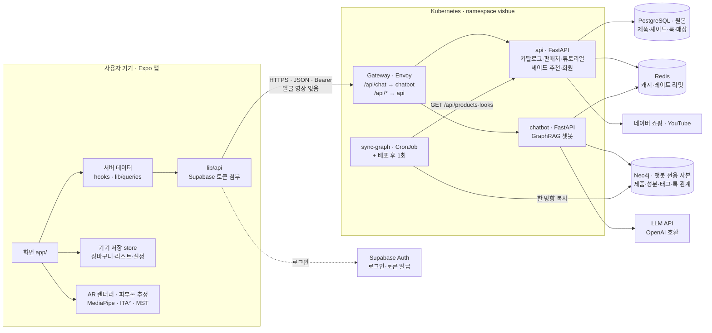

# 아키텍처

## 전체 구성

전체는 앱(기기), 단일 진입점(Gateway), 백엔드 두 서비스, 데이터 저장소, 외부 서비스로 나뉩니다. 얼굴 영상은 기기 밖으로 나가지 않고, 백엔드에는 피부톤 추정 수치(ITA°, MST 단계, 언더톤)만 전달합니다.



- 앱은 진입점 하나(`https://api.<도메인>`)만 압니다. 서비스가 늘거나 나뉘어도 앱 코드는 바뀌지 않습니다.
- 데이터 소유권은 서비스별로 나뉩니다. PostgreSQL은 `api`만, Neo4j는 `chatbot`만 접근합니다. 챗봇은 카탈로그를 PostgreSQL에서 직접 읽지 않고 `api`의 HTTP 계약으로 받아 갑니다.
- 같은 Dockerfile이 로컬(Docker Compose), 로컬 쿠버네티스(kind), 팀 공용 dev 서버(Render), 운영(AWS EKS)에서 그대로 돌아갑니다. 위 그림은 운영 기준이고, dev 서버는 Gateway 없이 서버마다 주소가 따로 있습니다. 실행 방법과 배포 흐름은 [`DEPLOYMENT.md`](DEPLOYMENT.md), 결정 이유는 [`adr/`](adr/README.md)에 있습니다.

앱은 `lib/api.ts`를 통해 백엔드만 호출합니다. 저장소 안의 Expo 서버(`app/api/dev/`, `server/`)에는 피부 분석 연구용 개발 도구만 남아 있고, 운영 환경에서는 차단됩니다.

## 저장소 구성

| 영역 | 위치 | 역할 |
| --- | --- | --- |
| 앱 | `app/`, `components/`, `hooks/`, `lib/`, `store/`, `constants/`, `types/` | Expo Go·웹에서 도는 클라이언트 |
| 백엔드 | `backend/api`, `backend/chatbot` | 운영 API ([백엔드](#백엔드) 절) |
| 인프라 | `infra/` | Compose, Helm, Argo CD ([`DEPLOYMENT.md`](DEPLOYMENT.md)) |
| 피부 분석 연구 | `ml/`, `reports/skin-analysis/`, `server/nia/`, `server/acne/` | 모델 학습·평가 ([개발 전용 도구](#개발-전용-도구-피부-분석-연구) 절) |

앱과 백엔드는 HTTP(`/api/*`)로만 통신합니다. 주고받는 데이터 형태는 앱의 `types/`에 정의하고, 백엔드는 같은 형태의 Pydantic 스키마로 응답합니다. 각 쪽은 레이어로 나뉘며 **위 레이어는 아래 레이어만 import합니다.**

## 데스크톱 GPU 피부 분석 서버

같은 저장소를 서버·사용자 개발 환경에 각각 clone하지만 설치와 실행을 구분합니다.
서버는 ml의 uv 환경과 `scripts/start-skin-server.ps1`로 CUDA API만 실행하고 Node/Metro가 필요하지 않습니다.
사용자 개발 PC는 `npm ci`와 `npm run client`로 Expo만 실행하며 Python/CUDA/피부 가중치가 필요하지 않습니다.
서버 모드가 기본이며 `EXPO_PUBLIC_SKIN_ANALYSIS_MODE=on-device`를 명시할 때만 기존 기기 분석 실험을 사용합니다.
GPU API 주소는 `EXPO_PUBLIC_SKIN_API_URL`로 지정하지만 사용자 승인 origin과 일치해야 합니다.
현재 승인된 대상은 `https://send-lots-advanced-amended.trycloudflare.com` 하나뿐입니다.
다른 origin, 이전 LAN 주소, redirect, 자동 전환은 거절합니다. Tunnel 생성·재시작은 앱의 역할이 아닙니다.

촬영 WebView는 기존 가이드·자동 촬영 판정을 재사용하고 JPEG 한 장만 48KiB 이하 메모리 청크로 RN에 전달합니다.
카메라 모듈은 상위 앱 레이어나 인증·업로드 코드를 import하지 않습니다. 화면이 훅으로 사진 이벤트를 전달하고,
훅과 lib의 업로드 헬퍼가 기본적으로 Supabase 사용자 access token을 첨부해 GPU API에 요청합니다.
임시 시험은 `__DEV__`와 `EXPO_PUBLIC_SKIN_AUTH_MODE=test-token`을 모두 만족할 때만 피부 분석 로그인 요구를 건너뜁니다.
이 모드에서는 개발용 입력란에서 매 촬영마다 직접 입력한 시험 Bearer 토큰을 훅의 메모리 참조로만 사용합니다.
토큰은 업로드 시작·취소·앱 비활성화·화면 이탈 시 참조를 해제하며 저장·로그·번들·WebView에 넣지 않습니다.
빈 토큰·잘못된 인증 모드·배포 빌드의 test-token 설정은 실패 처리하고 Supabase나 무인증 요청으로 전환하지 않습니다.
다른 화면의 인증과 저장 형식은 변경하지 않습니다.
토큰을 WebView에 전달하지 않습니다. 서버는 인증 후 YuNet→기존 ROI→전처리→CUDA 4개 모델→후처리를 실행합니다.
서버 응답 v1은 유지하며 선택적 execution(runtime/bundleVersion/serverMs)만 추가합니다.
앱은 `skin-analysis-server-v1`로 변환하여 결과 수치와 설문만 저장하고 기존 모바일 v1 기록도 계속 읽습니다.
원본 JPEG/ROI는 클라이언트·서버 어디에도 파일이나 영구 상태로 저장하지 않습니다.
이 한 장 업로드는 기존 AR 영상 비전송 정책의 명시적 예외입니다. DB·기존 백엔드 서비스 구조는 변경하지 않습니다.
실행·인증·제한은 [데스크톱 GPU 서버](../reports/skin-analysis/desktop-gpu-server.md)를 참고합니다.

## 클라이언트 레이어

### 별도 기기 내 피부 분석 실험

피부 정보 등록은 마이페이지 → `app/skin-analysis.tsx` → 전용 훅 →
`lib/skinAnalysis.ts`의 실행 환경 선택 → `modules/skin-analysis/` 순서로 호출합니다.
모듈은 상위 앱 레이어를 import하지 않으며 TypeScript 레이어 경계를 린트로 검사합니다.
기기 내 실험은 `EXPO_PUBLIC_ENABLE_SKIN_ANALYSIS=1`, `EXPO_PUBLIC_SKIN_ANALYSIS_MODE=on-device`에서 활성화합니다.
모바일 Expo Go에서는 `components/skin/SkinCamera.tsx`의 WebView를 통해
`modules/skin-analysis/web/`의 카메라·자동 촬영·ONNX Runtime Web CPU 추론을 실행합니다.
브라우저 런타임은 상위 앱 코드를 import하지 않고 상태·숫자 결과만 메시지로 전달합니다.
`scripts/skin-web-middleware.cjs`는 Metro 개발 서버에서 검증 자산과 웹 실행 코드의
명시된 파일만 GET/HEAD로 제공합니다. 사진 업로드나 서버 추론을 수행하지 않습니다.
웹 JPEG 코덱은 원본과 픽셀 단위로 일치하지 않아 별도 실험 전처리 버전으로 기록합니다.
WebView에서는 PSS를 측정할 수 없어 null을 저장하며 모델 전송 시간과 추론 시간을 구분합니다.
앱의 다른 화면과 기존 AR 렌더러는 기존 구조를 유지합니다.

Android 전용 빌드에서는 네이티브 CameraX·ML Kit로 자동 촬영하고 ONNX Runtime CPU로 4개 모델을 순차 실행합니다.
촬영 JPEG는 네이티브 메모리에서만 유지하며 분석·취소 후 참조를 해제합니다.
Expo Go에서는 카메라 기기 내 실험에서는 프레임·ROI·텐서를 WebView 내부 메모리에서만 처리하며,
얼굴 사진·ROI·텐서를 서버나 React Native 메시지 경계로 보내지 않습니다.
숫자 결과와 설문은 `skinProfileStore`를 통해 저장하며, AsyncStorage 쓰기의 성공을
확인한 뒤 완료를 표시합니다. 측정 기록도 기기에만 저장하고 숫자 메타데이터만 공유합니다.
네이티브 모듈은 Expo 자동 연결로 포함되며 루트 `android/`·`ios/`를 직접 수정하지 않습니다.
실행·측정 절차와 제한은 [모바일 피부 분석](../reports/skin-analysis/mobile-analysis.md)을 참고합니다.

피부 모델 연구 환경은 운영 흐름과 별도로 관리합니다. `ml/src/`에는 학습·평가 코드,
`ml/configs/`에는 설정, `ml/tests/`에는 자동 테스트를 두고, 실행 방법과 결과 요약은
[`reports/skin-analysis/`](../reports/skin-analysis/README.md)에 모읍니다. 가중치·원본 데이터·
개별 표본 결과는 Git에서 제외합니다. 향후 LLM 외부 호출과 서비스 조합은 기존
`server/clients/`·`server/services/` 레이어를 따릅니다.

로컬 NIA 연구 도구의 화면은 `app/dev/nia.tsx`, 사진 분석·결과 요청 훅은 `hooks/useNia*.ts`,
표현 컴포넌트는 `components/nia/`에 둡니다. 컴포넌트는 화면에서 결과와 동작을 props로
받으며 `lib/nia`를 직접 호출하지 않습니다. 이 경계를 린트로 검사합니다. 개발 API는
`server/services/niaEvaluationService.ts`를 통해 로컬 Python 평가 프로세스에 연결하며,
production/test/미지정 환경에서는 차단합니다. Python 코드는 `server/nia/`·`server/acne/`에
있습니다. 이 도구는 운영 앱의 얼굴 영상 비전송 정책을 변경하지 않습니다.

```
app/ (화면, app/api 제외)     화면 조립, 네비게이션, 훅 호출
  ↓
hooks/                        여러 데이터 소스를 화면용으로 조합하는 훅 (예: 장바구니 + 제품 조회)
components/                   UI 컴포넌트
  ↓
lib/ · store/                 서버 상태(lib/queries), HTTP(lib/api), i18n, 포맷, 기기 저장, 클라이언트 상태(Zustand)
  ↓
constants/ · types/           테마, 정적 상수, 공용 타입
```

| 폴더 | import 가능 | 금지 |
| --- | --- | --- |
| `app/` 화면 | `hooks`, `components`, `lib`, `store`, `constants`, `types` | `server` |
| `hooks/` | `lib`, `store`, `types` | `app`, `components` |
| `components/` | `components/ui`, 같은 폴더 내부, `lib`, `store`, `constants`, `types` | `app`, `hooks`, `lib/queries`, `lib/nia`, `server` |
| `components/ui/` | 같은 폴더 내부, `lib/i18n`, `lib/format`, `lib/api`(에러 타입), `constants`, `types` | 위 금지 항목 + `store`, 다른 `components/` 폴더 |
| `lib/`, `store/` | 서로, `types` | `app`, `hooks`, `components`, `server` |
| `constants/`, `types/` | 외부 패키지만 | 프로젝트 내부 전부 |

- **데이터 조회는 화면이나 `hooks/`에서만** 합니다. 컴포넌트는 props로 데이터를 받습니다.
- 서버에서 오는 데이터는 react-query(`lib/queries.ts`), 기기에만 있는 상태는 Zustand(`store/`)가 맡습니다. 같은 데이터를 두 곳에 두지 않습니다.
- `components/ui/`는 어느 화면에서나 쓸 수 있는 범용 컴포넌트입니다. 특정 기능의 상태를 읽어야 하면 `components/<기능>/`에 둡니다.

### 백엔드 주소와 로그인

- `lib/api.ts`가 모든 요청의 기준 주소를 정합니다. `EXPO_PUBLIC_API_BASE_URL`(공개 값)이 있으면 그 주소를 쓰고, 없으면 개발 중에는 Metro를 띄운 PC의 게이트웨이(`http://<PC IP>:8080`)로 보냅니다. 그래서 휴대폰의 Expo Go도 따로 설정하지 않고 로컬 백엔드에 붙습니다. 앱을 빌드할 때는 EAS 환경 변수로 운영 주소를 넣습니다.
- 로그인은 Supabase Auth를 씁니다. 앱은 `lib/auth`에서 로그인하고 세션을 기기에 저장하며, `lib/api.ts`가 요청마다 액세스 토큰(JWT)을 붙입니다. 백엔드는 `app/core/auth.py`에서 토큰을 검증합니다([ADR-0005](adr/0005-supabase-auth-jwks.md)). Supabase Project URL과 publishable 키는 공개용이라 `EXPO_PUBLIC_`로 앱에 넣지만, secret 키는 넣지 않습니다.
- API 키(네이버, YouTube, LLM)는 백엔드의 `clients/`에서만 읽습니다. 앱 번들에는 들어가지 않습니다.

## 개발 전용 도구 (피부 분석 연구)

피부 모델 연구 환경은 운영 흐름과 별도로 관리합니다. `ml/src/`에는 학습·평가 코드,
`ml/configs/`에는 설정, `ml/tests/`에는 자동 테스트를 두고, 실행 방법과 결과 요약은
[`reports/skin-analysis/`](../reports/skin-analysis/README.md)에 모읍니다. 가중치·원본 데이터·
개별 표본 결과는 Git에서 제외합니다. 운영 기능으로 만들 때는 [백엔드](#백엔드) 레이어를 따릅니다.

로컬 NIA 연구 도구의 화면은 `app/dev/nia.tsx`, 사진 분석·결과 요청 훅은 `hooks/useNia*.ts`,
표현 컴포넌트는 `components/nia/`에 둡니다. 컴포넌트는 화면에서 결과와 동작을 props로
받으며 `lib/nia`를 직접 호출하지 않습니다. 이 경계를 린트로 검사합니다. 개발 API
(`app/api/dev/nia/`)는 `server/services/niaEvaluationService.ts`를 통해 로컬 Python 평가
프로세스에 연결하며, production/test/미지정 환경에서는 차단합니다. Python 코드는
`server/nia/`·`server/acne/`에 있습니다. 이 도구는 운영 앱의 얼굴 영상 비전송 정책을 변경하지 않습니다.

| 폴더 | import 가능 | 금지 |
| --- | --- | --- |
| `app/api/dev/` | `server/services`, `server/lib`, `types` | 클라이언트 코드 |
| `server/services/` | `server/lib`, `types` | 클라이언트 코드 |
| `server/lib/` | `types` | `server` 내 다른 레이어, 클라이언트 코드 |

## 린트로 강제하기

위 규칙은 `eslint.config.js`의 `no-restricted-imports`로 검사하므로, 위반하면 `npm run lint`가 실패합니다.

- 다른 폴더를 import할 때는 `@/` 별칭을 씁니다 (`@/server/lib/http`). `../`로 시작하는 상대 경로는 금지입니다. 상대 경로를 쓰면 린트 패턴이 어느 레이어인지 알 수 없기 때문입니다.
- 같은 폴더 안에서는 `./`를 써도 됩니다.
- 규칙을 바꿀 때는 이 문서와 `eslint.config.js`를 함께 고칩니다.
- 백엔드는 같은 규칙을 import-linter로 검사합니다(`backend/*/pyproject.toml`의 `[tool.importlinter]`, `uv run lint-imports`). CI에서 위반하면 실패합니다.

## 새 기능을 넣을 때

예를 들어 로그인을 구현한다면 다음 순서로 위치를 정합니다.

1. 주고받는 형태를 `types/index.ts`에 정의합니다. 백엔드가 생기면 백엔드의 OpenAPI 스펙에서 생성합니다.
2. 서버: 새 기능은 백엔드에 만듭니다. `backend/api`(또는 챗봇 기능이면 `backend/chatbot`)의 `schemas/` → `routers/` → `services/` → `repositories/` 또는 `clients/` 순서입니다. 백엔드 응답 형태는 `types/index.ts`와 같은 camelCase JSON입니다.
3. 클라이언트: HTTP 호출과 훅은 `lib/`, 로그인 상태처럼 기기에 남길 값은 `store/`, 화면은 `app/login.tsx`
4. UI 문구는 `lib/i18n`의 네 사전(`en`, `ko`, `ja`, `zh`)에 모두 추가합니다.

## 백엔드

`backend/`에는 서비스 두 개가 있습니다. 각각 독립된 uv 프로젝트이고, Docker 이미지와 배포 단위도 따로입니다.

| 서비스 | 맡는 것 | 데이터 | 외부 호출 |
| --- | --- | --- | --- |
| `backend/api` | 카탈로그(제품·셰이드·룩·매장), 온라인 판매처·제품 이미지, 튜토리얼 검색, 셰이드 추천(CIEDE2000 ΔE), 회원(`/api/me`) | PostgreSQL(원본), Redis(캐시·레이트 리밋) | 네이버 검색 API, YouTube Data API, Supabase Auth(토큰 검증) |
| `backend/chatbot` | 챗봇(`/api/chat`), PostgreSQL → Neo4j 동기화 잡 | Neo4j(사본), Redis(레이트 리밋) | LLM API, `api` 서비스 |

서비스를 둘로 나눈 이유는 [ADR-0001](adr/0001-two-backend-services.md)에 있습니다. LLM 호출은 느리고 비용이 들어서 따로 확장하고 따로 제한해야 합니다. 챗봇 장애가 쇼핑 기능으로 번지지 않아야 하고, LLM 키는 챗봇 Pod에만 있어야 합니다.

### 기술 스택

| 영역 | 선택 |
| --- | --- |
| 언어 | Python 3.12 (`.python-version`으로 고정) |
| 패키지·환경 관리 | uv (`pyproject.toml` + `uv.lock`, 둘 다 커밋) |
| 프레임워크 | FastAPI + Pydantic |
| 원본 DB | PostgreSQL 17, 접근은 SQLAlchemy 2(async, asyncpg), 스키마 변경은 Alembic |
| 검색 | PostgreSQL `pg_trgm` GIN 인덱스 (`products.search_text`) |
| 캐시·레이트 리밋 | Redis (없으면 캐시 없이 동작, 레이트 리밋은 프로세스 메모리) |
| 챗봇용 그래프 DB | Neo4j 5, 공식 `neo4j` Python 드라이버 |
| 인증 | Supabase Auth 토큰을 JWKS로 로컬 검증 ([ADR-0005](adr/0005-supabase-auth-jwks.md)) |
| 테스트 | pytest (단위 테스트는 가짜 저장소, PostgreSQL 통합 테스트는 CI) |
| 린트·레이어 강제 | ruff, import-linter |
| 배포 | Docker 이미지(비루트, 읽기 전용 파일시스템) → Helm → Argo CD |

- 패키지는 `uv add <패키지>`로만 추가합니다. `pip install`로 따로 설치하면 `uv.lock`과 실제 환경이 어긋납니다.
- 실행은 `uv run`을 붙입니다 (`uv run uvicorn app.main:app --reload`, `uv run alembic upgrade head`, `uv run pytest`).

### 레이어

두 서비스 모두 같은 구조이고, import-linter 계약으로 강제합니다.

```text
backend/<service>/
  pyproject.toml · uv.lock · .python-version · Dockerfile · .env.example
  alembic/                 마이그레이션 (api만)
  seed/catalog.json        카탈로그 시드, types/index.ts의 Product·CelebLook·Store 형태 (api만)
  app/
    main.py                앱 조립: 미들웨어, 에러 핸들러, 라우터
    jobs/                  일회성 실행 진입점 (seed_catalog, sync_graph)
    routers/               요청 검증·상태 코드·응답
    services/              비즈니스 로직
    repositories/          DB 접근
    clients/               외부 API 호출, 키는 여기서만 (naver, youtube, llm, catalog)
    models/                PostgreSQL 테이블 (api만)
    schemas/               Pydantic 요청·응답 형태
    core/                  설정, DB·Redis 연결, 인증, 에러, 로깅, 레이트 리밋
  tests/
```

| 레이어 | import 가능 | 금지 |
| --- | --- | --- |
| `main`, `jobs/` | `routers`, `services`, `schemas`, `core` | `repositories`, `clients`, `models` |
| `routers/` | `services`, `schemas`, `core` | `repositories`, `clients`, `models` |
| `services/` | `repositories`, `clients`, `schemas`, `core` | 위 레이어 |
| `repositories/`, `clients/` | `models`, `schemas`, `core` | 서로, 위 레이어 |
| `models/` | `core` | 위 레이어 |
| `schemas/` | `core` | 위 레이어 |
| `core/` | 외부 패키지만 | 프로젝트 내부 전부 |

- 서비스는 FastAPI 의존성 함수(`get_catalog_service` 등)로 만들어집니다. 테스트는 이 함수를 가짜 저장소를 쓰는 서비스로 바꿔 끼웁니다.
- 리포지토리는 ORM 객체가 아니라 `schemas`의 Pydantic 모델을 돌려줍니다. 비동기 세션의 지연 로딩 문제가 서비스까지 번지지 않게 하기 위해서입니다.
- `clients/` 모듈끼리는 서로 import할 수 없습니다(independence 계약).
- 시드 데이터는 DB에 넣기 전에 `validate_catalog`가 검사합니다. id 중복, 빈 한국어 이름, 0원 가격, 셰이드 없는 체험 제품, 룩이 참조하는 제품·셰이드, 매장 좌표가 대상이고, 이후 크롤링 데이터도 같은 검사를 거칩니다.

### API 계약

응답 형태는 앱의 `types/index.ts`와 같습니다. 예전 Expo API 라우트와 경로·JSON이 같아서, 앱은 기준 주소만 바꿔 백엔드로 옮겨 왔습니다.

| 경로 | 서비스 | 비고 |
| --- | --- | --- |
| `GET /api/products?q=&category=&ids=` | api | `{ products }`, 5분 캐시, 네이버 이미지로 보강 |
| `GET /api/products/{id}` | api | `{ product }` |
| `GET /api/products/{id}/offers` | api | `{ configured, offers }`, 네이버 쇼핑 판매처·최저가 (6시간 캐시) |
| `GET /api/youtube/search?q=&max=` | api | `{ configured, videos }`, IP당 분당 20회, 12시간 캐시 |
| `GET /api/looks`, `GET /api/looks/{id}` | api | `{ looks }`, `{ look, products }` |
| `GET /api/stores` | api | 픽업 가능 매장만 |
| `GET /api/me` | api | 로그인 필요 |
| `POST /api/shades/recommend` | api | `{ skin: { ita?, mst, undertone }, limit }` → ΔE 순위 |
| `POST /api/chat` | chatbot | 로그인 필요, 사용자당 분당 10회 |
| `GET /api/health` | api | `{ ok, integrations: { youtube, naverShopping } }`, 배포 후 외부 API 키 확인용 |
| `GET /healthz`, `GET /readyz` | 둘 다 | Gateway로 노출하지 않음 (쿠버네티스 프로브용) |

- 네이버·YouTube 키가 없으면 해당 기능만 꺼집니다(`configured: false`, 이미지는 원래 값). 외부 API 장애는 `502 upstream_error`입니다.

- JSON 키는 camelCase이고(`priceKRW`, `nameKo`), TS의 선택 필드(`shadeId?`, `phone?`)는 값이 없으면 키를 빼고 보냅니다.
- 에러는 항상 `{ error, code }`(`ApiErrorBody`) 형태입니다. 잘못된 요청은 `400 invalid_request`입니다.
- 개발 환경에서는 `/api/docs`에서 OpenAPI 문서를 볼 수 있습니다. 운영에서는 꺼져 있습니다.

### PostgreSQL과 Neo4j

| DB | 담는 것 | 접근 |
| --- | --- | --- |
| PostgreSQL (원본) | 제품, 셰이드, 룩, 룩 구성, 매장 | `api`의 `catalog_repository`만 |
| Neo4j (사본) | `(:Product)-[:HAS_SHADE\|CONTAINS\|TAGGED]->`, `(:Look)-[:USES]->(:Product)` | `chatbot`의 `graph_repository`만 |

1. 데이터 추가와 수정은 **PostgreSQL에서만** 합니다(`seed_catalog` 잡 또는 이후 관리 API). Neo4j에 직접 쓰지 않습니다.
2. Neo4j는 `sync_graph` 잡이 `api`의 `GET /api/products`, `GET /api/looks`를 읽어 **한 방향으로만** 채웁니다. 쓰기는 트랜잭션 하나로 이뤄져서, 읽는 쪽은 이전 그래프나 새 그래프 중 하나만 봅니다.
3. 잡은 30분마다(CronJob) 돌고, 배포 직후에도 한 번 돕니다. 챗봇 서비스는 PostgreSQL 접속 정보를 갖지 않습니다 ([ADR-0002](adr/0002-postgres-source-neo4j-copy.md)).

### 운영 원칙

- **마이그레이션**: `api` Pod의 initContainer가 `alembic upgrade head`를 실행하고, PostgreSQL advisory lock으로 한 번에 한 Pod만 적용합니다. 롤링 배포 중에는 이전 버전 Pod도 함께 돌기 때문에, 스키마 변경은 확장 → 코드 배포 → 정리 순서로 나눕니다(컬럼 삭제와 이름 변경은 별도 PR). CI는 `alembic check`로 모델과 마이그레이션이 어긋나지 않았는지 확인합니다.
- **헬스 체크**: `/healthz`(liveness)는 의존성을 보지 않습니다. DB 장애로 Pod가 재시작되는 연쇄 장애를 막기 위해서입니다. `/readyz`(readiness)는 DB와 Redis에 연결되는지 보고, 실패하면 Gateway가 그 Pod로 트래픽을 보내지 않습니다.
- **로그**: 한 줄에 JSON 하나이고, 요청마다 `X-Request-ID`를 받거나 만들어 응답과 로그에 남깁니다. 챗봇은 질문 내용을 로그에 남기지 않습니다.
- **장애 격리**: Redis 장애는 캐시 미스로 처리하고(api), 레이트 리밋은 통과시킵니다(chatbot). LLM 장애는 `502 upstream_error`, 키나 모델이 설정되지 않았으면 `503 chatbot_unavailable`입니다.
- **개인정보**: 얼굴 영상과 이미지는 어떤 서비스에도 보내지 않습니다. 셰이드 추천과 챗봇은 기기에서 추정한 수치만 받습니다.

### 옮기는 순서

1. **1단계 (완료)**: 백엔드 두 서비스, PostgreSQL 스키마, 셰이드 추천, Compose·Helm·CI를 갖췄습니다.
2. **2단계 (완료)**: 네이버·YouTube 연동을 `backend/api`로 옮기고, 앱의 `lib/api.ts`가 백엔드를 호출하게 바꿨습니다. 예전 Expo API 라우트와 `server/`의 운영 코드, `data/catalog`를 삭제했습니다. 카탈로그 데이터는 이제 `backend/api/seed/catalog.json` → PostgreSQL로 들어갑니다(크롤링 데이터 연동은 담당 팀원과 형식을 정한 뒤 진행). 챗봇과 셰이드 추천 화면 연결은 기능 개발에서 합니다.
3. **3단계**: 앱 타입을 백엔드 OpenAPI 스펙에서 생성하고(`openapi-typescript` → `types/`), Langfuse로 LLM 호출을 추적하고 평가합니다 ([ADR-0007](adr/0007-observability.md)).

### 남은 결정

| 항목 | 현재 결정 | 바꿀 조건 |
| --- | --- | --- |
| 개발 서버 | Render 무료 플랜 + Supabase + Neo4j AuraDB Free ([ADR-0009](adr/0009-render-dev-environment.md)) | 잠들기·사용 시간 제약이 불편해지면 `vishue-api`만 유료로 |
| 운영 배포처 | AWS EKS (서울 리전, Terraform) + Argo CD ([ADR-0008](adr/0008-aws-environments.md)) | 확정 (캠프 AWS 지원, 배포 단계에 적용) |
| 운영 데이터 저장소 | RDS PostgreSQL, ElastiCache, Neo4j AuraDB | 운영 DB 비용이 문제면 Supabase로 바꿉니다(`DATABASE_URL`만 교체) |
| 카탈로그 데이터 | dev는 Git의 `seed/catalog.json`이 원본, 바뀌면 `dev-data` 워크플로가 반영 ([`DATA.md`](DATA.md)) | 크롤링 데이터가 파일 하나로 감당하기 어려워지면 가져오기 방식을 바꿉니다 |
| 챗봇 LLM | OpenAI 호환 API, 모델은 `LLM_MODEL`로 지정 | 모델 선정은 평가 세트를 만든 뒤에 합니다 |
| 챗봇 대화 기록 | 저장하지 않음 | 저장하려면 보관 기간과 동의 절차를 먼저 정합니다 |
