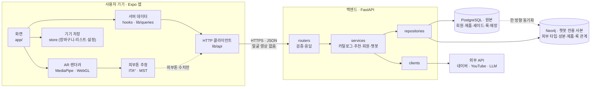

# 아키텍처

## 전체 구성 (목표)

앱(기기), 백엔드(FastAPI), 외부 서비스 세 영역으로 나뉩니다. 얼굴 영상은 기기 밖으로 나가지 않고, 백엔드에는 피부톤 추정 수치만 전달합니다.



지금은 백엔드가 없고, 앱 저장소 안의 Expo API 라우트(`app/api/`, `server/`)가 서버 역할을 합니다. 백엔드로 옮기는 순서는 [백엔드](#백엔드-계획) 절을 참고하세요.

## 앱 저장소의 두 런타임 (현재)

이 저장소에는 두 런타임이 함께 있습니다.

- **클라이언트**: Expo Go·웹에서 도는 앱 (`app/`의 화면, `components/`, `hooks/`, `lib/`, `store/`)
- **서버**: Expo Router API 라우트 (`app/api/**/*+api.ts`)와 서버 전용 로직 (`server/`)

두 쪽은 HTTP(`/api/*`)로만 통신하고, 주고받는 데이터 형태는 `types/`에 정의합니다. 각 쪽은 레이어로 나뉘며 **위 레이어는 아래 레이어만 import합니다.** 아래에서 위로, 또는 클라이언트에서 서버로 import하지 않습니다.

## 클라이언트 레이어

피부 모델 연구 환경은 운영 흐름과 별도로 관리합니다. `ml/src/`에는 학습·평가 코드,
`ml/configs/`에는 설정, `ml/tests/`에는 자동 테스트를 두고, 실행 방법과 결과 요약은
[`reports/skin-analysis/`](../reports/skin-analysis/README.md)에 모읍니다. 가중치·원본 데이터·
개별 표본 결과는 Git에서 제외합니다. 향후 LLM 외부 호출과 서비스 조합은 기존
`server/clients/`·`server/services/` 레이어를 따릅니다.

로컬 NIA 연구 도구의 화면은 `app/dev/nia.tsx`, 사진 분석·결과 요청 훅은 `hooks/useNia*.ts`,
표현 컴포넌트는 `components/nia/`에 둡니다. 컴포넌트는 화면에서 결과와 동작을 props로
받으며 `lib/nia`를 직접 호출하지 않습니다. 이 경계를 린트로 검사합니다. 개발 API는
`server/services/niaEvaluationService.ts`를 통해 로컬 Python 평가 프로세스에 연결하며,
production/test/미지정 환경에서는 차단합니다. Python 코드는 `server/nia/`·`server/acne/`에
있습니다. 이 도구는 운영 앱의 얼굴 영상 비전송 정책을 변경하지 않습니다.

```
app/ (화면, app/api 제외)     화면 조립, 네비게이션, 훅 호출
  ↓
hooks/                        여러 데이터 소스를 화면용으로 조합하는 훅 (예: 장바구니 + 제품 조회)
components/                   UI 컴포넌트
  ↓
lib/ · store/                 서버 상태(lib/queries), HTTP(lib/api), i18n, 포맷, 기기 저장, 클라이언트 상태(Zustand)
  ↓
constants/ · types/           테마, 정적 상수, 공용 타입
```

| 폴더 | import 가능 | 금지 |
| --- | --- | --- |
| `app/` 화면 | `hooks`, `components`, `lib`, `store`, `constants`, `types` | `server`, `data` |
| `hooks/` | `lib`, `store`, `types` | `app`, `components` |
| `components/` | `components/ui`, 같은 폴더 내부, `lib`, `store`, `constants`, `types` | `app`, `hooks`, `lib/queries`, `server`, `data` |
| `components/ui/` | 같은 폴더 내부, `lib/i18n`, `lib/format`, `lib/api`(에러 타입), `constants`, `types` | 위 금지 항목 + `store`, 다른 `components/` 폴더 |
| `lib/`, `store/` | 서로, `types` | `app`, `hooks`, `components`, `server`, `data` |
| `constants/`, `types/` | 외부 패키지만 | 프로젝트 내부 전부 |

- **데이터 조회는 화면이나 `hooks/`에서만** 합니다. 컴포넌트는 props로 데이터를 받습니다.
- 서버에서 오는 데이터는 react-query(`lib/queries.ts`), 기기에만 있는 상태는 Zustand(`store/`)가 맡습니다. 같은 데이터를 두 곳에 두지 않습니다.
- `components/ui/`는 어느 화면에서나 쓸 수 있는 범용 컴포넌트입니다. 특정 기능의 상태를 읽어야 하면 `components/<기능>/`에 둡니다.

## 서버 레이어

```
app/api/**/*+api.ts           라우트: 파라미터 파싱·검증, 상태 코드, 응답 형태
  ↓
server/services/              비즈니스 로직: 검색·필터, 룩과 제품 조합, 이미지 보강 정책
  ↓
server/repositories/          데이터 접근: 지금은 data/catalog 정적 데이터, 나중에 DB로 교체
server/clients/               외부 API 호출: 네이버, YouTube
  ↓
server/lib/                   공통: HTTP 응답·fetch, 캐시, 레이트 리밋, 환경 변수
```

| 폴더 | import 가능 | 금지 |
| --- | --- | --- |
| `app/api/` | `server/services`, `server/lib`, `types` | `server/repositories`, `server/clients`, `data` |
| `server/services/` | `server/repositories`, `server/clients`, `server/lib`, `types` | `app` |
| `server/repositories/` | `data`, `server/lib`, `types` | `server/services`, `server/clients` |
| `server/clients/` | `server/lib`, `types` | `server/services`, `server/repositories`, 다른 client |
| `server/lib/` | `types` | `server` 내 다른 레이어 |
| `data/` | `types` | 프로젝트 내부 전부 |

- **API 키는 `server/clients/`에서만 사용**하고 `server/lib/env.ts`로만 읽습니다. 클라이언트 코드가 `server/`를 import하면 키를 읽는 코드가 앱 번들에 들어갈 수 있습니다.
- 라우트에는 비즈니스 로직을 두지 않습니다. 같은 로직이 두 라우트에 필요해지면 서비스로 옮깁니다.
- 외부 API를 바꾸거나 데이터를 DB로 옮겨도 서비스와 라우트는 바뀌지 않아야 합니다.

- 리포지토리 함수는 지금 정적 데이터를 돌려주더라도 **항상 `async`** 로 둡니다. DB로 바꿀 때 호출하는 쪽을 고치지 않기 위해서입니다.
- 리포지토리는 저장된 데이터를 그대로 돌려주고, 조건 필터(예: 픽업 가능 매장만)는 서비스가 합니다.
- 파일 이름은 `<대상><레이어>.ts` 형식입니다 (`catalogService.ts`, `catalogRepository.ts`, `naverClient.ts`).

### 현재 파일

| 레이어 | 파일 |
| --- | --- |
| `server/services/` | `catalogService` (검색·필터·룩 조합·이미지 보강), `offerService` (온라인 판매처), `tutorialService` (튜토리얼 검색어 구성), `integrationService` (외부 API 설정 상태) |
| `server/repositories/` | `catalogRepository` (`data/catalog`의 제품·룩·매장) |
| `server/clients/` | `naverClient` (쇼핑·이미지 검색), `youtubeClient` (영상 검색) |
| `server/lib/` | `http`, `cache`, `env`, `text`, `concurrency`, `auth` (Supabase 액세스 토큰 검증) |

로그인은 Supabase Auth를 씁니다. 앱은 `lib/auth`에서 로그인하고 세션을 기기에 저장하며, `lib/api.ts`가 요청마다 액세스 토큰(JWT)을 붙입니다. 사용자 확인이 필요한 라우트는 `server/lib/auth.ts`의 `getAuthUser()`로 토큰을 검증합니다 (예: `app/api/me+api.ts`). Supabase의 Project URL과 publishable 키는 공개용이라 `EXPO_PUBLIC_`로 앱에 넣지만, secret 키는 넣지 않습니다.

## 린트로 강제하기

위 규칙은 `eslint.config.js`의 `no-restricted-imports`로 검사하므로, 위반하면 `npm run lint`가 실패합니다.

- 다른 폴더를 import할 때는 `@/` 별칭을 씁니다 (`@/server/lib/http`). `../`로 시작하는 상대 경로는 금지입니다. 상대 경로를 쓰면 린트 패턴이 어느 레이어인지 알 수 없기 때문입니다.
- 같은 폴더 안에서는 `./`를 써도 됩니다. 단 `server/clients/` 안에서는 금지입니다 (client끼리 의존하지 않도록).
- 규칙을 바꿀 때는 이 문서와 `eslint.config.js`를 함께 고칩니다.

## 새 기능을 넣을 때

예를 들어 로그인을 구현한다면 다음 순서로 위치를 정합니다.

1. 주고받는 형태를 `types/index.ts`에 정의합니다. 백엔드가 생기면 백엔드의 OpenAPI 스펙에서 생성합니다.
2. 서버: 백엔드가 생기기 전에는 라우트 `app/api/auth/...+api.ts` → 서비스 `server/services/` → 저장소 `server/repositories/` 또는 외부 인증 `server/clients/`. 백엔드가 생긴 뒤에는 같은 구조로 백엔드의 `routers/` → `services/` → `repositories/`에 둡니다.
3. 클라이언트: HTTP 호출과 훅은 `lib/`, 로그인 상태처럼 기기에 남길 값은 `store/`, 화면은 `app/login.tsx`
4. UI 문구는 `lib/i18n`의 네 사전(`en`, `ko`, `ja`, `zh`)에 모두 추가합니다.

## 백엔드 (계획)

아직 코드는 없습니다. 아래는 팀이 정한 기술 스택과 역할 분담입니다.

### 기술 스택

| 영역 | 선택 |
| --- | --- |
| 언어 | Python 3.12 (`.python-version`으로 고정) |
| 패키지·환경 관리 | uv (`pyproject.toml` + `uv.lock`, 둘 다 커밋) |
| 프레임워크 | FastAPI + Pydantic |
| 원본 DB | PostgreSQL, 접근은 SQLAlchemy 2, 스키마 변경은 Alembic |
| 챗봇용 그래프 DB | Neo4j, 공식 `neo4j` Python 드라이버 |
| 테스트 | pytest |
| 레이어 강제 | import-linter (앱의 ESLint 레이어 규칙과 같은 역할) |
| 배포 | Docker 이미지 (`uv sync --frozen --no-dev`) |
| 앱과의 타입 공유 | FastAPI OpenAPI 스펙 → `openapi-typescript` → 앱의 `types/` |

- 패키지는 `uv add <패키지>`로만 추가합니다. `pip install`로 따로 설치하면 `uv.lock`과 실제 환경이 어긋납니다.
- 실행은 `uv run`을 붙입니다 (`uv run uvicorn app.main:app --reload`, `uv run alembic upgrade head`, `uv run pytest`).

### 역할 분담

| 위치 | 맡는 것 |
| --- | --- |
| 백엔드 | 카탈로그(제품·셰이드·룩·매장), 회원·로그인, 셰이드 추천(피부톤 수치 → 색차 ΔE 순위), 챗봇, 네이버·YouTube 연동 |
| 기기 | 얼굴 추적, AR 렌더링, 피부톤 추정, 장바구니·쇼핑 리스트·언어 설정 |

- **얼굴 영상과 이미지는 서버로 보내지 않습니다.** 셰이드 추천에는 기기에서 추정한 수치(ITA°, MST 단계, 언더톤)만 보냅니다.
- 장바구니와 쇼핑 리스트는 기기에 둡니다. 로그인 사용자의 기기 간 동기화가 필요해질 때 백엔드로 옮깁니다.

### PostgreSQL과 Neo4j

| DB | 담는 것 | 쓰는 곳 |
| --- | --- | --- |
| PostgreSQL (원본) | 회원, 제품, 셰이드, 룩, 매장 | 챗봇을 제외한 모든 기능 |
| Neo4j (사본) | 피부 타입·성분·제품·룩·셀럽 사이의 관계 | 챗봇만 |

1. 데이터 추가와 수정은 **PostgreSQL에서만** 합니다. Neo4j에 직접 쓰지 않습니다.
2. Neo4j는 동기화 스크립트(`scripts/sync_graph`)로 PostgreSQL에서 **한 방향으로만** 채웁니다.
3. Neo4j는 `chatbotService` → `graphRepository` 경로로만 씁니다. 다른 서비스는 Neo4j를 몰라도 됩니다.

### 폴더 구조

앱의 `server/` 레이어와 같은 구조입니다.

```text
backend/
  pyproject.toml · uv.lock · .python-version · Dockerfile
  alembic/                 마이그레이션 파일
  scripts/sync_graph       PostgreSQL → Neo4j 동기화
  app/
    routers/               요청 검증·응답          (← 앱의 app/api/)
    services/              카탈로그·추천·회원·챗봇  (← server/services/)
    repositories/          catalogRepository(PostgreSQL), graphRepository(Neo4j)  (← server/repositories/)
    clients/               네이버·YouTube·LLM      (← server/clients/)
    core/                  설정·DB 연결·인증        (← server/lib/)
    schemas/               Pydantic 요청·응답 형태
    models/                PostgreSQL 테이블
  tests/
```

| 레이어 | import 가능 |
| --- | --- |
| `routers/` | `services`, `schemas`, `core` |
| `services/` | `repositories`, `clients`, `schemas`, `core` |
| `repositories/` | `models`, `core` (`graphRepository`는 `chatbotService`에서만 사용) |
| `clients/` | `core` (다른 client 금지) |
| `core/` | 외부 패키지만 |

### 옮기는 순서

1. **1단계**: 백엔드 뼈대(uv, FastAPI, PostgreSQL, Alembic)를 만들고 카탈로그와 셰이드 추천 API를 구현합니다. 앱은 `server/repositories/catalogRepository.ts`의 내부만 백엔드 호출로 바꿔서, 서비스·라우트·화면은 그대로 둡니다.
2. **2단계**: 로그인과 챗봇을 붙이고, 앱의 `lib/api.ts`가 백엔드를 직접 호출하게 바꿉니다. 네이버·YouTube 연동을 백엔드로 옮긴 뒤 앱의 `app/api/`와 `server/`를 삭제합니다.

### 미정

| 항목 | 선택지 |
| --- | --- |
| 인증 | Supabase Auth 또는 FastAPI 자체 JWT |
| 배포처 | Render · Railway · AWS (캠프 제공 여부 확인) |
| Neo4j 호스팅 | AuraDB 무료 플랜 (미사용 시 일시 정지) 또는 Docker 직접 운영 |
| 챗봇 LLM | 모델과 API 키 관리 방식 (키는 `clients/`에만 둠) |
| 챗봇 대화 기록 | 저장 여부와 보관 기간 (개인정보 원칙과 맞춤) |
| 그래프 모델 | 노드(피부 타입·성분·제품·룩·셀럽)와 관계 정의 |
| 저장소 위치 | 이 저장소의 `backend/` 폴더 또는 별도 저장소 |
| 2단계 시점 | Expo API 라우트를 없애는 시점 |
