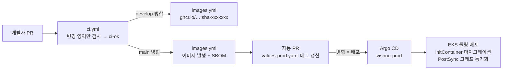

# 실행과 배포

같은 컨테이너 이미지를 세 환경에서 씁니다. 환경 사이의 차이는 설정 값(Compose 환경 변수, Helm values 파일)에만 있습니다. 왜 이렇게 나눴는지는 [ADR-0003](adr/0003-containers-helm-gitops.md)에 있습니다.

| 환경 | 용도 | 정의 | 데이터 저장소 | 진입점 |
| --- | --- | --- | --- | --- |
| Docker Compose | 일상 개발, 앱 연동 | `infra/compose/` | 컨테이너 (named volume) | nginx `:8080` |
| kind | 쿠버네티스 검증, 시연 | `infra/kind/`, `values-local.yaml` | 클러스터 안 StatefulSet + PVC | Envoy Gateway |
| AWS EKS | 운영 | `values-prod.yaml`, `infra/argocd/` | RDS · ElastiCache · Neo4j AuraDB | Envoy Gateway + NLB |



## 1. Docker Compose (로컬 전체)

Docker Desktop이 필요합니다. 저장소 루트에서 실행합니다.

```bash
docker compose -f infra/compose/compose.yaml --env-file .env up --build
```

- 루트 `.env`의 `EXPO_PUBLIC_SUPABASE_*` 값을 그대로 읽어 토큰 검증에 씁니다. 챗봇을 켜려면 `.env`에 `LLM_API_KEY`와 `LLM_MODEL`을 추가합니다. 없으면 `/api/chat`은 503을 돌려줍니다.
- 시작 순서는 자동입니다. PostgreSQL → `migrate`(Alembic) → `api` → `sync-graph` 순서로 뜨고, `chatbot`은 Neo4j가 준비되면 뜹니다.
- 확인: `curl http://localhost:8080/api/products`, API 문서는 `http://localhost:8080/api/docs`
- 휴대폰(Expo Go)에서는 `http://<PC의 LAN IP>:8080`으로 접근합니다. LAN에 열리는 포트는 게이트웨이(8080) 하나뿐이고, DB 포트는 `127.0.0.1`에만 열립니다.
- 카탈로그 넣기: `backend/api/seed/catalog.json`을 채운 뒤 다음을 실행합니다.

  ```bash
  docker compose -f infra/compose/compose.yaml run --rm seed
  docker compose -f infra/compose/compose.yaml run --rm sync-graph
  ```

- 데이터까지 지우기: `docker compose -f infra/compose/compose.yaml down -v`

### 서비스 하나만 직접 실행 (uv)

```bash
cd backend/api
cp .env.example .env
uv sync
uv run alembic upgrade head
uv run uvicorn app.main:app --reload
uv run pytest              # 단위 테스트 (DB 없이)
uv run ruff check . && uv run lint-imports
```

## 2. kind (로컬 쿠버네티스)

kind, kubectl, Helm이 필요합니다. 운영과 같은 차트를 노드 2대(zone 2개)에 올립니다.

```bash
# 클러스터와 게이트웨이 (처음 한 번)
kind create cluster --name vishue --config infra/kind/cluster.yaml
helm install eg oci://docker.io/envoyproxy/gateway-helm -n envoy-gateway-system --create-namespace
kubectl apply -f infra/platform/gatewayclass.yaml

# 이미지를 만들어 kind 노드에 넣기
docker build -t vishue-api:dev backend/api
docker build -t vishue-chatbot:dev backend/chatbot
kind load docker-image vishue-api:dev vishue-chatbot:dev --name vishue

# 배포 (릴리스 이름은 vishue로 고정, values-local.yaml의 주소가 이 이름을 씁니다)
helm upgrade --install vishue infra/helm/vishue -n vishue --create-namespace \
  -f infra/helm/vishue/values-local.yaml

# 게이트웨이를 localhost:8080으로 열기
kubectl -n envoy-gateway-system port-forward \
  "svc/$(kubectl -n envoy-gateway-system get svc \
    -l gateway.envoyproxy.io/owning-gateway-name=vishue -o jsonpath='{.items[0].metadata.name}')" 8080:80
```

- 코드를 고친 뒤에는 바뀐 서비스만 다시 빌드하고 `kind load` → `kubectl -n vishue rollout restart deploy/vishue-api` 순서로 반영합니다.
- 상태 확인: `kubectl -n vishue get pods -o wide`를 실행하면 `api`와 `chatbot` Pod가 zone별로 나뉘어 배치된 것을 볼 수 있습니다.
- GitOps까지 시연하려면 Argo CD를 설치하고 `kubectl apply -f infra/argocd/project.yaml -f infra/argocd/application-local.yaml`을 실행합니다(`develop` 브랜치를 따라갑니다).

## 3. AWS EKS (운영)

### 처음 한 번 준비할 것

| 항목 | 내용 |
| --- | --- |
| 클러스터 | EKS(ap-northeast-2), 노드 2대 이상을 서로 다른 AZ에 둡니다. metrics-server를 설치합니다(HPA용) |
| 게이트웨이 | Envoy Gateway 설치 후 `infra/platform/gatewayclass.yaml`을 적용합니다. 외부 노출은 NLB를 씁니다 |
| 시크릿 | External Secrets Operator를 설치하고 `infra/platform/cluster-secret-store.yaml`을 적용합니다. Secrets Manager에 `vishue/production/api`, `vishue/production/chatbot`을 만듭니다(키 목록은 `values.yaml` 주석 참고) |
| 데이터 | RDS PostgreSQL 17(Multi-AZ), ElastiCache Redis, Neo4j AuraDB. 모두 프라이빗 서브넷에 두고, 클러스터 보안 그룹에서만 접근하게 합니다 |
| 이미지 | GHCR 패키지 `vishue-api`, `vishue-chatbot`을 공개로 두거나, pull secret을 만들고 `image.pullSecrets`에 지정합니다 |
| 도메인·TLS | `api.<도메인>`을 게이트웨이 NLB로 연결하고, cert-manager로 인증서 Secret을 만든 뒤 `gateway.tls`를 켭니다 |
| 값 채우기 | `values-prod.yaml`에서 "set before first deploy" 표시가 붙은 값(Supabase 공개 값, `NEO4J_URI`, `LLM_MODEL`, `hostname`) |
| Argo CD | 설치 후 `kubectl apply -f infra/argocd/project.yaml -f infra/argocd/application-prod.yaml` |
| GitHub | 브랜치 보호에서 `ci-ok`를 필수 체크로 지정합니다. 저장소 설정에서 "Allow GitHub Actions to create pull requests"를 켭니다(태그 갱신 PR용) |

### 배포와 롤백

1. `develop` → `main` PR이 병합되면 `images.yml`이 `sha-<커밋>` 태그로 이미지를 발행합니다.
2. 같은 워크플로가 `values-prod.yaml`의 `image.tag`를 바꾸는 PR(`chore: 운영 이미지 태그를 … 로 갱신`)을 엽니다.
3. 그 PR을 병합하면 Argo CD가 감지해서 롤링 배포합니다. 새 Pod가 `/readyz`를 통과해야 이전 Pod가 내려갑니다(`maxUnavailable: 0`).
4. 롤백은 태그 갱신 커밋을 revert하는 PR로 합니다. 클러스터에서 직접 `kubectl`로 고치면 Argo CD의 selfHeal이 Git 상태로 되돌립니다.

마이그레이션은 배포 중에 이전 버전 Pod와 함께 돌아도 깨지지 않게 작성합니다(확장 → 배포 → 정리). 자세한 원칙은 [`ARCHITECTURE.md`의 운영 원칙](ARCHITECTURE.md#운영-원칙)을 참고하세요.

## 4. 문제가 생겼을 때

```bash
kubectl -n vishue get pods                               # CrashLoopBackOff, Pending 확인
kubectl -n vishue describe pod <pod>                     # 이벤트 (프로브 실패, 이미지 pull 실패)
kubectl -n vishue logs deploy/vishue-api -c migrate      # 마이그레이션 실패
kubectl -n vishue logs deploy/vishue-api --since=10m     # JSON 로그, request_id로 검색
kubectl -n vishue create job --from=cronjob/vishue-sync-graph sync-now   # 그래프 즉시 동기화
```

| 증상 | 먼저 볼 것 |
| --- | --- |
| `api` Pod가 Ready가 안 됨 | `/readyz` 응답의 `database`, `redis` 값, `DATABASE_URL` Secret |
| `/api/chat`이 503 | `LLM_API_KEY`(Secret), `LLM_MODEL`(ConfigMap)이 비어 있는지 |
| 챗봇이 제품을 못 찾음 | `sync-graph` Job 로그, `api`의 `/api/products` 응답이 비어 있는지 |
| 401만 나옴 | `SUPABASE_URL`이 앱의 Supabase 프로젝트와 같은지, 토큰 만료 |
