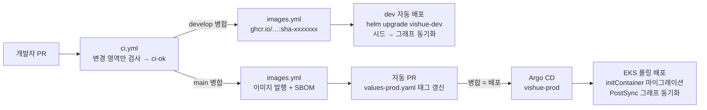

# 실행과 배포

같은 컨테이너 이미지를 네 환경에서 씁니다. 환경 사이의 차이는 설정 값(Compose 환경 변수, Helm values 파일)에만 있습니다. 왜 이렇게 나눴는지는 [ADR-0003](adr/0003-containers-helm-gitops.md)과 [ADR-0008](adr/0008-aws-environments.md)에 있습니다.

| 환경 | 용도 | 정의 | PostgreSQL | Redis · Neo4j | 배포 방식 |
| --- | --- | --- | --- | --- | --- |
| Docker Compose | 개인 PC에서 백엔드 개발 | `infra/compose/` | 컨테이너 | 컨테이너 | `docker compose up` |
| kind | 쿠버네티스 동작 확인 | `infra/kind/`, `values-local.yaml` | 클러스터 안 | 클러스터 안 | `helm upgrade` |
| **dev** (AWS EKS `vishue-dev`) | **팀 공용 개발 서버** | `values-dev.yaml` | **Supabase** (팀 공용) | 네임스페이스 안 | `develop` 병합 시 자동 (GitHub Actions) |
| **prod** (AWS EKS `vishue`) | 운영·시연 | `values-prod.yaml`, `infra/argocd/` | RDS | ElastiCache · AuraDB | Argo CD (GitOps) |

AWS 자원(네트워크, EKS, RDS, ElastiCache, Secrets Manager, 배포 권한)은 [`infra/terraform/aws`](../infra/terraform/aws)에 코드로 정의되어 있습니다.



## 1. Docker Compose (로컬 전체)

Docker Desktop이 필요합니다. 저장소 루트에서 실행합니다.

```bash
docker compose -f infra/compose/compose.yaml --env-file .env up --build
```

- 루트 `.env`를 그대로 읽습니다. `EXPO_PUBLIC_SUPABASE_*`는 토큰 검증에, `NAVER_*`와 `YOUTUBE_API_KEY`는 판매처·제품 이미지·튜토리얼 검색에, `LLM_API_KEY`와 `LLM_MODEL`은 챗봇에 씁니다. 키가 없으면 해당 기능만 꺼집니다(챗봇은 503).
- 시작 순서는 자동입니다. PostgreSQL → `migrate`(Alembic) → `api` → 게이트웨이 순서로 뜨고, `chatbot`과 `sync-graph`는 Neo4j가 준비되면 뜹니다. 게이트웨이는 챗봇을 기다리지 않아서, 챗봇이 꺼져 있어도 쇼핑 API는 동작하고 `/api/chat`만 503을 돌려줍니다.
- 처음 실행은 이미지를 받고 만드느라 몇 분 걸립니다. `-d`를 붙이면 터미널을 닫아도 계속 돌고, 상태는 `docker compose -f infra/compose/compose.yaml ps`로 봅니다.
- 확인: `curl http://localhost:8080/api/products`, API 문서는 `http://localhost:8080/api/docs`
- 앱(`npx expo start`)은 개발 중에 Metro를 띄운 PC의 `:8080`으로 자동 연결됩니다. 휴대폰 Expo Go도 같은 Wi-Fi라면 따로 설정할 필요가 없습니다(PC 방화벽에서 8080 허용 필요). 터널 모드(`--tunnel`)처럼 PC 주소로 닿지 않을 때는 `.env`의 `EXPO_PUBLIC_API_BASE_URL`에 백엔드 주소를 넣습니다.
- LAN에 열리는 포트는 게이트웨이(8080) 하나뿐입니다. DB 관리 도구용 포트는 `127.0.0.1`에만, PC에 이미 설치된 PostgreSQL·Redis와 겹치지 않는 번호로 열립니다(PostgreSQL 15432, Redis 16379, Neo4j 17474·17687). 겹치면 `.env`에서 `GATEWAY_PORT`, `POSTGRES_HOST_PORT` 등으로 바꿉니다.
- Expo 웹(`localhost:8081`)에서 부르는 경우를 위해 CORS가 기본으로 열려 있습니다(`CORS_ORIGINS`).
- 카탈로그 넣기: `backend/api/seed/catalog.json`을 채운 뒤 다음을 실행합니다.

  ```bash
  docker compose -f infra/compose/compose.yaml run --rm seed
  docker compose -f infra/compose/compose.yaml run --rm sync-graph
  ```

- 데이터까지 지우기: `docker compose -f infra/compose/compose.yaml down -v`

### 팀원은 Docker 없이 dev 서버를 씁니다

화면을 만드는 팀원은 Docker가 필요 없습니다. `.env`에 dev 서버 주소만 넣고 앱을 켭니다.

```
EXPO_PUBLIC_API_BASE_URL=https://dev-api.<도메인>   # 도메인 전이면 dev 게이트웨이 NLB 주소
```

그다음 `npx expo start -c`를 실행합니다(`.env`를 바꾸면 `-c`로 캐시를 지워야 반영됩니다). dev 서버는 `develop`에 병합될 때마다 자동으로 새 코드로 바뀝니다([3. AWS](#3-aws-dev--운영) 참고).

AWS dev 환경이 준비되기 전에는 Docker가 있는 PC 한 대에서 Compose로 띄우고, 같은 Wi-Fi의 팀원이 `http://<그 PC의 IP>:8080`을 쓰면 됩니다. 그 PC의 관리자 PowerShell에서 방화벽을 한 번 열어 둡니다.

```powershell
New-NetFirewallRule -DisplayName "VISHUE backend 8080" -Direction Inbound -Protocol TCP -LocalPort 8080 -Action Allow
```

### 서비스 하나만 직접 실행 (uv)

```bash
cd backend/api
cp .env.example .env
uv sync
uv run alembic upgrade head
uv run uvicorn app.main:app --reload
uv run pytest              # 단위 테스트 (DB 없이)
uv run ruff check . && uv run lint-imports
```

## 2. kind (로컬 쿠버네티스)

kind, kubectl, Helm이 필요합니다. 운영과 같은 차트를 노드 2대(zone 2개)에 올립니다.

```bash
# 클러스터와 게이트웨이 (처음 한 번)
kind create cluster --name vishue --config infra/kind/cluster.yaml
helm install eg oci://docker.io/envoyproxy/gateway-helm -n envoy-gateway-system --create-namespace
kubectl apply -f infra/platform/gatewayclass.yaml

# 이미지를 만들어 kind 노드에 넣기
docker build -t vishue-api:dev backend/api
docker build -t vishue-chatbot:dev backend/chatbot
kind load docker-image vishue-api:dev vishue-chatbot:dev --name vishue

# 배포 (DB 접속 정보는 차트가 릴리스 이름에 맞춰 자동으로 연결합니다)
helm upgrade --install vishue infra/helm/vishue -n vishue --create-namespace \
  -f infra/helm/vishue/values-local.yaml

# 게이트웨이를 localhost:8080으로 열기
kubectl -n envoy-gateway-system port-forward \
  "svc/$(kubectl -n envoy-gateway-system get svc \
    -l gateway.envoyproxy.io/owning-gateway-name=vishue -o jsonpath='{.items[0].metadata.name}')" 8080:80
```

- 코드를 고친 뒤에는 바뀐 서비스만 다시 빌드하고 `kind load` → `kubectl -n vishue rollout restart deploy/vishue-api` 순서로 반영합니다.
- 상태 확인: `kubectl -n vishue get pods -o wide`를 실행하면 `api`와 `chatbot` Pod가 zone별로 나뉘어 배치된 것을 볼 수 있습니다.
- GitOps까지 시연하려면 Argo CD를 설치하고 `kubectl apply -f infra/argocd/project.yaml -f infra/argocd/application-local.yaml`을 실행합니다(`develop` 브랜치를 따라갑니다).

## 3. AWS (dev + 운영)

EKS 클러스터 하나에 dev(`vishue-dev` 네임스페이스)와 운영(`vishue` 네임스페이스)을 함께 올립니다. 비용을 아끼면서도 두 환경이 같은 쿠버네티스 설정을 쓰게 하기 위해서입니다([ADR-0008](adr/0008-aws-environments.md)).

| | dev | 운영 |
| --- | --- | --- |
| PostgreSQL | Supabase (팀 공용, 대시보드로 데이터 확인) | RDS PostgreSQL 17 |
| Redis · Neo4j | 네임스페이스 안 컨테이너 | ElastiCache (TLS) · Neo4j AuraDB |
| 시크릿 | Secrets Manager `vishue/dev/*` | Secrets Manager `vishue/production/*` |
| 배포 | `develop` 병합 → GitHub Actions가 `helm upgrade` | `main` 병합 → 태그 갱신 PR 병합 → Argo CD |
| 카탈로그 데이터 | 배포할 때마다 Git의 `seed/catalog.json`으로 교체 | 담당자가 의도적으로 실행 |

### 처음 한 번 (클러스터 관리자 1명)

필요한 도구: AWS CLI(캠프 계정으로 `aws configure`), Terraform, kubectl, Helm.

**1. AWS 자원 만들기 (Terraform)**

```bash
cd infra/terraform/aws
terraform init
terraform plan        # 만들어질 자원 확인
terraform apply       # 15~20분
terraform output      # 다음 단계에서 쓸 값
```

- 만들어지는 것: VPC(2개 AZ, NAT 1개), EKS(노드 `t3.large` 2대), RDS PostgreSQL, ElastiCache Redis, Secrets Manager 4개, GitHub 배포용 IAM 역할.
- 비용은 대략 월 $250 안팎입니다(EKS·노드·NAT·RDS·ElastiCache·로드 밸런서). 캠프 크레딧 한도를 확인하고, 쓰지 않는 기간에는 노드 수를 줄이세요. 프로젝트가 끝나면 `terraform destroy`로 지웁니다. 운영 DB는 삭제 보호가 켜져 있어서 `db_deletion_protection = false`로 먼저 바꿔야 합니다.
- 팀이 같이 쓰려면 Terraform 상태 파일을 S3에 둡니다(`versions.tf`의 주석 참고).

**2. 클러스터 공용 구성 요소 설치**

```bash
aws eks update-kubeconfig --name vishue --region ap-northeast-2
helm repo add metrics-server https://kubernetes-sigs.github.io/metrics-server/
helm repo add external-secrets https://charts.external-secrets.io
helm repo add argo https://argoproj.github.io/argo-helm
helm upgrade --install metrics-server metrics-server/metrics-server -n kube-system
helm upgrade --install eg oci://docker.io/envoyproxy/gateway-helm -n envoy-gateway-system --create-namespace
helm upgrade --install external-secrets external-secrets/external-secrets -n external-secrets --create-namespace
helm upgrade --install argocd argo/argo-cd -n argocd --create-namespace

kubectl apply -f infra/platform/gatewayclass.yaml
kubectl apply -f infra/platform/cluster-secret-store.yaml
kubectl apply -f infra/platform/dev-namespace.yaml
kubectl apply -f infra/argocd/project.yaml -f infra/argocd/application-prod.yaml
```

- External Secrets는 Terraform이 만든 Pod Identity로 `vishue/*` 시크릿만 읽을 수 있습니다.
- `dev-namespace.yaml`은 GitHub 배포 역할이 `vishue-dev` 안에서만 일할 수 있게 묶습니다.

**3. 시크릿 값 채우기 (AWS 콘솔 → Secrets Manager)**

| 시크릿 | 채울 값 |
| --- | --- |
| `vishue/dev/api` | `DATABASE_URL`: Supabase 대시보드 → Connect → **Session pooler** 주소를 `postgresql+asyncpg://…:5432/postgres?ssl=require` 형태로 바꿔서 입력. `NAVER_*`, `YOUTUBE_API_KEY` |
| `vishue/dev/chatbot` | `LLM_API_KEY` |
| `vishue/production/api` | `DATABASE_URL`, `REDIS_URL`은 Terraform이 채워 둠. `NAVER_*`, `YOUTUBE_API_KEY`만 입력 |
| `vishue/production/chatbot` | `NEO4J_PASSWORD`(AuraDB), `LLM_API_KEY` |

**4. values 파일의 공개 값 채우기**

`values-dev.yaml`과 `values-prod.yaml`에서 "set before first deploy" 표시가 붙은 값을 채워 PR로 올립니다. Supabase 공개 값, `LLM_MODEL`, 운영의 `NEO4J_URI`(AuraDB), `gateway.hostname`이 대상입니다.

**5. GitHub 저장소 설정**

| 위치 | 이름 | 값 |
| --- | --- | --- |
| Settings → Secrets and variables → Actions → **Variables** | `AWS_DEV_DEPLOY_ROLE_ARN` | `terraform output github_dev_deploy_role_arn` |
| 〃 | `EKS_CLUSTER_NAME` | `vishue` |
| 〃 | `AWS_REGION` | `ap-northeast-2` |
| Settings → Secrets and variables → Actions → **Secrets** | `DEPLOY_PR_TOKEN` | 이 저장소에 contents·pull requests 쓰기 권한만 준 fine-grained PAT |
| Settings → Branches | `develop`, `main` 보호 | 필수 체크 `ci-ok` |
| Settings → Packages | `vishue-api`, `vishue-chatbot` | 공개로 두거나, pull secret을 만들고 `image.pullSecrets` 지정 |

`AWS_DEV_DEPLOY_ROLE_ARN`을 넣기 전까지 dev 자동 배포 단계는 건너뜁니다. `DEPLOY_PR_TOKEN`이 없으면 운영 태그 PR에서 CI가 돌지 않아 `ci-ok`가 끝나지 않습니다(GitHub 기본 토큰으로 만든 PR은 워크플로를 실행하지 않습니다).

**6. 도메인과 HTTPS (선택)**

게이트웨이마다 NLB가 하나씩 생깁니다(`kubectl get svc -n envoy-gateway-system`). `api.<도메인>`과 `dev-api.<도메인>`을 각각 연결하고, cert-manager로 인증서 Secret을 만든 뒤 `gateway.tls`를 켭니다.

### dev 배포 (자동)

1. PR이 `develop`에 병합되면 `images.yml`이 이미지를 `sha-<커밋>` 태그로 발행합니다.
2. 이어서 GitHub OIDC(저장된 AWS 키 없음)로 `vishue-dev`에 `helm upgrade`합니다.
3. 릴리스 안에서 마이그레이션 → 새 Pod 준비 → 카탈로그 시드 → 그래프 동기화가 순서대로 돌고, 하나라도 실패하면 워크플로가 실패합니다.

### 운영 배포와 롤백

1. `develop` → `main` PR이 병합되면 `images.yml`이 `sha-<커밋>` 태그로 이미지를 발행합니다.
2. 같은 워크플로가 `values-prod.yaml`의 `image.tag`를 바꾸는 PR(`chore: 운영 이미지 태그를 … 로 갱신`)을 엽니다.
3. 그 PR을 병합하면 Argo CD가 감지해서 롤링 배포합니다. 새 Pod가 `/readyz`를 통과해야 이전 Pod가 내려갑니다(`maxUnavailable: 0`).
4. 롤백은 태그 갱신 커밋을 revert하는 PR로 합니다. 클러스터에서 직접 `kubectl`로 고치면 Argo CD의 selfHeal이 Git 상태로 되돌립니다.

마이그레이션은 배포 중에 이전 버전 Pod와 함께 돌아도 깨지지 않게 작성합니다(확장 → 배포 → 정리). dev와 운영이 같은 마이그레이션을 쓰므로, dev에서 먼저 확인된 변경만 `main`으로 올립니다. 자세한 원칙은 [`ARCHITECTURE.md`의 운영 원칙](ARCHITECTURE.md#운영-원칙)을 참고하세요.

## 4. 문제가 생겼을 때

아래는 운영 기준입니다. dev는 `-n vishue-dev`, 리소스 이름은 `vishue-dev-api`처럼 앞에 `vishue-dev-`가 붙습니다.

```bash
kubectl -n vishue get pods                               # CrashLoopBackOff, Pending 확인
kubectl -n vishue describe pod <pod>                     # 이벤트 (프로브 실패, 이미지 pull 실패)
kubectl -n vishue logs deploy/vishue-api -c migrate      # 마이그레이션 실패
kubectl -n vishue logs deploy/vishue-api --since=10m     # JSON 로그, request_id로 검색
kubectl -n vishue create job --from=cronjob/vishue-sync-graph sync-now   # 그래프 즉시 동기화
```

| 증상 | 먼저 볼 것 |
| --- | --- |
| `api` Pod가 Ready가 안 됨 | `/readyz` 응답의 `database`, `redis` 값, `DATABASE_URL` Secret |
| `/api/chat`이 503 | `LLM_API_KEY`(Secret), `LLM_MODEL`(ConfigMap)이 비어 있는지 |
| 챗봇이 제품을 못 찾음 | `sync-graph` Job 로그, `api`의 `/api/products` 응답이 비어 있는지 |
| 401만 나옴 | `SUPABASE_URL`이 앱의 Supabase 프로젝트와 같은지, 토큰 만료 |
