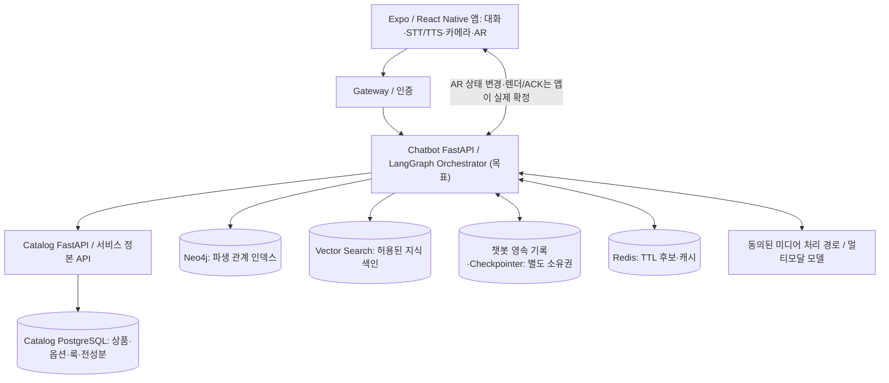
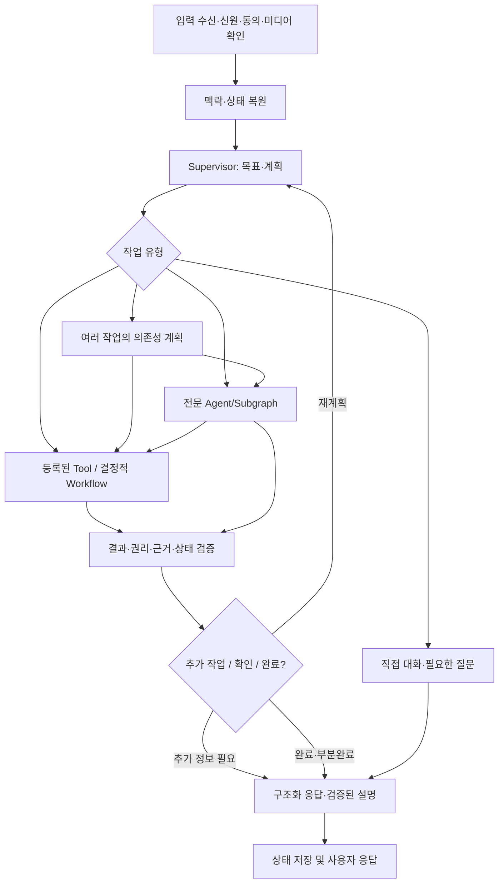

# VISHUE AI — 목표 논리 아키텍처 (2-1~2-3)

> 상태: **PROPOSED**, 2026-11-15. 확정된 사용자 목표는 [01 사용자 경험](01-user-experience.md), 기술 의사결정은 [DECISIONS](DECISIONS.md) 참조. 현재 `develop`의 실제 구현이 아니다.
> 기준 커밋: `d1cf4868f74d2ff6db188bf2c7646146f3ec72ad`.

## 1. 아키텍처 목표와 책임

**LangGraph 기반 대화 Supervisor + 전문 Agent·Tool·Workflow의 책임 기반 조합 + 검증된 데이터·실행 계층**을 목표로 한다. 14개 사용자 능력과 S01~S12를 모두 설계 범위에 포함한다. 시나리오나 기능 수를 Agent 수나 intent 화이트리스트로 변환하지 않는다.

- 대화 계층: 사용자의 현재 의사·목표·화면·대화 상태·동의된 기억 이해, 필요한 질문 및 적극적 제안.
- 계획·협력: 단일 Tool, 전문 Subgraph, 순차·병렬·조건부 작업, 명시적 Handoff 중 적합한 경로 선택.
- 실행: Catalog 상품·호수, 옵션별 성분, 근거 지식, 스타일 레시피, AR 동작 제안 등 각 서비스의 권한 있는 API 사용.
- 검증: 상품 사실·권리·근거 버전·실제 기기 상태를 별도 코드가 확정. LLM 결과가 승인 또는 AR ACK가 될 수 없음.
- 상태: 대화 이력, 작업 진행, 동의한 장기 기억, 캐시, 데이터 참조와 사용자 미디어를 분리.
- 응답: 설명·상품 카드·룩·레시피·AR 제안/상태를 구조적으로 반환하며 STT/TTS와 다국어를 지원.
- 평가: 고정 사례 정확도 외에 자유 질문·목표 전환·복합 과업·실제 사용자 피드백·복구까지 검증(세부 지표는 4단계에서 사용자 승인).

## 2. 컨테이너 경계 및 시스템 흐름

**현행 ADR-0001/0002의 소유권을 존중한다.** `backend/api`가 Catalog PostgreSQL을 관리하고 `backend/chatbot`은 Catalog API로 정본 데이터를 조회한다. 챗봇 영속 대화와 Checkpointer를 위한 PostgreSQL이 필요하면 별도 DB·스키마·자격증명/서비스 소유권을 기술 ADR로 결정한다. 같은 PostgreSQL 인스턴스를 써도 Catalog 테이블의 직접 접근 권한이 생긴 것은 아니다.

Neo4j/벡터 검색은 파생 인덱스다. 출처·문서 사용권한·발행 상태가 확인된 자료만 색인하고, 반환된 상품 사실은 현재 Catalog 검증을 거친다. 벡터 구현은 pgvector/독립 VectorDB 등을 3단계에서 평가한다. Neo4j에 자유 질의나 미검수 관계가 있다는 사실만으로 신뢰 가능한 답변 근거라고 주장하지 않는다.

## 3. 멀티모달 책임 (사용자 결정: 기기·서버 혼합)

| 입력/출력 | 책임 | 필수 경계 |
| --- | --- | --- |
| AR 실시간 카메라 | 앱 내 WebView/렌더러 | 기존 AR 프레임의 상시 서버 전송 금지 유지 |
| 피부 분석 결과·설문 | 별도 앱 분석/동의된 서버 처리 | 실험적 결과·기법·버전·자기보고의 차이를 표시 |
| 사용자가 선택한 참고 이미지 | 동의된 업로드·미디어 서비스 | 접근권한·용도·보존/삭제·외부 모델 제공 고지 |
| 사용자 참고 영상 | 기기에서 필요한 전처리 + 동의된 서버 분석 | 구간/프레임/음성 전사별 관찰 출처 추적. 제목만으로 장면을 단정하지 않음 |
| STT | 앱 음성 입력 어댑터 | 인식 문장·언어·오류·요청 연관 ID, 음성 원본 보관 정책 |
| TTS | 앱 출력 어댑터 | 텍스트 최종 검증 후 재생, 재생 중단·끼어들기·언어 전환 |
| 텍스트·화면 맥락 | 앱 → 챗봇 | 사용자 제공 ID는 참고 힌트, 검증된 사실·실행 권한이 아님 |

## 4. Supervisor, Agent, Tool, Workflow의 경계

| 구성요소 | 판단/실행 책임 | 확정하지 못하는 것 |
| --- | --- | --- |
| Supervisor | 현재 목표, 전체 계획, 라우팅, 부분 성공·재계획, 사용자에게 제안할 다음 행동 | 실제 가격, 성분 부재, AR 적용 성공 |
| Product Consultation | 취향 탐색·비교 전략·후보 선택 근거 | 검증되지 않은 실제 상품·옵션 |
| Ingredient Evidence Consultation | 근거 검색·서로 다른 주장 비교·설명 계획 | 검수되지 않은 포함/부재 판정·의료적 진단 |
| Style Coaching | 룩·기법·단계 조합, 피드백 기반 수정 | 영상에서 확인하지 않은 실제 동작 |
| AR Planning | 여러 부위 조정과 사용자 체험 목표를 실행 가능한 명령으로 계획 | 렌더 성공을 자체 선언하거나 직접 상태 변경 |
| Visual Understanding | 미디어 구간·스타일 특징 분석을 위한 전문 작업 조정 (필요시 Subgraph) | 미관찰 장면·실제 상품 사용을 확정 |
| Knowledge / Skin / STT / TTS | 주로 공통 조회·처리 Tool. 복잡한 조사 필요 시 전문 Subgraph 가능 | 각 서비스의 원본 권한 우회 |
| Tool Executor | Pydantic 입력 검증, 허용 도구, 네트워크 호출·표준 ToolResult | 모델이 생성한 임의 SQL/권한 없는 실행 |
| Evidence / Action Validator | 출처·권리·버전·옵션·실제 기기 상태 검증 | 사용자 목표·취향을 임의 변경 |
| Response Composer | 검증된 사실 기반 자연어+구조화 카드·레시피·상태 | 검증 결과 변경·새 사실 생성 |

**설계 판단:** Product, Ingredient, Style, AR의 복합 상담은 전문 자율성·도구 조합을 검토할 충분한 근거가 있다. 단순 가격 조회, 성분 존재 판정, 레시피 API 호출은 결정적 Tool로 처리할 수 있다. 분리 여부는 2-7에서 같은 과업에 대해 정확도, 지연·비용, 장애 격리, 디버깅을 비교해 확정한다. 기능 영역 수만큼 LLM 호출을 강제하지 않는다.

## 5. 목표 그래프와 흐름

대화 주도성 A는 유용한 정보를 먼저 주고 적절한 질문·룩·상품·AR 제안을 한다는 뜻이다. 실제 상태 변경이나 동의 없는 장기 정보 저장을 의미하지 않는다. 자동 추천도 강요하지 않는다.

## 6. 현재 코드와의 차이

- `backend/chatbot/app/services/chat_service.py`: 규칙 기반 `route_intent` + `build_plan`, `compound_request_unsupported` 존재. 목표 그래프는 아직 없음.
- `backend/chatbot/app/schemas/supervisor.py`: `TaskPlan.tasks` 최대 2개 및 단일 `ToolResult` 중심, 새 의존성·병렬성 표현 불충분.
- `backend/chatbot/app/clients/llm_client.py`: OpenAI 호환 텍스트 `complete` 호출만 확인. 구조화 Tool Calling/멀티모달 API 호출 경로는 별도 설계·구현 필요.
- `backend/chatbot/pyproject.toml`: 기준 커밋에서 LangGraph 의존성 없음.
- `backend/chatbot/app/repositories/chat_session_repository.py`: Redis TTL ≤600초, 요청 중복·버전 검사 존재. 영속 대화·그래프 복구를 대신하지 않음.
- 앱 `store/chatConversationStore.ts`: 대화방 메시지·선택 상태 관리 코드 존재. 서버 간 지속 보관과는 별도.
- `hooks/useArCommand.ts` / `lib/arCommandAck.ts`: ACK·실패 복원·중복 방지 일부 존재. 현재 ACK outbox는 프로세스 메모리. 운영 영속성이 자동 보장되지 않음.

## 7. 이후 상세 설계 인계

- [03 실행 계약](03-execution-contracts.md): 식별자, 상태, TaskPlan, Handoff, 동시 요청 정책, 영속 실행·복구.
- 2-5: Tool·Evidence·권한·DB/검색 경계를 명세하고 Agent 도구별 검증 수준 확정.
- 2-6: 앱·AR·STT/TTS·이미지·영상 실제 요청/응답/ACK 설계.
- 2-7: 시퀀스 다이어그램과 고장·보안·성능·실제 평가 근거로 목표 아키텍처의 구현 적합성 승인.

## 8. 언어 중립 아키텍처 및 1차 한국어 정책 (VAI-D-013)

- **사용자 확정:** 1차 AI 개발·검증은 `ko`, 목표 능력 C01~C14·시나리오 S01~S12·기존 UI `en/ko/ja/zh` 코드는 보존. `en/ja/zh`의 AI/STT/TTS/AR 음성 제공 시점은 미정.
- **목표 설계(미구현):** LangGraph의 상태 ID, TaskPlan, Tool 이름·입력/출력, Agent Handoff, 근거·검수 상태·옵션 ID는 `locale`와 독립. 필요 시 `inputLanguage`, `responseLocale`, `sourceLanguage` 분리. 텍스트 설명과 UI 문구만 현지화한다.
- **2-6 인계:** 한국어 STT/TTS/AR 음성 먼저 실기기 검증, 현재 `app.json`의 Android 녹음 권한 차단과 Expo Go/네이티브 엔진·동의·오디오 보관 방식 검토. 기능 미구현인 언어 UI는 자동 언어 변경 없이 안내와 사용자 선택 경로 검토.
- **3단계 인계:** 한국어 의미 검색·정확 매칭·동의어·임베딩 품질 우선, 향후 동일 근거 ID에 `contentLanguage`·모델·색인 버전을 추가 가능한 구조.
- **평가:** TC-KO-STRUCTURE-01을 1차 계약 테스트로, 기존 TC-22는 TC-22-I18N-FOLLOWUP(후속 언어 평가)으로 이동. 모두 미실행 계획.

상세 정책·미결정 사항은 [07 한국어 우선](07-ko-first-language-and-evaluation.md) 참조.

### 변경 이력

- 2026-11-15: VAI-D-013 언어 범위 및 구조 중립성 연결. 기존 멀티모달·Supervisor·전문 Agent 아키텍처는 변경 없음.

## 9. 2-6 팀 책임과 물리 서비스 배치 (2026-11-15)

> **ACCEPTED-USER:** 일반 LLM 담당과 AR·AR 내부 AI 담당의 **개발 책임을 구분**한다. **REVIEW-CONCLUSION:** 논리적 모듈 경계는 설계할 수 있으나 **별도 서버/배포 분리는 확정하지 않는다**. [03 공동 인계 계약](03-execution-contracts.md)과 [04 현행 차이](04-gap-analysis-and-2-5.md) 참고.

### 9-1. 역할과 개발 소유권

| 시스템·역할 | 직접 구현 책임 | 공동으로 확인할 내용 |
| --- | --- | --- |
| **일반 LLM 담당** | K-뷰티 자유 대화, LangGraph Supervisor·일반 상담 전용 Agent·Tool·RAG·근거 검증, 일반 대화/추천 State, AR 인계 요청·복귀 맥락 소비 | AR 체험 제안·옵션 확인, 반환 이벤트 검증·대화 연속성 |
| **AR 화면·기능 담당** | AR 화면·렌더·제품/호수 적용·기기 상태, 실제 결과·Undo·Restore | app ↔ AR Handoff 수락, 결과·상태 버전·오류 |
| **AR 내부 AI 담당** | AR 전용 LLM, STT·TTS, 음성/텍스트 AR 명령 해석과 관련 실행 로직 | 일반 AI와의 최소 맥락 전달, 명령 결과·ACK 의미, 음성 인터페이스 |
| **앱/백엔드/데이터/보안 기타** | **담당 확인 전**. 상담 카드/UI·공통 라우터·Catalog 데이터·미디어 등 자동으로 일반 LLM 담당으로 지정 금지 | 파일 소유·권한·변경 주체 합의 |

일반 LLM의 Supervisor는 **AR AI를 강제로 자신의 LangGraph 하위 노드로 구현하지 않는다**. 복합 대화에서 AR 화면이 필요하면 독립 AR 담당 시스템으로 **Handoff**하고, 사용자 의사·상품·룩 참조 및 최종 검증 상태만 사용한다. AR AI 내부의 기기/서버 혼합 STT 방식은 **AR AI 담당의 기술 선택과 팀 검증**을 거친다. C 혼합 구조 = 기기·서버 STT 두 구현을 1차에 동시에 개발한다는 뜻이 아니다.

### 9-2. 논리 경계와 물리 배치의 대안

| 선택 | 서비스 배치 | 장점 | 한계 | 상태 |
| --- | --- | --- | --- | --- |
| A. **현재 chatbot 유지 + 내부 모듈/라우터 책임 분리** | 동일 `backend/chatbot` FastAPI, 필요 시 구별된 서비스/모듈 어댑터 | `/api/chat` 및 기존 인증/배포·앱 이동 경로와 호환성 높음 | 같은 배포/장애 도메인, 공통 코드 변경 협의 | **우선 추천, PROPOSED** |
| B. 일반 LLM과 AR AI 별도 서비스 | 인증된 내부 API/이벤트 버스로 연동 | 독립 배포/확장·장애 격리 | 신규 인증/배포/운영·이벤트 정확성·추가 지연 | **미결정/후속 검토** |
| C. AR 전용 AI도 일반 LangGraph에 단일화 | 단일 Supervisor가 음성·AR 내부 로직 관리 | 단일 라우팅 | 팀 소유권·내부 자율성과 충돌, 결합도 증가 | **비추천** |

기존 `backend/chatbot/app/routers/chat.py`는 `POST /api/chat`와 `POST /api/chat/acks`, `ChatService.execute_tool`은 `ar_command`와 일반 상담을 함께 담당하는 **현행 코드 사실**이다. 서비스 분리를 설계 확정/구현 완료로 기록하지 않는다. 팀 Discord 2026-11-04의 인계 공지에는 기존 ChatService·Supervisor 구조 보존과 책임 협의 제안이 있으며, AR 담당의 최종 서비스 분리·모듈 소유 승인 결과는 이번 확인에서 미확인.

### 9-3. 2-7에서 파일별 변경 책임 협의

| 파일·영역 | 현행 코드 | 권장 협의 주체 |
| --- | --- | --- |
| `backend/chatbot/app/services/chat_service.py`, `schemas/chat.py`, `schemas/supervisor.py` | 공용 일반·AR 파이프라인/메시지 계약 | **일반 LLM 통합 담당 + AR AI 담당 공동 리뷰**, 단일 변경 PR의 책임자 지정 필요 |
| `backend/chatbot/app/routers/chat.py`, Gateway 라우팅 | 공용 `/api/chat` 및 ACK | **공동 계약**; 최종 소유자 미확정 |
| `app/(tabs)/ar.tsx`, `hooks/useArRouteSelection.ts`, `store/makeupStore.ts`, `ArFaceView.tsx` | AR 화면·상태·렌더 | **AR 기능 담당**과 앱 담당 협의 |
| `hooks/useArCommand.ts`, `lib/arChatRoute.ts`, `lib/arChatAdjust.ts`, `lib/arCommandAck.ts` | AR 전용 자연어·명령·ACK | **AR AI + AR 기능 담당** 사이 수정·검증 경계 합의 |
| `app/chat.tsx`, `components/chat/ChatProducts.tsx`, `lib/routes.ts` | 일반 상담 UI·상품 카드·화면 간 이동 | **공용 앱/UI 담당 확인 필요**. 일반 LLM 담당으로 자동 할당하지 않음 |
| 한국어 STT·TTS와 `app.json` 녹음 권한 | 신규 AR 음성 입력·출력, 앱 빌드·권한 | AR AI + 앱/배포·보안 담당 공동 협의 |

**개발 운영 원칙:** 일반 LLM은 독립적인 수직 기능 하나씩 최신 develop에서 개발→테스트·관련 E2E→리뷰→병합. AR·AR AI 팀은 독립 진행 가능하되 **공유 파일/인터페이스는 동시 충돌 수정 전 계약 합의**하고, 공동 통합 테스트를 별도 수행한다.

### 변경 이력
- 2026-11-15: 일반 LLM / AR / AR AI의 소유권과 물리 배치 여부를 분리. 기존 14개 사용자 능력·12개 대표 시나리오 및 2서비스 ADR은 변경하지 않음. **2-6 논리 설계 검토 종료**, 세부 팀 소유권·서비스 배치는 OPEN.
