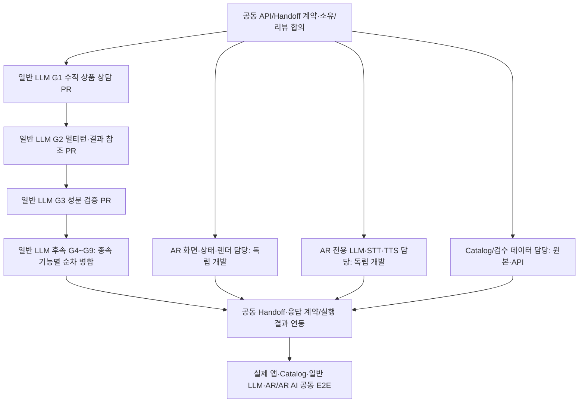

# VISHUE — 실행·기억·Agent 협력 계약 (2-2~2-4)

> 상태: **PROPOSED 기술 상세안**. 2026-11-15. 사용자 확정 정책은 [DECISIONS](DECISIONS.md), 목표 경험은 [01](01-user-experience.md). 예시 스키마·상태값은 **API 반영 전 제안**이다. 구현·실행 테스트가 아니다.
> 기준: `develop d1cf4868`. [현재와의 차이](04-gap-analysis-and-2-5.md).

## 1. 논리적 상태의 소유권

| 상태 영역 | 소유·저장 후보 | 허용된 활용·갱신 |
| --- | --- | --- |
| Conversation | 대화방·현재 메시지·현재 목표, 영속 대화 이력과 LangGraph thread | 현재 스레드 맥락 기본 사용 |
| Execution | plan, tasks, Handoff, 중단·재개 위치, ToolResult | Checkpointer + 필요시 영속 실행 이력 |
| Session references | 순서가 확정된 상품 후보(resultSetId), 일시 필터, 캐시 | Redis TTL; 만료되면 원본 재조회 |
| Long-term memory | 동의한 취향·프로필·보유 제품 | 사용자 전용 영속 저장소, 명시적 저장·수정·삭제 |
| Catalog / Evidence | 상품·옵션·성분·룩·승인 근거·출처 버전 | 원본 소유 서비스가 기준. 대화의 과거 답변은 정본 아님 |
| Media | 업로드 식별자·검수/동의 상태·분석 관찰·만료 | 원본은 접근 통제된 별도 미디어 저장소, Checkpoint에 원본 미보관 |
| Device / AR | 실제 렌더러 상태·명령 결과·적용 ACK | 앱 권한 + 상태 버전 검증; LLM 스냅샷은 실행 근거가 아님 |

**Checkpoint는 대화와 실행 재개 도구이며 외부 시스템의 실제 행동에 대한 단독 정본이 아니다.** 대화 기록·체크포인트·동의 장기 기억의 동시 삭제 정책이 필요하다. 영속 데이터 저장 위치와 테이블·리전은 2-7/팀 ADR에서 확정한다.

## 2. 식별자·버전 계약 (권장)

| 키 | 범위·수명 | 재전송·변경 규칙 |
| --- | --- | --- |
| `ownerId/userId` | 사용자/익명 세션 권한 주체 | 토큰/세션 소유 확인, 타인의 thread·media 접근 거부 |
| `threadId` | 하나의 대화방 또는 실행 스레드 | 체크포인터 스레드 키, 소유자와 결합 |
| `turnId` | 하나의 논리적 사용자 발화 | 새 발화마다 발급. 같은 입력 재시도는 같은 turn 유지 |
| `requestId` | HTTP 처리의 멱등성 키 | **같은 논리 요청 재시도는 동일 ID·payload fingerprint**. 다른 payload 동일 ID면 409 |
| `planId` | 특정 사용자 목표의 작업 계획 | 한 턴에 여러 목표/계획 있을 수 있음 |
| `planVersion` | 계획 개정 번호 | 수정·정정 시 증가, 늦은 구버전 결과가 최신 선택을 덮지 못함 |
| `taskId` | 계획 내 하나의 작업 | 입력·의존성·실행 결과·실패 사유 연결 |
| `actionId` / `commandId` | 실제 변경 행동(AR, 저장·삭제) | 동일 행동은 장애 후에도 같은 ID로 조회·재시도. 재생성 금지 |
| `stateVersion` | 대화의 애플리케이션 버전 | 갱신 시 기대 버전 비교. 충돌 시 재조회·재계획 |
| `arStateVersion` | 기기의 실제 AR 상태 버전 | 렌더 적용 전 앱 최신 상태와 비교. 대화 버전과 별개 |
| `checkpointId` | LangGraph 저장 시점 식별 | 복원·감사 참조. `stateVersion`과 동일시하지 않음 |
| `schemaVersion` | 메시지·Tool·Agent 입출력 버전 | 호환·마이그레이션·구형 앱 처리 명시 |
| `sourceVersion` / `indexVersion` | 상품·근거 원본 및 검색 사본 버전 | 검색·상담 시 현재 유효성 재검증, 철회·변경 판정 무효화 |

**동시성 원칙:** 단일 thread에서 동시에 제출된 실행은 기대 `stateVersion`과 요청 소유자를 검사한다. 두 요청이 같은 버전을 읽으면 먼저 커밋한 것만 확정되고 나머지는 새 상태를 확인해 조정한다. LangGraph node 병렬 실행 중 `task_results[taskId]`는 각자의 키로 병합하고, `selected_product` 같은 단일값을 서로 덮어쓰게 하지 않는다.

## 3. LangGraph State 목표 구조

```python
# 의사 설계 — 코드 구현/확정 필드명이 아님
class VishueState(TypedDict):
    messages: Annotated[list, add_messages]
    thread_id: str
    current_goal: dict
    session_preferences: dict
    long_term_memory_refs: list[str]
    conversation_search_grant: dict | None
    media_refs: list[dict]
    selected_refs: dict
    plan: dict
    task_results: dict[str, dict]
    evidence_refs: list[dict]
    pending_action: dict | None
    error_events: list[dict]
    response: dict | None
    state_version: int
```

설계 구현 시 다음을 분리한다.

- **요청 입력/출력 TypedDict/Pydantic 계약** vs **LangGraph 내부 State** vs **Checkpointer 저장 직렬화**.
- **공통 State**: 사용자 목표·공유 결과 참조. **전문 Subgraph State**: 검색 루프·사고 과정이 아닌 검증 가능한 중간 결과·허용 도구.
- **비밀정보**: access token, 원본 얼굴 사진/영상, 개인 동의 상세를 메시지·LLM prompt·일반 실행 추적에 무분별하게 복제 금지.
- **병합 규칙**: 메시지 reducer, taskId 기준 결과 병합, 단일 선택/동의 변경은 버전 조건부 확정.
- **감사·삭제**: 체크포인트 속 개인 정보의 삭제·만료·보존, 장기 기억 수정·삭제와 연동.

## 4. 과거 대화 참조: 확정 B, C 확장성

현재 기본 `ContextProvider` = **현재 thread 이력 + 동의된 장기 기억**. `ConversationRetriever`는 인터페이스로 분리하지만 **사용자가 이전 대화 요청을 명시하지 않으면 호출 금지**. 호출 시 소유자·삭제·접근 권한·검색 범위 검사 후 반환한다.

향후 C 자동 관련 대화 검색은 Retriever 교체가 아니라 **검색 트리거 정책과 사용자 권한/동의 계약의 확장**으로 설계한다. 저장된 과거 추천 가격·성분은 현재 Catalog에서 재확인. 과거 기록·검색 인덱스 삭제는 연동하여 처리한다.

## 5. TaskPlan 및 하위 작업 데이터 계약

```json
{
  "planId": "example-plan",
  "planVersion": 2,
  "threadId": "example-thread",
  "turnId": "example-turn",
  "goal": "선호 스타일과 검증된 상품으로 AR 체험",
  "tasks": [
    {
      "taskId": "visual",
      "type": "visual_understanding",
      "mode": "subgraph_or_tool",
      "dependsOn": [],
      "status": "PENDING",
      "inputRefs": ["media-ref"],
      "requiredPermissions": ["media-analysis"]
    },
    {
      "taskId": "skin",
      "type": "profile_lookup",
      "mode": "tool",
      "dependsOn": [],
      "status": "PENDING"
    },
    {
      "taskId": "style",
      "type": "style_coaching",
      "mode": "subgraph",
      "dependsOn": ["visual", "skin"],
      "status": "PENDING"
    },
    {
      "taskId": "product",
      "type": "product_consultation",
      "mode": "subgraph_or_tool",
      "dependsOn": ["style"],
      "status": "PENDING"
    },
    {
      "taskId": "ar",
      "type": "ar_action",
      "mode": "controlled_workflow",
      "dependsOn": ["product"],
      "status": "PENDING",
      "requiresValidDeviceState": true
    }
  ]
}
```

값은 테스트 예시이며 실제 진행 결과나 특정 Agent 개수의 확정이 아니다. 작업 상태는 `PENDING → RUNNING → COMPLETED/PARTIAL/WAITING_USER/FAILED/BLOCKED/CANCELLED/SUPERSEDED`를 지원하고, 외부 행동 결과 불명확은 `UNKNOWN`으로 별도 기록한다. `dependsOn` 그래프에서 순환을 검출하고 실행을 차단한다. 업무 목표가 바뀌면 planVersion을 올리고 구버전 작업을 `SUPERSEDED` 처리한다.

전문 Agent 요청: `taskId`, `goal`, `contextRefs`, `allowedTools`, `dependencies`, `planVersion`, `ownerScope`, `timeBudget`, `schemaVersion`.  
전문 Agent 결과: `taskId`, `status`, `resultRefs`, `evidenceRefs`, `missingInputs`, `proposedNextTasks`, `errors`, `version`.  
Agent가 제시한 후보는 검증·정합성 검사 전까지 사용자 대상 확정 사실이 아님.

## 6. Supervisor·전문 Agent·Tool·Handoff의 권한

| 역할 | 소유 책임 | 재위임·실행의 경계 |
| --- | --- | --- |
| Supervisor | 사용자 최신 목표·전체 계획·작업 생명주기·결과 구성 | 계획 변경·다른 전문 영역 이동은 여기서 조정 |
| 전문 Agent/Subgraph | 위임된 전문 목표의 세부 계획·Tool 조합·반복 | 허용된 도구만 실행; 다른 업무 필요 시 결과/Handoff 요청 |
| Tool Executor | 실제 API·모델 호출과 구조화된 결과 | 입력 검증, 인증/권한/마감시각/멱등성 적용 |
| Evidence Validator | 권리·출처·발행·버전·실제 상품/옵션 검증 | 미확인·실패를 확정 판정으로 승격 금지 |
| Action Controller | 실제 변경 행동 승인·중복 방지·결과 추적 | 명확한 사용자 의사·기기 현재 상태·부작용 확인 |
| 앱·AR 실행 계층 | 실제 렌더 상태·ACK | LLM/서버 제안만으로 적용 성공 선언 금지 |

Handoff 시 반드시 `fromAgent`, `toAgent`, `taskId`, `reason`, `contextRefs`, `planVersion`, `returnTo`, `executionGrant`를 남긴다. Supervisor가 승인한 계획의 고정 전이는 코드로 수행할 수 있으며, 매 호출마다 Supervisor LLM 재판단을 강제하지 않는다.

## 7. 순차·병렬 실행의 조정

- 선행 의존성이 없는 읽기 작업은 병렬 허용: 예) Visual 분석과 동의된 프로필 조회.
- 의존성 있는 작업은 선행 결과/근거 상태를 받아 실행: 스타일 → 상품·호수 → 필요한 성분 → AR.
- 병렬 결과는 각각의 taskId·inputHash·planVersion과 함께 수집한다. 최신 계획의 입력과 다른 오래된 결과는 사용자 선택·상태에 커밋하지 않는다.
- Agent가 여러 Tool을 쓰더라도 개인 정보와 원본을 무제한 공유하지 않는다. 입력 범위·권한·목표를 좁힌 참조만 전달한다.
- 성분 조건의 부재 확인 등 직접적인 사실 판단은 Tool/근거 검증이 책임진다.
- 부분 작업 실패는 사용자 목표 실패로 자동 승격하지 않는다. 유효한 일부 결과·대안·추가 질문이 가능하다.

## 8. 동시 요청 정책: 확정 C

**사용자의 최신 명시적 목표는 지체 없이 반영. 취소 가능한 조회·분석은 취소/재계획하며, 외부 상태 변경은 실행 상태를 조사한 후 후속 행동을 결정**한다.

| 상황 | 계약 |
| --- | --- |
| 취소 가능한 검색·LLM 분석 | 취소 신호 전달, 취소가 늦게 적용돼도 구버전 결과 무효화 |
| 이미 전달된 AR 명령 | 무조건 재전송·중복 실행하지 않음; 기존 actionId의 실제 렌더/ACK 상태 먼저 확인 |
| 명령 실행 전 사용자 취소 | 아직 적용되지 않았으면 취소, 실행 기록 남김 |
| 적용 후 되돌리기 | 별도 Undo 행동과 이전 성공 상태 참조, 현재 arStateVersion 확인 |
| 실패 후 복원 | Restore 독립 상태/결과/ACK 관리. 취소·Undo와 동일시하지 않음 |
| 신규 발화 중 기존 결과 도착 | 일치하는 planVersion/inputRef만 반영; 오래된 답변은 최신 사용자 목표에 끼어들지 않음 |

**ACK 유실 ≠ 실행 실패**. 기기 상태와 영속 Action Ledger 확인 없이 사용자에게 적용 완료 또는 미적용을 단정하지 않는다.

## 9. 영속 기록·재시작·멱등성

| 구성요소 | 데이터 소유권 | 복구 기준 |
| --- | --- | --- |
| LangGraph Checkpointer | thread·그래프 노드·작업 결과·사용자 입력 대기 | 마지막 영속 checkpoint에서 재개, 재개 전 부작용 확인 |
| 챗봇 기록 DB (제안) | 대화·동의·Action Ledger/Outbox·작업 이벤트 | 사용자별 권한, 조건부 상태 갱신·복구·감사 |
| Redis | 10분 내 상품 후보/일시 세션/캐시 및 보조 중복 정보 | 만료 후 정본 조회; Redis만 믿고 외부 행동을 재실행하지 않음 |
| Catalog API + PostgreSQL | 상품·옵션·성분·룩의 기준 정보 | 항상 원본 API 검증 |
| AR 기기 | 실제 실행·렌더 상태 | actionId, arStateVersion, 앱 renderer 결과, ack 영속화 계약 필요 |

권장 실행 기록 상태: `PREPARED → DISPATCHED → APPLIED/NO_CHANGE/FAILED/REJECTED/UNKNOWN`, ACK 전송 상태 별도. 실제 명령 의도·actionId를 **실행 전에 영속 기록**하고, ACK를 재전송할 때는 같은 actionId와 결과를 재사용하며 명령 자체를 재적용하지 않는다. 영속 Outbox의 전송·중복 규칙은 AR 담당과 2-6에서 합의해야 한다.

실패 시 재계획: 네트워크 오류는 제한 재시도, 입력 부족은 질문, 근거 부족은 UNKNOWN, 권한 미확정 자료는 검색 단계부터 차단, 상태 충돌은 최신 조회, 앱 ACK 불명확은 Action Ledger/기기 재조회 후 결정. 사용자 목표의 `COMPLETED/PARTIAL/WAITING_USER/FAILED` 최종 상태는 Supervisor가 검증 계층 결과를 종합해 작성한다.

## 10. 실제 구현과 구분해야 할 차이

- 현행 `ChatService.build_plan`은 복합 요청을 중단하며 `TaskPlan.tasks` 최대 2개. 위 DAG 계획은 **목표 계약**.
- 현행 Redis 세션은 600초 최대, `WATCH` 기반 충돌 검사 존재. 새 영속 Checkpointer·장기 대화 DB가 구현됐다는 뜻이 아님.
- 현재 JS ACK Outbox는 프로세스 메모리에만 존재. 영속 Outbox·서버 Action Ledger 및 운영 AR 안정성이 확인되지 않음.
- 실기기 렌더 결과와 서버 ACK는 다른 사실. 실제 AR 명령의 중복·취소·복원은 통합 시 E2E로 검증해야 함.

## 11. 열린 기술 검토 항목 (미확정)

1. 영속 체크포인터와 챗봇 전용 DB의 물리 배치·소유 권한·암호화·유지 기간.
2. 프로필·대화·영상·Checkpoint 연결 삭제 및 동의 철회 시 중단·폐기 정책.
3. 장기 대화 검색의 대상·색인 방식과 향후 C 자동 검색 동의 UI.
4. 이벤트·Outbox 스키마, 모바일 프로세스 재시작 후 ACK 결과 회수 방식, 장기 실행 작업 마감.
5. LangGraph 세부 node/subgraph·동적 Send, 결과 reducer, 최대 반복·비용·지연 기준.
6. 사용자 표시용 진행 이벤트와 모바일 메시지 표시의 정확한 API.
7. 각 Agent의 분리가 실제 상담 품질을 개선하는지 검증할 평가 설계.

다음 [2-5 인계와 충돌 목록](04-gap-analysis-and-2-5.md)에서 Tool·권한·출처 계약을 상세화한다.

## 12. 언어 중립 State·협력 불변조건 (1차 `ko`)

- **ACCEPTED-USER:** VAI-D-013으로 첫 구현·평가 언어만 한국어 지정. 이전의 14개 능력과 12개 시나리오·동의 기억·동시 요청 C·과거 대화 B는 그대로 유지.
- **PROPOSED:** `threadId/turnId/requestId/planId/taskId/actionId/stateVersion/arStateVersion`와 Agent의 `taskId/dependsOn/status/toolName`, Tool 검증 코드, Product/Ingredient ID는 언어 중립. 한국어 제품명·사용자 문장을 ID/키로 쓰지 않음.
- `inputLanguage`, `responseLocale`, `sourceLanguage` 등은 사용자 원문 언어와 응답 언어를 구분하기 위한 메타데이터로 전달하고, 오래된 클라이언트의 `locale`는 기존 API 버전 어댑터로 보존한다. 언어 추가가 Checkpointer/영속 저장 스키마의 핵심 식별자를 바꾸지 않도록 한다.
- 관련 입력·출력 현지화는 Supervisor/Response Composer 경계에 두고, 전문 Agent 결과·근거·숫자·상태 코드는 언어와 독립적으로 검증한다.
- 한국어 STT가 늦거나 실패한 경우 텍스트 대체를 제공하며, 기기 실제 명령의 부작용 상태는 언어와 무관하게 명령 ID·ACK로 확인한다.
- `en/ja/zh` 확장 시 LangGraph 그래프·Tool을 새로 만들지 않고 언어별 이해·검색·안내·음성·평가를 교차 확장할 수 있도록 계약을 유지한다.

참고: [07 한국어 우선·지원 안내](07-ko-first-language-and-evaluation.md), [06 실제 Tool 계약](06-tool-implementation-contracts.md). 

### 변경 이력

- 2026-11-15: VAI-D-013 언어 중립 식별자·상태·Agent/Tool 계약의 설명 추가. 기존 식별자·State·동시성·복구 정책 변경 없음.

## 13. 2-6 일반 LLM ↔ AR·AR AI Handoff 최소 계약 (2026-11-15)

> **REVIEW-CONCLUSION:** 기본안 B = **기존 앱 이동 + 최소한의 검증된 AR 결과 이벤트**. 물리 서비스 분리·이벤트 전달 수단/저장소·팀 소유권은 아직 PROPOSED/OPEN. AR 실행 상태·음성은 AR/AR AI가 소유. 일반 LLM은 AR 렌더 성공을 자체 확정하지 않는다.

### 13-1. 현재 연결을 보존하는 단계적 접근

1. 기존 `lib/routes.ts::arHref({productId,shadeId})` → `/ar` 및 `useArRouteSelection`의 상품·호수 재조회 경로는 유지한다. 인계 ID는 별도 앱 인계 기록/불투명한 참조로 연계 가능하지만 **URL 인자를 사용자 인증·실행 승인 근거로 사용하지 않는다**.
2. 일반 상담에서 선택한 결과 집합·실제 옵션·룩 참조를 **필요한 것만** 인계한다. `ELIGIBLE/REFERENCE_ONLY`는 추천 근거의 판정이지 AR 렌더링 가능성 보증이 아니다. 상품·옵션 소유관계와 AR 지원 여부를 AR에서 재검증한다.
3. AR 시스템에서 단순 진입 확인/선택/실제 렌더 확정은 **서로 다른 이벤트**로 보고, 사용자가 일반 상담으로 돌아갈 때 최신 검증 결과·실패 상태를 전달한다. 성공 이벤트가 없으면 단순 AR 탭 진입만으로 '적용 완료'라고 말하지 않는다.
4. 앱 내부 초기 연계로 시작할 수 있지만 앱 재시작·다중 기기·영속 복귀가 요구되면 **서버의 인증된 결과 이벤트 저장/조회**를 별도로 구현해야 한다. 단순 앱 라우트 파라미터로 영속·정확히 한 번 처리를 보증하지 못한다. 전송 경로/endpoint은 팀 합의 전 미정.

### 13-2. 인계 요청 데이터 계약 (개념 예시)

```typescript
type HandoffRequestV1 = {
  schemaVersion: "1";
  handoffId: string;                  // 고유 UUID, 같은 인계 재시도에 유지
  from: "general_ai";
  to: "ar";
  intent: "try_on" | "open_look" | "continue_consultation";
  origin: {
    threadId: string; turnId: string; requestId: string;
    resultSetId?: string; resultSetVersion?: number;
  };
  selection?: {
    productId?: string; shadeId?: string;
    lookId?: string; lookKind?: "catalog" | "video";
    candidateGroup?: "ELIGIBLE" | "REFERENCE_ONLY";
  };
  responseLocale: string;             // 1차 ko; 식별 ID의 일부가 아님
  issuedAt: string;
  expiresAt?: string;
};
```

- `handoffId`/`origin.threadId`는 상관관계 참조일 뿐 소유권 토큰·개인정보 전체 이력·실행 권한이 아니다.
- 실제 소유권은 앱 인증 사용자/검증된 게스트 범위와 서버측 Handoff 기록·유효기간에서 판정한다. 다른 사용자 방/AR 세션 데이터 조회 금지.
- 실상품/호수/룩 ID 및 선택된 결과 집합 버전은 Catalog/소유 서비스에서 재검증한다.
- 기존 `/ar` URL은 상품·호수 이동을 유지하되 전체 인계 데이터는 URL에 넣지 않는다. route의 `handoffId` 추가 여부, 로컬 store vs 서버 조회는 **OPEN-INT-01**.

### 13-3. AR → 일반 LLM 결과 이벤트(개념 예시)

```typescript
type ArHandoffEventV1 = {
  schemaVersion: "1";
  eventId: string;                   // 동일 이벤트 재전송 시 불변
  handoffId: string;
  originThreadId: string;
  arSessionId: string;
  arEventSeq: number;                // AR 세션 내 단조 증가
  eventType: "SELECTION_VALIDATED" | "RENDER_RESULT" |
             "UNDO_RESULT" | "RESTORE_RESULT" | "SESSION_EXIT";
  arStateVersion: number;
  actual: { productId?: string; shadeId?: string; lookId?: string;
            zone?: string; intensity?: number };
  renderStatus?: "APPLIED" | "NO_CHANGE" | "REJECTED" | "FAILED" | "UNKNOWN";
  ackDeliveryStatus?: "PENDING" | "DELIVERED" | "FAILED" | "NOT_REQUIRED";
  occurredAt: string;
};
```

**주의:** `SELECTION_VALIDATED`는 AR 카탈로그 선택 상태의 검증이고 **`RENDER_RESULT(APPLIED)`가 아니다**. 현재 `useArRouteSelection`은 진입 시 `applyShade`를 호출하지만, 기존 AI 명령용 `useArCommand`와 동일한 영속 ACK 경로를 거친다고 볼 수 없다. 결과 진실성 검증 방식/이벤트 발행 주체는 AR 담당과 구현 전 합의가 필요하다.

**상태의 소유권:** AR 측은 `arStateVersion`, 실제 렌더·현재 적용 제품/호수·Undo/Restore 결과를 확정한다. 일반 LLM은 검증된 이벤트로 '방금 체험한 제품'을 참조하고 Catalog에서 해당 제품·성분·가격을 **다시 조회**한다. AR 렌더 이벤트가 검증되더라도 상품 무향료·현재가 조건까지 자동 보증하지 않는다.

### 13-4. 중복·순서·오래된 상태·권한

| 상황 | 수신·조정 규칙 |
| --- | --- |
| 동일 `handoffId` 재사용 | 같은 요청·사용자·payload fingerprint면 동일 Handoff 반환. 다른 선택으로 동일 ID 재사용하면 CONFLICT |
| 동일 `eventId` 재전송 | 소유자/인계 ID 검증 후 동일 결과 반환, 중복 상담 메시지·장기 기억 저장 금지 |
| `arEventSeq` 뒤집힘 또는 `arStateVersion` 더 오래됨 | 최신 AR 상태를 덮어쓰지 않고 이전 기록으로만 보존·거부 |
| 기존 대화방을 벗어나 목표 변경 | 사용자의 최신 `turnId`/`planVersion` 우선. 늦게 온 AR 결과를 자동 현재 답변에 주입하지 않음 |
| AR 앱·서버 ACK 유실 | 렌더 상태와 ACK 전달 상태 분리, **같은 commandId/actionId·eventId**로 결과 조회/재전송. 명령 재실행 금지 |
| 이벤트가 영영 도달하지 않음 | 일반 LLM은 적용 성공 추정 금지. 사용자에게 상태 확인 안내 또는 AR 측 상태 조회 |
| 사용자 계정 변경/로그아웃·게스트 세션 만료 | 소유권 재검사, 다른 계정 인계 결과 반영/노출 금지 |
| 카메라·미디어 동의 철회 | 권한 없는 프레임/원본·분석 결과를 Handoff에 포함하거나 다시 노출 금지 |
| 복원·Undo 이벤트 | 이전 성공 결과/대상 버전 연결, 실제 결과 도착 전 '복원됨' 확정 금지 |

**정확히 한 번 전송을 약속하지 않는다.** at-least-once 전송 + `(owner,eventId)` 유일성·인계/순서 검사 및 소유자 인증의 **멱등성 처리**를 우선 검토. `eventSeq`는 동일 AR session에서 단조증가하되 각도·부위 상태를 덮어쓸 때는 AR 측의 최신 확정 `arStateVersion`가 기준이다. 식별 ID·에러 코드·전달 문맥은 한국어/다국어에 종속되지 않는다.

### 13-5. 사용자 경험과 취소

- 일반 상담에서 'AR로 체험' 버튼 → `arHref` 제품·호수 전달 → AR이 재조회·권한·실제 적용 가능성 확인. 제품 추천의 `REFERENCE_ONLY`라도 **실상품/옵션 존재·소유관계가 확인되고 AR 지원**이면 체험은 가능, 근거 없는 무향료/현재가 성공 표시 금지.
- AR에서 선택·조절 → 기기 상태 결과 → 사용자가 일반 상담으로 복귀 → 검증된 이벤트를 토대로 '방금 적용해본 제품' 참조 및 새 상품·성분 조회. **전체 AR 대화·STT 음성 원본·카메라 프레임을 자동 공유하지 않는다.**
- 사용자가 복귀 전에 목표를 바꾸면, 이전 이벤트가 늦게 와도 새 대화의 선택을 덮어쓰지 않는다. AR 실행 중 취소는 AR 담당이 실제 실행 여부 확인/Undo·Restore를 수행하며, 일반 LLM은 상황을 설명·다음 상담으로 연결한다.
- 이벤트 공유는 현재 대화/명시적 과거 대화 B, 동의한 장기 기억 정책과 별개. **장기 보관 자동 저장 금지**. 앱에서 현재 탭 상태를 참조하는 것도 사용자 권한과 기능 목적 범위 내에서 수행한다.

### 13-6. 최소 검증 시나리오 (계획, 실행 미확인)

| ID | 사용자 여정·주입 상황 | 기대 결과 |
| --- | --- | --- |
| HAND-01 | 일반 챗봇 추천에서 유효한 상품·호수로 AR 진입 | 기존 URL 동작 보존, AR에서 실제 상품/호수 재검증 |
| HAND-02 | 잘못된 상품/호수·다른 상품 호수를 URL/이벤트로 주입 | AR 선택 거부, 일반 AI에 적용 성공 표시 금지 |
| HAND-03 | 참고 후보(전성분 미확인)를 AR 체험 | 상품·옵션 검증이 있으면 AR 사용 가능, '무향료 확인' 문구 없음 |
| HAND-04 | AR에 진입만 했음 | 렌더 APPLIED/ACK 성공으로 잘못 승격하지 않음 |
| HAND-05 | AR 렌더 완료 후 일반 챗봇 복귀하여 성분 질문 | 동일 product/shade 확인 후 Catalog에서 성분 재검증 |
| HAND-06 | 같은 `eventId` 중복 전송 | 단일 결과 반영, 중복 메시지/저장/새 AR 실행 없음 |
| HAND-07 | 이전 `arEventSeq` 및 다른 `arStateVersion` 늦게 도착 | 최신 확정 상태 유지, 요청 변경 후 답변 덮어쓰기 금지 |
| HAND-08 | ACK/이벤트 전송 실패·앱 재시작 | 미확정 시 UNKNOWN, 인계 결과 재조회/재전송. 중복 AR 적용 금지 |
| HAND-09 | 다른 사용자/게스트 범위에서 인계 이벤트 접근 | FORBIDDEN, 원본 대화/미디어 정보 미노출 |
| HAND-10 | 한국어 STT 명령·TTS·앱 조작 중 취소 | 입력 취소·TTS 중단은 AR Undo와 혼동하지 않고 각 담당의 상태 계약 준수 |
| HAND-11 | 영상·카메라·음성 동의 거부/철회 | 인계 범위 밖 원본/개인정보를 전달하지 않음, 가능한 텍스트·스와치 UI 제공 |
| HAND-12 | AR AI 일시 중단, 일반 AI 사용 가능 | 일반 상담 독립 지속, AR 기능 가용성/상태만 안내 |

**이 테스트들은 공동 개발/실기기 검증의 목표 계약이며 실제 테스트를 수행한 것은 아니다.**

### 13-7. 2-6 논리 설계 종료 경계

**종료 판단 가능한 설계 결과:** 일반/AR/AR AI 구현 책임, 서비스 분리 OPEN, 기존 화면 이동 호환 최소 인계·복귀 이벤트, 소유권/중복/버전/권한/오류/Undo/ACK 불변조건, 담당별 독립 검증/통합 E2E 계획, 한국어 STT C 혼합 구조의 담당 분리.

**후속 이관:** 2-7 실제 서버 분리 여부·공유 코드 소유/PR 절차·이벤트 운송/영속성·운영 장애/성능·팀 승인; 3단계 데이터/Vector/인덱스; 4단계 한국어 기능/실기기 평가 임계치; 5~6단계 실제 기능별 코드 구현. **팀 공동 인터페이스 승인과 코드 구현/자동 테스트·실기기는 미완료**.

### 변경 이력
- 2026-11-15: 2-6 담당 책임 정정·Handoff B 우선 검토·최소 이벤트/권한/멱등성/버전·이벤트 유실/취소 테스트 및 종료 경계 정리. 기존 2-2~2-4 State·동시성 정책 유지.

## 14. 2-7 실제 구현·공동 통합을 위한 실행·소유권·PR 계약

> **REVIEW-CONCLUSION 2026-11-15**: 수직 기능별 일반 LLM 순차 PR과 AR/AR AI 독립 개발 및 명시적 공동 계약이 현재 코드베이스에서 **조건부 구현 가능**하다. 팀 승인/코드·자동 시험/실제 LLM·DB·기기 E2E는 별도다. 사용자 결정 VAI-D-001~017 유지, 신규 기술 선택은 승인 전 OPEN.

### 14-1. 실제 서비스 경계와 공유 변경 충돌

현행 `backend/chatbot`에는 일반 채팅 `/api/chat`, AR `ar_command`, `/api/chat/acks`, `ChatService`와 공통 `ChatRequest/ChatResponse`·`Supervisor`가 결합되어 있다. **별도 서비스 없이 모듈 책임을 구분하는 A가 기본 추천안**이며, AR AI 담당과 운영팀의 의견·배포 요구/장애 격리 필요를 확인한 뒤만 분리 여부를 선택한다.

| 변경 가능 경계 | 현재 의존성/충돌 위험 | 구현 시 제안 규칙 |
| --- | --- | --- |
| `backend/chatbot/app/routers/chat.py` | 일반/AR가 같은 진입점과 인증·rate limit 공유 | 외부 URI/JSON 의미 호환, 공용 변경은 작업 PR 1개·일반/AR AI 공동 리뷰 |
| `backend/chatbot/app/services/chat_service.py` | AR 제안/일반 beauty/style/graph/세션이 1개 모듈에 집중 | 일반 LangGraph 전환은 **AR 명령 기존 라우트·ACK 호출을 그대로 살리는 adapter** 우선. 공유 서비스 삭제/재배치 전 AR 담당 리뷰 |
| `backend/chatbot/app/schemas/chat.py`·`schemas/supervisor.py` | 공용 요청/응답 DTO·상태 코드, AR context 분기 | 스키마 버전/구버전 payload·필드 호환 계약 검사. PR 단일 작성자 지정, 일반/AR AI 필수 리뷰 |
| `backend/chatbot/app/services/ar_command_service.py`·`repositories/ar_command_repository.py` | AR 전용 LLM 처리·상태·ACK | **AR AI 담당** 구현. 일반 LLM PR에서 임의 변경 금지 |
| `hooks/useArCommand.ts`·`store/makeupStore.ts`·`lib/arCommandAck.ts` | 앱 로컬 명령 상태/렌더 ACK·메모리 outbox | **AR/AR AI 담당** 구현. 일반 LLM은 인증된 결과 이벤트를 소비 |
| `app/chat.tsx`·`components/chat/ChatProducts.tsx`·`lib/routes.ts` | 검증된 카드·상품→AR 이동·대화방 선택 | 프론트 코드 소유자 **미확정**. 일반 LLM은 API/결과 스키마, AR 담당은 AR 입구 검증에 대한 리뷰 |
| Catalog `backend/api` | 정본 상품/호수/전성분/수집가, 별도 API 서비스 | API·데이터 담당 소유. 챗봇이 직접 PG에 접근하거나 외부 option 매핑을 만들지 않음 |
| 영속 Checkpointer/챗봇 Memory | 신규 DB·권한·마이그레이션 충돌 | 서비스 소유권/접속·삭제·복구 ADR 선행. Catalog PostgreSQL 소유권(ADR-0002) 위반 금지 |

**공유 코드 변경 게이트:** (1) 변경 제안·기존 계약/기능 영향, (2) 새 API·스키마/호환성 테스트, (3) 공유 수정의 단일 주체와 일반/AR/프론트/API 필수 리뷰 확인, (4) 관련 AR/일반 회귀, (5) 병합·기준선 갱신, (6) 다른 담당 브랜치 rebase·공동 E2E. 모든 팀의 코드를 강제로 직렬화하지는 않는다. 소유자 없는 파일은 담당을 임의 배정하지 않고 `OPEN-OWNER-01` 유지.

### 14-2. 일반 LLM만 적용하는 수직 순차 PR 전략 (PROPOSED)

모든 새 일반 LLM 주 작업은 **그 작업 시작 시 최신 `develop`에서 분기**, 앞선 **의존 일반 LLM PR이 자동 검사·관련 E2E·리뷰·병합을 완료한 뒤** 다음 작업 시작. AR·AR AI는 독립 개발 가능하나 공유 API 영향은 사전 계약·공동 검증한다.

| 우선순위 | 실제 사용자 행동을 포함한 최소 수직 PR 경계 | 의존성 및 구현·시험 통과 조건 |
| --- | --- | --- |
| G1 | **한국어 자유 상품 상담 첫 실행 경로**: 일반 질문 → LangGraph Supervisor 최소 경로 → Catalog API 상품 조회·검증 → 기존 채팅 앱의 실제 상품 응답 | 현재 `/api/chat` 계약/AR 분기 보존; 임의 상품·실시간가 생성 금지; 실제 API/DB 연동·앱 응답 E2E + 일반/AR 회귀. **LangGraph 라이브러리 설치만으로 완료 금지** |
| G2 | **같은 대화에서 조건 변경·상품 지시어**: "두 번째 상품" / "조건 바꿔줘" → State → 재검증된 결과 | G1 병합 필수. `resultSetId`·선택 순서·`requestId` 중복·오래된 응답·세션 만료 시험. 초기 단기 State는 영속 보증 아님 |
| G3 | **실제 선택한 상품·옵션의 성분 질문** → 검수 원본·부재·동의어/권리·오류·후속 질문 | G2 + Catalog 원본·옵션 검증/자료 가용성. `excludes+MATCH=조건 충족`, 전성분 미완전은 UNKNOWN, 오류는 ERROR, 승인 없는 원문 사용 금지 |
| G4 | **옵션 복합 검색**: 예산·제형·성분 → 확인된 상품/참고 후보/제외 카드를 같은 응답에서 구분 | G3 + Catalog 담당 실제 옵션 검색 API/선별 이식·검증 계약 선행. \`priceBasis/observedAt\`, `ELIGIBLE/REFERENCE_ONLY/EXCLUDED`, 실옵션/권한/검색범위 시험 |
| G5 | **허용된 K-뷰티 지식 자유 질문**: Knowledge/RAG·출처 근거·제약 안내 | G1의 일반 상담 경로 + 3단계 허용 자료/지식 검수·임베딩 기준. AIHub 권리 미확정 시 승인 자료로 가장하지 않음. 별도 지식자료 사용 가능할 때 개발 |
| G6 | **룩·메이크업 코칭**: 실제 룩 선택 → 확인된 단계·제품/AR 제안 | G1 + 3단계 레시피/룩 실제 서빙 자료. 일반 팁·영상 메타·검수된 레시피를 분리하고 앱 화면 E2E |
| G7 | **대화방 재개·동의 기반 기억**: 새로 접속→이전 사용자 선택/동의 정보만 재사용·수정/삭제 | G2 + 챗봇 영속 Checkpointer/DB 권한 ADR·삭제/동의 계약. **Redis 600초는 장기 기억이 아님**; 장기 기억과 현재 thread 분리 |
| G8 | **복합 자유 대화**: 질문 정정→여러 Tool/Agent 의존·부분 성공→실제 카드/레시피 | G3~G7 중 필요한 기능의 병합에 의존. `Send/Command/Subgraph` 남용 없이 의존 DAG·재시도/중복/권한/상태 검증. 단일 거대 PR 금지 |
| G9a~c | **피부·미디어·AR 복귀의 각 독립 수직 연동**: 각각 입력→권한→관련 Tool/외부 기능→일반 답변 | 타 담당 API/미디어 원본 권한/인계 이벤트 **사전 합의** 후 독립 PR 분리; 실제 담당 기능은 AR·미디어·피부 팀이 구현. 공동 E2E 확인 |

**주의:** 순서는 **권장 의존성 지도이지 확정 PR 번호/팀 합의/일정이 아님**. 독립 지식/룩의 데이터가 먼저 확보되면 G5/G6 시점을 조정할 수 있다. G9a~c는 서로 독립적인 완료 기준을 갖는 별도 PR 후보이며 하나의 큰 구현 PR로 묶지 않는다. 첫 G1은 최신 `develop`·공유 API 계약/리뷰 책임·실제 Catalog 사용 가능성·가벼운 평가 기준이 준비된 이후 착수한다.

### 14-3. 개발 상태와 PR 병합 게이트

| 상태 필드 | 증거 | 마감/이행 원칙 |
| --- | --- | --- |
| `DESIGN_REVIEWED` | 기능·시나리오·입출력·실패·권한·완료 조건 문서 | 팀 승인과 별개 |
| `TEAM_CONTRACT_APPROVED` | 실제 API/공유 소유자·리뷰/마이그레이션/권한 협의 기록 | 공용 파일·팀 간 통합 변경 착수 전 선결 |
| `CODE_IMPLEMENTED` | 독립 branch/commit/PR에서 변경 | 코드 존재로 실사용 완료 주장 금지 |
| `AUTO_TEST_PASSED` | 실제 단위·통합·CI 로그·커밋 | 실패·skip·mock 여부 기록 |
| `REAL_INTEGRATION_VERIFIED` | 실제 Catalog API·원본 DB·실제 LLM/허용 RAG 연결·데이터 버전 | 합성 모델/모의 API와 구분 |
| `DEVICE_E2E_VERIFIED` 또는 `NOT_APPLICABLE` | 해당 기능의 실제 Android/iOS 앱·AR·음성 작동 결과 | 기기 불필요 기능도 앱 카드 연동은 실제 환경 검증 필요 |
| `REVIEW_APPROVED` | 일반/AR/프론트/API 담당 필수 리뷰 | 필요한 승인 누락 시 병합 금지 |
| `MERGED_TO_DEVELOP` | 정확한 병합 커밋 및 재검증 결과 | 의존 일반 LLM 작업의 후속 시작 기준 |

공유 계약 변경 PR은 기존 일반 상담·AR 명령·`/api/chat/acks`·앱 라우트의 **회귀 테스트(regression test)**, 보안·권한·게스트·세션 만료 및 실제 결과 시퀀스를 자동/실환경에 맞춰 기록한다. 병합 후 첫 요청·후속질문/중복/오류 회귀를 확인한다. **과거 PR #227~#232는 Closed·미병합**, 코드·데이터·평가 자산을 선별 diff로 최신 기준에 이식하고 해당 PR을 재개·병합하지 않는다.

### 14-4. 팀 개발 독립성·의존성



AR/AR AI팀의 자체 구현·PR은 일반 LLM G1~G9 전체 병합을 기다릴 필요가 없으나 **공동 변경·인계 기능은 관련 양측 버전·계약 검증이 완료돼야 병합 가능**하다. 다른 팀의 독립 서비스 코드까지 일반 LLM 담당이 직접 수정하도록 지정하지 않는다.

### 14-5. 2-7에서 닫을 것과 3~5단계 인계

- **2-7 설계 검토 종료 기준:** 전체 능력/시나리오 매핑, 서비스 소유권·공유 인터페이스, 최소 안전 Handoff, 일반 LLM 수직 PR 의존성, 기술 OPEN·실제 검증 공백을 식별. 이는 구현 명세를 개발자에게 무조건 확정 승인한 상태와 다르다.
- **3단계 선결:** 실제 상품/옵션 전성분·현재가·룩/영상 레시피·동의 미디어/AIHub 권리, VectorDB/임베딩·Graph 동기화와 한국어 검색 품질 기준. 출처가 불허된 지식의 임베딩/외부 LLM 전달 금지.
- **4단계 선결:** G1부터 순차 PR별 한국어 자동 테스트·실제 데이터·모델·앱 E2E 평가셋/합격 기준. AR/한국어 STT·TTS는 AR AI/기기 담당의 독립 기기 평가 및 공동 복귀 시퀀스.
- **5단계 선결:** 팀에 확인한 공유 파일/엔드포인트 오너·리뷰 책임, 첫 수직 G1 scope/feature flag·호환성/되돌리기·branch·Issue·완료 조건. Catalog/AR 팀의 독립 PR과 공동 Handoff 변경 일정은 조정하되 불필요하게 전부 직렬화하지 않음.
- **운영 선택 OPEN:** 별도 AR AI 배포 여부, 챗봇 Checkpointer 영속 DB·권한/삭제 ADR, Event Outbox/At-least-once·재시도/TTL, 제3자 STT/미디어 전송, 실제 API/DB·LLM/Vector/Neo4j 지연·비용·모니터링의 정량 조건.

### 변경 이력
- 2026-11-15: G1~G9 수직 PR 의존성·일반 LLM 순차/AR 독립 작업, 공유 파일 변경 게이트와 단계 3~5 선결 인계·통합 검증 상태 체계를 일괄 추가. 코드 및 기존 사용자 결정 변경 없음.
