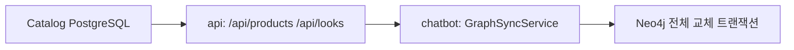
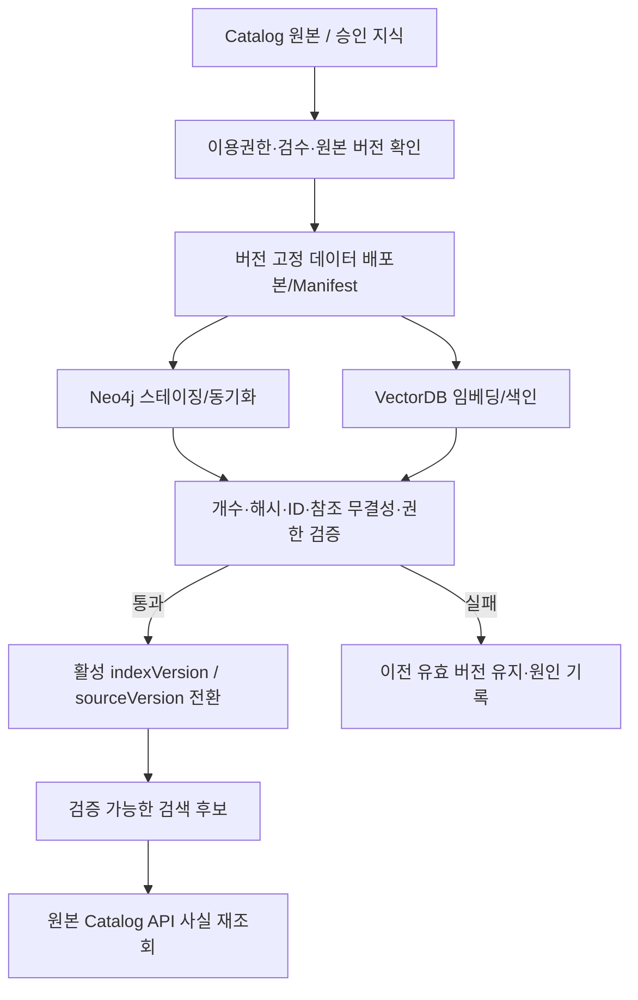

# VISHUE AI — 2-5 옵션 복합 검색·근거 검증·색인 동기화 계약

> 상태: 아래 본문은 PR #241의 설계 기준이며, G4 최소 구현 현황은 마지막 보충 절을 우선한다. **PROPOSED — 정적 코드 대조를 바탕으로 작성한 개발 설계안 v0.1, 2026-11-15**. 새 엔드포인트/마이그레이션·인덱스·테스트를 구현하지 않았다.
> 기준: `develop d1cf4868f74d2ff6db188bf2c7646146f3ec72ad`. [Tool 입출력](06-tool-implementation-contracts.md), [언어 정책](07-ko-first-language-and-evaluation.md), [ADR-0002](../adr/0002-postgres-source-neo4j-copy.md), [AIHub 권리](../AIHUB_DATA_RIGHTS.md) 참조.

## 1. 실제 코드에 있는 것과 아직 없는 것

| 코드/데이터 | 정적 확인 사실 | 목표 계약과 차이 |
| --- | --- | --- |
| `GET /api/products?q&category&ids&concerns` | `backend/api/app/routers/catalog.py`, `ProductsResponse.products: list[Product]`. 검색은 `catalog_repository.py`의 `search_text` 문자열 포함 / 카테고리/ID/태그 | 옵션별 가격·재고·실제 성분의 **복합 조건 검색 API가 아님** |
| 상품 상세/셰이드 | `Product.priceKRW`, `Product.shades[].id/name/hex/measureMethod/colorSource` | `priceKRW`는 카탈로그 참고 필드; 현재 수집 가격의 보증/실시간 재고 정보 아님 |
| 옵션 원본 | `RawOyProductOptionRow.option_id,goods_no,option_no,shade_code/name,collected_at,delisted_at` | 외부 옵션 ID와 서비스 `productId/shadeId` 관계를 검증해야 함. 비색상·세트 제품도 존재 |
| 가격 이력 | `RawOyPriceSnapshotRow.option_id,sale_price,list_price,max_benefit_price,is_latest,is_sold_out,collected_at` | 수집 시점의 관측 데이터. `is_latest`는 **DB 관측 최신 행**이지 상점의 실시간 상태 아님 |
| 성분 GET | `GET /api/products/{id}/ingredients?shadeId&optionId&ingredientName&operator` → `IngredientReadResult` | 상품/호수/옵션 귀속·coverage·review·sourceVersion 검증, 특히 부재 판정은 강한 조건 필요 |
| Graph sync | `GraphSyncService.sync()`가 API로 모든 상품·룩 조회 → Neo4j `replace_catalog()`에서 기존 그래프 전체 지우고 재생성 | 그래프 전체 교체 코드 존재, **sourceVersion/graphGeneration·권리·검수·증분·원본 해시 검증 배포 계약 미확인** |
| 그래프 Ingredients | `graph_sync_service.py:product_row()`의 `key_ingredients`가 `(:Ingredient)` 노드로 전달 | **핵심 성분은 완전한 검수 전성분이 아니다.** 그래프의 `CONTAINS` 관계를 완전한 포함·부재 판정의 근거로 쓰면 안 됨 |
| VectorDB | 현재 Graph/Product 문자열 검색 및 일부 데이터 설계 문서 | 승인 자료의 임베딩 색인·전파·철회·품질 검증 계약 **미구현/미확인** |

## 2. 옵션별 복합 검색: 개발 대안

### A. 기존 GET 결과를 챗봇이 순차 조회·후처리

**가능:** `GET /api/products`로 후보를 찾고, 후보별 성분 GET을 호출해 필터·근거를 구성한다.

장점: 초기 API 변경이 적다. 단점: 서버가 모르는 전체 옵션 검색 범위·가격 스냅샷/재고 조건을 충족시키기 어렵고, 후보가 앞에서 잘리면 정확한 교집합 검색이 되지 않는다. 검색량과 타임아웃에 따른 **부분 결과**를 반드시 드러내야 한다.

### B. Catalog 소유 읽기 전용 복합 옵션 검색 API (추천 후보)

**PROPOSED:** `POST /api/catalog/options/search` (**조회 의미의 POST**; 실제 경로는 미합의). POST 선택 이유는 다수의 포함/제외 성분·옵션 조건·후보 ID/정렬 조건을 구조화 JSON으로 전달하고 GET 쿼리의 길이·표현 한계를 피하기 위해서다. 인증·캐시·레이트 리밋·성능 측정에 관한 기존 정책은 별도 적용.

```json
{
  "schemaVersion": "v1",
  "queryLanguage": "ko",
  "query": "촉촉한 데일리 립",
  "category": "lip",
  "maxPriceKRW": 20000,
  "priceKind": "collected_sale",
  "conditions": [
    {"kind": "ingredient", "name": "향료", "operator": "excludes"}
  ],
  "sort": "reference_price_ascending",
  "pageSize": 20,
  "pageToken": null
}
```

이 요청 JSON은 **실제 API가 아니라 설계용 예시**다. `queryLanguage`는 질문 검색 언어이지 상품·호수·권한의 식별자에 포함하지 않는다. `priceKind`와 `sort`는 가능한 데이터와 검증 수준을 일치시켜야 하며, 수집 판매가 오름차순/카탈로그 참조가 오름차순을 혼동하지 않는다. `pageSize` 상한과 타임아웃·페이지 예산은 실측 후 확정한다.

### 최소 반환 계약 (PROPOSED)

```json
{
  "schemaVersion": "v1",
  "status": "PARTIAL",
  "queryLanguage": "ko",
  "checkedScope": {
    "candidateOptions": 20,
    "checkedOptions": 18,
    "exhaustive": false,
    "stoppedReason": "SOURCE_UNAVAILABLE"
  },
  "items": [
    {
      "productId": "serving-product-id",
      "shadeId": "serving-shade-id",
      "optionId": "source-option-id",
      "identityStatus": "verified",
      "referencePrice": {
        "amountKRW": 18000,
        "priceKind": "collected_sale",
        "observedAt": "2026-11-10T12:00:00+09:00",
        "currentPriceVerified": false
      },
      "stockStatus": "unknown",
      "ingredientChecks": [
        {
          "ingredientName": "향료",
          "operator": "excludes",
          "verdict": "UNKNOWN",
          "reason": "full_ingredient_evidence_unavailable",
          "evidenceId": null,
          "sourceVersion": null
        }
      ]
    }
  ],
  "nextPageToken": null
}
```

값은 **스키마 사례이며 실제 조회·가격·판매 상태가 아니다**. `status=PARTIAL`은 요청 조건이 모두 충족됐다는 뜻이 아니다. 성분이 UNKNOWN이면 제외 조건 충족/미충족으로 단정하지 않는다. 서버가 확정적인 예산 위반이나 제외 성분 존재를 확인했다면 다른 조회가 실패하더라도 그 확정 위반을 덮어써서는 안 된다.

### 권장 후보 선정 규칙

1. 올리브영 등 외부 옵션 ID `optionId`를 서비스 `productId/shadeId`와 **검증된 매핑 관계**로 연결한다. 미매핑·중복 매핑·색상/세트 옵션을 구분한다.
2. 예산은 원화 숫자뿐 아니라 `priceKind`, 기준 시각, 부가 혜택 적용 여부를 함께 고려한다. **현재가 요청은 현재가 검증이 없으면 미확인**.
3. 성분 포함/제외는 각 옵션에 대한 검수 결과와 `verdict`를 필수 조건의 상태로 누적한다. `ERROR`와 `UNKNOWN`을 결과에서 지우지 않는다.
4. 반영된 조건·미확인·부분 검색 범위·기준 시각을 반환해 사용자가 다시 검색·조건 수정할 수 있게 한다.
5. `resultSetId` 및 옵션 ID·정렬 순서 버전을 저장해 "두 번째" 참조를 안전하게 처리하고, 후속 상담에서 현재 Catalog를 재조회한다.

**데이터 변경 범위:** 기존 #228 및 #231은 Closed·미병합이므로 최종 API/마이그레이션을 그대로 적용하지 않는다. 실제 속성·호수·가격·성분 DB 열과 운영 조회 경로는 API·데이터 담당자의 별도 확인 및 격리 DB 실행으로 검증해야 한다.

## 3. 근거 검증 파이프라인: 상품·성분·지식의 차이

### 옵션별 사실 판정

- 검색 전: 신원/권한/허용 카탈로그 범위·옵션 ID의 소유 관계 검증.
- 카탈로그 원본: 제품·호수/외부 option ID 매핑을 검증하고 옵션별 수집 기록과 `sourceVersion`을 확보.
- 성분 검증: `IngredientReadResult`의 `status`, `reviewStatus`, `mappingStatus`, `ingredientCoverage`, `normalizationStatus`, `evidenceId`, `sourceVersion`, `synthetic`, `issues`와 `conditions[].verdict`를 함께 확인.
- 결과: **확정 포함/부재, 조건 위반, UNKNOWN, ERROR를 독립적으로 표시**. 상품 정보를 검증하지 못하면 미확인으로 반환하며 사용자에게 거짓 추천 사실을 표시하지 않는다.

**중요:** `IngredientDecision.verdict`는 operator-relative라 `excludes + MATCH`가 '성분 부재 조건 성립'이고 `excludes + NOT_MATCH`가 '제외 성분 존재 확인'이다. `includes`의 경우 반대로 해석한다. `keyIngredients` 목록에 단어가 없다는 이유로 향료 부재를 확정할 수 없다.

### 지식과 출처의 서비스 적격성

별도 권한 조건으로 `rights_status=service_approved`, 문서/QA 검수 승인, `claim_review.support_status`의 허용 판정, 배포본/문서 발행 상태와 사용 목적을 검증한다. 자료 권리·검수·발행은 서로 다른 상태 축이다.

- 수집됨/parsed/source_matched는 승인 자료가 아님.
- 철회·기간 만료·권리 축소 시 벡터·Neo4j·캐시·요약의 재사용 차단이 필요.
- AIHub 71961의 현재 서비스 RAG/외부 모델 원문 제공은 **[기존 이용권한 문서](../AIHUB_DATA_RIGHTS.md)에 따라 보류**. 승인되지 않은 실제 QA 원문을 여기서 인용하지 않는다.
- LLM에 전달하기 전에 신뢰할 수 없는 검색 텍스트가 시스템 명령·권한을 변경하지 않도록 분리한다.

## 4. PostgreSQL → Neo4j / VectorDB 동기화

### 현재 경로 (EXISTING-CODE)



현행 `GraphSyncService.sync`는 `fetch_products()`, `fetch_looks()`를 호출해 `replace_catalog`를 수행한다. `GraphRepository.replace_catalog`는 Neo4j 트랜잭션 안에서 기존 Product/Ingredient/Look/Tag/Shade 노드를 지우고 목록을 다시 생성한다. **트랜잭션 단위 원자성은 있어도 소스 집합이 동일 시점의 스냅샷인지, 버전·권리·검수 상태가 일치하는지는 별도의 보증이 확인되지 않는다.**

### 목표 경로 (PROPOSED)



**필수 계약:**

| 이름 | 내용 | 미충족 시 |
| --- | --- | --- |
| `sourceVersion` | 정본에서 발행·검수한 데이터의 불변 버전 또는 스냅샷 해시 | 후보를 확정 근거로 사용 금지 |
| `graphGeneration` / `indexVersion` | 그래프·벡터 색인의 생성 버전/활성 버전 | 오래된 색인의 버전·권리 상태 재조회 |
| `sourceManifest` | 수집 대상 집합 크기, 자료별 소유권·권리·검수·삭제/철회, 원본 해시·시각 | 불완전/승인 전 자료는 발행 금지 |
| `indexBuildStatus` | 준비→작성→검증→활성화→구버전 정리 상태 | 장애 발생 시 활성 버전 보존 |
| `revocationEpoch` | 권리 철회·검수 취소·기밀 제거를 검색에 즉시 적용하기 위한 버전 | 오래된 캐시·벡터/관계 결과 차단 |
| `freshnessLag` | 원본 발행→파생 색인 반영 지연 | 임계치 초과 시 후보 검색 제한·안내 |
| `syncRunId` | 동기화 시도 ID/시작·완료·오류 및 수행 주체 | 반복 실행·장애 복구 판단 불가 |

**권리 처리에서 중요:** 게시 철회나 접근 차단은 긴 배치 재색인이 끝날 때까지 기다리면 안 된다. 검색·응답 시 원본 승인·권리 상태를 재검사할 수 있는 별도 권한 게이트가 필요하다. 자료/사용자 계정 삭제의 파생 인덱스 제거는 실패 시 재시도 가능한 작업으로 관리한다.

**동기화 기술 대안:** ① 기존 전체 교체 + 스냅샷/Manifest·활성 인덱스 전환을 보완(구현 부담 낮을 수 있음) ② sourceVersion 기반 변경분 동기화(증분 갱신·철회 추적 쉬움, 스키마/운영 복잡). 실제 데이터 크기와 검색 지연·재색인 시간을 측정한 뒤 선택. **중국어·영어·일본어 확장 시** 동일 원본 ID와 권리 정책을 공유하고 `contentLanguage`, `embeddingModelVersion` 등의 색인 메타데이터만 추가되도록 설계.

## 5. 한국어 우선 검색/임베딩과 3단계 인계

현재는 한국어 상품명·호수·성분 표준명·메이크업 기법 검색을 우선한다. **신뢰 가능한 결과를 구성할 때 정확 매칭 + 한글 표기·동의어 처리 + 관계 검색 + 허용 자료의 의미 검색**을 목적에 따라 결합하고, 상품·옵션·전성분의 확정 판정은 API에서 한다.

- `queryLanguage='ko'`는 1차 기본값이지만 ID·상태·근거·Tool 필드는 언어 중립.
- 텍스트 정규화/동의어 사전을 적용해도 원문·공식 한글/영문 표기와 호수 문자열을 덮어쓰지 않는다.
- 한국어 기반 임베딩 모델 후보/청크 분할/재순위화/VectorDB 엔진은 3단계에서 원문 사용권한과 측정 결과를 확인해 확정한다.
- `en/ja/zh`는 후속 언어별 콘텐츠·동의어·번역 대조·다국어 임베딩/검색 검증으로 확장한다.

## 6. 최소 검증 시나리오와 완료 조건 (미실행)

| ID | 검증 입력·상황 | 필수 결과 |
| --- | --- | --- |
| OPT-01 | 판매가가 없는 옵션과 예산 조건 | 현재가/재고 조건 충족으로 승격하지 않음 |
| OPT-02 | 두 호수의 서로 다른 전성분/가격 | 옵션별 결과·sourceVersion 섞이지 않음 |
| OPT-03 | excluded ingredient 있음 + 다른 자료 조회 실패 | 확정 위반 유지, 오류는 별도 보고 |
| OPT-04 | excluded ingredient 없음이나 full 증거 불충분 | `UNKNOWN`, 무향료 보증하지 않음 |
| OPT-05 | 복합 검색 2차 페이지 실패 | `checkedScope.exhaustive=false` 및 실제 검사 개수 공개 |
| OPT-06 | 동일 질의 요청 재전송 | 같은 요청·후속 결과 ID/순서 보존 또는 명시적 재조회 |
| IDX-01 | 그래프/벡터 생성 중 실패 | 이전 활성 버전 유지, 새 미검증 색인 미노출 |
| IDX-02 | 정본 권리 철회 뒤 오래된 색인 검색 | 검색 단계 또는 최종 검증 단계에서 노출·사용 차단 |
| IDX-03 | keyIngredients 그래프만 있음 | **전성분 부재** 근거로 사용 금지 |
| IDX-04 | 그래프 상품이 Catalog에 없는 경우 | 실상품 카드 반환 금지 |
| IDX-05 | ko 질의·표준명·띄어쓰기 변형 | recall/정확도 측정, 모델/색인 버전 재현 |
| IDX-06 | 향후 en/ja/zh 검색 자료 추가 | 동일 상품/근거 ID 유지, 언어별 색인/권리 범위 독립 검사 |

테스트는 **설계 계획**이며 실행 성공·Gold 승인·실제 데이터 적재 근거가 아니다. 평가 정량 임계치는 4단계에서 사용자 결정.

## 7. 지금 확정하지 않은 선택

| ID | 대안 | 권장 판단 방식 |
| --- | --- | --- |
| OPEN-T01 | 기존 GET 후처리(A) / 읽기용 복합 옵션 POST(B) | B 우선 검토. 실제 수집 데이터/조건 누락/페이지·속도·API 소유권 확인 후 확정 |
| OPEN-SYNC-01 | Neo4j 전체 교체 보완 / 증분 동기화 | 데이터 크기·권리 철회·고가용성·재빌드 관측으로 선택 |
| OPEN-VECTOR-01 | `pgvector` / 독립 VectorDB | 한국어 검색 품질·비용·동기화·자료 권리 조건 비교, 3단계 |
| OPEN-EVIDENCE-01 | 기존 Evidence 스키마 사용 / 공통 Envelope 추가 | 기존 API 무파괴 어댑터 우선 검토 |
| OPEN-RIGHTS-01 | 권리·발행 정본 조회 위치 및 revocationEpoch API | API·데이터 담당 검수, 팀 ADR 필요 |
| OPEN-LANG-01 | 1차 `ko` 확정, `en/ja/zh` 후속 공식 AI·STT/TTS 제공 시점 미결정 | [한국어 우선 정책](07-ko-first-language-and-evaluation.md), 2-6·4단계 |

**이 문서는 2-5의 설계 범위를 보강했으며 아직 확정된 구현 지시서가 아니다.** 사용자의 명시적 결정 없이 DB 엔진·기술 대안·성능 임계치를 확정 상태로 표시하지 않는다.

## 변경 기록

- **2026-11-15:** 코드의 `GraphSyncService.replace_catalog`, 핵심 성분 `keyIngredients` 관계, 수집가·현재가 차이를 근거로 옵션 복합 검색·근거·색인 동기화 상세 계약 추가. 한국어 우선 결정 반영, 기존 아키텍처·ADR과 2-5 Tool 계약 유지.

## 8. 2-5 최종 가격·후보 구분 계약 (2026-11-15)

> **REVIEW-CONCLUSION / 설계 검토 종료**: 과거 가격을 현재가로 승격하지 않고, 상품별 필수 조건의 개별 판정을 보존하는 계약으로 2-5의 가격 의미를 명확히 한다. API 구현이나 실시간 가격 검증을 수행한 것은 아니다.

### 8-1. 가격 판정의 범위(필수 불변조건)

1. 각 가격 조건에 `requestedBasis`, `maxPriceKRW`, `currency`, 대상 `productId/optionId`, 요청 시각을 기록한다. 자유로운 쇼핑 질의 "2만원 이하"는 원칙적으로 **현재 확인 가능한 구매 제안의 가격**을 원하는 것으로 해석한다. 사용자가 참조가·과거 수집시점을 명시하면 그 명시 범위가 우선한다.
2. 가격 근거에 `observedBasis`(카탈로그 참고가 / 수집 시점 판매가 / 조회 시점 판매처 제안가 / 결제 확인가), `amountKRW`, `observedAt`, `sourceRef`, `sourceVersion` 또는 응답 식별자, 검증 시각 `checkedAt`을 넣는다. **검증 시각과 원본 관측 시각은 서로 다른 값**이다.
3. `MATCH`는 **(a) 요청한 가격 기준과 근거 유형이 일치하고 (b) 원본/옵션 귀속이 확인되며 (c) 요구되는 관측 시각·갱신 기준을 충족하고 (d) 요청한 비교식이 성립한 경우에만** 반환한다. 기준 불일치·시점 만료·결제/재고 미검증 시 `UNKNOWN`을 유지한다. 가격 근거를 정상 조회하지 못했다면 `ERROR`를 분리한다.
4. 수집된 `sale_price`의 `is_latest=true`는 **관측 DB에서 가장 최근 기록**일 뿐, 현재 판매처 가격 또는 결제 시점 가격 증명이 아니다. 조회 시점 제안가도 결제 성공 가격을 보장하지 않는다. 검증된 시점·범위를 명시한다.
5. `NOT_MATCH` 역시 **동일한 요청 가격 기준과 유효한 근거**에서 상한 초과 등이 확정될 때만 사용한다. 과거 참고 가격이 높았다는 이유만으로 현재 2만원 이하가 불가능하다고 단정하지 않는다.
6. `sourceVersion`·관측 시각·가격 유형·상품/외부 옵션 식별자가 누락됐거나 서로 맞지 않으면 최신 판매 조건을 확정하지 않는다. 어떤 최대 경과 시간에서 '조회 시점 가격'으로 인정할지는 팀/운영 기준과 실제 제공 API를 확인해 별도 확정한다(임의 상수 금지).

| 사용자의 가격 조건 | 실제 근거 | 가격 조건 verdict | 표시 |
| --- | --- | --- | --- |
| "지금 2만원 이하" | 11월 10일 수집가 18,000원 | `UNKNOWN` | 과거 관측가 18,000원/관측 시각, 현재가는 미확인 |
| "11월 10일 수집가 2만원 이하" | 같은 옵션, 동일 시점의 검증된 수집가 18,000원 | `MATCH` | 지정된 과거 수집 조건만 충족 |
| "지금 2만원 이하" | 현재 정책상 유효한 판매처 조회 시점 18,000원 | `MATCH` 가능 | **조회 시점 제안가**만 충족, 실제 결제·재고 보장 아님 |
| "지금 2만원 이하" | 현재가 조회 API 실패 | `ERROR` | 참고 가격을 현재가로 대체하지 않음 |
| "참고가 2만원 이하" | 검증된 Catalog 참고가 22,000원 | `NOT_MATCH` | 요청한 **참고가 기준** 위반 확인 |

위 금액과 시점은 판정 예시이지 실제 상품 조회 결과가 아니다.

### 8-2. 복합 조건의 상품 최종 판정

각 조건은 `conditionId`와 `requestedPredicate`, `verdict`, `evidenceRef`, `observedAt`, `checkedAt`, `limitations`을 보존한다. 성분 Tool의 `MATCH`는 **operator-relative**이므로 `excludes + MATCH`는 검증된 부재 조건 충족이며 `excludes + NOT_MATCH`는 제외 조건 위반이다.

| 그룹 | 판정 불변조건 | 사용자 설명 |
| --- | --- | --- |
| `ELIGIBLE` | 해당 요청의 **모든 필수 조건이 유효한 `MATCH`**, 실패·미확인 필수조건 0개 | 조건 충족이 확인된 상품. 시점·가격 기준 표시 |
| `REFERENCE_ONLY` | **실제 상품·옵션 존재와 귀속 확인 필수**, 확정 위반은 없으나 필수 조건 일부가 `UNKNOWN` 또는 `ERROR` | 근거 부족과 조회 실패를 구별 표시하는 **참고 후보**, 무향료/현재가 충족 추천 금지. 상품·옵션 식별 자체가 불명확하면 카드 그룹에 포함 금지 |
| `EXCLUDED` | **하나 이상 필수 조건이 검증된 `NOT_MATCH`** | 요청 필수 조건을 위반해 추천에서 제외. 다른 조건의 ERROR로 위반을 지우지 않음 |

- `ERROR`는 결과 그룹과 별개로 오류 정보를 보존하며, 검색 전체가 실패한 경우 빈 '조건 충족' 목록 대신 실패·재시도 안내를 반환한다.
- `ELIGIBLE` 결과가 없어도 `REFERENCE_ONLY`를 구분하여 보여줄 수 있으나 "조건에 맞는 추천"이라고 표기하지 않는다. 미확인 향료·피부 위험·유효기간·권한을 안전하다고 단정하지 않는다.
- `checkedScope.exhaustive=false`인 경우 전체 검색 공간에서 일치 항목이 없다고 단정하지 않는다. 각 결과 그룹은 동일한 원본·요청 스냅샷을 참조해야 한다.
- 같은 `resultSetId`와 버전·순서를 통해 후속 "두 번째" 지시를 해석하고, 실제 후속 상담에서는 원본 재검증을 수행한다.

### 8-3. 새 API 구현 여부와 무관한 보장 조건

Catalog가 복합 검색을 **소유하고 검증 경계를 제공**해야 한다. 구현 대안은 (A) 기존 GET + 제한된 후보 후처리, (B) Catalog 소유 읽기 전용 옵션 복합 검색 API이다. **B가 정확한 교집합/범위 표현에 유리하므로 추천하지만, 신설 endpoint 경로/요청 수 제한/실제 DB 모델은 승인 전**이다. A를 임시로 사용하더라도 `partial`·`checkedScope`·`REFERENCE_ONLY`를 유지하고 이를 전체 검증 결과처럼 표현하지 않는다.


## 9. 3단계 데이터·RAG·스타일 최종 논리 설계 (2026-11-15)

**관측 출처 분리:** (a) GitHub `develop d1cf4868` 카탈로그·코드 및 후보 파일, (b) **연결된 단일 Supabase PostgreSQL** (`alembic_version=0022`) SQL 스냅샷, (c) **데이터 담당 국내 로컬 PostgreSQL** AIHub 적재 보고. (b)의 숫자를 팀원 로컬 DB, 공용 dev DB 또는 운영 API/DB 수치로 추정하지 않는다. 이번 문서에서는 구현/실시간 API·LLM·앱/기기 테스트를 하지 않았다.

### 9-1. 데이터 관측과 서비스 적격성

| 데이터 | 연결 Supabase 스냅샷 관측 | 의미·추가 확인 |
| --- | ---: | --- |
| 서빙 상품/셰이드 | 7,845 / 10,561 | G1 상품 기반. 실 HTTP·앱 검증 별도 |
| 원본 상품/옵션 | 8,215 / 21,951 | Product↔Option↔Shade 검증 연결 필요 |
| 옵션 성분 연결 행/성분 행이 있는 옵션 | 715,482 / 18,980 | 검수된 전성분 건수 아님; 전체 원본 옵션 21,951 |
| 원본 상품공지에서 전성분 원문 있는 상품 | 8,196 | 상품 원문≠검수 완료한 옵션별 완전 전성분 |
| Olive Young↔MFDS 성분명 매핑 | 4,801 | 검수자·검수일 있는 매핑 151. 신원 매핑≠완전 원본 검수 |
| 비어 있지 않은 서빙 `key_ingredients` | 0 | 빈 주요 성분 목록으로 부재 판정 금지 |
| 가격 스냅샷 | 21,951 | 최근 수집 2026-11-02 09:46:05. `is_latest`는 실시간 판매가 아님 |
| 발행 `makeup_looks`/AR 룩 설정 | 3 / 9 | 영상 기반 검수 레시피와 구별 |
| `looks`/`look_products`/`yt_catalog_product_link` | 0 / 0 / 0 | 검수된 실제 영상 사용 제품 연결 아직 없음 |
| `aihub_qa_case`/`aihub_knowledge_document`/`aihub_claim_review` | 0 / 0 / 0 | 데이터 담당 **로컬 보고: QA 9,031/고유 문서 3,108**. 환경 혼동 금지 |
| 벡터·키워드 검색 | `vector` 확장 없음, `pg_trgm` 설치 | 해당 연결 DB 스냅샷. VectorDB 기술 미확정 |

별도 GitHub 레시피 후보 24개/168단계, 영상 후보 231개, 제품 연결 검토 1,617행, 스타일 영상 메타데이터 등은 **후보**. 원본 추출/공개·제품 연결/단계 검수와 서비스 발행은 분리한다.

### 9-2. 성분 판정·G1/G4 경계

| operator | MATCH: **질문 조건 충족** | NOT_MATCH: **질문 조건 불충족** |
| --- | --- | --- |
| `includes` | 요청 성분 존재 검증 | 검수한 **완전 목록**에서 성분 부재 |
| `excludes` | 검수한 **완전 목록**에서 성분 부재 | 제외 요청 성분 존재 검증 |

- `UNKNOWN`: 옵션 귀속·목록 완전성·성분 신원/동의어·출처 버전·권리/검수 불충분. `ERROR`: 조회/검증 자체 실패. `keyIngredients` 빈 목록, raw 존재, 부분 검색으로 '무향료'·부재 확정 금지.
- **G1:** 실제 LangGraph 일반 상담→Catalog Tool 호출→상품/호수 ID 검증→가격·제형·성분 **확인 조건과 미확인 조건을 구분**해 자연스럽게 앱 카드 응답. 실판매가/성분을 근거 없이 단정하지 않음. G4 복합 교집합을 G1의 필수 완료조건으로 끌어오지 않음.
- **G4:** 검증된 원본 Option/상품/셰이드 귀속, 예산·가격 basis/`observedAt`·제형·성분 교집합, `checkedScope/exhaustive` 명시. 필수 조건 중 하나라도 확정 `NOT_MATCH`이면 `EXCLUDED`, 모두 `MATCH`면 `ELIGIBLE`, 나머지 미확인/부분/오류는 별도로 `REFERENCE_ONLY` 또는 시스템 오류 표기. 현재가를 지난 참고가로 대체 금지.

### 9-3. AIHub 71961 국내 로컬 RAG 개발 경로 (D3-01 변경)

**목표:** 71961 데이터를 RAG 설계에서 제외하지 않고 실제 개발 계획에 포함. **권리 게이트:** 본인 합법 접근/국내 로컬/데이터셋 개별 이용조건·문서별 `Purpose/Cautions`, 원문/발췌 외부 LLM 전송, 2차 저작물, 공용 서비스 제공을 별도로 검토. 기존 [원본 이용권한 결정](../AIHUB_DATA_RIGHTS.md)과 [검수 계약](../AIHUB_REVIEW_CONTRACT.md)을 변경 승인 없이 무효화하지 않는다.

1. **구조 실사:** QA 9,031·고유 문서 3,108·출처 참조 9,181의 로컬 DB/원본 해시·`Purpose/Cautions`·문서 출처 구조 분석(원문 공유 금지).
2. **근거 연결/검수:** QA→출처 문서→주장 연결 및 `direct/indirect/insufficient/contradicting`, 출처·검수자·일시·권리/발행 상태 분리. 자동 링크 일치가 주장 승인 아님.
3. **청킹:** 처리 권한이 확인된 텍스트에 대해 문서 제목·절·주장·문단/기법 단위 청크, `chunkId/documentId/claimId/sourceSpan/contentHash/sourceVersion/contentLanguage/reviewStatus/rightsStatus/publicationStatus`. QA/문서 이중 임베딩으로 중복 검색 부풀림 방지.
4. **한국어 의미 검색:** 허용 처리 자료로 정확 키워드/형태소·동의어 + 임베딩·재순위화 결합. `embeddingModelVersion/indexVersion/sourceVersion` 고정; pgvector 기준선, Neo4j Vector/Qdrant 대안 비교. 실제 모델·엔진 확정은 평가 후.
5. **응답:** 권리·발행·범위 Gate→검색→근거 본문/주장 일치 재검증→답변. 권리 미승인 원문·발췌를 외부 LLM에 보내지 않음; 로컬 모델도 개별 목적에 맞는 허용 처리만. 별도 라이선스 확인 자료를 병행.
6. **RAG 평가:** Recall@k/MRR, 근거 적중률/claim 지지 여부·거짓 근거/오답·거절·철회. 데이터 담당 기존 보고의 원본 학습/검증에 **대상자 339명 중복, 검증 QA 403/1,000 중복 대상자**가 있으므로 대상자 단위 그룹 분리 + 동일/유사 출처 문서/claim 해시 중복 방지. 같은 QA를 인덱스에 넣고 정답을 검색하는 누출 시험 금지.
7. **발행/철회:** 출처 버전·검수/권리 확인→청크/그래프/벡터 인덱스 생성·정합성 검증→활성 버전 전환. 철회는 재색인 전에도 조회·답변 시 즉시 차단하고 파생 Vector/Graph/Redis 캐시·요약까지 정리. 공용 서비스 발행은 별도 승인/환경·실 E2E.

**개발이 멈추지 않도록:** 원본 처리 권한 미확정 구간은 합성·별도 권리 확인 자료로 파이프라인·인터페이스·검색 평가기를 구현하면서 71961 로컬 원본 구조/근거 검수를 병행한다. '수집 완료'·'검수 완료'·'서비스 사용 승인'·'실제 검색·응답 성공' 네 상태는 독립 증빙이다.

### 9-4. 정본·관계·벡터·스타일·기억 데이터 모델

| 저장 계층 | 담당 데이터·필드(제안) | 규칙 |
| --- | --- | --- |
| Catalog PostgreSQL/API | Product/Shade/RawOption/가격관측/성분/Look, 옵션 매핑·검수·출처·발행 | API 소유 정본; 챗봇의 PostgreSQL 직독 금지 |
| Neo4j | 승인된 Product↔Shade, Look↔Technique↔Product 등 관계 + `graphGeneration` | 검증된 파생 인덱스, 조회 후 정본 재확인 |
| VectorDB | 승인/허용 문서·청크·레시피·기법 임베딩, `embeddingModelVersion/indexVersion` | 권리·출처·재현성 필터, 회수·삭제 가능 |
| Redis | 캐시·요청 중복·단기 세션 | 장기 기억/성분 사실의 정본 아님 |
| Chatbot 전용 Checkpointer/Store | `VishueState`/thread/checkpoint, 동의한 장기 프로필·취향 | G2/G7 동일 State, 소유권·동의·삭제 계약 별도 |

레시피의 최소 개념 계약은 `recipeId/lookId/kind/videoId/sourceSpan/stepOrder/zone/technique/productId/shadeId/reviewStatus/publicationStatus/reviewer/evidenceId`. 일반 메이크업 팁·영상 메타 추정·검수된 영상 레시피를 구분하고 실제 영상에서 확인하지 않은 제품/호수·화장법을 확정하지 않는다.

### 9-5. G1~G9 데이터·API 착수 조건(권장 순서)

| 작업 | 착수/완료 전 준비해야 할 실제 데이터·연동 |
| --- | --- |
| G1 | 7,845 상품/10,561 셰이드 기준 Catalog 스냅샷 후보, 실제 HTTP·LangGraph Catalog Tool·LLM/앱·AR 회귀 확인 |
| G2 | G1 병합 + 공통 VishueState/결과 집합·선택/요청 ID·Redis 단기 상태 |
| G3 | 검수 원본 옵션 성분·완전성·동의어/근거 버전·발행과 오류 구분 |
| G4 | 옵션 교집합/가격 basis/관측시각·검색 범위, 세 후보 그룹, Catalog 담당 Tool/API |
| **G5** | **AIHub 71961 로컬 RAG 적극 개발**, 문서·주장 검수, 권리 허용 청킹/한국어 임베딩/검색·평가; 서비스 승인 분리 |
| G6 | 룩·영상과 검수 레시피 단계·영상 근거·상품/옵션 승인 연결 |
| **G7** | G2 공통 State + Checkpointer/Memory Store·동의·삭제·복구 |
| **G8** | 필요한 G1~G7 Tool·Agent 의존/부분 성공·재계획·권한 |
| G9a~c | 피부/미디어/AR 담당 서비스·동의/Handoff·ACK·공동 E2E. AR 내부 LLM·STT·TTS는 타 담당 |

**3단계 종료 범위:** 문서상 논리 설계 검토(REVIEW-CONCLUSION). 실제 구현/승인/검색 정량 측정/팀 검수/운영 배포·실기기 검증 **미완료**. 다음은 4-1 환경·데이터 평가 계약을 먼저 검토.


## G4 최소 구현 보충 (2026-11-17, 로컬 작업본)

사용자가 승인한 35개 파일 범위의 구현이다. PR #241의 확정 불변조건은 계속 적용하며, 다음은 최초 구현 시점의 기록이다. 아래 종료 감사 보완 절이 이후 변경 사항을 설명한다. G3 부모는 `feat/vishue-ingredient-context` / `d359da39b5aa6dd10fcfb18ce7cfe559f31519e3`이다. 아직 커밋·푸시·G4 PR 생성·실연동 승인이 아니다.

- Catalog 소유 `POST /api/catalog/options/search`: 공개 Catalog와 동일한 접근 경계, 조회 전용, `Cache-Control: no-store`, 별도 `option-search` rate-limit bucket. 챗봇은 HTTP로만 호출한다.
- 요청: `query`(브랜드/상품명), `category`, 선택적 `productIds`/`optionScope`, `texture=matte`, `maxPriceKRW`, `priceBasis`, `ingredientConditions[{ingredientName,operator}]`, `fragranceFree`, `moisturizing`, `unsupportedConditions`. 추가 필드는 거부한다. 정렬/페이지 토큰/재고/임의 제형 지원은 없다.
- 가격 기준: 기본 `current_offer`는 현재가 검증 공급자가 없으므로 UNKNOWN. `catalog_reference`는 상품 참고가, `collected_snapshot`은 옵션 수집가로 명시 요청한 경우만 비교한다. `observedAt`의 시간대가 없거나 미래이면 수집가도 미확인이다. `is_latest`를 현재가로 승격하지 않는다. 금액·관측/확인 시각·sourceRef/sourceVersion을 분리한다.
- 응답 `schemaVersion=1`, `status=SUCCESS|PARTIAL|ERROR`, `items`, `products`, `checkedScope`, `excludedCount`, `omittedCount`. 본문의 `schemaVersion="v1"`, `priceKind`, `referencePrice`, `ingredientChecks`, 페이지 JSON은 실제 스키마가 아니다. 구현 스키마는 API `schemas/option_search.py` 및 챗봇 `schemas/catalog.py`에 있다.
- 각 옵션은 `(productId, shadeId, optionId)`로 귀속을 확인한다. 무호수 상품의 `shadeId=null`도 실재 검증 옵션일 수 있다. 기존 매핑/원본 버전/활성 상태/상품 fingerprint 검증을 통과하지 못하면 카드에서 제외하고 unidentified 수에 포함한다. 생산 환경의 synthetic 옵션은 카드에서 제외한다.
- 조건별 `MATCH|NOT_MATCH|UNKNOWN|ERROR`와 reason/evidenceId/sourceVersion을 반환한다. 모든 조건 MATCH는 `ELIGIBLE`, 하나라도 확정 NOT_MATCH이면 `EXCLUDED`, 그 밖은 `REFERENCE_ONLY`. 뒤의 오류/타임아웃이 앞의 확정 위반을 지우지 않는다. 모든 실제 조건 조회가 ERROR이면 전체 ERROR로 처리한다.
- 포함·부재는 기존 `evaluate_ingredient`를 그대로 사용한다. 검수된 일부 목록의 포함 사실은 확인할 수 있지만, 부재는 full coverage·정규화·연속 목록·정본 성분 신원/버전·출처/검수 근거가 필요하다. UNKNOWN은 부재/안전/무향료 확인이 아니다. 무향료·보습 주장과 기타 미지원 조건은 UNKNOWN 또는 명시적 재질문이다.
- 상품 순번 최대 6개를 유지하며 같은 상품의 여러 옵션 판정을 카드 안에서 표시한다. 상품 참고가만으로 옵션 조건을 앱이 재판정하지 않는다. 미확인/오류·합성 근거·수집가 시점·선택한 호수의 미확인 여부를 구분한다. 제외 조건과 검사 범위/생략 수는 답변에 표시한다.

### 비용 제한과 정확한 검색 범위

초기 안전 상한은 후보 상품 42개, 작업 단위 42개, 요청 시간 15초, IP당 분당 20회다. 작업 단위는 옵션 귀속 조회 1 + 성분 조건 수 + 가격 조회 여부이며 SQL 문장 수와 같지 않다. 상품/작업/시간 상한은 설정으로 낮출 수 있다. 상품 6개·성분 6개·기존 성분 조회 42개 경계, 기존 외부 조회 분당 20회 정책을 참고한 **미실측 초기 제한**이며 처리량/SLA/완전 검색 보증이 아니다. 초기값을 성능 실측 결과로 간주하지 않는다.

상품 후보 상한 뒤의 옵션 수는 아직 조사하지 않았으므로 `candidateOptions`는 로드한 후보 범위만 뜻한다. `PRODUCT_LIMIT|WORK_LIMIT|TIMEOUT`은 exhaustive=false와 부분 결과 설명을 동반한다. 귀속 미확인·표시 생략은 별도 수로 반환한다. 6개 상품 표시 제한으로 모든 검사 결과를 표시하지 못할 수 있다. 전체 시장에서 일치 상품이 없다고 답하지 않는다. 기존 Redis limiter의 장애 시 허용 정책은 유지되지만 요청 자체의 작업/시간 제한은 항상 적용한다.

### 검증 및 남은 차단

이번 자동 검증은 합성 자료·HTTP MockTransport/ASGI·Redis 대역을 사용한다. 실제 모델·0022 Catalog·전용 Redis·앱 기기 통합을 수행한 결과가 아니다. G3의 이전 실제 HTTP 검증도 G4 검증으로 계산하지 않는다. 구체 실행 결과는 09 문서의 G4 보충 절을 참조한다.

- BLOCKED_DATA: 옵션 귀속, sourceVersion, full/partial coverage, normalizationStatus, 원본 귀속·검수 출처 감사. 부재 성공을 검증하려면 정본 성분 신원이 완비된 허용 전성분 자료가 필요하다.
- BLOCKED_RIGHTS: 자료 이용 및 외부 LLM 제공 권한 확인. 새 경로는 성분 원문을 LLM에 보내지 않고 서버에서 판정한 결과만 앱으로 보낸다.
- BLOCKED_ENV: 실제 회원 인증·Expo Go E2E, 실제 모델/격리 Catalog/전용 Redis의 G4 흐름 확인. 이번에는 서비스 기동을 하지 않았다.
- 후속 실연동 승인 시 별도 G4 챗봇·전용 Redis·충돌 없는 포트를 사용하고 Catalog는 HTTP로만 접근한다. 상품/옵션 매핑·조건별 근거·가격 시간대와 예산별 지연/부분 결과를 실측한다. 기존 Compose·공유 Redis·Metro·평가 원본은 보존한다.
- G6 스타일 확장, G7 영속화/요약/장기 기억, G8 복합 Agent, 색인 동기화·마이그레이션·새 수집 작업은 이번 구현에 포함하지 않는다.


### 종료 감사 보완 (2026-11-17)

사용자가 제시된 수정 후보와 권장 순서의 진행을 승인하여 보완했다. 착수 당시 승인한 **8개 방향의 번호별 원문은 미확인**이며 이 구현에서 재구성하지 않는다.

- G2 상품 수준 매트 필터는 유지한다. G4에서는 상품 `texture`를 옵션 검증 사실로 승격하지 않는다. 옵션별 제형 근거가 없는 현재 경로는 `UNKNOWN / option_texture_unverified`이며 앱과 답변에 한계를 표시한다. 따라서 매트 조건을 포함한 모든 조건 충족 성공은 아직 입증하지 못한다.
- 특정 날짜·기간 가격 요청은 Tool/대화 프롬프트에서 원문을 `unsupportedConditions`에 보존한다. 기존 미지원 변경 방어로 실행을 보류하며 최신 수집가로 대체하지 않는다. API에 미지원 조건이 전달돼도 전체 조건 충족으로 분류하지 않는다. 실제 모델의 자연어 날짜 인식은 미검증이다.
- 응답에 `effectiveRequest`와 공통 검사 시각 `checkedAt`을 보존한다. 옵션·조건 종류·성분명·연산자로 조건을 식별하므로 중복 conditionId를 만들지 않는다. 성분 check에는 기존 근거의 sourceRef/reviewRef, observedAt/reviewedAt, coverage, normalizationStatus, reviewStatus, issues를 보존하며 원문 목록은 보내지 않는다. 과거 저장 응답을 읽기 위해 새 필드는 선택적이지만 새 Catalog HTTP 응답은 유효 요청과 검사 시각이 필수다.
- G4 요청 의존성의 첫 DB 문장에서 `REPEATABLE READ READ ONLY` 트랜잭션을 설정한다. 기존 AsyncSession을 모든 저장소가 공유하고 요청 동안 매핑 파일 내용을 고정한다. 가격 조회는 예상 상품의 goodsNo도 검증한다. 성분과 가격의 sourceVersion 문자열을 서로 같게 강제하지 않는다. 전역 스냅샷 저장소·DB 변경은 없다. 실제 PostgreSQL 동시 변경 실험은 남아 있다.
- `OPTION_SEARCH_SERVING_APPROVAL_REF` 기본값은 미설정이며 G4는 조회 전에 503 `option_search_rights_unverified`로 차단한다. 이 값은 권한을 자동 검증하는 기능이 아니다. 운영자가 **현재 제공하는 Catalog·옵션·가격·성분 자료 전체**의 서비스 제공/발행 허가 범위를 확인한 근거 참조를 설정할 때만 열 수 있다. 일부 자료만 허가됐다면 전체 경로를 열면 안 된다. 철회·자료 범위 변경 시 설정을 해제하고 재검토해야 한다. 성분 검수 기록이나 외부 LLM 제공 허가와 동일하지 않으며, 이번에는 환경 설정을 변경하지 않았다.
- 현재 기본 차단은 외부 권리 감사를 완료했다는 뜻이 아니다. 별도 자료별 승인 저장소·자동 철회 동기화·G5 RAG 권리 프레임워크는 추가하지 않았다.


### 기존 데이터 활용 보완 (2026-11-17, 사용자 승인 21개 파일 범위)

이 절은 앞선 종료 감사 보완의 가격 기본값·시간대 처리·권리 차단 정책을 대체한다. 과거 기록은 당시 동작으로 보존한다. DB 원본·매핑 JSON·성분 판정기·검수 상태는 변경하지 않는다.

- 성분: 부분 목록의 포함 확인과 제외 성분 발견을 계속 활용한다. 옵션 결과에 `ingredientEntryCount`/`ingredientIdentityCount`를 추가해 실제 신원 연결 개수를 표시한다. 모든 이름 연결이 통과해도 원문 목록의 완전성이나 normalizationStatus를 자동 승격하지 않는다. 미발견과 부재 확정은 구분한다. 수동 매핑의 기존 검수 근거 인정 규칙은 이번 범위에서 변경하지 않는다.
- 제형: 기존 제한 후보 중 상품 texture가 요청 제형과 같은 옵션을 후보로 사용한다. 따라서 이 검색 범위는 상품 분류에 따른 후보 범위이며 전체 옵션 제형 검색을 완료했다는 뜻이 아니다. raw 상품 제형의 `product_name`/`review_survey`/`review_ai` 출처를 읽고 앱에 상품명 분류·리뷰 추정을 구분한다. raw와 serving 분류가 다르면 출처 불일치 제한을 남긴다. 옵션 제형 조건은 UNKNOWN(조회 실패는 ERROR)이므로 참고 후보이며 ELIGIBLE로 승격하지 않는다. 공식 상품의 공통 제형을 옵션 근거로 인정하는 새 규칙은 추가하지 않았다.
- 가격: 일반 옵션 가격 상한의 기본 기준은 `collected_snapshot`이다. 명시적 현재 구매가는 `current_offer`로 유지하며 현재가 공급자가 없으므로 UNKNOWN이다. 명시적 상품 참고가만 `catalog_reference`로 비교한다. G2 상품 검색 경로는 변경하지 않는다.
- 시간대 없는 수집 시각은 `observedAtRaw`에 보존하고 `timezone_unknown`을 표시한다. 이를 UTC로 바꾸지 않으며 저장 금액의 비교는 허용한다. 시각 자체가 없거나 시간대가 있는 시각이 미래이면 계속 미확인이다. 특정 날짜·기간 요청은 미지원 조건으로 유지한다.
- 옵션 수집가가 없으면 상품 참고가를 표시하되 `option_price_unavailable`로 한계를 남기고 옵션 가격 조건은 UNKNOWN이다. 상품 최저 참고가를 해당 옵션 가격으로 대입하지 않는다. 조회 실패는 ERROR로 유지한다.
- 가격과 제형 저장소는 소문자 serving ID와 대문자 raw goodsNo를 맞춰 소유 관계를 조회한다. 기존 요청 단위 READ ONLY/REPEATABLE READ·매핑 고정은 유지한다.
- 사용자의 현재 자료 사용 지시에 따라 `OPTION_SEARCH_SERVING_APPROVAL_REF`에 의한 일괄 503 차단과 설정을 제거한다. 결과 `limitations`에 `rights_unverified`를 남긴다. 개발·검증 사용 지시이며 외부 권리자 허가 확인·공개 배포 승인으로 해석하지 않는다. 원문 외부 LLM 전송은 추가하지 않는다.
- 기존 42 후보/42 작업/15초 제한은 유지한다. 작업 단위에 제형 출처 조회 여부 1을 추가한다. 기존 제한 후보를 분류로 좁히므로 그 밖의 매트 상품을 모두 찾는 보장은 없다. 페이지 이어보기·실시간 가격·이력 검색은 추가하지 않는다.


### G4 실연동 발견 사항 보완 (2026-11-17, 사용자 승인 6개 파일)

- 특정 성분 `향료 제외/포함`과 포괄적 `무향료(fragranceFree)`를 구분한다. 같은 성분 연산자는 교체하고 다른 조건은 유지한다. 기존 무향료와 향료 포함이 충돌하면 명시적 전환 근거가 없는 한 실행 대신 재확인한다. 성분 근거·완전성 판정은 변경하지 않는다.
- 한국어 단일 정수 원화 상한의 `이하`는 포함 비교, `미만`은 1원 작은 상한이다. 최초 Tool Calling과 후속 대화 프롬프트를 맞추고 G4 실행 직전 명확한 단일 상한을 원문과 대조한다. 복합 금액·소수·모든 자연어를 처리하는 일반 파서가 아니다. API의 기존 <= 비교와 collected_snapshot/current_offer 계약은 유지한다.
- G4 조건 변경은 기존 조건을 유지하며 Catalog 후보를 다시 조회한다. 명시적 `그중/이전 후보 안에서`만 서버에 저장한 이전 후보·옵션으로 제한한다. 앞선 부분 검색의 검사·표시 결과가 이후 일반 조건 변경의 영구 검색 범위가 되지 않도록 한다.
- 이전 후보 검색의 exhaustive=true는 그 범위의 검사 완료이며 전체 Catalog 완료가 아니다. 답변에 앞서 표시한 후보 안의 결과임을 명시한다. 전체 재검색도 기존 작업·후보·시간 제한을 유지한다.
- API/세션 스키마, DB/매핑, 앱, Redis 저장소, 검색 예산, 페이지 이어보기는 변경하지 않는다. 실제 결과와 검증 한계는 09 문서의 같은 날짜 실연동 재검증 절에 기록한다.

### G4 공통 성분명 검색 보완 (2026-11-17)

- Catalog API가 같은 읽기 전용 요청에서 성분 조건별 이름을 한 번 확인한다. 공식 한글·영문명, 기존 승인 동의어, 유일한 한글 공백 차이는 동일 성분 신원으로 판정한다. 화학명의 숫자와 구두점은 보존한다. 분리 영문 표기는 현재 사전 해시와 연결된 기존 승인 기록이 필요하다.
- 오타 후보는 기존 사전의 철자 유사도로 제안한다. 유사도는 성분 판정의 근거가 아니다. 미확정 이름·미승인 표기·지원하지 않는 성분군 또는 동일 성분의 포함/제외 충돌은 상품 조회 전에 `INGREDIENT_CONFIRMATION`으로 보류한다. 사용자에게 성분명을 다시 적도록 안내한다. 이미 검수된 옵션 성분표의 정확한 이름 검출은 기존 판정을 유지한다.
- 이름 확인 정보와 옵션 근거를 분리하고 `effectiveRequest` 및 조건의 입력 이름을 보존한다. 성분이라고 명시한 입력은 지원하는 문장 형태에서 원래 표기를 유지한다. 모델이 성분명을 상품명 조건에 복사한 경우 기존 상품 참조는 보존하면서 중복 검색어를 무시한다. 성분명을 확인했어도 전체 목록과 정규화 근거가 부족하면 부재는 미확인이다.
- 실제 Catalog HTTP에서 미네랄오일(옵션 `A000000000855-001`), 판테놀(`A000000000040-001`), 나이아신아마이드(`A000000004434-001`)의 띄어쓰기 변형이 해당 성분의 검출로 연결됐다. 공식 영문 단일 표기인 `Panthenol`, `Niacinamide`의 제외 검색도 `NOT_MATCH`를 반환했다. 분리 영문 `Mineral Oil`은 승인 없이 보류했다. 별도 토리든 옵션에서는 이름이 연결된 뒤에도 부분 성분표의 부재 미확인을 보존했다.
- 최종 실제 챗봇은 `미네랄오잉`과 `실리콘 오일 성분군`에 상품 카드 없이 각각 이름을 다시 요청했다. `판 테놀` 포함 요청은 사용자의 띄어쓰기를 보존했고, 상품명 검색어는 비운 채 G4에서 `판테놀`로 해석해 조건 충족 1개와 참고 20개를 반환했다. 대화 표본은 전체 표현의 성공을 보장하지 않는다.
- 자동 회귀는 API 176건, 챗봇 202건 통과(2 skip, 2 deselect). Ruff, 양쪽 import-linter, typecheck, Expo lint와 diff 공백 검사 통과. 실제 DB는 읽기 전용이며 격리 G4 API·챗봇에서만 변경 코드를 실행했다.
- 성분군의 구성원 판정, 파운데이션·쿠션 검색 분리, 완전한 전성분 자료 확보는 별도 범위다.

### G4 베이스 세부 상품 유형 검색 (2026-11-17)

- `category=base`를 유지하면서 요청·기존 서버 세션·옵션 결과에 선택적 `productType`을 보존한다. 이번 범위는 `foundation`과 `cushion`이다. 명시적 유형은 상품명 검색어와 분리한다. 가격·성분 조건 변경은 유형을 유지하며, 사용자가 유형을 교체하거나 해제할 수 있다. 앞서 표시한 후보 안에서 요청한 경우 기존 옵션 범위도 적용한다. 두 유형이 함께 나타나 원하는 유형이 불명확하면 재확인한다.
- Catalog는 `oy-<goodsNo>` 상품 연결과 기존 올리브영 표준 분류·사이트 하위 분류를 대조해 두 분류가 일치하는 활성 원천 상품만 선택한다. 후보 집계와 제한보다 먼저 적용한다. 상품명, 태그, AR zone 대신 두 원천 분류를 사용한다. 누락·충돌은 명시적 유형 검색의 후보에서 제외하며 세부 유형 판정과 옵션 성분 판정은 독립적으로 유지한다.
- 실제 Catalog 대조에서 파운데이션으로 분류된 루나 수분광 팩트(`oy-a000000149711`)는 상품명에 파운데이션이 없어도 반환됐다. 헤라 블랙 쿠션 파운데이션(`oy-a000000202777`)은 쿠션 검색에서만 반환됐다. 표준 컨실러/하위 파운데이션으로 분류가 충돌한 상품(`oy-a000000233036`)은 두 검색 모두에서 빠졌다.
- 원래 재작성 상담의 후속 요청은 `foundation`으로 좁혀졌다. 해당 실행에서 파운데이션 후보 90개 중 로드한 범위의 옵션은 235개였다. 한도 안에서 확인을 시도한 21개의 옵션 근거를 연결하지 못해 새 카드나 결과 세션은 생기지 않았다. 전체 파운데이션에서 조건 충족이 불가능하다는 판정은 하지 않는다.
- 기존 옵션 연결이 있는 네이밍으로 실제 다단계 흐름을 재확인했다. 파운데이션 카드 2개와 미네랄오일 부재 미확인 → 5만원 이하에서도 같은 유형·성분 조건 유지 → `그중` 4만원 이하는 이전 6개 옵션만 검사 → 쿠션으로 바꾸면 원천 분류가 일치한 쿠션 카드 2개 → 베이스 전체로 넓히면 세부 유형 해제. 상품 유형이 확인돼도 부분 성분표의 부재는 미확인이다.
- 별도 네이밍 대화에서 판테놀 포함만 추가했을 때도 `foundation`과 미네랄오일 제외가 유지됐다. 결과 후보는 두 원천 분류가 일치한 파운데이션이었다.
- 자동 검증은 API 124건, 챗봇 223건(2 skip, 2 deselect), 앱 G4 대역 4건 통과. Ruff·import-linter·typecheck·Expo lint 통과. 실제 Expo 기기 화면과 전체 G4 평가를 별도로 남긴다.

### G4 검수 매핑 우선 검사 (2026-11-17)

- 성분 조건이 있고 상품 범위를 별도로 지정하지 않은 G4 검색에 적용한다. Catalog가 상품 유형 등을 반영해 불러온 옵션을 대상으로, 같은 요청에 고정한 매핑에서 검수된 상품·호수 연결을 앞에 둔다. 같은 우선순위의 기존 순서는 유지한다. 중복·미검수·합성 매핑은 정렬 근거로 쓰지 않는다. 기존 옵션 귀속·활성 상태·버전 재검증과 성분 부재 판정은 유지한다.
- 브랜드 없는 파운데이션 검색의 기존 순서에서 첫 21개는 한 상품의 옵션이었다. 13개는 원천 옵션을 하나로 식별하지 못했고 8개는 원천·성분 자료가 부족했다. 기존에 로드한 42개 상품의 235개 옵션 중 143개는 검수 매핑이 있었다. 검색 한도나 로드할 상품 수를 높이지 않았다.
- 별도 G4 API의 동일 요청 전후 비교에서 후보 235개와 처리 21개는 동일했다. 연결 미확인은 21개에서 0개가 됐고, 새 결과는 확인 가능한 옵션 21개와 파운데이션 참고 카드 3개였다. 옵션의 미네랄오일 부재는 모두 미확인, 검색은 `WORK_LIMIT` 부분 결과였다. 단일 API 호출은 1.88초에서 5.53초로 늘었다. 연결 확인 후 성분 근거까지 조회한 경우이며 반복 성능 평가는 아니다.
- 재작성 상담 뒤 무브랜드 상품 요청을 실제 챗봇에서 반복해 같은 파운데이션 카드 3개와 결과 세션을 확인했다. 뒤이은 `그중 가격만 6만원 이하`는 앞서 표시한 21개 옵션 범위에서 14개를 처리했고, 파운데이션과 미네랄오일 제외 조건을 유지했다.
- 관련 자동 회귀는 API 148건, 챗봇 166건 통과(2 skip, 2 deselect). 변경 API Ruff, API import-linter, 프로젝트 typecheck와 Expo lint 통과. 재검증에는 별도 G4 API만 재시작했으며 기존 서비스와 원천 DB를 변경하지 않았다.

### G4 일반 추천과 색상 추천의 가격 기준

- 한국어 G4의 일반 예산 검색은 쇼핑 카드·상품 상세·주문 단가가 사용하는 VISHUE 등록 가격으로 비교한다. 기존 Catalog 가격 기준인 catalog_reference와 Product.priceKRW를 사용한다. 일반 상품 추천에서 같은 예산으로 색상 추천을 요청하면 상한과 가격 기준을 유지한다.
- 판매처의 실시간 가격을 명시하면 current_offer로 조회하고 확인할 수 없는 경우 이를 알린다. 옵션 수집가를 명시하면 collected_snapshot으로 비교하고 수집 시각을 표시한다. 이전 대화에 저장된 가격 기준은 후속 조건 변경에서도 유지하며 사용자가 기준을 지정하면 교체한다.
- 답변은 결과와 미확인 이유를 먼저 설명한다. 조회 범위·건수·중단 이유는 검색 범위 보기에서 확인할 수 있다. 일반 가격 질문은 해당 상품의 등록 가격을 답하고, 선택한 호수의 단일 성분 질문은 확인 가능한 포함·부재를 색상명과 함께 답한다.

### G4 무향료 검색과 카드의 판매가 표시

- 무향료 검색에서 같은 옵션의 검수된 성분표에 향료가 확인되면 제외한다. 기존 성분명·검수·귀속 판정을 재사용하고, 향료 검출 근거를 조건 결과에 남긴다. 챗봇은 같은 옵션 버전과 검수 근거가 일치하는 제외만 수용한다. 향료 미발견은 무향료 미확인으로 남긴다. 공식 무향료 표시에 대한 확정 판정은 후속 범위다.
- G4 상품 카드의 기본 가격은 `Product.priceKRW`다. 판매처 현재가를 확인할 수 없으면 답변에서 알리고 과거 수집가를 조회하거나 표시하지 않는다. 옵션 수집가 기준을 사용자가 지정한 결과에만 수집 금액과 시각을 별도 정보로 표시한다. 앱 등록 가격은 판매처 현재가나 수집가 조건의 충족 근거로 쓰지 않는다.
- 무향료 확인 결과를 답변 첫머리에 놓고 미확인 문구는 카드에 한 번 표시한다. 향료가 확인돼 제외한 호수는 같은 결과 카드의 호수 선택에서도 제외한다.
