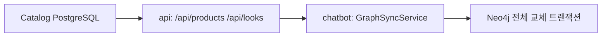
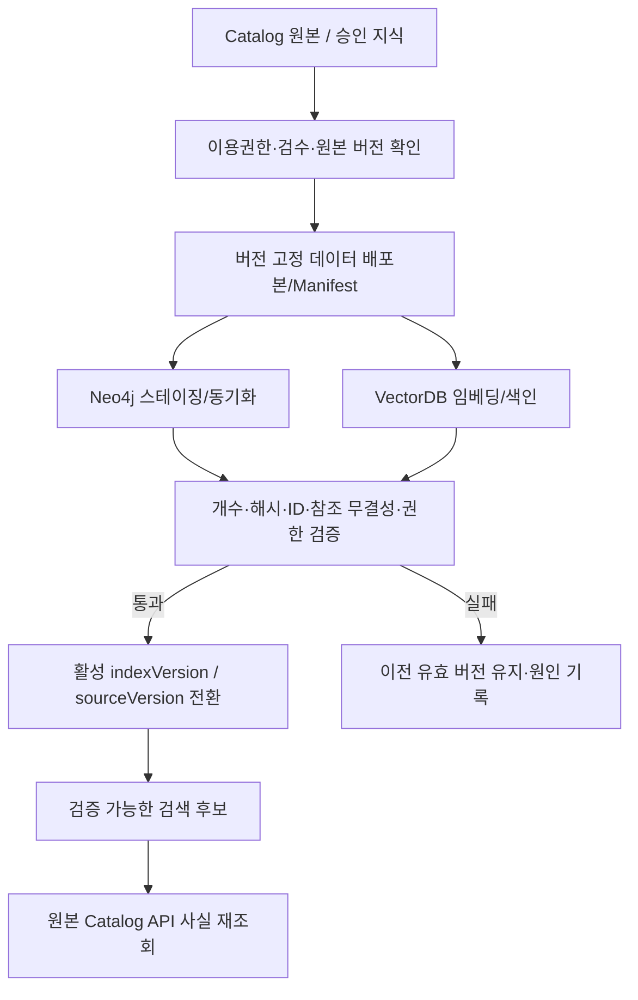

# VISHUE AI — 2-5 옵션 복합 검색·근거 검증·색인 동기화 계약

> 상태: **PROPOSED — 정적 코드 대조를 바탕으로 작성한 개발 설계안 v0.1, 2026-11-15**. 새 엔드포인트/마이그레이션·인덱스·테스트를 구현하지 않았다.
> 기준: `develop d1cf4868f74d2ff6db188bf2c7646146f3ec72ad`. [Tool 입출력](06-tool-implementation-contracts.md), [언어 정책](07-ko-first-language-and-evaluation.md), [ADR-0002](../adr/0002-postgres-source-neo4j-copy.md), [AIHub 권리](../AIHUB_DATA_RIGHTS.md) 참조.

## 1. 실제 코드에 있는 것과 아직 없는 것

| 코드/데이터 | 정적 확인 사실 | 목표 계약과 차이 |
| --- | --- | --- |
| `GET /api/products?q&category&ids&concerns` | `backend/api/app/routers/catalog.py`, `ProductsResponse.products: list[Product]`. 검색은 `catalog_repository.py`의 `search_text` 문자열 포함 / 카테고리/ID/태그 | 옵션별 가격·재고·실제 성분의 **복합 조건 검색 API가 아님** |
| 상품 상세/셰이드 | `Product.priceKRW`, `Product.shades[].id/name/hex/measureMethod/colorSource` | `priceKRW`는 카탈로그 참고 필드; 현재 수집 가격의 보증/실시간 재고 정보 아님 |
| 옵션 원본 | `RawOyProductOptionRow.option_id,goods_no,option_no,shade_code/name,collected_at,delisted_at` | 외부 옵션 ID와 서비스 `productId/shadeId` 관계를 검증해야 함. 비색상·세트 제품도 존재 |
| 가격 이력 | `RawOyPriceSnapshotRow.option_id,sale_price,list_price,max_benefit_price,is_latest,is_sold_out,collected_at` | 수집 시점의 관측 데이터. `is_latest`는 **DB 관측 최신 행**이지 상점의 실시간 상태 아님 |
| 성분 GET | `GET /api/products/{id}/ingredients?shadeId&optionId&ingredientName&operator` → `IngredientReadResult` | 상품/호수/옵션 귀속·coverage·review·sourceVersion 검증, 특히 부재 판정은 강한 조건 필요 |
| Graph sync | `GraphSyncService.sync()`가 API로 모든 상품·룩 조회 → Neo4j `replace_catalog()`에서 기존 그래프 전체 지우고 재생성 | 그래프 전체 교체 코드 존재, **sourceVersion/graphGeneration·권리·검수·증분·원본 해시 검증 배포 계약 미확인** |
| 그래프 Ingredients | `graph_sync_service.py:product_row()`의 `key_ingredients`가 `(:Ingredient)` 노드로 전달 | **핵심 성분은 완전한 검수 전성분이 아니다.** 그래프의 `CONTAINS` 관계를 완전한 포함·부재 판정의 근거로 쓰면 안 됨 |
| VectorDB | 현재 Graph/Product 문자열 검색 및 일부 데이터 설계 문서 | 승인 자료의 임베딩 색인·전파·철회·품질 검증 계약 **미구현/미확인** |

## 2. 옵션별 복합 검색: 개발 대안

### A. 기존 GET 결과를 챗봇이 순차 조회·후처리

**가능:** `GET /api/products`로 후보를 찾고, 후보별 성분 GET을 호출해 필터·근거를 구성한다.

장점: 초기 API 변경이 적다. 단점: 서버가 모르는 전체 옵션 검색 범위·가격 스냅샷/재고 조건을 충족시키기 어렵고, 후보가 앞에서 잘리면 정확한 교집합 검색이 되지 않는다. 검색량과 타임아웃에 따른 **부분 결과**를 반드시 드러내야 한다.

### B. Catalog 소유 읽기 전용 복합 옵션 검색 API (추천 후보)

**PROPOSED:** `POST /api/catalog/options/search` (**조회 의미의 POST**; 실제 경로는 미합의). POST 선택 이유는 다수의 포함/제외 성분·옵션 조건·후보 ID/정렬 조건을 구조화 JSON으로 전달하고 GET 쿼리의 길이·표현 한계를 피하기 위해서다. 인증·캐시·레이트 리밋·성능 측정에 관한 기존 정책은 별도 적용.

```json
{
  "schemaVersion": "v1",
  "queryLanguage": "ko",
  "query": "촉촉한 데일리 립",
  "category": "lip",
  "maxPriceKRW": 20000,
  "priceKind": "collected_sale",
  "conditions": [
    {"kind": "ingredient", "name": "향료", "operator": "excludes"}
  ],
  "sort": "reference_price_ascending",
  "pageSize": 20,
  "pageToken": null
}
```

이 요청 JSON은 **실제 API가 아니라 설계용 예시**다. `queryLanguage`는 질문 검색 언어이지 상품·호수·권한의 식별자에 포함하지 않는다. `priceKind`와 `sort`는 가능한 데이터와 검증 수준을 일치시켜야 하며, 수집 판매가 오름차순/카탈로그 참조가 오름차순을 혼동하지 않는다. `pageSize` 상한과 타임아웃·페이지 예산은 실측 후 확정한다.

### 최소 반환 계약 (PROPOSED)

```json
{
  "schemaVersion": "v1",
  "status": "PARTIAL",
  "queryLanguage": "ko",
  "checkedScope": {
    "candidateOptions": 20,
    "checkedOptions": 18,
    "exhaustive": false,
    "stoppedReason": "SOURCE_UNAVAILABLE"
  },
  "items": [
    {
      "productId": "serving-product-id",
      "shadeId": "serving-shade-id",
      "optionId": "source-option-id",
      "identityStatus": "verified",
      "referencePrice": {
        "amountKRW": 18000,
        "priceKind": "collected_sale",
        "observedAt": "2026-11-10T12:00:00+09:00",
        "currentPriceVerified": false
      },
      "stockStatus": "unknown",
      "ingredientChecks": [
        {
          "ingredientName": "향료",
          "operator": "excludes",
          "verdict": "UNKNOWN",
          "reason": "full_ingredient_evidence_unavailable",
          "evidenceId": null,
          "sourceVersion": null
        }
      ]
    }
  ],
  "nextPageToken": null
}
```

값은 **스키마 사례이며 실제 조회·가격·판매 상태가 아니다**. `status=PARTIAL`은 요청 조건이 모두 충족됐다는 뜻이 아니다. 성분이 UNKNOWN이면 제외 조건 충족/미충족으로 단정하지 않는다. 서버가 확정적인 예산 위반이나 제외 성분 존재를 확인했다면 다른 조회가 실패하더라도 그 확정 위반을 덮어써서는 안 된다.

### 권장 후보 선정 규칙

1. 올리브영 등 외부 옵션 ID `optionId`를 서비스 `productId/shadeId`와 **검증된 매핑 관계**로 연결한다. 미매핑·중복 매핑·색상/세트 옵션을 구분한다.
2. 예산은 원화 숫자뿐 아니라 `priceKind`, 기준 시각, 부가 혜택 적용 여부를 함께 고려한다. **현재가 요청은 현재가 검증이 없으면 미확인**.
3. 성분 포함/제외는 각 옵션에 대한 검수 결과와 `verdict`를 필수 조건의 상태로 누적한다. `ERROR`와 `UNKNOWN`을 결과에서 지우지 않는다.
4. 반영된 조건·미확인·부분 검색 범위·기준 시각을 반환해 사용자가 다시 검색·조건 수정할 수 있게 한다.
5. `resultSetId` 및 옵션 ID·정렬 순서 버전을 저장해 "두 번째" 참조를 안전하게 처리하고, 후속 상담에서 현재 Catalog를 재조회한다.

**데이터 변경 범위:** 기존 #228 및 #231은 Closed·미병합이므로 최종 API/마이그레이션을 그대로 적용하지 않는다. 실제 속성·호수·가격·성분 DB 열과 운영 조회 경로는 API·데이터 담당자의 별도 확인 및 격리 DB 실행으로 검증해야 한다.

## 3. 근거 검증 파이프라인: 상품·성분·지식의 차이

### 옵션별 사실 판정

- 검색 전: 신원/권한/허용 카탈로그 범위·옵션 ID의 소유 관계 검증.
- 카탈로그 원본: 제품·호수/외부 option ID 매핑을 검증하고 옵션별 수집 기록과 `sourceVersion`을 확보.
- 성분 검증: `IngredientReadResult`의 `status`, `reviewStatus`, `mappingStatus`, `ingredientCoverage`, `normalizationStatus`, `evidenceId`, `sourceVersion`, `synthetic`, `issues`와 `conditions[].verdict`를 함께 확인.
- 결과: **확정 포함/부재, 조건 위반, UNKNOWN, ERROR를 독립적으로 표시**. 상품 정보를 검증하지 못하면 미확인으로 반환하며 사용자에게 거짓 추천 사실을 표시하지 않는다.

**중요:** `IngredientDecision.verdict`는 operator-relative라 `excludes + MATCH`가 '성분 부재 조건 성립'이고 `excludes + NOT_MATCH`가 '제외 성분 존재 확인'이다. `includes`의 경우 반대로 해석한다. `keyIngredients` 목록에 단어가 없다는 이유로 향료 부재를 확정할 수 없다.

### 지식과 출처의 서비스 적격성

별도 권한 조건으로 `rights_status=service_approved`, 문서/QA 검수 승인, `claim_review.support_status`의 허용 판정, 배포본/문서 발행 상태와 사용 목적을 검증한다. 자료 권리·검수·발행은 서로 다른 상태 축이다.

- 수집됨/parsed/source_matched는 승인 자료가 아님.
- 철회·기간 만료·권리 축소 시 벡터·Neo4j·캐시·요약의 재사용 차단이 필요.
- AIHub 71961의 현재 서비스 RAG/외부 모델 원문 제공은 **[기존 이용권한 문서](../AIHUB_DATA_RIGHTS.md)에 따라 보류**. 승인되지 않은 실제 QA 원문을 여기서 인용하지 않는다.
- LLM에 전달하기 전에 신뢰할 수 없는 검색 텍스트가 시스템 명령·권한을 변경하지 않도록 분리한다.

## 4. PostgreSQL → Neo4j / VectorDB 동기화

### 현재 경로 (EXISTING-CODE)



현행 `GraphSyncService.sync`는 `fetch_products()`, `fetch_looks()`를 호출해 `replace_catalog`를 수행한다. `GraphRepository.replace_catalog`는 Neo4j 트랜잭션 안에서 기존 Product/Ingredient/Look/Tag/Shade 노드를 지우고 목록을 다시 생성한다. **트랜잭션 단위 원자성은 있어도 소스 집합이 동일 시점의 스냅샷인지, 버전·권리·검수 상태가 일치하는지는 별도의 보증이 확인되지 않는다.**

### 목표 경로 (PROPOSED)



**필수 계약:**

| 이름 | 내용 | 미충족 시 |
| --- | --- | --- |
| `sourceVersion` | 정본에서 발행·검수한 데이터의 불변 버전 또는 스냅샷 해시 | 후보를 확정 근거로 사용 금지 |
| `graphGeneration` / `indexVersion` | 그래프·벡터 색인의 생성 버전/활성 버전 | 오래된 색인의 버전·권리 상태 재조회 |
| `sourceManifest` | 수집 대상 집합 크기, 자료별 소유권·권리·검수·삭제/철회, 원본 해시·시각 | 불완전/승인 전 자료는 발행 금지 |
| `indexBuildStatus` | 준비→작성→검증→활성화→구버전 정리 상태 | 장애 발생 시 활성 버전 보존 |
| `revocationEpoch` | 권리 철회·검수 취소·기밀 제거를 검색에 즉시 적용하기 위한 버전 | 오래된 캐시·벡터/관계 결과 차단 |
| `freshnessLag` | 원본 발행→파생 색인 반영 지연 | 임계치 초과 시 후보 검색 제한·안내 |
| `syncRunId` | 동기화 시도 ID/시작·완료·오류 및 수행 주체 | 반복 실행·장애 복구 판단 불가 |

**권리 처리에서 중요:** 게시 철회나 접근 차단은 긴 배치 재색인이 끝날 때까지 기다리면 안 된다. 검색·응답 시 원본 승인·권리 상태를 재검사할 수 있는 별도 권한 게이트가 필요하다. 자료/사용자 계정 삭제의 파생 인덱스 제거는 실패 시 재시도 가능한 작업으로 관리한다.

**동기화 기술 대안:** ① 기존 전체 교체 + 스냅샷/Manifest·활성 인덱스 전환을 보완(구현 부담 낮을 수 있음) ② sourceVersion 기반 변경분 동기화(증분 갱신·철회 추적 쉬움, 스키마/운영 복잡). 실제 데이터 크기와 검색 지연·재색인 시간을 측정한 뒤 선택. **중국어·영어·일본어 확장 시** 동일 원본 ID와 권리 정책을 공유하고 `contentLanguage`, `embeddingModelVersion` 등의 색인 메타데이터만 추가되도록 설계.

## 5. 한국어 우선 검색/임베딩과 3단계 인계

현재는 한국어 상품명·호수·성분 표준명·메이크업 기법 검색을 우선한다. **신뢰 가능한 결과를 구성할 때 정확 매칭 + 한글 표기·동의어 처리 + 관계 검색 + 허용 자료의 의미 검색**을 목적에 따라 결합하고, 상품·옵션·전성분의 확정 판정은 API에서 한다.

- `queryLanguage='ko'`는 1차 기본값이지만 ID·상태·근거·Tool 필드는 언어 중립.
- 텍스트 정규화/동의어 사전을 적용해도 원문·공식 한글/영문 표기와 호수 문자열을 덮어쓰지 않는다.
- 한국어 기반 임베딩 모델 후보/청크 분할/재순위화/VectorDB 엔진은 3단계에서 원문 사용권한과 측정 결과를 확인해 확정한다.
- `en/ja/zh`는 후속 언어별 콘텐츠·동의어·번역 대조·다국어 임베딩/검색 검증으로 확장한다.

## 6. 최소 검증 시나리오와 완료 조건 (미실행)

| ID | 검증 입력·상황 | 필수 결과 |
| --- | --- | --- |
| OPT-01 | 판매가가 없는 옵션과 예산 조건 | 현재가/재고 조건 충족으로 승격하지 않음 |
| OPT-02 | 두 호수의 서로 다른 전성분/가격 | 옵션별 결과·sourceVersion 섞이지 않음 |
| OPT-03 | excluded ingredient 있음 + 다른 자료 조회 실패 | 확정 위반 유지, 오류는 별도 보고 |
| OPT-04 | excluded ingredient 없음이나 full 증거 불충분 | `UNKNOWN`, 무향료 보증하지 않음 |
| OPT-05 | 복합 검색 2차 페이지 실패 | `checkedScope.exhaustive=false` 및 실제 검사 개수 공개 |
| OPT-06 | 동일 질의 요청 재전송 | 같은 요청·후속 결과 ID/순서 보존 또는 명시적 재조회 |
| IDX-01 | 그래프/벡터 생성 중 실패 | 이전 활성 버전 유지, 새 미검증 색인 미노출 |
| IDX-02 | 정본 권리 철회 뒤 오래된 색인 검색 | 검색 단계 또는 최종 검증 단계에서 노출·사용 차단 |
| IDX-03 | keyIngredients 그래프만 있음 | **전성분 부재** 근거로 사용 금지 |
| IDX-04 | 그래프 상품이 Catalog에 없는 경우 | 실상품 카드 반환 금지 |
| IDX-05 | ko 질의·표준명·띄어쓰기 변형 | recall/정확도 측정, 모델/색인 버전 재현 |
| IDX-06 | 향후 en/ja/zh 검색 자료 추가 | 동일 상품/근거 ID 유지, 언어별 색인/권리 범위 독립 검사 |

테스트는 **설계 계획**이며 실행 성공·Gold 승인·실제 데이터 적재 근거가 아니다. 평가 정량 임계치는 4단계에서 사용자 결정.

## 7. 지금 확정하지 않은 선택

| ID | 대안 | 권장 판단 방식 |
| --- | --- | --- |
| OPEN-T01 | 기존 GET 후처리(A) / 읽기용 복합 옵션 POST(B) | B 우선 검토. 실제 수집 데이터/조건 누락/페이지·속도·API 소유권 확인 후 확정 |
| OPEN-SYNC-01 | Neo4j 전체 교체 보완 / 증분 동기화 | 데이터 크기·권리 철회·고가용성·재빌드 관측으로 선택 |
| OPEN-VECTOR-01 | `pgvector` / 독립 VectorDB | 한국어 검색 품질·비용·동기화·자료 권리 조건 비교, 3단계 |
| OPEN-EVIDENCE-01 | 기존 Evidence 스키마 사용 / 공통 Envelope 추가 | 기존 API 무파괴 어댑터 우선 검토 |
| OPEN-RIGHTS-01 | 권리·발행 정본 조회 위치 및 revocationEpoch API | API·데이터 담당 검수, 팀 ADR 필요 |
| OPEN-LANG-01 | 1차 `ko` 확정, `en/ja/zh` 후속 공식 AI·STT/TTS 제공 시점 미결정 | [한국어 우선 정책](07-ko-first-language-and-evaluation.md), 2-6·4단계 |

**이 문서는 2-5의 설계 범위를 보강했으며 아직 확정된 구현 지시서가 아니다.** 사용자의 명시적 결정 없이 DB 엔진·기술 대안·성능 임계치를 확정 상태로 표시하지 않는다.

## 변경 기록

- **2026-11-15:** 코드의 `GraphSyncService.replace_catalog`, 핵심 성분 `keyIngredients` 관계, 수집가·현재가 차이를 근거로 옵션 복합 검색·근거·색인 동기화 상세 계약 추가. 한국어 우선 결정 반영, 기존 아키텍처·ADR과 2-5 Tool 계약 유지.
