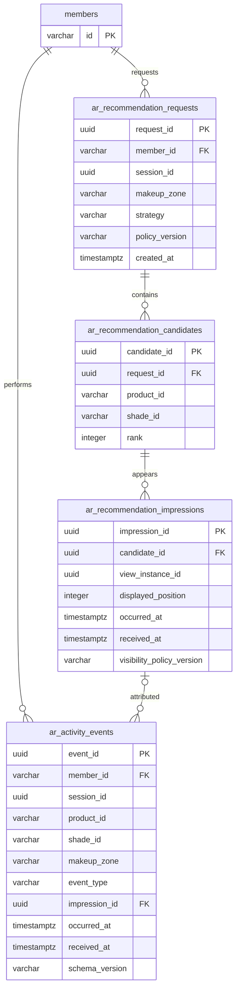

# AR 개인화 추천 DB 테이블 요청서

## 목적과 전제

- 구독자에게 AR 추천 색상칩을 제공하고, 동의한 사용자의 AR 활동을 **본인의 개인화 추천**에 반영한다.
- 초기 추천은 제품 평점과 리뷰 수를 참고한다. 활동이 충분해지면 시착과 재선택, 담기 등 본인의 활동도 반영한다.
- 추천 후보 생성, 실제 노출, 선택과 시착을 구분해 노출 대비 선택률과 이후 행동을 평가한다.
- AR 활동의 서버 저장과 개인화 활용에 관한 동의 문구 및 처리 절차는 추후 반영된다고 가정한다. 여러 사용자의 활동을 다른 사람의 추천에 활용하는 것은 이번 범위에서 제외한다.
- 얼굴 영상·사진과 얼굴 측정값은 이 테이블에 저장하지 않는다.
- 이 문서는 DB 담당자의 검토를 위한 제안이다. 실제 DB 생성이나 마이그레이션은 수행하지 않았다.

## 기존 DB와의 관계

기존 `recommendation_requests`, `recommendation_candidates`, `recommendation_impressions`, `user_behavior_events`는 피부 제품 추천 이력을 위한 구조다. 현재 이벤트 API는 기존 추천 노출을 필수로 검증하며, 허용된 이벤트에 AR 시착이 없다. 자유 탐색을 포함하는 AR 활동은 아래 전용 테이블로 제안한다.

`members.id`는 `varchar(64)`이고, `shades`의 기본키는 `(product_id, id)`다. 호수 ID만으로 제품을 식별하지 않는다. 구독 상태는 활동 행에 복사하지 않고 추천 제공 시 별도 자격 정보에서 확인한다. 현재 저장소에서 구독 자격 테이블은 확인되지 않았다.

## ERD

제품·호수 ID는 카탈로그 식별자를 기록한 값이다. 카탈로그 삭제·재적재로 활동 이력이 사라지지 않도록 FK는 두지 않는 안을 제안하며, 생성 시 서비스에서 `(product_id, shade_id)` 조합과 부위를 검증한다. 삭제된 카탈로그의 과거 속성을 재현해야 한다면 별도 버전 관리가 필요하다.

## 테이블 상세

별도 표시가 없는 컬럼은 `NOT NULL`이다. 시각은 모두 PostgreSQL `timestamptz`를 사용한다.

### 1. `ar_recommendation_requests`

| 컬럼 | 타입 | 제약 및 설명 |
|---|---|---|
| `request_id` | UUID | PK. 추천 생성 요청 식별자 |
| `member_id` | varchar(64) | FK → `members.id`, `ON DELETE CASCADE` |
| `session_id` | UUID | AR 세션 식별자 |
| `makeup_zone` | varchar(20) | 추천 대상 부위 |
| `strategy` | varchar(40) | `rating`, `personalized` 등 실제 적용 방식 |
| `policy_version` | varchar(64) | 추천 정책 버전 |
| `created_at` | timestamptz | 서버 생성 시각, 기본값 `now()` |

인덱스는 `(member_id, created_at)`을 제안한다. `strategy`의 허용값과 개인화 전환 기준은 추천 정책 확정 시 정한다.

### 2. `ar_recommendation_candidates`

| 컬럼 | 타입 | 제약 및 설명 |
|---|---|---|
| `candidate_id` | UUID | PK |
| `request_id` | UUID | FK → 요청, `ON DELETE CASCADE` |
| `product_id` | varchar(64) | 추천 제품 ID |
| `shade_id` | varchar(64) | 추천 호수 ID |
| `rank` | integer | 요청 내 추천 순위, `rank > 0` |

`UNIQUE (request_id, product_id, shade_id)`와 `UNIQUE (request_id, rank)`를 둔다. 평점이 제품 단위일 때 추천할 호수 선정 기준은 별도 결정이 필요하다.

### 3. `ar_recommendation_impressions`

| 컬럼 | 타입 | 제약 및 설명 |
|---|---|---|
| `impression_id` | UUID | PK. 클라이언트 재전송 시 동일 ID 사용 |
| `candidate_id` | UUID | FK → 후보, `ON DELETE CASCADE` |
| `view_instance_id` | UUID | 팔레트 표시 단위 식별자 |
| `displayed_position` | integer | 실제 노출 위치, 1 이상 |
| `occurred_at` | timestamptz | 실제 노출 시각 |
| `received_at` | timestamptz | 서버 수신 시각, 기본값 `now()` |
| `visibility_policy_version` | varchar(64) | 노출 판정 기준 버전 |

`UNIQUE (candidate_id, view_instance_id)`를 둔다. 후보가 계산된 것과 실제로 보인 것은 구분한다. 같은 표시 단위에서 같은 후보는 한 번만 기록한다.

### 4. `ar_activity_events`

| 컬럼 | 타입 | 제약 및 설명 |
|---|---|---|
| `event_id` | UUID | PK. 클라이언트 재전송 시 동일 ID 사용 |
| `member_id` | varchar(64) | FK → `members.id`, `ON DELETE CASCADE` |
| `session_id` | UUID | AR 세션 식별자 |
| `product_id` | varchar(64) | 활동 대상 제품 ID |
| `shade_id` | varchar(64) | 활동 대상 호수 ID |
| `makeup_zone` | varchar(20) | 활동 대상 부위 |
| `event_type` | varchar(40) | 초기 후보는 `try_on`, `cart_add` |
| `impression_id` | UUID, nullable | FK → 노출, `ON DELETE SET NULL`. 추천에서 이어진 행동일 때 연결 |
| `occurred_at` | timestamptz | 활동 발생 시각 |
| `received_at` | timestamptz | 서버 수신 시각, 기본값 `now()` |
| `schema_version` | varchar(64) | 이벤트 형식 버전 |

인덱스는 `(member_id, occurred_at)`, `(session_id, occurred_at)`, `impression_id`를 제안한다. 시착은 칩이 정렬되고 실제 색이 적용된 시점에 기록한다. 같은 색의 재선택은 기록을 조회해 판단한다. 자유 탐색 이벤트의 `impression_id`는 비워 둔다.

서버는 연결된 노출의 사용자·세션·제품·호수·부위가 활동과 일치하는지 검증한다. 동일 ID의 재전송은 중복 저장하지 않고, 동일 ID에 내용이 다르면 충돌로 처리한다. 발생 시각 검증과 배치 수집 실패·재시도 방식은 API 설계에서 확정한다.

## 집계와 운영 시 확인할 사항

- 노출 대비 선택률은 노출된 추천 칩 중 연결된 시착이 1회 이상 발생한 노출의 비율로 제안한다. 분자와 분모는 같은 기간·노출 기준을 사용한다.
- 노출과 시착은 비동기로 도착할 수 있다. 연결 전 노출 수신을 보장하거나 재시도·순서 조정 방식을 API에서 정해야 한다. 자유 탐색 선택을 추천 선택으로 추정하지 않는다.
- 사용자가 추천 칩을 실제로 볼 수 있었다는 판정 기준, 표시 단위의 수명, 선택을 해당 노출에 연결하는 시간 범위는 확정이 필요하다.
- 동의 상태의 저장 구조, 보관 기간, 동의 철회·기록 삭제 시 처리 범위, 비로그인 활동 처리와 기존 회원 재동의 방식은 정책 확정 후 반영한다. 현재 회원 테이블의 약관 동의 기록만으로 별도 AR 개인화 동의를 표현하지 않는다.
- 계정 삭제 시 요청·후보·노출 및 활동은 회원 참조의 연쇄 삭제 경로를 검증한다. 개인 기록 삭제나 동의 철회 시에도 관련 추천·활동 이력을 일관되게 처리한다.
- 구독 자격 확인과 동의 확인은 서버에서 수행한다. 구독 정보의 출처와 만료·해지 시 동작은 별도 결정이 필요하다.
- 최초 후보의 평점·리뷰 수가 AR 카탈로그 제품에 얼마나 연결되는지, 제품 평점으로 어떤 호수를 제안할지는 데이터 확인이 필요하다.
- 현행 `docs/AR_SPEC.md` 6-14는 활동을 동의 후 기기에만 저장하고 추천에 사용하지 않도록 규정한다. 구현 전에 서버 저장과 추천 활용에 맞게 명세 및 동의·삭제 흐름을 변경해야 한다.
