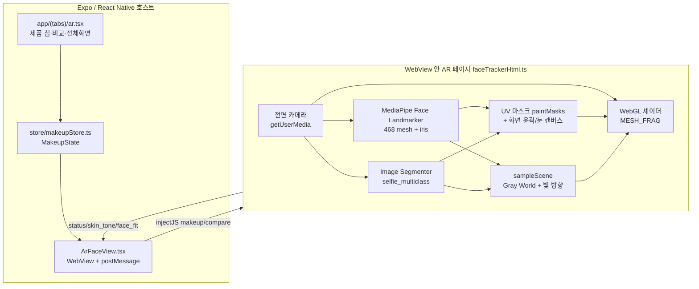
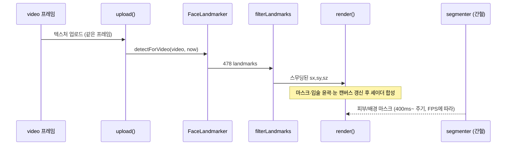

# 1. AR 전체 구조 1페이지 요약

## 비전공자용 한 문단

스마트폰 전면 카메라가 얼굴을 찍으면, 앱 안의 **작은 웹 페이지(WebView)** 가 그 영상을 받는다. Google **MediaPipe**가 얼굴의 눈·코·입 위치를 **점(랜드마크)** 으로 찍고, GPU용 **셰이더(Shader)** 가 그 점들로 만든 마스크 위에 립스틱·블러셔 색을 **투명하게 섞어** 다시 화면에 그린다. 사진은 서버로 보내지 않는다.

## 실제 실행 흐름 (코드 기준)

명세 예시와 달리, 현재 코드의 핵심은 아래다.

```
[Expo 앱] ArFaceView
    │ makeup / compare / guide 메시지
    ▼
[WebView HTML] faceTrackerHtml.ts
    │
    ├─ openFrontCamera()          getUserMedia 전면 카메라
    ├─ startLoop()                requestVideoFrameCallback
    │       ▼
    ├─ processFrame()
    │     1) renderer.upload()     같은 프레임을 WebGL 텍스처로 업로드
    │     2) landmarker.detectForVideo()  Face Landmarker 478점
    │     3) filterLandmarks()     One Euro (오프셋만)
    │     4) updateMesh()          468점 메시 위치·법선
    │     5) sampleScene()         조명·맨입술색·흐림 (0.5s)
    │     6) runSegmenter()        selfie multiclass (조명색·피부마스크·가림)
    │     7) renderer.render()     WebGL: 카메라 배경 → 메시+메이크업
    │     8) drawOverlay()         가이드·HUD (Canvas 2D)
    ▼
화면 출력 (glCanvas + overlay)
```

## Mermaid — 시스템 구조



## Mermaid — 한 프레임 처리



## 단계별 요약표

| # | 단계 | 무엇을 하나? | 왜 필요? | 기술 | 파일·함수 | 입력 | 출력 | 없으면? |
|---|---|---|---|---|---|---|---|---|
| 0 | 호스트 연결 | 앱이 HTML을 WebView에 넣고 메이크업 상태를 보냄 | Expo Go에서 네이티브 CV 모듈을 못 쓰므로 | React Native WebView | `ArFaceView.tsx`, `FACE_TRACKER_HTML` | `MakeupState`, compare | status 콜백 | 카메라 AR 자체가 불가 |
| 1 | 카메라 | 전면 영상 스트림 | 실시간 얼굴 입력 | getUserMedia | `openFrontCamera` | 권한 | `video` 요소 | denied/unavailable |
| 2 | 프레임 동기 | 카메라 프레임마다 처리 | 화장이 영상보다 늦게 따라오지 않게 | `requestVideoFrameCallback` | `onVideoFrame` → `processFrame` | video timestamp | 한 프레임 작업 | 지연·어긋남 |
| 3 | 텍스처 업로드 | 그 프레임을 GPU에 올림 | **검출과 렌더가 같은 프레임**을 쓰게 | WebGL `texImage2D` | `renderer.upload` | video | `uVideo` | 메이크업이  lagged |
| 4 | 얼굴 감지·랜드마크 | 478점 (메시 468+홍채) | 입·눈·볼 위치를 알아야 칠할 수 있음 | MediaPipe Face Landmarker 1.1.1 | `createLandmarker`, `detectForVideo` | video | landmarks | 화장 위치 불가 |
| 5 | 스무딩 | 점 떨림 줄이기 | 정지 시 흔들림, 움직일 때 지연 균형 | One Euro (오프셋만) | `filterLandmarks` | raw face | `sx,sy,sz` | 경계가 떨림 |
| 6 | 메시·UV | 3D 얼굴 삼각형 + UV | 고개 돌려도 마스크가 붙어 있게 | Face Mesh UV | `updateMesh`, `faceUV.ts` | landmarks | `meshPos/Nrm` | 스티커처럼 미끄러짐 |
| 7 | 부위 마스크 | 립/볼/눈두덩 등 어디를 칠할지 | 픽셀마다 농도 결정 | Canvas 2D → 텍스처 + 화면 윤곽 | `paintMasks`, `drawLipOutline`, `drawEyes` | UV·랜드마크 | mask 텍스처 | 단색 사각형만 |
| 8 | 조명·색 추정 | 빛 색·방향·맨입술색 | 같은 hex가 조명마다 다르게 보이게 | Gray World + Lambert/`matchLight` | `sampleScene`, `runSegmenter` | video+seg | `light.*` | 플라스틱·색 어긋남 |
| 9 | 피부 분할 | 얼굴 피부 vs 머리/배경 | 파운데이션 헤어라인·가림 | selfie multiclass | `runSegmenter`, `applyFoundSkinMask` | video | skin mask, occGate | 머리·손에 칠함 |
| 10 | WebGL 합성 | 카메라×색소×광택 | GPU로 실시간 픽셀 합성 | GLSL fragment shader | `MESH_FRAG`, `renderer.render` | video+masks+uniforms | 화면 | CPU로는 속도 부족 |
| 11 | 오버레이 | 가이드·HUD | 따라 바르기·디버그 | Canvas 2D | `drawOverlay`, `drawGuide` | landmarks | overlay canvas | 기능만 없음 |

## 데이터는 어디로 가나?

| 나감 | 안 나감 |
|---|---|
| `status`, `light_hint`, 피부 Lab 숫자(`skin_tone`), 얼굴형 **이름만**(`face_fit`) | 카메라 프레임, 얼굴 이미지, base64 |

근거: 파일 헤더 주석 + `AR_SPEC` 1-4 + `__tests__/faceTracker.test.ts`(fetch/localStorage 금지).

## 발표용 30초 스크립트

> “저희 AR은 Expo 앱이 WebView로 HTML을 띄우고, 그 안에서 MediaPipe Face Landmarker가 얼굴을 추적합니다.  
> 같은 카메라 프레임을 먼저 GPU에 올린 뒤 검출해서 지연을 줄이고, UV 마스크와 화면 공간 입술 윤곽으로 부위를 정한 다음 WebGL 셰이더가 제품 hex를 카메라 명암·광택과 합성합니다.  
> 영상은 기기 밖으로 나가지 않고, 피부색 Lab 같은 숫자만 앱으로 보냅니다.”
