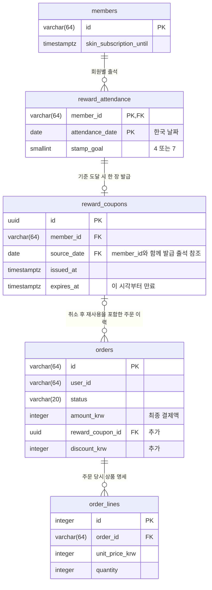

# 출석 쿠폰 ERD · DB 담당자 요청서

**목표**는 한 회원이 여러 기기에서 같은 출석 기록과 쿠폰함을 보고, 발급된 쿠폰으로 주문 한 건에 한 번만 할인받게 하는 것이다. 출석과 쿠폰은 서버에서 발급하고 조회한다. 기기에 남은 예전 출석 기록은 결제에 사용할 수 없다.

**기준**은 2026-11-25 로컬 PostgreSQL `vishue_db.public`, Alembic `0038`이다. 이전 검토 시점의 리비전은 AR 동의만 포함했다. 통합 후 쿠폰 스키마는 develop의 `0038`, 두 이력을 합친 로컬 head는 `0039`다. 아래는 적용된 관계다.

| 구분 | 대상 | 요청 |
| --- | --- | --- |
| 신설 | `reward_attendance`, `reward_coupons` | 회원별 출석과 발급 근거를 기록한다. |
| 확장 | `orders` | 사용한 쿠폰과 할인액을 주문에 보관한다. |
| 재사용 | `members.skin_subscription_until`, `order_lines` | 출석 시점의 구독 여부와 주문 당시 상품 합계를 계산한다. |
| 기기 저장 | 수정 닉네임 | 기본 이름은 회원 ID로 생성하고 수정한 이름은 해당 기기에 저장한다. |

## 목표 ERD

선은 물리 외래 키를 나타낸다. 기존 테이블에는 이 기능과 관련된 열만 표시했다. `orders.user_id`는 현재 회원 식별자 문자열이며 `members`를 참조하는 FK가 없다.

쿠폰과 주문의 관계가 1:N인 이유는 취소된 주문에도 할인 이력을 남기기 위해서다. **한 쿠폰으로 동시에 열어 두거나 결제를 완료할 수 있는 주문은 최대 한 건**이다.

## 키와 제약

| 대상 | 구현 계약 |
| --- | --- |
| `reward_attendance` | 세 열 모두 `NOT NULL`. 복합 PK `(member_id, attendance_date)`. `member_id → members.id ON DELETE CASCADE`. `CHECK (stamp_goal IN (4, 7))`. |
| `reward_coupons` | 모든 열 `NOT NULL`. 서버에서 UUID 발급. 복합 FK `(member_id, source_date) → reward_attendance(member_id, attendance_date) ON DELETE CASCADE`. 같은 열 쌍에 `UNIQUE`를 걸어 출석 한 건에서 최대 한 장만 발급한다. `CHECK (expires_at > issued_at)`. |
| `orders.reward_coupon_id` | NULL 허용. `reward_coupons.id`를 참조하며 `ON DELETE SET NULL`. 주문 생성 시 인증 회원, 쿠폰 소유자, `orders.user_id`가 일치해야 한다. |
| `orders.discount_krw` | `integer NOT NULL DEFAULT 0`. 할인액은 0~2,000원. 기존 주문은 쿠폰 NULL, 할인 0원으로 읽히며 기존 `amount_krw`를 보존한다. |
| 주문 중복 사용 방지 | `orders(reward_coupon_id)`에 부분 유일 인덱스를 둔다. 조건은 `reward_coupon_id IS NOT NULL AND status <> 'canceled'`. 취소된 주문에는 동일 쿠폰 ID를 보존한다. |

회원 탈퇴 시 출석과 쿠폰은 삭제한다. 주문과 주문 명세, 당시 할인액과 최종 결제액은 보존한다. 쿠폰 FK가 NULL이 된 할인 주문도 유효한 과거 거래이므로 `reward_coupon_id IS NULL`이면 할인액을 0으로 강제하는 제약을 두지 않는다. 기존 탈퇴 정책은 [ADR-0010](adr/0010-account-deletion-secret-key.md)에 있다.

## 출석과 발급 규칙

1. 서버 시각을 `Asia/Seoul`로 변환해 출석일을 결정한다. 회원 행을 잠근 트랜잭션에서 출석 기록과 쿠폰 발급을 함께 처리한다. 같은 날 재요청하면 기존 결과를 반환한다.
2. 출석 시점에 `skin_subscription_until > 현재 시각`이면 기준은 4회, 그 외는 7회다. 그날 적용한 값을 `stamp_goal`에 기록한다. 연속 출석 조건은 없다.
3. **남은 스탬프 = 누적 출석 건수 − 발급된 각 쿠폰의 원본 출석에 기록된 `stamp_goal`의 합**이다. 새 출석을 포함한 잔액이 그날 기준 이상이면 한 장을 발급한다. 쿠폰이 만료되거나 주문이 취소돼도 발급에 쓴 스탬프는 돌아오지 않는다.
4. 발급일을 포함해 7일간 유효하다. 한국 날짜 11월 25일에 발급한 쿠폰의 `expires_at`은 12월 2일 00:00 KST다.

## 결제와 쿠폰 상태

상품 합계는 서버가 확정한 `SUM(order_lines.unit_price_krw × quantity)`다. 합계가 10,000원 이상이면 10%를 할인하며 상한은 2,000원이다. 원 단위 미만은 버리는 안을 제안한다. 기존 `orders.amount_krw`에 **상품 합계 − 할인액**을 저장하고 결제 승인 금액도 이 값과 대조한다.

쿠폰 상태는 아래 조건으로 판정한다. 주문 상태와 별도의 쿠폰 상태 열을 동시에 갱신할 필요가 없다.

| 쿠폰함 상태 | 판정 및 처리 |
| --- | --- |
| 사용 가능 | 현재 시각이 만료 전이고 취소 외 상태의 연결 주문이 없다. |
| 예약 중 | 해당 쿠폰을 쓴 `pending` 주문이 있다. 주문 생성 트랜잭션에서 쿠폰 소유자·유효기간·최소금액을 검증하고 예약한다. |
| 사용 완료 | 연결 주문이 `paid`, `preparing`, `shipped`, `delivered` 중 하나다. 같은 승인 요청을 재시도해도 할인은 한 번만 반영한다. |
| 기간 만료 | 예약·사용 중인 주문이 없고 현재 시각이 `expires_at` 이상이다. |
| 주문 취소 후 | 결제 취소가 확인되면 주문을 `canceled`로 전환한다. 쿠폰은 유효기간이 남았으면 사용 가능, 지났으면 만료로 표시한다. |

사용자가 결제 전 창을 닫으면 미결제 주문을 종료하고 즉시 쿠폰을 돌려준다. 현재 승인 경로는 `pending` 주문을 처리하므로 쿠폰만 풀면 이전 주문도 승인될 수 있다. 승인되지 않았음이 확인된 주문을 승인 불가 상태로 닫고 같은 트랜잭션에서 예약을 해제한다. 결제사 응답을 받지 못한 주문은 승인 결과부터 확인한다. 만료 후 처음 승인을 시도하는 주문과 탈퇴로 쿠폰이 삭제된 미결제 할인 주문도 새로 승인되지 않아야 한다.

## 인수 조건

| 검증 사례 | 기대 결과 |
| --- | --- |
| 같은 회원이 두 기기에서 한국 날짜가 같은 날 동시 출석 | 출석 1건. 발급 기준에 도달했다면 쿠폰도 1장. 다음 날 00:00 KST부터 새 출석 가능. |
| 일반 회원이 5회 적립 후 구독하고 다음 출석 | 총 6개에서 4개를 사용해 쿠폰 1장 발급, 잔여 2개. |
| 상품 합계 9,999원 / 10,000원 / 25,000원 | 쿠폰 적용 불가 / 1,000원 할인 / 상한 2,000원 할인. |
| 다른 회원의 쿠폰으로 결제하거나 두 주문이 한 쿠폰을 동시에 예약 | 타인 쿠폰은 거절. 같은 회원의 동시 예약은 최대 한 건만 성공. |
| 결제 승인 재시도, 취소 후 재주문 | 중복 승인·할인 없음. 유효기간 내에만 재사용 가능하며 취소 주문의 할인 이력은 보존. |
| 변경 전 주문 조회, 회원 탈퇴 후 주문 조회 | 기존 결제액 보존. 탈퇴 회원의 출석·쿠폰은 삭제되고 주문 금액·할인액은 조회 가능. |

구현 시 대조할 소스는 [회원 모델](../backend/api/app/models/member.py), [주문 모델](../backend/api/app/models/order.py), [주문 금액 산정](../backend/api/app/services/payment_service.py), [재고 처리](../backend/api/app/services/inventory_service.py), [관리자 취소](../backend/api/app/services/admin_service.py), [출석 계산](../backend/api/app/services/reward_service.py)이다.
