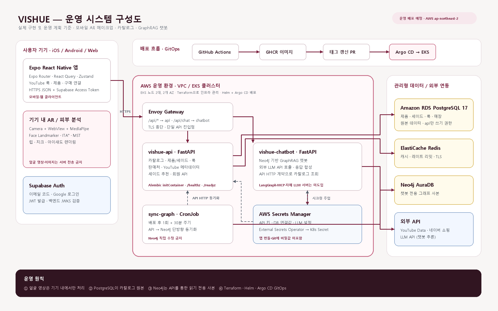

# VISHUE 시스템 구성도 및 기술 스택 명세

> 기준일: 2026-10-28  
> 상태 표기: **구현됨**은 저장소 코드·인프라 정의가 존재하는 항목, **운영 예정**은 AWS 운영 배포 설계가 확정되었지만 실제 프로비저닝·배포 여부를 이 문서에서 주장하지 않는 항목입니다.

## 1. 전체 서비스 구조

원본 벡터 파일: [vishue-system-architecture.svg](vishue-system-architecture.svg)

### 요청 및 데이터 흐름

1. 사용자는 Expo React Native 앱에서 아이돌 룩·제품·챗봇·AR 기능을 사용합니다.
2. 얼굴 랜드마크와 가상 메이크업은 기기 내 WebView/MediaPipe에서 처리합니다. 얼굴 영상이나 사진은 서버로 전송하지 않습니다.
3. 앱은 Supabase Auth 세션의 access token을 붙여 Gateway의 HTTPS API를 호출합니다.
4. Gateway는 `/api/chat`을 `vishue-chatbot`으로, 그 외 `/api/*`을 `vishue-api`로 보냅니다.
5. `vishue-api`만 PostgreSQL 원본 데이터를 읽고 쓰며, 외부 YouTube Data API·네이버 쇼핑 API도 서버에서만 호출합니다.
6. `sync-graph` CronJob은 API의 HTTP 계약을 읽어 Neo4j 챗봇 그래프 사본을 단방향 갱신합니다. 챗봇은 PostgreSQL에 직접 접속하지 않습니다.
7. `vishue-chatbot`은 Neo4j와 외부 LLM API를 이용해 GraphRAG 답변을 생성합니다.

### AI/모델 서빙 범위

| 항목 | 실제 구성 | 상태 |
| --- | --- | --- |
| 실시간 AR | 기기 내 Camera + WebView + MediaPipe Face Landmarker | 구현됨 |
| 피부톤 분석 | 기기 내 ITA°·MST·언더톤 계산, 수치만 API 요청에 사용 | 구현됨 |
| 챗봇 추론 | `vishue-chatbot`이 외부 LLM API를 호출 | 구현됨 |
| LangGraph / MCP Server | 현재 저장소에 도입되지 않음 | 미도입 |
| 자체 GPU/파인튜닝 모델 서빙 | 현재 저장소에 도입되지 않음 | 미도입 |

## 2. 배포 환경

| 환경 | 컴퓨팅 | 데이터 저장소 | 배포 방식 | 상태 |
| --- | --- | --- | --- | --- |
| 팀 공용 개발 | Render `api` / `chatbot` | Supabase PostgreSQL, Neo4j AuraDB Free, Redis 없음 | `develop` 병합 후 CI 통과 시 자동 배포 | 구현됨 |
| 개인 로컬 | Docker Compose | PostgreSQL·Redis·Neo4j 컨테이너 | `docker compose up` | 구현됨 |
| 쿠버네티스 검증 | kind | 클러스터 내부 서비스 | Helm | 구현됨 |
| 운영 | AWS EKS (서울 리전) | RDS PostgreSQL 17, ElastiCache Redis(TLS), Neo4j AuraDB | Terraform → Helm → Argo CD | 운영 예정 |

## 3. 시스템 구성 요소

| 계층 | 구성 요소 | 책임 / 연결 |
| --- | --- | --- |
| 클라이언트 | Expo React Native 앱 | Expo Router 화면, React Query 데이터 조회, Supabase 토큰 첨부 |
| 클라이언트 AR | `faceTrackerHtml.ts` WebView + MediaPipe | 얼굴 랜드마크·AR 렌더링·피부톤 분석을 기기 내 처리 |
| 인증 | Supabase Auth | 이메일 코드·Google 로그인, JWT 발급 |
| Gateway | Envoy Gateway | 단일 HTTPS 진입점, 경로 기반 API 라우팅 |
| API | `backend/api` FastAPI | 카탈로그·셰이드 추천·회원·YouTube/네이버 외부 연동, PostgreSQL 소유 |
| 챗봇 | `backend/chatbot` FastAPI | Neo4j GraphRAG·외부 LLM API 호출 |
| 동기화 | `sync-graph` CronJob | API HTTP 계약을 통해 PostgreSQL 원본을 Neo4j 사본으로 반영 |
| 원본 DB | PostgreSQL | 제품·셰이드·룩·룩 구성·매장 |
| 캐시 | Redis | 캐시·레이트 리밋. 장애 시 캐시 없이 제한적으로 동작 |
| 그래프 DB | Neo4j AuraDB | 챗봇 전용 제품·성분·태그·룩 관계 그래프 |
| 시크릿 | AWS Secrets Manager + External Secrets Operator | 운영 API 키·DB 연결값을 Kubernetes Secret으로 동기화 |

## 4. 기술 스택 및 버전

`>=`는 `pyproject.toml`에 지정된 최소 버전이며, 정확한 재현 버전은 각 서비스의 `uv.lock`을 따릅니다.

| 구분 | 기술 | 버전 | 용도 |
| --- | --- | --- | --- |
| 모바일 | Expo | `^58.0.19` | React Native 앱 런타임 |
| 모바일 | React / React Native | `19.3.0` / `0.88.0` | 앱 UI |
| 라우팅 | Expo Router | `~58.0.26` | 파일 기반 화면 라우팅 |
| 카메라 | expo-camera | `~58.0.0` | 기기 카메라 권한·프리뷰 |
| AR | MediaPipe Face Landmarker (WebView) | 앱 내 HTML 렌더러 기준 | 기기 내 얼굴 랜드마크·메이크업 오버레이 |
| 클라이언트 데이터 | TanStack React Query / Zustand | `^5.104.3` / `^5.0.15` | 서버 상태·로컬 UI 상태 |
| 인증 | Supabase JS | `^2.118.0` | Supabase Auth 세션 |
| API / 챗봇 | Python / FastAPI / Uvicorn | `>=3.12` / `>=0.161.1` / `>=0.54.0` | 비동기 HTTP 서비스 |
| DB 접근 | SQLAlchemy async / asyncpg / Alembic | `>=2.1.6` / `>=0.32.0` / `>=1.20.1` | PostgreSQL ORM·드라이버·마이그레이션 |
| 캐시 | redis-py | `>=8.1.0` | Redis 캐시·레이트 리밋 |
| 그래프 DB | Neo4j Python Driver / Neo4j | `>=6.4.1` / `5.x` | 챗봇 그래프 조회 |
| 외부 HTTP | HTTPX | `>=0.28.1` | YouTube·네이버·API 서비스 간 호출 |
| 인증 검증 | PyJWT | `>=2.15.1` | Supabase JWT JWKS 검증 |
| 컨테이너 | Docker | Dockerfile 기준 | API·챗봇 이미지 분리 |
| 오케스트레이션 | Kubernetes / Helm / Argo CD | 클러스터 관리 버전 기준 | EKS 배포·GitOps |
| IaC | Terraform | `infra/terraform/aws` 기준 | VPC·EKS·RDS·ElastiCache·Secrets Manager |

## 5. 보안 및 운영 원칙

- 얼굴 영상·사진은 서버에 저장하거나 전송하지 않습니다.
- API 키와 데이터베이스 연결값은 `.env`(로컬) 또는 AWS Secrets Manager(운영)에서만 읽습니다. 앱 번들에는 Supabase 공개 URL·publishable key만 포함할 수 있습니다.
- PostgreSQL은 `api` 서비스만 접근하며, 챗봇은 API의 HTTP 계약을 거쳐 Neo4j 사본을 갱신·조회합니다.
- 배포는 GitHub Actions → 이미지 태그 갱신 PR → Argo CD 롤링 배포 흐름을 사용합니다. 운영 Kubernetes 리소스를 수동 `kubectl apply`로 변경하지 않습니다.
- `/healthz`는 프로세스 생존, `/readyz`는 DB·Redis 의존성 준비 상태를 분리해 확인합니다.

## 6. 제출 전 기입 항목

| 항목 | 기입값 |
| --- | --- |
| 팀명 | `[작성 필요]` |
| 작성 팀원 | `[작성 필요]` |
| GitHub 경로 | `[작성 필요]` |
| 제출 일자 | `[작성 필요]` |
