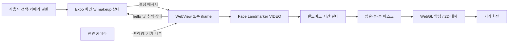

# AI 및 Computer Vision 아키텍처

## 0. 범위와 상태

본 문서는 정적 코드 관찰과 개선 제안을 구분한다. **PARTIAL**은 관련 코드가 있으나 요구 기능 전체 또는 실기기 실행이 검증되지 않은 상태다. **PLANNED**는 요구사항, **PROPOSED**는 개선 제안, **UNKNOWN**은 근거 부족이다. 실행 성능·모델 정확도·서비스 실제 가용성은 측정하지 않았다. [기능 명세](functional-spec.md) 및 [아키텍처](architecture.md)와 함께 읽는다.

## 1. 모델과 처리 위치

| 요소 | 입력 → 출력 / 실행·위치 | 상태 및 제한 |
|---|---|---|
| MediaPipe Face Landmarker | 전면 카메라 프레임 → 단일 얼굴 랜드마크. 모바일 WebView 또는 웹 iframe 안에서 실행. `components/ar/faceTrackerHtml.ts`의 `@mediapipe/tasks-vision` 버전 1.1.1, 외부 CDN WASM 및 Google 모델 URL의 float16 v1 task 사용 | PARTIAL. VIDEO·1 face·GPU 우선, 실패 시 CPU. 네트워크/모델 초기 로딩 필요. 실제 기기 호환·속도는 UNKNOWN |
| 메이크업 합성 | 좌표·제품 hex·강도·질감 + 영상 → 합성 영상. 기기 WebGL 또는 2D canvas | PARTIAL: `components/ar/faceTrackerHtml.ts`. 색상 외관은 화면과 조명에 좌우되며 물리적 발색 보장 불가 |
| 피부 기기 실험 | 캡처 프레임 → 얼굴 검출·ROI·정규화 → acne, pore, pigmentation, wrinkle 지표. `modules/skin-analysis/web/runtime.mjs`에서 ONNX Runtime Web WASM, OpenCV Haar; Android 선택적 네이티브 모듈 | PARTIAL. 플래그·기기·개발 서버 자산 필요. 모델/fixture 해시 및 일부 수치 검증, 결과는 `experimental_unvalidated`. 임상 진단 용도 아님 |
| 피부 서버 실험 | JPEG → YuNet 얼굴 박스 기반 ROI → 서버 모델 → 수치. `lib/skinServer.ts`, `server/nia/`, `reports/skin-analysis/desktop-gpu-server.md` | PARTIAL. 기본 서버 모드는 얼굴 이미지 서버 전송 금지 지침과 충돌. 사용 불가로 취급하고 P0에서 정책에 맞게 제거/차단하는 방안을 제안. 실제 실행 미검증 |
| 피부톤 셰이드 추천 | ITA/MST/undertone 또는 기존 셰이드 → 색상 거리 기반 제품/셰이드 결과. `backend/api/app/services/shade_service.py` | PARTIAL. 룰/색상 거리이며 생성 모델이 아니다. 사용자 조건과 품질 검증 미실시 |
| 챗봇 추천 | 텍스트·언어 → 카탈로그/그래프와 모델 연계 응답. `backend/chatbot/app/services/`, `backend/chatbot/app/clients/` | PARTIAL. 외부 모델·카탈로그 구성과 결과 정확성은 UNKNOWN. 제품 ID/가격 검증 보강은 아래 제안 |
| Image Segmenter / BiSeNet | 마스크 추론 | PLANNED 검토 후보. AR 실행 경로에서 사용 확인되지 않음. 기기 성능·라이선스·정확도 검증 전 채택하지 않음 |
| STT / 생성형 실시간 메이크업 | 음성 또는 이미지 → 명령·이미지 | PLANNED 검토 후보. 해당 실시간 경로 확인되지 않음. 개인정보·지연·비용·사용자 확인을 평가해야 함 |

피부 분석 ONNX 번들은 `scripts/skin-assets.mjs`와 `modules/skin-analysis/web/runtime.mjs`의 매니페스트에 따른다. 가중치 자체의 존재나 다운로드 가능성은 환경 의존이며, 모델 버전은 번들 버전·SHA-256으로 식별한다. 서버 실험은 `lib/skinServer.ts`가 `pytorch-cuda`, 스키마 버전과 `experimental_unvalidated`를 확인한다. 이 검증은 모델의 의료적 정확도를 보증하지 않는다.

## 2. 실시간 AR 흐름

`app/(tabs)/ar.tsx`는 동의·권한·화면 포커스와 앱 활성 상태를 관리하고 `store/makeupStore.ts`의 선택을 `ArFaceView`에 전달한다. `components/ar/ArFaceView.tsx`는 `window.__kb.receive`로 선택/비교 설정을 주입하고 상태 메시지를 받는다. 웹 구현은 `components/ar/ArFaceView.web.tsx`의 iframe이다. 페이지는 `getUserMedia`의 전면 카메라를 사용하고 `requestAnimationFrame`에서 새 비디오 프레임에 `detectForVideo`를 실행한다. 이 AR 경로는 프레임을 서버로 전송하지 않는다.

랜드마크에는 One Euro 필터를 적용한다. 일정 시간 얼굴이 보이지 않으면 추적 상태를 초기화한다. 입술 마스크는 입술 외곽과 내부를 사용하며 WebGL에서 LAB 색상 및 원래 밝기/질감을 활용한다. 볼은 얼굴 폭 기반 타원, 눈은 랜드마크 영역으로 부드러운 저해상도 마스크를 만든다. 비교 모드는 화면 일부에 효과를 표시한다. WebGL 사용 불가 또는 렌더링 오류 시 2D 합성으로 대체한다. 좌표 반전, 회전, 얼굴 가림, 낮은 조명 및 흔들림에서의 안정성은 실기기 검증 대상이다.

카메라 해상도 720×960은 `ideal` 요청이며 보장된 출력이 아니다. 렌더링·검출은 같은 페이지의 프레임 루프에서 수행하므로 지연, 발열, 메모리 증가 가능성이 있다. 기기별 FPS, p50/p95 추론 및 첫 화면 지연, 배터리/발열, 저조도·머리 회전·피부톤별 추적 손실을 측정하되 현재 수치는 UNKNOWN이다. 페이지 가시성 변경 시 비디오 트랙을 비활성화하고 화면 포커스/앱 상태를 반영한다. 실제 카메라 해제 시점은 기기별 시험이 필요하다.

## 3. 피부 분석 데이터 경계

`lib/skinAnalysis.ts`는 `EXPO_PUBLIC_ENABLE_SKIN_ANALYSIS=1`이고 지원 조건을 만족할 때 기능을 활성화한다. `EXPO_PUBLIC_SKIN_ANALYSIS_MODE=on-device`면 선택적 Android 네이티브 또는 Expo Go 실험용 WebView에서 추론한다. `modules/skin-analysis/web/runtime.mjs`는 번들 해시와 fixture를 검사하고 OpenCV 검출·전처리·ONNX WASM 추론 뒤 숫자 결과를 전달한다. `hooks/useSkinAnalysis.ts`는 결과 검증·설문·취소·저장 흐름을 관리하고, `store/skinProfileStore.ts`는 결과와 설문을 저장한다. `lib/skinFilters.ts`는 결과로 추천 관심사를 제시하고 사용자가 선택한 코드만 상품 조회에 사용하도록 설계되어 있다.

**정책 충돌:** 동일 코드의 기본 모드는 서버 모드이며, 활성화되면 `modules/skin-analysis/web/capture.mjs`에서 캡처된 JPEG를 `hooks/useSkinAnalysis.ts`가 조립해 `lib/skinServer.ts`의 `uploadSkinPhoto`로 `/analyze`에 전송한다. 제한된 origin, 인증, 타임아웃 및 메모리 정리는 존재하나 사용자 지침의 얼굴 이미지 서버 전송 금지를 충족시키지 못한다. `app.json`의 전송 고지 및 `docs/ARCHITECTURE.md`의 서버 실험 설명과 같은 문서 상단의 전송 금지 선언도 서로 맞지 않는다. 실제 사용·배포 여부는 UNKNOWN이며 정책 정합성 확보 전 이 경로를 활성화하지 않는 것이 제안이다. 문서 작업은 코드를 변경하지 않는다.

## 4. 추천 신뢰성과 모델 변경 제안

현재 `backend/chatbot/app/services/chat_service.py`는 그래프에서 찾은 제품만 추천하도록 LLM 프롬프트를 만들고 해당 제품의 참조 목록을 별도로 반환한다. 그러나 자유 텍스트 답변이 실제 목록에 한정되는지 사후 검증하지 않는다. 이 프롬프트 지시는 환각 방지 보증이 아니다.

**PROPOSED**: 모델이 제안한 제품은 서버 카탈로그의 검증된 ID·셰이드로 해석하고 제목·가격·링크는 카탈로그에서 다시 채운다. 없는 ID, 옵션 불일치, 오래된 가격은 제외하거나 사용자에게 확인 불가로 표시한다. 결과에 출처·시각과 데이터 버전을 기록하고 LLM이 임의로 만든 URL을 신뢰하지 않는다.

모델 추가는 전처리·입출력 스키마·모델/런타임 버전·해시·라이선스·실패 대체 경로를 함께 고정한다. 모델별 검증 데이터 분리, 피부톤·기기·조명·각도 하위집단 성능과 신뢰구간을 측정하고 승인된 임계값을 명시한다. 세그먼테이션은 현재 랜드마크 마스크의 한계가 측정되고 모바일 예산과 데이터 권리가 확인된 이후 실험한다. 외부 AI 호출에 얼굴 이미지를 보내는 설계는 현 지침상 허용하지 않는다. 일반 RGB 영상으로 UV 분포·선크림 보호막 또는 실제 차단율을 측정한다고 주장하지 않는다.

## 5. 검증 계획

`__tests__/`와 `scripts/skin-*.test.mjs`, `ml/tests/`의 존재는 테스트 성공을 뜻하지 않는다. 코드 변경 시 AR HTML 스크립트는 TypeScript 검사 밖이므로 `npm test`가 필요하다. 실기기에서는 카메라 권한 거부/재허용, 앱 백그라운드 및 회전, CDN 실패·오프라인, 얼굴 이탈·복귀, WebGL 실패, CPU 대체, 모델 자산 결함, 분석 취소와 저장 실패를 재현한다. 원본 이미지의 전송·보관 경계를 네트워크 및 저장소 관찰로 확인한다. 피부 결과는 독립 검증 전 실험 결과로만 표시한다.
