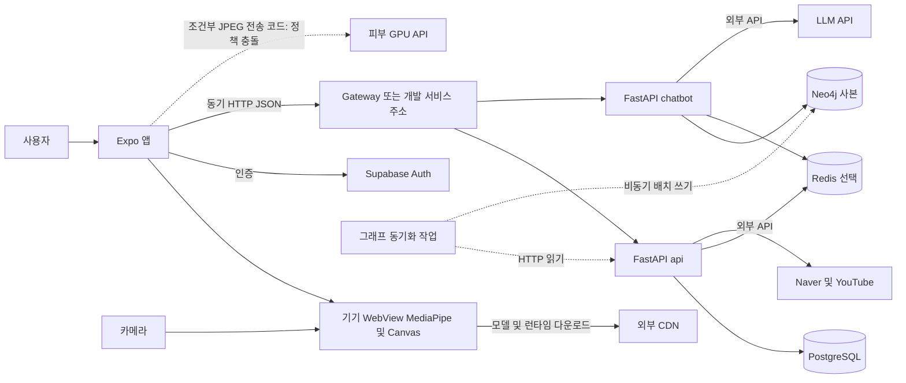
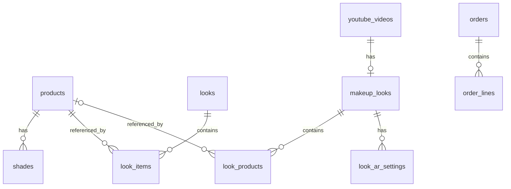

# VISHUE 시스템 아키텍처 분석과 목표 설계

> 분석 기준: 2026-10-28 작업 트리. 기존 미커밋 결제 변경도 관찰 대상으로 포함한다. 동작 중인 배포, 실제 데이터 및 모바일 실기기는 확인하지 않았다. 이 문서는 분석·제안이며 기존 규칙은 [ARCHITECTURE.md](../ARCHITECTURE.md), 배포 절차는 [DEPLOYMENT.md](../DEPLOYMENT.md)가 기준이다. 코드와 규칙이 충돌하는 경우 충돌을 해소했다고 가정하지 않는다.

## 0. 프로젝트 배경과 결정

VISHUE는 K-Beauty 제품과 룩을 탐색하고 모바일에서 가상 메이크업을 체험하며 셰이드와 제품을 추천받는 서비스다. 사용자는 일반 소비자, 카탈로그 운영자, 앱·서버 개발자다. 판매 연계, B2B AR 제공, B2C 구독은 제품 방향이며 별도 완성 기능으로 단정하지 않는다. 요구는 저지연 기기 내 AR, Expo Go 호환, 카탈로그 신뢰성, 네 가지 언어, 장애 격리와 얼굴 영상·이미지 비전송이다.

상태 표기는 **IMPLEMENTED**(실제 동작 확인), **PARTIAL**(코드가 있으나 미완성 또는 실행 미검증), **PLANNED**(기존 계획), **PROPOSED**(본 문서 제안), **UNKNOWN**(근거 부족)이다. 이 문서에서 코드만 확인한 기능은 원칙적으로 PARTIAL로 표시한다. 실제 기기, 운영 배포, 네트워크, 데이터 품질과 모델 정확도는 검증하지 않았다.

가장 시급한 차이는 `lib/skinAnalysis.ts`가 피부 분석 활성화 시 기본으로 서버 모드를 선택하고, `lib/skinServer.ts`가 JPEG를 `/analyze`로 전송하는 코드가 있다는 점이다. 개발 전용 NIA 프록시도 이미지가 포함될 수 있는 요청을 로컬 서비스로 전달한다 (`server/services/niaEvaluationService.ts`). `docs/ARCHITECTURE.md`의 GPU 예외 및 `app.json`의 고지와 이번 작업의 **어떤 서버에도 얼굴 이미지 전송 금지** 지침은 충돌한다. 실제 전송은 실행 검증하지 않았다. 정책 정합성이 확인되기 전 관련 경로를 배포·활성화하지 않는 것이 PROPOSED P0이며 목표 구조에서는 이미지가 기기를 떠나지 않는다. 이 문서 작업은 코드를 변경하지 않는다.

| 대안 | 개발 비용·장점 | 운영 및 확장 | 결정 |
|---|---|---|---|
| 기존 두 FastAPI 서비스와 앱 유지 | 기존 코드·계약 재사용, 변경 적음 | 챗봇 비용·장애를 분리하나 배포 단위 2개 유지 | **선택 / PARTIAL**: 이미 존재하는 경계를 유지하며 기능별 모듈 경계를 개선 |
| 단일 모듈러 모놀리스로 통합 | 배포 단순화 가능 | 챗봇 장애·비밀키·스케일 격리를 재설계해야 함 | PROPOSED 대안; 현재 이관 비용 대비 이점 불확실 |
| 세분화된 MSA | 독립 배포·확장 | 인프라·계약·관측·인력 비용 증가 | 현재 규모에서는 보류; 별도 부하와 소유권 근거가 생길 때 재평가 |

선택은 현 상태를 출발점으로 한다. `backend/api`와 `backend/chatbot`을 더 쪼개거나 루트 앱을 `mobile/`로 옮기지 않는다. 모델·데이터 파이프라인·결제의 독립 서비스화는 부하, 소유권, 실패 격리 필요성이 측정된 뒤 검토한다. 선택 근거와 비용은 [ADR-0001](../adr/0001-two-backend-services.md), [감사](architecture-audit.md)를 함께 참조한다.

## 1. 시스템 아키텍처

### 1.1 서비스 경계와 소유권

| 서비스·모듈 | 언어 | 책임 | 데이터 소유권 | 상태·근거 |
|---|---|---|---|---|
| Expo 앱 | TypeScript, WebView JavaScript | 화면, 기기 상태, 카메라·AR, 인증 세션 | 기기 내 상태·피부 결과 | PARTIAL; `app/`, `components/ar/`, `store/` |
| api | Python | 제품·룩·매장, 판매처, YouTube 검색, 셰이드, 회원, 작업 트리 결제 | PostgreSQL 원본; Redis 캐시 | PARTIAL; `backend/api/app/`, `backend/api/alembic/` |
| chatbot | Python | 그래프 검색·LLM 응답·그래프 동기화 | Neo4j 검색용 사본, Redis 제한 | PARTIAL; `backend/chatbot/app/` |
| 피부 연구·GPU API | Python, JS, Kotlin | 연구·평가, 로컬 또는 서버 피부 분석 실험 | 연구 자산; 실제 보존·운영 상태 UNKNOWN | PARTIAL; `ml/`, `modules/skin-analysis/`, `lib/skinServer.ts`; 서버 전송 충돌 별도 처리 필요 |
| Supabase Auth | 외부 | 로그인·JWT 발급 | 인증 사용자 | PARTIAL; `lib/auth/`, `backend/api/app/core/auth.py`; 설정과 운영 상태 UNKNOWN |
| 배치 | Python·CI·Helm | 카탈로그 시드와 그래프 복사 | 원본은 api, 그래프는 chatbot | PARTIAL; `backend/*/app/jobs/`, `.github/workflows/`, `infra/helm/vishue/templates/` |

### 1.2 구성도: 현재 코드·설정 관찰

실선은 요청·처리, 점선은 예약 작업 또는 조건부 경로다. 실제 배포를 주장하지 않는다. 구매 연계는 판매처 URL과 미커밋 결제 코드를 구분한다.

```text
사용자 → Expo 화면 → WebView 카메라 → MediaPipe + Canvas (기기 내)
                 ├→ Supabase Auth (인증)
                 └→ HTTP JSON → Gateway ┬→ api → PostgreSQL / Redis
                                        │       └→ Naver / YouTube
                                        └→ chatbot → Neo4j / Redis / LLM
                              예약 동기화: api HTTP → chatbot Job → Neo4j
     [조건부·정책 충돌] 피부 JPEG → GPU /analyze (코드 존재, 동작 미검증)
정적 모델: 외부 CDN 다운로드; 제품 이미지: 외부 URL; 별도 파일 저장소 운영 UNKNOWN
```



올리브영 전용 수집기·검증된 매칭 DB, 객체 저장소, 별도 영상 처리 서비스는 확인하지 못했다. 네이버 검색 결과나 YouTube 검색 자체가 올리브영 동일 제품 매칭을 보장하지 않는다. 목표 구성에서는 GPU로 가는 이미지 화살표를 제거하고 수치 정보만 필요한 계약에 전송한다.

### 1.3 통신·장애 원칙

| 흐름 | 요청자 → 처리 | 형식·응답 | 현 코드의 시간 제한·재시도·대체 | 목표 성능 |
|---|---|---|---|---|
| AR | 카메라 → 기기 WebView | 프레임 로컬 처리, 상태 메시지 | 모델 CDN·카메라 실패 시 상태 표시; 프레임 네트워크 업로드 아님 (`components/ar/faceTrackerHtml.ts`) | 실측 UNKNOWN; P0에서 기기별 프레임 시간·발열 예산 수립 PROPOSED |
| 상품·판매처 | 앱 → api | HTTP JSON | `naver_client.py` 5초, 429에 한 번 지연 재시도; 캐시 실패는 miss (`core/cache.py`); 빈 결과·오류는 기능별 처리 | 사용자 체감 p95 기준 측정 후 제안 |
| 영상 검색 | 앱 → api → YouTube | HTTP JSON, 검색 결과 | YouTube 클라이언트 5초; 키·외부 장애 시 에러; `routers/tutorials.py`, `clients/youtube_client.py` | UNKNOWN |
| 셰이드 | 앱 → api | 피부톤 숫자 JSON → 순위 | `services/shade_service.py` CIEDE2000; DB·입력 오류를 응답으로 전달; 추가 재시도 확인 안 됨 | UNKNOWN |
| 챗봇 | 앱 → chatbot → Neo4j·LLM | HTTP JSON, 비스트리밍 응답 | LLM 기본 30초, 미설정 503, upstream 오류 502; `core/ratelimit.py` Redis 장애 시 fail-open | UNKNOWN; 재시도는 중복 비용을 고려해 명시적 정책 필요 PROPOSED |
| 그래프 동기화 | Job → api → Neo4j | 페이징 HTTP, 배치 쓰기 | catalog client 기본 15초; 재실행·원자성·실제 주기 점검 필요 | freshness 관측 후 목표 설정 PROPOSED |
| 결제 | 앱 → api → 결제 공급자 | 주문 JSON, 브라우저 반환·확인 | 미커밋 코드 `clients/toss_client.py` 10초; 실제 결제·멱등성 검증 UNKNOWN | P0에서 중복 확인·실패 복구 검증 PROPOSED |

숫자는 코드 설정이지 관측된 성능이 아니다. 공통 오류 계약 `{ error, code }` 및 Pydantic 검증의 실제 예외는 [API 명세](api-spec.md)를 따른다. 네트워크 재시도는 GET의 제한적 재시도와 결제 등 쓰기 작업의 멱등성 검증을 분리한다(PROPOSED).

### 1.4 비동기 작업과 이벤트

현재 시드와 그래프 복사는 실행 진입점·CI/배포 잡으로 존재한다. YouTube 제품 추출, 정규화·검수·매칭, 추천 인덱스 갱신은 확인되지 않은 목표 작업이다. 소규모 MVP는 스케줄러와 재실행 가능한 작업을 우선하고 메시지 브로커는 운영 부하·독립 소비자 요구가 증명될 때만 도입한다(PROPOSED). 목표 작업은 `sourceId`, `sourceVersion`, `runId`와 상태를 기록하고 동일 버전 재처리를 멱등화하며 실패는 사유와 재시도 횟수를 남긴다. 큐를 도입한다면 생산자·소비자·스키마 버전, backoff, 최대 횟수와 DLQ 운영자를 함께 정한다. 현재 큐와 DLQ 구현은 확인하지 못했다.

### 1.5 핵심 흐름: 현재와 목표

| ID | 현재 관찰 (PARTIAL, 실행 미검증) | 목표와 실패 처리 (PROPOSED) |
|---|---|---|
| FLOW-01 AR | `ArFaceView` → WebView 카메라 → Face Landmarker → 좌표·Canvas → 화면, 모델 원격 로드 | 권한 거부·미검출·오프라인 상태 안내, 추론 부하 계측; 얼굴 영상 전송 금지 |
| FLOW-02 영상 | `routers/tutorials.py`의 YouTube 검색과 룩 탐색이 존재 | 영상별 사용 제품·검증 매칭·AR 연결을 별도 계약으로 구축; 미검증 후보를 동일 제품으로 표현하지 않음 |
| FLOW-03 매칭 | `naver_client.py` 판매처 검색, 시드 룩-상품 관계는 존재; 영상 제품의 검증 매칭은 확인 안 됨 | 브랜드·제품·용량·옵션·색상을 분리하고 exact/variant/candidate/no-match/review를 구분해 검수 |
| FLOW-04 추천 | `shades/recommend`는 숫자 기반 색차, `chat_service.py`는 그래프 후보와 LLM | 허용된 후보 ID 검증, 결과 근거·외부 호출 실패 처리와 평가셋 운영 |
| FLOW-05 피부 | 기기 추론 실험 및 JPEG 서버 전송 코드 공존 | 영상·사진·ROI·텐서 모두 기기에 유지, 검증된 수치만 전송; 모델 결과는 의료 진단으로 취급하지 않음 |
| FLOW-06 음성 | 음성 명령 구현 확인 못함; Android 마이크 권한 차단 `app.json` | STT 채택 전 명령 집합·동의·기기/서버 경계·오인식 복구를 정함 |

## 2. 백엔드 구조

### 2.1 계층과 모듈

`backend/<service>/app/`의 `routers`·`jobs` → `services` → `repositories` 또는 `clients` → `models` → `schemas` → `core`를 import-linter가 검사한다 (`pyproject.toml`). 라우터는 입력·응답, 서비스는 업무 규칙, repository는 저장, client는 외부 호출을 담당한다. 기능 중심 Presentation/Application/Domain/Infrastructure 구분은 논리적 책임으로만 적용하고 새 추상화 계층을 강제하지 않는다. `app/api/dev/`와 `server/`는 별도의 개발용 Expo API 경로다.

| 모듈 | 입력 → 출력·의존성 | 저장 범위·근거 |
|---|---|---|
| catalog | 질의·ID → 제품/룩/매장; `CatalogService` → `CatalogRepository`, image client | api PostgreSQL·캐시; `backend/api/app/services/catalog_service.py` |
| offers·tutorials | 검색어 → 판매처/영상; Naver·YouTube clients | 외부 응답·캐시; `backend/api/app/services/`, `clients/` |
| shades | MST·ITA·undertone → 색차 순위; `ShadeService` → catalog | 상품 읽기, 숫자 계산; `backend/api/app/services/shade_service.py` |
| chat | 메시지·선택적 피부톤 → 답변·후보; `ChatService` → graph·LLM | Neo4j 읽기; 본문과 후보 일치 사후 검증 없음 `backend/chatbot/app/services/chat_service.py` |
| payments | 주문·승인 → 결제 결과; `PaymentService` → 저장소·Toss client | 미커밋 코드, 거래 검증·배포 UNKNOWN; `backend/api/app/services/payment_service.py` |

### 2.2 API와 일관성

공개 HTTP 경로·인증·입출력은 [api-spec.md](api-spec.md)에 수록한다. 서비스 간 그래프 복사는 api의 제품·룩 HTTP를 읽으며 챗봇은 PostgreSQL에 직접 접근하지 않는다. 서비스 오류, 검증, 인증은 각 `core/errors.py`, `core/auth.py`와 스키마를 기준으로 한다. 카탈로그 교체는 서비스 검증 후 repository를 통해 수행하고 캐시 prefix를 무효화한다. 결제 거래의 트랜잭션·중복·외부 승인 간 복구는 별도 테스트가 필요하다. 민감 값이나 얼굴 데이터는 로그·LLM 프롬프트에서 제외하도록 검증하는 것을 제안한다.

## 3. 모바일 프론트엔드

### 3.1 기술과 경계

`package.json`: Expo 58, React Native 0.88, TypeScript, Expo Router, TanStack Query, Zustand, WebView, `expo-camera`. 라우팅은 `app/`, 서버 조회는 화면·`hooks/`와 `lib/queries.ts`, 컴포넌트는 props, 기기 상태는 `store/`, 공용 타입은 `types/`다. `eslint.config.js`가 의존 방향을 검사한다. 인증 세션은 `lib/auth/`에서 관리하고 `lib/api.ts`가 토큰을 붙인다. `lib/i18n/`에 네 언어가 있다. 기능별 폴더 이동보다 기존 계층과 기능별 컴포넌트 경계를 유지한다.

### 3.2 카메라와 렌더링

`components/ar/faceTrackerHtml.ts`는 `getUserMedia`로 카메라를 열고 `requestAnimationFrame`과 `detectForVideo`로 추적한 뒤 Canvas에 효과를 그린다. `ArFaceView`는 메시지로 설정·상태를 교환한다. WebView가 MediaPipe 런타임과 모델을 CDN에서 받는다. 전면 반전·좌표 변환·얼굴 이탈·카메라 해제 코드는 실기기별 검증이 필요하다. 프레임 드롭, 동시 추론, 초기 다운로드, 메모리, 회전, 조명·피부톤 편차, 발열은 위험 요인이지 실측된 결함은 아니다. `__tests__/faceTracker.test.ts`는 HTML 스크립트 검사에 도움을 주지만 실제 렌더 성능을 보증하지 않는다.

| 기능 | 기기 | 서버 | 근거·이유 |
|---|---|---|---|
| AR·얼굴 랜드마크 | 프레임·추론·그리기 | 모델 파일 배포/CDN | 저지연·프라이버시; `components/ar/faceTrackerHtml.ts` |
| 피부 분석 | 기기 실험 존재 | 현재 JPEG 업로드 코드도 존재 | 정책 충돌, 목표는 기기만; `lib/skinAnalysis.ts`, `lib/skinServer.ts` |
| 셰이드 추천 | 피부톤 추정 값 | 색차 계산·상품 조회 | 숫자만 전달; `backend/api/app/services/shade_service.py` |
| 제품·챗봇 | 입력·결과 표시 | 검색·LLM | `lib/api.ts`, `backend/chatbot/app/` |
| STT·자외선 보호막 | 미확인 | 미확인 | UNKNOWN/PLANNED; RGB 영상만으로 실제 UV 보호 측정 불가 |

## 4. AI·CV 설계

Face Landmarker는 기기 WebView 추적에 사용된다. 피부 분석 실험은 ONNX Runtime Web 및 별도 Android 네이티브 모듈, GPU 서버 코드를 포함한다. 네이티브 모듈은 Expo Go에 포함된다고 가정할 수 없다. 셰이드 추천은 학습 모델이 아닌 수치 휴리스틱과 CIEDE2000이며, 챗봇은 그래프 검색과 외부 LLM이다. Image Segmenter, BiSeNet, 생성형 실시간 메이크업과 STT는 확인되지 않아 도입 제안 또는 UNKNOWN이다. 성능·정확도는 장치·조명·데이터셋·모델 버전별로 평가해야 하며 측정값을 지어내지 않는다. 모델별 의존성·대안·검증은 [ai-cv-architecture.md](ai-cv-architecture.md) 참조.

## 5. 데이터·DB

시드 `backend/api/seed/catalog.json` → `seed_catalog` 검증·저장 → api → 앱 및 `sync_graph` → Neo4j 사본이 확인되는 경로다. YouTube 검색과 Naver 검색은 별도의 외부 호출이며, 영상에서 제품 추출·검증 매칭을 자동으로 수행한다는 근거는 없다. 목표 파이프라인은 원본·수집 시각·정규화 버전·근거·검수 기록을 유지하고 동일 상품과 유사 후보를 구분한다. 검증 커버리지는 `EXACT_MATCH / 영상의 전체 추출 제품 수`로 정의하고 옵션 차이는 별도 집계하며 분모가 0이면 미산출로 처리하는 방안을 제안한다. 상세는 [data-pipeline.md](data-pipeline.md).

실제 PostgreSQL 테이블·컬럼·관계는 `backend/api/app/models/`와 Alembic에서 확인하며 Neo4j는 별도 사본이다. 영상과 룩·제품 관계 모델은 존재하지만, 매칭 심사 이력과 추천 이력 등의 추가 엔티티는 현재 테이블로 단정하지 않는다. PK/FK·인덱스와 제안 ERD는 [erd.md](erd.md) 참조. 개인 결과의 보존 기간·삭제 요청 절차·외부 데이터 사용 허가와 실제 DB 내용은 UNKNOWN이다.

아래는 코드에서 확인한 주요 FK의 축약도다. `look_products.product_id`는 null일 수 있고, 주문 테이블은 기존 미커밋 작업에 있다. 논리 관계 전체나 실제 DB 마이그레이션 적용 여부를 뜻하지 않는다.



## 6. 인프라·운영

| 환경 | 저장소 근거 | 확인 수준 |
|---|---|---|
| 로컬 | `infra/compose/`, Expo 개발 서버 | 구성 코드 존재; 이번 작업에서 실행 안 함 |
| 팀 개발 | `infra/render/render.yaml`, `docs/adr/0009-render-dev-environment.md` | 설정·절차 존재; 실제 서비스 상태 UNKNOWN |
| 테스트 | `__tests__/`, `backend/*/tests/`, `.github/workflows/` | 자동 테스트 코드; 통합 환경 가용성 UNKNOWN |
| 시연 | `infra/kind/`, Helm local values | 정의 존재; 실행 상태 UNKNOWN |
| 운영 | Terraform AWS, Helm prod, Argo CD | 목표·설정 존재; 실제 리소스와 비용 UNKNOWN |

앱 배포 설정은 `eas.json`, 서버는 Docker·Helm·GitOps 설정을 사용한다. `infra/argocd/`, `.github/workflows/`와 `docs/DEPLOYMENT.md`가 변경·롤백 경로를 정의한다. 적용 여부는 확인하지 않았다. API 키는 서버 전용, Supabase 공개 URL과 publishable 키만 앱 공개 설정으로 사용한다. Redis 장애 시 캐시 누락 또는 rate limiter fail-open 정책의 운영 위험을 관측해야 한다. 백업·복원, 권한·보존 기간, TLS 및 실제 비밀 관리, 알림 수신자는 운영 환경에서 별도 검증한다.

성장 시 기기 내 AR 사용량이 곧 서버 프레임 처리량이 되는 것은 아니다. 모델 CDN 다운로드, 카탈로그·LLM 호출 비용, DB 읽기, 배치 처리량을 각각 측정하고 병목이 생긴 부분만 확장한다. 테스트 기준은 단위·API 통합·기기 E2E, 매칭 정밀도, 얼굴 추적 안정성, 프레임/모델 시간, 추천 유효성, 오류율 및 데이터 복구로 나눈다. 수치 SLO는 측정 후 결정한다.

## 7. 디렉터리

### 7.1 현재 주요 구조

```text
app/                 Expo Router 화면; api/dev는 개발용 서버 라우트
components/          화면 표시와 AR WebView 렌더러
hooks/               화면 수준 데이터·상태 조합
lib/                 HTTP, 인증, 질의, i18n, 피부 분석 실행 경계
store/               기기 상태 및 저장
types/ constants/    공유 계약과 상수
backend/api/         FastAPI 카탈로그·셰이드·회원·결제 작업 트리, PostgreSQL
backend/chatbot/     FastAPI 챗봇·그래프 복사, Neo4j
modules/skin-analysis/ 피부 분석 웹·Android 실험
ml/ reports/         학습·평가 코드와 보고서
server/              개발 전용 연구 서버 로직
infra/               Compose, Helm, Argo CD, Render, Terraform
__tests__/           클라이언트 테스트; backend/*/tests/ 서버 테스트
docs/                기존 규칙·운영 문서 및 이번 설계
```

루트 `android/`는 작업 공간에서 관찰했지만 생성물·추적 여부나 운영 빌드 사용은 별도 확인이 필요하다. 구조 설명을 위해 수정하지 않는다.

### 7.2 목표 구조 (PROPOSED)

현재 폴더와 서비스 경계를 유지한다. 실제 필요가 증명되면 `backend/api/app/` 아래 데이터 매칭 모듈, `evaluation/`(제안, 평가 데이터·측정), `docs/`의 계약 문서를 추가한다. 새 `mobile/`, `ai/`, `contracts/`, `infrastructure/`로 강제 이관하지 않는다. 다섯 명의 독립 작업 경계·선행 관계는 [roadmap.md](roadmap.md), 실행 가능한 기능 조건은 [functional-spec.md](functional-spec.md)에 정리한다.

```text
app/ components/ hooks/ lib/ store/ types/   기존 앱 경계 유지
backend/
  api/app/            기존 router → service → repository/client 유지
    services/         검증된 매칭 업무 모듈 (제안)
  chatbot/app/        기존 그래프·LLM 경계 유지
modules/ ml/          기기 CV와 연구 경계 유지
evaluation/           추천·매칭·기기별 평가 자료 (제안)
infra/                기존 배포 코드 유지
docs/design/          설계·계약·검증 기록
```
