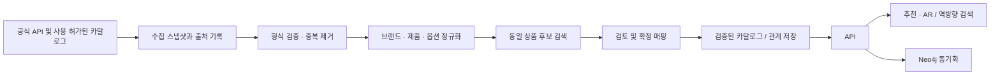

# 데이터 파이프라인과 제품 매칭

## 1. 범위와 상태

이 문서는 저장소에서 확인한 카탈로그와 YouTube 처리 경로 및 그 위의 개선안을 구분한다. `PARTIAL`은 코드가 존재하나 전체 흐름이 완성되거나 실제 환경에서 동작함이 확인되지 않은 상태다. `PROPOSED`는 신규 설계다. 이 분석에서 외부 API, 배포 워크플로와 실제 DB는 실행하거나 조회하지 않았으므로 운영 데이터, 수집 성공률과 최신성은 `UNKNOWN`이다.

| 데이터 | 현재 경로와 상태 | 근거 |
|---|---|---|
| 카탈로그 | `seed/catalog.json`을 검증 후 PostgreSQL로 교체하는 잡 코드 존재; 환경별 실제 실행은 UNKNOWN | `backend/api/app/jobs/seed_catalog.py`, `backend/api/app/services/catalog_service.py`, `docs/DATA.md` |
| YouTube 후보 | 공식 API에서 공개·임베드 가능 영상 후보 CSV 수집 코드 존재; 실행은 미검증 | `backend/api/app/jobs/collect_youtube_playlist.py`, `backend/api/app/services/youtube_playlist_service.py` |
| 영상 제품 | 검토된 별도 CSV를 분해·분류해 비검증 제품 CSV와 이슈 CSV를 생성; DB 적재와 자동 매칭은 확인되지 않음 | `backend/api/app/jobs/normalize_youtube_candidates.py`, `backend/api/seed/source/` |
| 판매처 | 검색 시 네이버 쇼핑 조회 코드가 존재하며 Olive Young 전체 카탈로그 수집은 확인되지 않음 | `backend/api/app/clients/naver_client.py`, `backend/api/app/services/` |
| 룩·영상·제품 관계 | `youtube_videos`, `makeup_looks`, `look_products` 등의 DB 모델과 공개 룩 조회 존재; 정규화 CSV에서 이 테이블로의 자동 적재는 확인되지 않음 | `backend/api/app/models/idol_look.py`, `backend/api/app/repositories/idol_look_repository.py` |
| 그래프 사본 | chatbot 잡이 API 카탈로그를 읽어 Neo4j에 반영하도록 구성; 실제 실행은 UNKNOWN | `backend/chatbot/app/jobs/sync_graph.py`, `backend/chatbot/app/services/graph_sync_service.py` |
| 개인 분석·추천 | 기기 측 저장 및 추천 요청에 쓰이는 수치와 설문은 코드별로 확인 필요; 중앙 저장·보존기간은 UNKNOWN | `store/`, `lib/`, `types/index.ts` |

수집 CSV와 제품이 포함된 검토 CSV는 열 형식이 다르다. 두 파일 사이 변환 또는 수동 검토가 필요하며, 현재 확인한 잡을 하나로 이어진 자동 파이프라인으로 해석해서는 안 된다. 원본 CSV에 `제품명`이 있어도 영상 제품 인식이나 동일 상품 확정을 뜻하지 않는다.

## 2. 현재 데이터 흐름

```text
YouTube Data API → playlist 수집 → youtube_candidates.csv
                                      ↓ 별도 검토·제품 정보 준비 (자동화 여부 UNKNOWN)
                        youtube_candidates_with_products.csv
                                      ↓ normalize_youtube_candidates
               영상 CSV + 영상별 제품 후보 CSV + 이슈 CSV (DB에 쓰지 않음)

수동 관리 catalog.json → CatalogBundle 검증 → catalog service → PostgreSQL
PostgreSQL → api GET /api/products, /api/looks → chatbot sync job → Neo4j 사본
```

| 단계 | 입력 → 출력 | 확인된 처리와 한계 |
|---|---|---|
| 수집 | playlist ID → `playlistId`, `playlistItemId`, `playlistPosition`, `videoId`, 제목, 설명, 채널, 게시일, 길이, 썸네일, 검토상태 등의 CSV | 중복 `videoId`, 비공개·삭제·임베드 불가 영상은 제외 사유를 보고한다. API 키 필요. 출처: `youtube_playlist_service.py`, `collect_youtube_playlist.py` |
| 영상·제품 정규화 | 한국어 헤더의 검토 CSV → `youtube_videos_normalized.csv`, `youtube_video_products_normalized.csv`, `youtube_normalization_issues.csv` | 필수 열과 중복 video ID 검사, ` / ` 기준 제품 분리, 단어 패턴 분류. 브랜드·색상은 빈 값, `mappingStatus=unverified`, `reviewStatus=needs_review`; 원문 `rawProductText` 보존. 일부 영상은 코드 내 override 사용 |
| 메타데이터 갱신 | 등록된 세 video ID → 외부 메타데이터 → DB 갱신 | `refresh_youtube_metadata.py`는 일부 실패를 모아 보고하고 나머지 갱신을 계속한다. 목록과 실행 시점은 코드에 고정되어 있다 |
| 카탈로그 적재 | `CatalogBundle` JSON의 `products`, `looks`, `stores` → PostgreSQL | Pydantic과 서비스 무결성 검사 후 교체. 제품·룩·셰이드 참조 등을 검사한다. 외부 수집 CSV를 직접 입력받는 과정은 확인되지 않음 |
| 그래프 복사 | API 카탈로그 응답 → Neo4j | 챗봇은 PostgreSQL 직접 접근 대신 API 사용. Helm 기본값은 30분, local 값은 10분이며 배포 후 잡도 정의됨. `dev-data.yml`은 12시간 스케줄에서 그래프 복사만 실행하고 시드는 비예약 실행에서 적재한다. 실제 배포·최근 실행은 UNKNOWN |

각 잡의 출력 파일은 동일 경로에 다시 실행하면 덮어쓸 수 있으므로 원본 보전과 변경 검토가 필요하다. CSV는 로컬 파일이므로 Git 변경 이력으로 버전을 식별할 수 있지만 실행별 입력 해시, 처리 버전 및 변경 감사 기록을 자동으로 남기는 완전한 계보 시스템은 확인되지 않았다. 파일별 수집 시각과 원본 정합성도 확인 필요다.

## 3. 목표 파이프라인 (PROPOSED)



| 단계 | 입력·출력 계약과 검증 | 실패·재실행·주기 |
|---|---|---|
| 수집 | 원본 식별자, 출처 URL·종류, 조회 시각, API 버전·권한, 원문, 수집 실행 ID와 해시를 보존한다 | 실패한 페이지와 제한 응답을 기록하고 정상 스냅샷을 유지; 주기는 공급자 정책·실제 요구 확인 후 결정 |
| 검증·중복 제거 | 필수 필드·형식·식별자 확인, `(source, external_id)` 기준 중복을 기록하며 처리. 누락 행을 검토 대기열로 보낸다 | 전체 실패와 행별 격리를 구분하고 오류 원본을 추적한다 |
| 정규화 | `raw`, 표준 브랜드 ID, 제품명, 용량, 색상명·호수, 분류, 정규화 규칙 버전 출력 | 알 수 없는 값은 null/검토로 남긴다. 추정값을 원문으로 덮지 않는다 |
| 후보·검토 | 제품 후보 ID, 세부 옵션, 근거, 점수·버전, 판정자·시각, 상태를 기록한다 | 데이터 변경이나 규칙 변경 시 기존 확정을 자동으로 재확정하지 않고 재검토한다 |
| 저장·공개 | 무결성 검사된 승인본만 트랜잭션으로 반영. 영상·제품 관계는 원본 및 검토 상태를 보존한다 | 반영 전후 수량·오류를 기록하고 이전 승인본으로 복구 가능한 절차를 마련한다 |
| API·추천 | 확정 관계와 후보를 다른 응답 상태로 제공하고 출처·기준 시각을 표시한다 | 데이터 없음은 빈 결과와 이유로 응답하며 임의의 제품을 만들지 않는다 |

소규모 단계에서는 수동 실행 또는 기존 CI/스케줄러를 우선하고 큐 도입은 처리량·독립 재시도 요구를 측정한 뒤 결정한다. 재실행의 멱등 키는 `(source, external_id, source_version)`와 실행 ID를 분리하여 설계한다. 메시지 브로커를 도입한다면 생산자, 소비자, 이벤트 ID·스키마 버전·원본 ID·시각, 멱등 처리, 제한된 재시도와 실패 격리/DLQ를 별도로 정의한다. 이것은 현재 구현이 아니다.

## 4. 매칭 및 검토 정책 (PROPOSED)

1. 브랜드 별칭을 표준 브랜드 ID에 연결하고 제품명에서 공백·표기 차이를 정규화한다. 원문은 유지한다.
2. 용량·제형·색상명·호수를 별도 필드로 추출한다. 브랜드, 제품, 옵션과 외부 상품 ID를 구별한다.
3. 브랜드와 제품의 식별 근거가 일치하는 후보만 확정 대상으로 취급한다. 옵션이 다르거나 불명확하면 상품 단위와 옵션 단위를 분리해 판단한다.
4. 유사도는 후보 정렬에만 쓰고, 충돌하거나 증거가 부족하면 사람이 확인한다. 비슷하다는 이유만으로 동일 상품으로 연결하지 않는다.
5. 각 결정에 출처, 근거 문구, 판정 시각과 규칙 버전을 남긴다. 공식 판매처 데이터의 품절·상품명 변경은 기존 매핑을 재검토 대상으로 표시한다.

| 제안 상태 | 의미 | 사용자 표시·자동 처리 |
|---|---|---|
| `EXACT_MATCH` | 검증 가능한 동일 제품·해당 옵션 | 동일 제품으로 표시 가능 |
| `VARIANT_MATCH` | 제품은 같으나 색상·용량 등 옵션이 다르거나 별도 확인됨 | 옵션 차이를 명시; 동일 옵션으로 취급 금지 |
| `CANDIDATE_MATCH` | 유사 후보이나 동일성 미확정 | 대체 후보로만 표시 |
| `NO_MATCH` | 현재 확인 가능한 후보 없음 | 미매칭으로 표시 |
| `REVIEW_REQUIRED` | 충돌·불충분한 증거로 사람 검토 필요 | 확정 결과에서 제외 |

위 상태는 기존 CSV의 `unverified` 및 DB의 기존 상태값과 동일한 것으로 가정하지 않는다. 도입 시 명시적 변환과 기존 데이터 이관 검증이 필요하다.

## 5. 영상 사용 가능성과 역방향 검색 (PROPOSED)

영상별 추출 제품의 전체 건수, 정확 매칭 건수, 옵션 차이 건수, 후보 건수, 미매칭 및 검토 필요 건수를 각각 기록한다. `검증 커버리지 = EXACT_MATCH 건수 / 전체 추출 제품 건수`로 정의하고 분모가 0이면 계산 불가로 표시한다. 제품에 필요한 옵션 수준이 있는 경우에만 `EXACT_MATCH`에 포함한다. 후보와 옵션 차이는 커버리지에 합산하지 않는다. 영상의 노출 기준과 최소 커버리지는 실제 표본 검토 후 별도 승인하며 임의의 문턱값을 현재 정책인 것처럼 사용하지 않는다.

역방향 검색은 `product_id → 검증된 영상-제품 관계 → 공개·재생 가능한 영상` 순서로 조회하고, 관계의 상태·출처와 확인 시각을 함께 보여 준다. 영상 삭제·비공개 전환 및 제품 삭제 시 결과에서 제외 또는 상태를 갱신한다. 현재 공개 룩 조회 모델은 존재하지만 이 역검색 API와 검증된 관계의 완전한 파이프라인은 확인되지 않았다.

## 6. 품질·보안·운영

- 측정 제안: 수집 성공/실패, 단계별 행 수와 중복률, 확정 매핑 정밀도(표본 검수), 미매칭·검토 대기율, 오래된 원본 비율, 그래프 동기화 지연을 실행 ID와 함께 기록한다. 실제 수치는 측정 전 UNKNOWN이다.
- 테스트 제안: 중복 video ID, 누락 열, 구분자·브랜드 별칭, 색상/용량 충돌, 잘못된 상품 ID, 영상 비공개 전환, 부분 실패 후 재실행과 롤백을 검증한다. 기존 단위 테스트는 `backend/api/tests/test_normalize_youtube_candidates.py`, `test_youtube_playlist_service.py`, `test_seed_catalog.py`에 존재한다; 이 문서 작성 시 실제 실행 결과는 별도로 확인한다.
- 개인정보: 이 파이프라인에 얼굴 영상·이미지를 수집·전송하지 않는다. 개인 분석 수치를 도입할 경우 최소화·접근권한·동의·삭제 및 보존 기간을 먼저 정한다. 로그에 토큰·원본 개인정보를 남기지 않는다.
- 수집 전 API 이용약관, 로봇 접근 조건, 저작권, 재배포·썸네일 사용 권한, 호출 제한과 삭제·갱신 요건을 확인한다. Olive Young 데이터 공급 권한 및 실제 수집 범위는 UNKNOWN이다.

관련 문서: [아키텍처](architecture.md), [ERD](erd.md), [로드맵](roadmap.md), [기존 카탈로그 운영 방법](../DATA.md).
