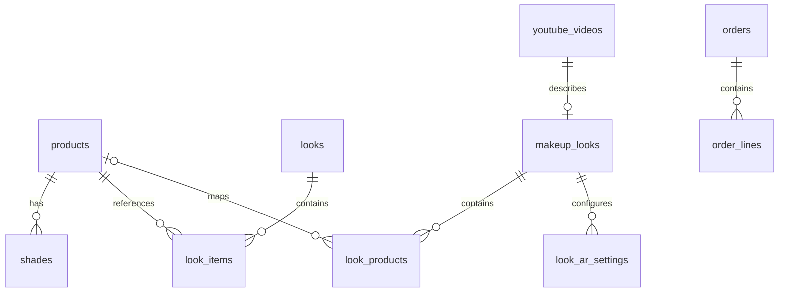

# 데이터 관계 및 저장소 명세

## 0. 범위

아래는 `backend/api/app/models/`와 `backend/api/alembic/versions/0001_catalog.py`–`0004_orders.py`의 정의다. **PARTIAL**은 스키마 코드가 있다는 뜻이며 실제 인스턴스의 적용, 저장 데이터, 백업 및 삭제 운영은 **UNKNOWN**이다. `0004`와 주문 관련 모델은 작성 시점의 미커밋 사용자 작업이다. DB·사용자 데이터를 수정하지 않았다. 타입 약어 `S(n)`은 `String(n)`, `T`는 Text, `I`는 Integer, `J`는 PostgreSQL JSONB, `B`는 Boolean, `F`는 Float, `?`는 nullable이다. 이 표에 없는 필드는 없다.

## 1. 관계도

`look_items.shade_id`, `look_products.shade_id`, `order_lines.product_id`/`shade_id`는 위 코드에서 FK가 아니다. `orders.user_id`는 Supabase 사용자 식별자이나 DB FK가 아니다. `stores`는 다른 표와 FK가 없다. 도식은 물리 FK 기준이며 관계의 사업적 완전성을 보장하지 않는다.

## 2. 테이블·컬럼

| 테이블 | 컬럼과 타입 | 키·제약·인덱스 |
|---|---|---|
| products | id S(64), position I, brand S(100), name/name_ko S(200), category S(20), makeup_zone S(20)?, texture S(20), price_krw I, volume S(50), description T, key_ingredients/tags J, image_url T, search_keyword S(200), search_text T | PK id; category 인덱스; search_text `pg_trgm` GIN |
| shades | product_id S(64), id S(64), position I, name S(100), hex S(7) | 복합 PK(product_id,id), product_id FK → products CASCADE |
| looks | id S(64), position I, title/inspiration S(200), description/thumbnail_url T, tutorial_query S(200), makeup/tags J | PK id |
| look_items | look_id S(64), position I, product_id S(64), shade_id S(64)?, step S(20) | 복합 PK(look_id,position), look_id FK → looks CASCADE, product_id FK → products 및 인덱스 |
| stores | id S(64), position I, name S(200), address S(300), district S(100), lat/lng F, hours S(100), phone S(40)?, pickup_available B | PK id |
| youtube_videos | id S(32), video_id S(32), youtube_url T, start_seconds I, title S(300), channel_name S(200), thumbnail_url T, description T?, published_at S(40)?, analysis_status/product_mapping_status S(32) | PK id, video_id UNIQUE 및 인덱스 |
| makeup_looks | id S(32), video_id S(32), display_name S(300), style_description T, is_published B | PK id, video_id UNIQUE FK → youtube_videos, is_published 인덱스 |
| look_products | id S(64), look_id S(32), makeup_zone S(20), status S(32), product_id S(64)?, shade_id S(64)?, source_type S(64)?, source_url/evidence_text T?, verified B, similarity_score F?, recommendation_reason T? | PK id, UNIQUE(look_id,id); look_id FK → makeup_looks CASCADE, product_id FK → products; 양 FK 인덱스 |
| look_ar_settings | look_id S(32), makeup_zone S(20), hex S(7), intensity F, texture S(20) | 복합 PK(look_id,makeup_zone); look_id FK → makeup_looks CASCADE |
| orders | id S(64), user_id S(64), amount_krw I, order_name S(100), status S(20), checkout_token_hash S(64), payment_key S(200)? | PK id, payment_key UNIQUE, user_id/status 인덱스; 미커밋 |
| order_lines | id I, order_id S(64), product_id S(64), shade_id S(64)?, quantity I, unit_price_krw I | PK id 자동 증가; order_id FK → orders CASCADE 및 인덱스; 미커밋 |
| members | id S(64), terms_version S(32), terms_agreed_at timestamptz | PK id(Supabase 사용자 id, FK 아님); RLS 켜짐(정책 없음) — `0008_members.py` |

그 외 열은 위 `?`가 없는 경우 NOT NULL이다. 상태 enum, 가격·hex 등의 일부 제약은 DB CHECK가 아니라 Pydantic/시드 검증에 있다. 스키마의 모든 제약과 서버 기본값은 마이그레이션 원문이 우선한다. `0002`의 영상 등록과 `0003`의 프리셋은 검증된 실제 사용 제품의 증거가 아니다.

## 3. 다른 저장소와 소유권

| 저장소 | 소유·데이터 | 보관 및 삭제 현황 |
|---|---|---|
| PostgreSQL | api가 원본 카탈로그·영상 룩과 작업 트리의 주문을 관리한다. 모델/마이그레이션은 위 표. | 시드 갱신은 `backend/api/app/jobs/seed_catalog.py` 참조. 실제 DB 보존·복구·주문 삭제 규정은 UNKNOWN. |
| Neo4j | chatbot 사본: `Product`→`HAS_SHADE`→`Shade`, `CONTAINS`→`Ingredient`, `TAGGED`→`Tag`, `Look`→`USES`→`Product`; Product/Look id, Ingredient/Tag name 유일 제약 | `backend/chatbot/app/repositories/graph_repository.py`에서 한 트랜잭션으로 기존 노드 삭제 후 재구성. 실제 동기화 시각은 UNKNOWN. |
| Redis | 응답 캐시·요청 제한용; 서비스 설정 참조 | TTL 및 가용성은 호출별 구현 참조. 지속 보관 정책 UNKNOWN. |
| Supabase Auth | 인증 계정 및 토큰의 외부 소유자 | 앱의 회원 탈퇴(`DELETE /api/me`)가 계정과 `members` 기록을 삭제하고 주문은 남긴다([ADR-0010](../adr/0010-account-deletion-secret-key.md)). 앱 저장과 세션은 `lib/auth/` 참조. |
| 기기 저장 | `store/`의 설정·장바구니·피부 수치 등 | 저장 및 개별 삭제 동작은 각 store 참조. 기기 삭제, 백업 정책은 UNKNOWN. 원본 얼굴 이미지 서버 전송은 사용자 지시상 금지. |

## 4. 목표 설계 제안

**PROPOSED:** 카탈로그 매칭의 제품/셰이드 참조 무결성을 검증하고 DB FK 도입 시 기존 데이터 정리·롤백을 계획한다. 영상-제품의 출처·검증일·신뢰도를 보존하고 오매칭 검토 절차를 만든다. 계정·주문·기기 데이터의 보존 기간 및 삭제 권한은 정책 결정과 별도 마이그레이션이 선행되어야 한다. 비디오 또는 얼굴 이미지를 저장소에 추가하는 것은 현재 허용하지 않는다.
