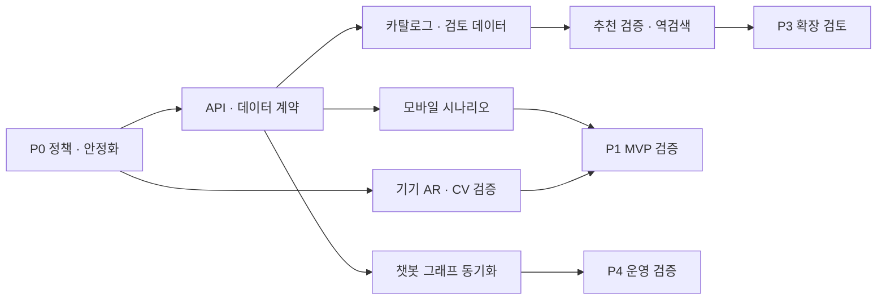

# 기술 아키텍처 로드맵

## 1. 기준과 선행 조건

아래 항목은 모두 `PROPOSED`이며 완료 일정과 비용은 측정 전 추정하지 않는다. 현재 저장소의 구조와 동작 상태는 [아키텍처](architecture.md) 및 [감사](architecture-audit.md)를 기준으로 하고 실제 배포 상태는 별도 확인한다. 제품의 얼굴 이미지·영상 서버 전송 금지 지침을 우선한다. 현재 관련 코드·기존 문서에 다른 동작 또는 설명이 있다면 이를 확인하고 동의만으로 예외를 가정하지 않는다.

| 단계 | 우선순위와 이유 | 선행 조건 | 작업 범위 | 완료 기준 및 산출물 |
|---|---|---|---|---|
| P0 안정화 | 최우선: 개인정보 경계와 동작 신뢰 확보 | 실제 실행 경로·정책 확인, 테스트 환경 준비 | 이미지 전송 경로의 정책 정합성 확보, 챗봇 추천의 미검증 상품 응답 통제, 결제의 중복·승인 후 저장 실패 복구 검증, 공개 기능 오류 점검 | 이미지·프레임 비전송과 추천 안전 대체, 결제 재조정 및 핵심 검사 결과를 검증하고 미검증 항목 기록. 준비되지 않은 경로는 공개하지 않음 |
| P1 MVP | 핵심 AR·탐색과 제품 조회의 사용 가능성 | P0 및 화면/API 계약 확정 | Expo Go에서 추적·카메라 권한·오류 상태 검증, 카탈로그·룩·셰이드·인증 핵심 시나리오 연결 검토 | 실제 기기의 대표 사용자 흐름과 실패 처리가 검증되고 계약 테스트 및 결과 기록 |
| P2 데이터·AI | 추천 근거와 카탈로그 정확성 개선 | P1과 출처·권리·검토 정책 확정 | 정규화·매핑 검토, 승인된 관계 저장, 역검색 및 추천 결과의 카탈로그 존재 검증, 평가셋 구축 | 검증 표본과 매칭 상태별 집계, 재실행·복구 시험, 추천에 허구 ID가 없음을 평가 |
| P3 확장 | 검증된 수요에 따라 B2B/B2C 적용 | P2 품질·동의·권한·상업 요건 결정 | B2B 계약과 버전 관리, 구독·판매 연계의 범위·인증·과금 정의 | 실제 사용 사례, 보안·데이터 소유권·지원 범위와 계약 테스트 합의 |
| P4 운영 자동화 | 운영 부담 또는 처리량이 입증될 때 확대 | 복구 요구·트래픽·비용 측정 및 운영 환경 확정 | 모니터링·경보, 백업 복구 실습, 배포와 동기화 점검, 필요 시 큐·확장 정책 평가 | 운영 지표·담당 경계·복구 시나리오 및 실제 리허설 결과 확보 |

P3와 P4는 선행 데이터나 실제 수요에 따라 부분 병렬화할 수 있으나, 관리·과금 및 인프라 도입을 이미 완료한 것으로 취급하지 않는다. 기간은 팀 가용성, 데이터 권리, 실기기 및 외부 서비스 환경을 확인한 뒤 추정한다.

## 2. 5개 병렬 작업 경계

| 작업 트랙 | 소유 범위 | 교환 계약·의존성 | 독립 작업과 통합 기준 |
|---|---|---|---|
| 모바일·제품 경험 | `app/`, `hooks/`, `components/`, `lib/`, `store/` | `types/index.ts`, API 응답, AR 설정, 네 언어 사전 | 확정된 계약의 fixture로 화면 개발 가능; 실제 API 및 실기기 통합 후 완료 |
| AR·CV | `components/ar/`, `modules/skin-analysis/`, `ml/`의 해당 범위 | 기기 입력·결과 메시지, 색상·강도·좌표, 이미지 비전송 정책 | 모델·기기별 검증과 성능 측정. HTML 렌더러 변경 시 `npm test` 포함 |
| API·인증 | `backend/api/` | camelCase 스키마·오류 형식, 인증, 제품/룩 조회, 셰이드 입력 | 서비스와 저장소 경계를 유지하고 API 계약·DB 마이그레이션 검증 |
| 데이터·카탈로그 | `backend/api/seed/`, 수집·정규화 jobs 및 검수 절차 | 원본·식별자·매핑 상태·근거·검토 결과, API 팀이 합의한 스키마 | 검토 CSV와 fixture로 우선 진행; 검증된 매핑만 반영 |
| 챗봇·운영 | `backend/chatbot/`, `infra/`, `.github/workflows/` | API 카탈로그 계약, 그래프 동기화, 환경별 배포 설정 및 비밀 | mock API로 병렬 작업; 실제 동기화 및 복구·배포 검증은 연결 환경 확보 후 |

트랙은 사람 이름이 아니라 협업 경계다. 공통 파일 `types/index.ts`, API 스키마, 마이그레이션 및 배포 설정의 변경자는 미리 합의하고 한 PR의 계약 변경을 기준으로 다른 트랙이 동기화한다. 동일 파일을 동시에 수정해야 한다면 변경 단위와 병합 순서를 합의한다. `docs/ARCHITECTURE.md`와 `eslint.config.js`는 의존성 규칙을 바꿀 때 함께 갱신한다.

## 3. 의존성과 통합 순서

각 통합은 계약과 검증용 fixture 합의 → 독립 구현 → 계약 테스트 → 실기기/실서비스 의존성 검증 → 결과 및 제한 기록 순서로 진행한다. 계약이 바뀌면 응답 호환성과 기존 데이터 이관을 확인한다. 실제 운영 자격증명, 계정, 기기 및 데이터 접근이 없으면 해당 검증은 UNKNOWN으로 남긴다.

## 4. 완료와 검증 원칙

- 기능별 수용 기준은 [기능 명세](functional-spec.md), 경로와 오류는 [API 명세](api-spec.md), 데이터 품질 기준은 [파이프라인](data-pipeline.md)에 연결한다.
- 모바일 변경은 lint와 typecheck, 커밋 전 `npm run check`; 변경된 백엔드는 해당 서비스에서 `uv run ruff check .`, `uv run lint-imports`, `uv run pytest`; Helm 변경은 환경별 `helm lint`를 실행한다. 테스트 결과는 실제 실행한 것만 기록한다.
- AR 추적 안정성, 프레임 지연·발열, 추천 품질, 데이터 정확도, 장애 복구 시간은 측정 방법·기기·표본·환경과 함께 기록한다. 측정 전 수치를 실적이나 SLO로 제시하지 않는다.
- 기존 코드나 데이터를 삭제하거나 배포 리소스를 수동 생성하지 않는다. 구조 변경이 필요하면 이유, 영향, 이전·복구 절차와 검증 기준을 별도 제안한다.

## 5. 위험과 결정 보류

| 위험 또는 불확실성 | 확인할 사항 | 다음 결정 |
|---|---|---|
| 이미지 비전송 정책과 일부 기존 문서의 GPU 서버 설명 충돌 | 호출 경로 및 설정별 전송 가능 여부, 실행 환경 | 정책 준수 설계와 검증을 P0에 배치 |
| YouTube 후보와 실제 제품 매핑 사이 단절 | 원본 권리, 검토 작업, 정확한 상품·옵션 증거 | 검토 상태·이력과 승인본 저장 계약 결정 |
| 성능과 실제 배포 상태 미측정 | 기기별 FPS·발열, 환경·잡 실행 이력, 외부 API 할당량 | 실측 후 목표 및 확장 기준 결정 |
| 추천 품질과 데이터 갱신 주기 불명 | 표본 데이터, 평가셋, 제품 최신성 | 지표·수용 기준과 재검토 주기 결정 |
