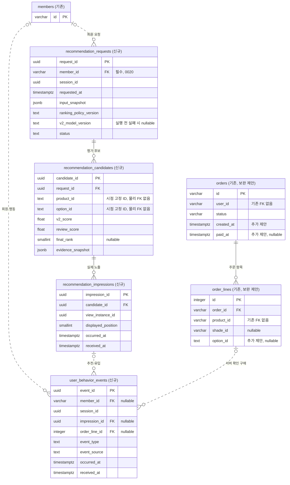
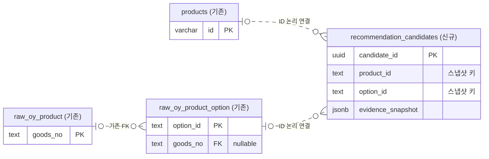

# V2 지속 개선을 위한 추천·반응 이력 ERD — 담당자 전달용

기준일: 2026-11-13. **0020 마이그레이션과 개발용 피부 분석 V2 비교 경로에 이력 수집을 연결했다.**
목적은 현재 V2의 추천 근거와 사용자 반응을 연결해 성분 예측·제품 연결·리뷰 보정·주/보조 고민 비중의 개선 대상을 찾고, 정책 변경 전후를 평가하는 것이다.
현재 추천 흐름은 [V2 비교 설계](recommendation-v2-comparison.md)를 따른다.
별도 선호 모델, 자동 재학습·배포, 새로운 순위 결합식은 이번 범위에 포함하지 않는다.

## 현재 구현 범위

- 비회원 `POST /api/dev/recommendations/compare`는 저장하지 않는다. 로그인한 비교 화면은 `/compare/recorded`에 `{sessionId, input}`을 보낸다. 회원은 검증된 토큰에서 결정하고, 약관 동의로 생성된 `members` 행이 필요하다. 입력·정책·모델과 **제품 중복 제거 전 적격 옵션 전체**를 저장한다. 응답에는 `history.requestId/sessionId`, 최종 후보에는 `candidateId`를 붙인다. 순위 계산은 유지한다.
- 요청은 `running → completed/failed`로 기록한다. 후보 저장과 완료 처리는 한 트랜잭션이다. 계산 실패는 제한된 코드만 기록하며, 프로세스 중단으로 남은 `running`은 성공으로 간주하지 않는다. 저장 실패를 비회원 실행으로 조용히 우회하지 않는다.
- `POST /api/dev/recommendations/impressions`: 실제 스크롤 영역에서 카드 면적 50% 이상이 500ms 유지되면 `half-visible-500ms-v1`, 그 전에 상품을 눌러 진입하면 `direct-interaction-v1`로 구분한다. 화면 이탈·백그라운드에서는 시간을 누적하지 않는다. 같은 후보·화면 인스턴스의 노출은 한 번만 저장한다.
- `POST /api/dev/recommendations/events`: 추천에서 진입한 상품 상세의 `product_view`, `cart_add`, `outbound_click`을 연결한다. 노출 저장 완료 후 반응을 전송하며 사용자·세션·제품·옵션의 일치를 검증한다. 현재 장바구니는 제품 단위이므로 `cart_add`의 `optionId`는 `null`, `context_snapshot.scope`는 `product`다. 수량 상한 때문에 수량이 늘지 않으면 기록하지 않는다.
- 클라이언트는 UUID·시각을 유지하여 통신 실패를 한 번 재시도한다. 같은 UUID·같은 내용은 멱등 처리하고 다른 내용은 409다. 상세 화면 귀속은 메모리에만 두므로 새로고침·앱 재시작으로 잃은 연결을 임의로 복원하지 않는다. 저장 실패는 화면에 표시한다.
- 모두 기존 개발 환경/활성화 조건을 유지한다. AR 색상 추천 및 운영 피부 추천에는 연결하지 않았다. 구매 확정·저장/취소 등 나머지 이벤트, 오프라인 영속 큐, 자동 재학습은 아직 구현하지 않았다. 아래 ERD는 이 확장 범위까지 포함한 설계다.
- nullable JSONB 모델은 `none_as_null=True`로 매핑한다. 실패 시 모델 정보가 없으면 SQL `NULL`로 저장해 0020의 객체 제약을 지킨다. 마이그레이션 자체는 수정하지 않았다.

검증: `RECOMMENDATION_FEEDBACK_MIGRATION_TEST_URL`을 지정한 PostgreSQL 테스트는 임의 스키마와 외부 트랜잭션을 사용하고 전체를 롤백한다. 후보 저장, 소유권, 비노출 후보 거부, 중복/충돌, 선행 노출 없는 반응 거부, 실패 기록 및 회원 삭제 연쇄를 검사한다.

## 1. 변경 범위 요약

**0020에서 신규 4개 테이블을 추가했다.** 기존 상품·성분·COSING·리뷰 테이블은 재사용한다.

| 구분 | 테이블 | 목적 |
|---|---|---|
| 신규 | `recommendation_requests` | 언제, 어떤 입력·모델·정책으로 추천했는지 |
| 신규 | `recommendation_candidates` | 최종5 이전의 후보별 근거·점수와 최종 선정 결과 |
| 신규 | `recommendation_impressions` | 사용자가 실제 본 제품·위치·시각 |
| 신규 | `user_behavior_events` | 조회·저장·장바구니·구매 등 행동과 추천 유입 연결 |
| 구매 연결 시 별도 협의 | `orders` | `created_at`, `paid_at` 보완 |
| 구매 연결 시 별도 협의 | `order_lines` | 스킨케어 `option_id` 보완; 기존 `shade_id`는 유지 |
| 기존 재사용 | `members`, 상품·옵션·성분·태그·리뷰 관련 테이블 | 회원 식별과 상품 근거 조회 |

2026-11-12 로컬 DB 조회 결과 당시 적격 추천 옵션 1,002개 / 고유 제품 956개가 각각
`raw_oy_product_option.option_id` / `products.id`와 모두 연결됐다.
다만 이는 현재 스냅샷의 결과이며 향후 카탈로그 삭제·재적재 때도 동일하다는 보장은 아니다.
`skincare_serving`은 `id=1` 단일 JSONB 투영으로, 과거 추천 이력을 저장하는 테이블이 아니다.
`rec_*`는 성분·고민·근거 매핑이며 추천 실행 이력이 아니다.

처음에는 추천 요청·후보·실제 노출과 조회·저장·거절 반응부터 연결할 수 있다.
기존 주문 컬럼 보완과 구매 이벤트는 구매 경로가 확인될 때 별도로 진행해도 된다.
구매를 연결하지 않아도 나머지 기록은 유효하다. 사용 후 피드백은 별도 다섯 번째 테이블 없이
`user_behavior_events`의 구조화된 이벤트로 제안한다.

## 2. 핵심 ERD

각 엔티티 제목에 기존/신규를 표시했다. 표시는 주요 컬럼만이며 상세 정의는 다음 절에 있다.
PK=기본키, FK=외래키, UK=고유 제약. `nullable`은 선택적 연결이다.
실선/점선은 관계의 식별 여부를 나타내며 기존/신규 구분이 아니다.

현재 `orders.user_id → members.id`, `order_lines.product_id → products.id`는
물리 FK가 없다. 위 그림에서도 존재하는 FK처럼 연결하지 않았다.
주문 회원과 행동 회원의 일치 확인은 서버에서 필요하다.

## 3. 기존 상품 데이터와의 연결

후보의 상품·옵션 ID는 당시 값을 보존하는 **논리 참조**로 제안한다.
기존 카탈로그 재적재·삭제가 과거 추천 이력을 없애거나 막지 않게 하기 위해서다.
물리 FK를 원하면 카탈로그 행의 영구 유지·삭제 정책부터 합의한다.
후보 저장 시점에는 ID 존재와 해당 옵션이 해당 제품에 속하는지를 서버가 검증한다.
현재 코드의 상품 키는 `oy-`와 소문자 `goods_no`를 결합하는 방식이며,
주문 `shade_id`를 스킨케어 `option_id`로 간주하지 않는다.

## 4. 신규 테이블 상세

공통으로 시각은 `timestamptz`를 사용한다. 아래 NULL 표시 외 필드는 필수 제안이다.
JSONB는 구조가 자유로운 원문 저장소가 아니다. 필드 허용 목록·형식·버전을 API에서 검증한다.

### 4.1 recommendation_requests — 추천 실행 한 번

| 컬럼 | 타입 / NULL | 의미 |
|---|---|---|
| `request_id` | uuid / PK | 서버가 생성하는 추천 요청 ID |
| `member_id` | varchar(64) / NOT NULL, FK | 로그인 회원. 요청 본문의 임의 ID가 아니라 인증 결과 사용. 0020은 비회원 요청 저장을 지원하지 않음 |
| `session_id` | uuid | 요청·행동 연결용 세션. 기기 영구 식별자를 의미하지 않음 |
| `requested_at`, `completed_at` | timestamptz / 완료 시각만 NULL | 서버 요청·완료 시각 |
| `status`, `environment` | text | 요청 진행/성공/실패와 운영/개발/시험 구분 |
| `input_snapshot` | jsonb | 당시 연령대·성별·피부타입·분석 수치·분석 버전·점수 해석 |
| `primary_concern`, `secondary_concern` | text / 보조만 NULL | 자동 선택한 주·보조 고민 |
| `contract_version`, `feature_version`, `ranking_policy_version` | text | 요청 계약·성분 ML 입력 변환·V2 순위 정책 버전 |
| `v2_model_version` | text / NULL | 성분 추천 모델 버전; 모델 확인 전 실패 시 NULL, 성공 시 필수 |
| `catalog_version`, `catalog_digest` | text / NULL | 당시 카탈로그 식별자·내용 해시; 카탈로그 읽기 실패 시 NULL, 성공 시 필수 |
| `policy_snapshot` | jsonb | 주/보조 고민 선택 기준·비중, 성분·리뷰 비중, COSING 확장, 리뷰 사전분포 버전·값, 유사도 감점 등 실제 설정 |
| `model_manifest` | jsonb / NULL | 모델 아티팩트 해시와 불변 위치; 읽기 실패 시 NULL, 비밀키·서명 URL 금지 |
| `recommendation_evidence` | jsonb / NULL | 주·보조 ML 입력·핵심 성분, 확장 근거, 리뷰 보정 전 목록 등 공통 기록; 계산 전 실패 시 NULL |
| `failure_code` | text / NULL | 실패 시 데이터 조회·모델 로딩·추론 등 단계를 구분하는 제한된 코드; 예외 원문·비밀정보 저장 금지 |

실패한 요청은 후보 0건일 수 있으며, 성공한 요청도 적격 후보가 없을 수 있다.
성공 상태로 확정할 때는 V2 버전·카탈로그·모델 명세·추천 근거가 모두 있어야 한다.
모델 버전 문자열만 남기고 파일을 덮어쓰면 재현할 수 없으므로 아티팩트 보존도 필요하다.
`input_snapshot`은 서버 검증을 통과한 숫자·범주 입력만 담는다. 연속 분석 점수와
ML에 전달한 양호/주의 범주를 구분하며, `scoreKind`·집계 방식·분석 버전도 함께 보존한다.
현재 분석 점수를 검증된 심각도 등급으로 바꾸어 기록하지 않는다.
연령대는 원래 입력 범주로 보존하고 원본 생년월일 등 불필요한 정보는 추가하지 않는다.

### 4.2 recommendation_candidates — 요청별 후보 옵션 한 개

| 컬럼 | 타입 / NULL | 의미 |
|---|---|---|
| `candidate_id` | uuid / PK | 후보 식별자 |
| `request_id` | uuid / FK | 소속 추천 요청 |
| `product_id`, `option_id` | text | 당시 상품·옵션 키; 논리 참조 |
| `primary_ingredient_score`, `ingredient_score`, `review_score`, `v2_score` | double precision | 주 고민 근거, 주·보조 결합 근거, 리뷰, 유사도 감점 전 V2 점수 |
| `secondary_ingredient_score` | double precision / NULL | 보조 고민 성분 점수; 보조 비활성 시 NULL |
| `final_rank` | smallint / NULL | 반환한 최종 목록 순위 1~5; 미선정은 NULL |
| `diversity_penalty`, `selection_score` | double precision / NULL | 최종 선정 당시 순차 감점·점수; 미선정은 NULL |
| `evidence_snapshot` | jsonb | 당시 성분 ID·연결 근거·카테고리·확인된 가격/제형·리뷰 입력·파생 특성 |

**최종 5개만 저장하지 않고 평가 대상 전체 적격 옵션을 남긴다.** 동일 상품의 여러 옵션도
후보 단계에서는 구분하며 최종 목록에서만 상품 중복을 제거한다.
미선정 후보에 최종 선택 점수나 전체 다양성 순위를 지어내지 않는다.
현재 `skincare_serving`은 갱신될 수 있으므로 버전·해시만으로 과거 값이 복구된다고 가정하지 않는다.
스냅샷에는 점수 재계산에 실제 사용한 리뷰 비율·별점분포·리뷰 수 등 필요한 값을 담는다.
별도 불변 스냅샷 저장소를 채택하면 공통 값을 참조로 분리할 수 있다.

현재 응답과의 대응은 `v2_score ← score`, `ingredient_score ← ingredientScore`,
`review_score ← review.normalizedScore`, `selection_score ← selectionScore`다.
`primary_ingredient_score`는 `primaryIngredientScore`를 사용하고,
보조가 비활성인 현재 단일 고민 경로에서는 `ingredientScore`와 같다.
`secondary_ingredient_score`는 `secondaryIngredientScore`이며 비활성 시 NULL이다.
`final_rank`는 실제 반환 순위다. 보조 고민 비활성과 0점 평가를 혼동하지 않는다.

### 4.3 recommendation_impressions — 실제 화면 노출 한 번

| 컬럼 | 타입 / NULL | 의미 |
|---|---|---|
| `impression_id` | uuid / PK | 동일 노출 재전송 시 유지하는 멱등 키 |
| `candidate_id` | uuid / FK | 실제 노출된 추천 후보 |
| `view_instance_id` | uuid | 화면 진입 인스턴스; 재방문과 재렌더 구분 |
| `surface`, `displayed_position` | text, smallint | 노출 화면·영역과 실제 위치 |
| `occurred_at`, `received_at` | timestamptz | 앱 발생 시각, 서버 수신 시각 |
| `visibility_policy_version` | text | 노출로 인정할 가시성·체류 조건의 버전 |

요청 ID·회원은 후보→요청으로 유도한다. 서버 응답 생성만으로 노출을 만들지 않는다.
최종 선정된 후보만 이 테이블에 기록한다. 한 후보는 화면 재방문으로 여러 번 노출될 수 있다.
노출 인정 시간·면적 기준은 앱 구현 시 협의하고, 동일 화면 내 단순 재렌더는 중복 기록하지 않는다.

### 4.4 user_behavior_events — 행동 한 번

| 컬럼 | 타입 / NULL | 의미 |
|---|---|---|
| `event_id` | uuid / PK | 이벤트 재전송에도 유지하는 멱등 키 |
| `member_id` | varchar(64) / NULL, FK | 행동 당시 인증 회원 |
| `session_id` | uuid | 행동 당시 세션; 별도 세션 테이블 FK는 이번 안에 없음 |
| `event_type`, `event_source` | text | 행동 종류와 client/server 구분 |
| `occurred_at`, `received_at` | timestamptz | 실제 발생·수신 시각; 클라이언트 시각은 검증 필요 |
| `impression_id` | uuid / NULL, FK | 출처가 확인된 추천 노출. 추천 외 유입은 NULL |
| `product_id`, `option_id` | text / NULL | 대상 상품·옵션의 당시 키; 카테고리 탐색은 둘 다 NULL 가능 |
| `order_line_id` | integer / NULL, FK | 서버에서 확인한 구매·거래 관련 이벤트의 주문 항목 |
| `attribution_policy_version` | text / NULL | 구매 등 지연 행동을 특정 노출에 연결한 귀속 정책 |
| `source_record_key` | text / NULL | 결제 등 서버 원천 기록의 중복 방지 키 |
| `event_schema_version`, `surface` | text | 이벤트 형식과 발생 화면 |
| `context_snapshot` | jsonb | 허용된 카테고리·당시 가격·수량·이유 코드 등; 이벤트별 필드 제한 |

초기 이벤트와 피드백의 필드 범위는 아래 4.5절을 따른다.
취소·환불은 실제 처리 기능·원천 데이터가 준비되면 명세를 확장한다.
`purchase_confirmed`는 서버만 작성하며, 판매처 클릭이나 클라이언트 자기 신고를 구매로 인정하지 않는다.

추천 출처가 없는 일반 탐색·구매도 기록할 수 있다. 제품이 같다는 이유만으로
가장 최근 추천에 자동 귀속하지 않는다. 다른 세션에서 구매해도 로그인 회원과 출처를 검증할 수
있을 때만 연결하며, 귀속 기간·정책은 별도 합의한다. 초기안은 하나의 행동에 최대 한 노출을
귀속하는 방식이다. 다중 접점 기여도는 향후 별도 연결 테이블로 확장할 수 있다.

### 4.5 이벤트별 필드와 V2 활용

아래는 수집 형식 제안이며 해당 버튼·피드백 UI가 이미 구현되었다는 뜻이 아니다.
모든 사용자 행동의 종류와 발생 시각은 관측으로 기록하고 정답/오답 라벨은 저장하지 않는다.

| event_type | 대상 / context_snapshot 필드 | 활용 및 주의 |
|---|---|---|
| `product_view` | product_id 필수; 진입 경로 | 노출 대비 상세 조회. 위치·화면별로 구분 |
| `save`, `unsave` | product_id 필수 | 저장 관심과 취소. 사용 만족의 정답으로 해석하지 않음 |
| `cart_add`, `cart_remove` | product_id, 확인된 option_id; quantity_delta | 담기와 삭제. 현재 장바구니 상태로 과거 이벤트를 만들지 않음 |
| `category_view` | category_id; 상품 ID는 NULL 가능 | 제품 종류별 탐색 비율. 자유 입력 검색어 수집은 이번 범위 밖 |
| `outbound_click` | product_id; 판매처 식별 코드 | 외부 판매처 이동. 구매와 별개 |
| `not_interested` | product_id; reason_code | 가격·제형·제품 종류·보유 중·추천 근거 등 거절 이유 구분 |
| `product_use_feedback` | product_id; 사용 여부·기간·만족·불편 코드 | 실제 사용 경험에 대한 자기보고. 반복되는 불만과 추천 근거를 대조 |
| `purchase_confirmed` | order_line_id 필수; 실제 구매 상품·가격·수량 | 서버만 작성. 구매한 사실이며 피부 적합성 정답은 아님 |

`not_interested.reason_code`의 초기 허용 값은 `price`, `texture`, `category`,
`already_owned`, `recommendation_reason`, `other`, `unspecified`로 제안한다.
`other`도 자유 입력 원문 없이 코드로 남긴다. 아무 반응이 없다는 이유로 거절 이벤트를 만들지 않는다.

`product_use_feedback`의 구조화 필드는 다음처럼 한정한다.

| 필드 | 형식 | 조건 |
|---|---|---|
| `used` | boolean | 실제 사용 여부에 대한 필수 자기보고 |
| `usage_days` | 0 이상의 integer 또는 NULL | 사용한 경우, 기억하는 기간만 기록 |
| `satisfaction` | 1~5 integer 또는 NULL | 사용한 경우만 응답; 미응답은 NULL, 0점으로 대체하지 않음 |
| `texture_satisfaction` | 1~5 integer 또는 NULL | 사용한 경우의 제형 만족 |
| `discomfort_reported` | boolean 또는 NULL | 불편 경험. NULL은 질문 미응답이며 false와 다름 |
| `discomfort_codes` | 코드 배열 | true인 경우 선택한 코드; 예: 따가움·당김·붉어짐·기타. 원인 단정 금지 |
| `target_concern` | 기존 고민 코드 또는 NULL | 어떤 고민에 관한 피드백인지 명시; 추천에 연결됐다면 당시 주·보조 고민 범위에서 검증 |
| `perceived_helpfulness` | 1~5 integer 또는 NULL | 사용자가 느낀 해당 고민 관리 도움 정도; 효능 측정치가 아님 |

`used=false`이면 사용 기간·만족·불편·도움 정도는 NULL/빈 배열로 제한한다.
새 피드백은 새 event_id로 기록하고, 단순 재전송만 같은 ID를 사용한다.
반복 보고는 독립된 사용자 수로 합산하지 않는다. 분석 시 회원·제품·기간 기준의 최신 응답 등
명시적 집계 규칙을 사용한다. 구매 확인 없이도 사용 경험은 보고할 수 있지만
이 이벤트로 구매 기록을 자동 생성하지 않는다.

## 5. 기존 주문 테이블 보완

- `orders.created_at`: 주문 생성 시각. 과거 주문에 현재 시각을 넣어 생성 시각으로 가장하지 않는다.
- `orders.paid_at`: 결제 확인 시각. 기존 `status='paid'`만으로 과거 결제 시각을 복원할 수 없다.
- `order_lines.option_id`: 스킨케어 원본 옵션 키. 기존 `shade_id`와 다른 개념이다.
  옵션이 없는 기존 거래는 NULL로 유지하고, 확인되지 않은 옵션으로 추천과 연결하지 않는다.
- 구매 이벤트는 주문 항목별로 생성하고 실제 결제 확인 시각을 사용한다. 주문량·가격은 기존
  `quantity`, `unit_price_krw`를 사용한다. 상품 단위만 확인되는 구매는 상품 단위로 표시한다.

이 필드 추가만으로 현재 결제 기능이 모든 추천 제품·옵션을 구매 지원하게 되는 것은 아니다.
구매 경로에서 해당 상품·옵션을 검증하는 작업은 별도 구현 범위다.
외부몰 구매 확인이 불가능하면 `outbound_click`까지만 수집한다.

## 6. 제약·인덱스·수집 규칙

| 대상 | 제안 제약 / 인덱스 |
|---|---|
| 후보 중복 | UNIQUE `(request_id, option_id)` |
| 최종 순위 | `final_rank`는 NULL 또는 1~5; NOT NULL 행에 UNIQUE `(request_id, final_rank)` |
| 최종 상품 중복 | `final_rank IS NOT NULL` 행에 UNIQUE `(request_id, product_id)` |
| 실제 노출 중복 | UNIQUE `(candidate_id, view_instance_id, surface)`; 재노출 측정 단위는 버전으로 고정 |
| 서버 이벤트 중복 | `source_record_key IS NOT NULL` 행에 UNIQUE `(event_source, source_record_key)` |
| 구매 중복 | `event_type='purchase_confirmed'` 행에 UNIQUE `(order_line_id)`; 서버·주문 항목 필수 |
| 사용자 시간 조회 | 요청·행동 각각 `(member_id, 발생시각)`, `(session_id, 발생시각)` |
| 관계 조회 | 후보 `request_id`, 노출 `candidate_id`, 행동 `impression_id`·`order_line_id` |
| 점수 | NaN/Infinity 금지. V2 점수의 범위는 해당 버전 계약으로 검증 |

FK만으로 보장되지 않는 항목은 서버의 같은 처리 경계에서 검증해야 한다.

1. 노출이 최종 선정된 후보에 속하는지, 요청 소유자가 맞는지 확인한다.
2. 행동의 추천 출처가 실제 대상 제품·옵션과 같은지, 동일 회원 또는 유효한 동일 익명 세션인지 확인한다.
   회원이 다른 이벤트를 연결하지 않는다. 클라이언트가 전달한 회원 ID는 신뢰하지 않으며,
   익명 세션도 서버가 발급·검증한 연결 정보로 처리한다.
3. 구매는 결제 상태·주문 소유자·상품/옵션 일치까지 확인한다.
4. 이벤트가 노출보다 먼저 도착하면 재시도/대기 정책을 사용한다. 도착 순서 때문에 가짜 노출을 만들지 않는다.
5. 단순 재전송은 무시하되 같은 이벤트 ID에 다른 본문이 오면 충돌로 처리한다.
6. 서버 구매 이벤트의 유실 방지를 위해 결제 상태 갱신과 이벤트 저장의 원자성 또는
   재처리 가능한 원천 기록을 확보한다. 이벤트 기록 실패로 결제가 중복 실행되지 않아야 한다.

조회용 컬럼·FK·고유 제약을 JSONB 안에 숨기지 않는다. JSONB는 시점 고정 특성·근거에 한정한다.
초기부터 모든 JSONB에 GIN 인덱스를 만들거나 대규모 파티셔닝을 도입하지 않고 사용량에 맞춰 결정한다.

## 7. 담당자와 확정할 사항

| 항목 | 제안 및 결정 필요 내용 |
|---|---|
| 회원/비회원 | 회원은 `members.id`, 비회원은 세션만 연결. 익명 장기 추적·로그인 전후 병합은 별도 결정 |
| 수집 범위 | 실제 노출·행동과 추천 입력의 서버 보관 범위, 동의·보관 기간·접근 권한 확정 |
| 삭제 | 추천·행동·피드백·분석용 추출본까지 삭제/비식별 정책 확정. FK의 CASCADE/SET NULL은 그 뒤 결정 |
| 피드백 | 질문 범위·허용 코드·응답 척도·반복 응답 집계 방식 확정 |
| 기존 회원 탈퇴 | 현재 회원 행 삭제 로직만으로 새 로그 삭제가 완료되지 않으므로 확장 필요. 주문 보존과 구분 |
| 상품 FK | 초기안은 시점 고정 ID+스냅샷. 물리 FK는 카탈로그 수명 정책 합의 후 결정 |
| 노출 단위 | 화면 재방문·스크롤 재노출·표시 위치 변경을 어떻게 한 노출로 셀지 확정 |
| 구매 귀속 | 출처 전달 방식·귀속 기간·확인 가능한 구매 경로·옵션 일치 수준 확정 |
| 과거 주문 | 생성/결제 시각과 옵션은 복원 가능한 것만 채움; 모르는 값은 NULL 유지 |
| 후보 보관량 | 전체 적격 옵션 저장을 기본으로 비용 추정. 향후 축소 시 후보 정책 버전과 누락 영향 평가 |
| 버전 저장 | 초기에는 요청별 버전·해시·설정 스냅샷. 별도 모델 레지스트리/특성 저장소 테이블은 이번 필수안에서 제외 |

이 문서는 기존 AR의 기기 내 이벤트 저장 원칙을 변경하거나 서버 수집을 시작하는 승인 문서가 아니다.
얼굴 사진·ROI·텐서는 어떤 신규 테이블에도 저장하지 않는다.

## 8. 전달 시 핵심 설명과 구현 확인 기준

> 기존 상품·성분·리뷰 DB는 유지하고, 추천 요청 → 후보 → 실제 노출 → 행동을 연결하는
> 이력 4종을 추가하는 안입니다. 추천 근거와 반응을 연결해 V2의 문제 구간을 찾고 변경 효과를 평가합니다.
> 구매는 기존 주문을 참조하며, 시각·스킨케어 옵션과 추천 출처 확인이 필요합니다.
> 현재는 협의용 ERD이며 실제 DB 변경은 하지 않았습니다.

- 현재 V2의 추천 결과·점수·순위는 수집 기능 도입 전후 동일해야 한다.
- 추천 결과 5개가 반환돼도 실제로 본 것이 2개면 노출은 2개만 기록한다.
- 최종 목록 밖 후보는 미노출 상태다. 클릭하지 않았다는 이유로 학습 부정 정답으로 쓰지 않는다.
- 동일 노출·이벤트 재전송, 다른 사용자/상품 연결, 결제 반복 확인을 검사한다.
- 같은 상품 재추천·다른 옵션·다른 세션 구매·추천 외 유입을 구분한다.
- 개발 페르소나·기존 테스트 사례는 운영 사용자 반응 통계에서 제외한다.
- 클릭·구매·사용 만족을 성분 추천의 정답으로 변환하지 않는다. 성분 ML 재학습은 별도 검수 정답을 사용한다.
- 사용자 반응으로 개선 후보를 찾고, 정책별 비교로 효과를 검증한다. 수집만으로 자동 학습하지 않는다.
- 거절 이유와 사용 피드백을 구분하고, 미사용·미응답을 부정적인 사용 경험으로 집계하지 않는다.
- 신규 테이블 생성, 과거 자료 보완, 쓰기 API, 앱 노출 측정, 행동 수집, 삭제·유실 대응은
  모두 후속 구현이며 이 문서 작성으로 완료된 것으로 보지 않는다.

확인 근거: 로컬 PostgreSQL `information_schema.columns`·`pg_constraint` 조회,
적격 serving 옵션과 상품/옵션 테이블의 ID 일치 집계,
`backend/api/app/models/order.py`, `models/member.py`,
`services/payment_service.py`, `repositories/recommendation_comparison_repository.py`.
