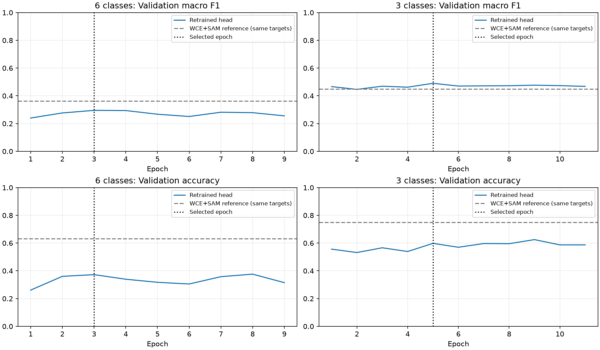

# 모공 분류층 균형 재학습과 조건부 3등급 실험

분류층만 재학습한 아래 실험 이후의 3등급 WCE+SAM 전층 학습은
[모공 3등급 실험 보고서](pore-coarse-experiment.md)에서 별도로 관리한다.

## 사전에 고정한 실험 계획

기존 WCE + AdamW + SAM의 선택 가중치에서 특징 추출기를 가져오고 마지막
분류층을 초기화해 다시 학습한다. 특징 추출기의 파라미터와 BN 이동 통계는
모두 고정한다. 매 epoch마다 원래 학습 ROI 수 4,112개만큼 복원 추출하며
목표 등급별 횟수 차이가 최대 1개가 되도록 한다. 등급 안에서는 인물을 균등
추출하고, 선택된 인물의 해당 등급 ROI 중 하나를 균등 추출한다.

손실은 가중치 없는 CE이다. 균형 샘플링과 WCE를 중복 적용하지 않는다.
최적화는 분류층에만 AdamW + SAM(rho=0.05), 배치 16, LR 0.001에서 cosine
감소, weight decay 0.0001, 최대 20 epoch, patience 6, seed 42를 사용한다.
기존 ±5도 회전·2% 이동·약한 색상 증강과 256px ROI는 유지한다.
검증 Macro-F1이 가장 높은 체크포인트를 선택하고 동률이면 검증 CE로 결정한다.

이는 [cRT 논문](https://arxiv.org/abs/1910.09217)의 특징 학습/분류층 재학습 분리를
차용한 실험이다. 원 논문의 자연 분포 특징 학습·SGD 설정을 재현하는 실험은 아니다.
기존 피부 특징을 사용하는 후처리 학습이므로 ImageNet 초기 상태에서 분류층을
먼저 학습하던 기존 warmup 및 layer4 미세조정 실험과 다르다.

**6등급 통과 조건**: 기존 WCE+SAM보다 검증 Macro-F1 증가, Accuracy 유지 이상,
4·5등급의 정확한 등급 재현율을 support로 합산한 값 증가, 5등급 Recall > 0을
모두 충족해야 한다. 이것은 이번 실험의 운영 판단 기준이며 통계적 유의성 기준이 아니다.

충족하지 못하면 원본 라벨을 보존하면서 `0·1 → 낮음(0)`, `2·3 → 중간(1)`,
`4·5 → 높음(2)`으로 묶은 **3출력 분류층**을 같은 방식으로 새로 학습한다.
이 구간은 추천 기능을 위한 임시 묶음이며 임상적으로 검증된 중증도 기준은 아니다.
3등급 후보는 기존 6등급 모델의 확률을 같은 두 등급씩 합산한 3등급 기준선과
비교한다. 6등급 Accuracy와 3등급 Accuracy를 직접 비교해 개선으로 주장하지 않는다.
3등급 통과 조건도 같은 목표 공간에서 Macro-F1 증가·Accuracy 유지 이상·높음 Recall
증가이다. 높음 Recall은 원본 4·5를 구분하지 않고 묶어 맞힌 비율이다.

## 데이터 및 보존

- 기존 스마트폰 데이터의 인물별 train/valid/test 분할과 원본 라벨을 유지한다.
- train 690명·4,112 ROI, valid 138명·816 ROI만 사용한다. test 137명·819 ROI는 평가하지 않는다.
- 원본 5등급은 학습 8명·48 ROI, 검증 1명·6 ROI이다. 복원 추출은 새로운 피부 사례를 만들지 않는다.
- 3등급에서도 원본 4·5등급의 인물 다양성 부족은 그대로 남는다.
- 기존 가중치와 서비스 설정은 SHA-256으로 전후 비교하며 후보는 별도 run에 저장한다.
- `pore_coarse`와 명시적 원본→목표 매핑을 저장한다. 기존 6등급 추론 계약과 혼용하지 않는다.
- 테스트 페이지와 추천용 활성 모델은 이 실험으로 자동 변경하지 않는다.

3등급으로 묶었을 때의 데이터 수는 다음과 같다. 인물은 여러 등급의 ROI를 가질 수
있으므로 등급별 인물 수를 더한 값은 전체 고유 인물 수와 다를 수 있다.

| 목표 | 원본 | 학습 ROI / 인물 | 검증 ROI / 인물 |
|---|---|---:|---:|
| 낮음(0) | 0·1 | 835 / 145 | 165 / 28 |
| 중간(1) | 2·3 | 3,005 / 511 | 601 / 103 |
| 높음(2) | 4·5 | 272 / 47 | 50 / 9 |

## 실행

저장소 루트, 로컬 GPU 환경에서 실행한다. 설정은 `ml/configs/nia_smartphone_classifier_retraining.toml`과
`ml/configs/nia_smartphone_pore_coarse.toml`이다.

```powershell
uv run --project ml python -m skin_analysis.smartphone.classifier_retraining --config ml/configs/nia_smartphone_classifier_retraining.toml --phase preflight
uv run --project ml python -m skin_analysis.smartphone.classifier_retraining --config ml/configs/nia_smartphone_classifier_retraining.toml --phase train
uv run --project ml python -m skin_analysis.smartphone.classifier_retraining --config ml/configs/nia_smartphone_classifier_retraining.toml --phase evaluate
```

6등급의 기록된 조건이 미달일 때만 아래 명령이 허용된다.

```powershell
uv run --project ml python -m skin_analysis.smartphone.classifier_retraining --config ml/configs/nia_smartphone_pore_coarse.toml --phase preflight
uv run --project ml python -m skin_analysis.smartphone.classifier_retraining --config ml/configs/nia_smartphone_pore_coarse.toml --phase train
uv run --project ml python -m skin_analysis.smartphone.classifier_retraining --config ml/configs/nia_smartphone_pore_coarse.toml --phase evaluate
```

완료되거나 일부 생성된 run은 덮어쓰지 않는다. 이 소규모 재학습 실행기는 재개 기능이
없다. 새 실험은 설정의 output 경로를 분리한다. 3등급 전환의 선행 판단은 위 기본
6등급 run의 `comparison.json`에서 읽는다. 개별 인물·예측·가중치는 Git 제외 경로에만
저장하며 이 보고서에는 집계 통계만 게시한다.

## 실제 비교 결과

동일 검증 138명·816 ROI, 증강 없는 FP32 평가이다.

6등급 분류층 재학습은 사전 통과 조건에 미달해 채택하지 않는다.

3등급 비교의 통과 조건도 미달했다. 자동 교체하지 않는다.

### 6등급 비교

| 모델 | Accuracy | Macro Precision | Macro Recall | Macro F1 | MAE | ±1등급 | 고등급 Recall |
|---|---:|---:|---:|---:|---:|---:|---:|
| 기존 WCE+SAM | 63.11% | 42.06% | 36.70% | 36.34% | 0.4534 | 92.77% | 20.00% |
| 분류층 균형 재학습 | 37.25% | 28.95% | 43.78% | 29.53% | 0.8958 | 77.82% | 34.00% |

선택 epoch 3 / 실행 9, 실행 시간 169.6초. 사전 통과 조건: **미달**.

Accuracy 변화 -25.86%p, Macro-F1 변화 -6.81%p, 고등급 Recall 변화 +14.00%p.

| 모델 | 목표 등급 | 실제 ROI | 예측 ROI | Precision | Recall | F1 |
|---|---|---:|---:|---:|---:|---:|
| baseline | 0 | 21 | 23 | 60.87% | 66.67% | 63.64% |
| baseline | 1 | 144 | 140 | 42.14% | 40.97% | 41.55% |
| baseline | 2 | 498 | 617 | 69.37% | 85.94% | 76.77% |
| baseline | 3 | 103 | 10 | 40.00% | 3.88% | 7.08% |
| baseline | 4 | 44 | 25 | 40.00% | 22.73% | 28.99% |
| baseline | 5 | 6 | 1 | 0.00% | 0.00% | 0.00% |
| candidate | 0 | 21 | 63 | 30.16% | 90.48% | 45.24% |
| candidate | 1 | 144 | 184 | 31.52% | 40.28% | 35.37% |
| candidate | 2 | 498 | 232 | 78.02% | 36.35% | 49.59% |
| candidate | 3 | 103 | 158 | 18.35% | 28.16% | 22.22% |
| candidate | 4 | 44 | 135 | 11.11% | 34.09% | 16.76% |
| candidate | 5 | 6 | 44 | 4.55% | 33.33% | 8.00% |

| 모델 | 학습 Accuracy | 학습 Macro-F1 | 검증 Macro-F1 | F1 차이(%p) |
|---|---:|---:|---:|---:|
| baseline | 65.98% | 43.89% | 36.34% | 7.55 |
| candidate | 52.36% | 49.53% | 29.53% | 20.01 |

검증 혼동행렬(행=정답, 열=예측):

baseline:

```text
[14, 6, 1, 0, 0, 0]
[6, 59, 77, 0, 2, 0]
[3, 61, 428, 2, 4, 0]
[0, 11, 78, 4, 9, 1]
[0, 3, 28, 3, 10, 0]
[0, 0, 5, 1, 0, 0]
```

candidate:

```text
[19, 2, 0, 0, 0, 0]
[30, 58, 35, 9, 8, 4]
[14, 102, 181, 101, 82, 18]
[0, 18, 11, 29, 29, 16]
[0, 4, 5, 16, 15, 4]
[0, 0, 0, 3, 1, 2]
```

후보는 원본 5등급 6개 중 2개를 맞혔지만 5등급으로 예측한 44개 중 42개가 오탐이다. 균형 샘플링은 출력 분포를 바꿨고 소수 등급 재현율과 전체 정확도 사이의 손익이 발생했다. 이 설정의 실패가 모든 분류층 재학습이나 데이터셋 자체의 실패를 증명하는 것은 아니다.

5등급 검증 사례는 동일 인물의 6개 ROI이므로 Recall 변화는 독립적인 6명의 개선을 뜻하지 않는다. 고등급 Recall은 원본 4·5를 각각 정확한 등급으로 맞혀야 성공으로 센다.

후보 SHA-256: `10a371f4feab92481a39c0a526d4de0ad8a30df2e71a08319a2ee1153903ce71`

후보 경로: `ml/runs/nia-smartphone-classifier-retraining-seed-42/pore/inference.bin`

### 3등급 비교

| 모델 | Accuracy | Macro Precision | Macro Recall | Macro F1 | MAE | ±1등급 | 고등급 Recall |
|---|---:|---:|---:|---:|---:|---:|---:|
| 기존 WCE+SAM | 74.88% | 44.33% | 45.76% | 44.96% | 0.2537 | 99.75% | 0.00% |
| 분류층 균형 재학습 | 59.80% | 48.37% | 58.05% | 49.02% | 0.4203 | 98.16% | 52.00% |

선택 epoch 5 / 실행 11, 실행 시간 195.4초. 사전 통과 조건: **미달**.

Accuracy 변화 -15.07%p, Macro-F1 변화 +4.06%p, 고등급 Recall 변화 +52.00%p.

| 모델 | 목표 등급 | 실제 ROI | 예측 ROI | Precision | Recall | F1 |
|---|---|---:|---:|---:|---:|---:|
| baseline | 낮음(0·1) | 165 | 153 | 52.94% | 49.09% | 50.94% |
| baseline | 중간(2·3) | 601 | 662 | 80.06% | 88.19% | 83.93% |
| baseline | 높음(4·5) | 50 | 1 | 0.00% | 0.00% | 0.00% |
| candidate | 낮음(0·1) | 165 | 228 | 45.18% | 62.42% | 52.42% |
| candidate | 중간(2·3) | 601 | 430 | 83.49% | 59.73% | 69.64% |
| candidate | 높음(4·5) | 50 | 158 | 16.46% | 52.00% | 25.00% |

| 모델 | 학습 Accuracy | 학습 Macro-F1 | 검증 Macro-F1 | F1 차이(%p) |
|---|---:|---:|---:|---:|
| baseline | 78.04% | 54.86% | 44.96% | 9.90 |
| candidate | 72.08% | 64.94% | 49.02% | 15.92 |

검증 혼동행렬(행=정답, 열=예측):

baseline:

```text
[81, 84, 0]
[70, 530, 1]
[2, 48, 0]
```

candidate:

```text
[103, 50, 12]
[122, 359, 120]
[3, 21, 26]
```

기준선은 기존 6등급 softmax 확률을 두 등급씩 합산하고 argmax한 결과다. 단순히 기존 argmax 등급을 2로 나눈 결과와는 다를 수 있다. 높음 Recall은 원본 4·5 중 어느 등급인지는 구분하지 않는다.
3등급 ±1 정확도는 낮음↔높음 오류만 실패로 세므로 특히 관대하다. MAE 단위도 원본 세부 등급과 다르다.

후보의 높음 정답 50개 중 26개를 맞혔으며, 높음 예측 158개 중 132개는 실제 낮음·중간이었다. 추천에 활용하려면 재현율과 함께 이 정밀도도 고려해야 한다.

후보 SHA-256: `c431e2541de1c1054eb72143e6e7b831c6518a38b24476fe190c9fcb784fb26a`

후보 경로: `ml/runs/nia-smartphone-pore-coarse-seed-42/pore/inference.bin`



## 검증 및 해석 한계

각 epoch 후와 최종 평가에서 고정된 특징 추출기의 모든 파라미터·BN 버퍼가 기존 WCE+SAM 가중치와 동일한지 확인했다. 선택된 후보는 CPU에서 합성 입력 `[1,3,256,256]`으로 계약에 맞는 유한한 출력을 확인했고, 다른 등급 계약으로 읽으려 하면 거절되는지도 검사했다. 분류 지표는 sklearn 결과와 교차 검산했다.

복원 추출은 소수 등급을 더 자주 학습시키지만 새로운 인물 정보는 늘리지 않는다. 검증셋을 여러 실험의 선택에 반복 사용했으므로 수치는 탐색 결과이며 최종 일반화 성능은 별도 테스트로 확정해야 한다. 이번에는 보존된 테스트셋을 평가하지 않았다. 세부 등급을 묶어도 수치형 측정값이나 임상 중증도는 복원되지 않는다.

기존 가중치·활성 서비스 설정의 해시 보존 검사를 통과했다. 이 결과는 모공 후보 모델 비교이며 다른 지표나 테스트 페이지의 활성 모델을 변경하지 않았다.
3등급 후보를 기능에 연결하려면 기존 6등급 API·화면·추천 입력 계약도 매핑과 함께 변경해야 한다. 기존 6출력 로더에 가중치만 바꾸어 넣으면 안 된다.
