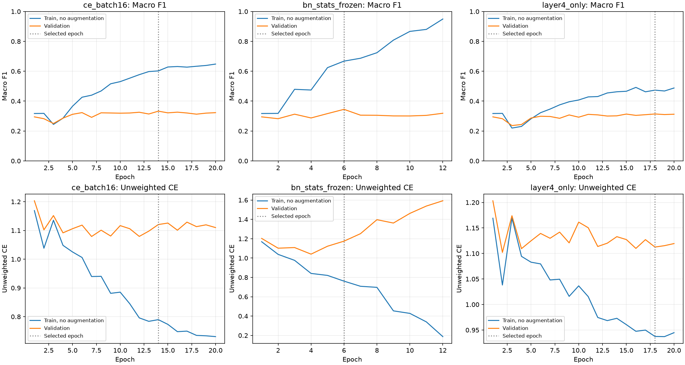

# 모공 BN 통계 고정·부분 미세조정 분리 실험

## 사전에 고정한 비교

기존 CE 배치 16을 기준으로 두 요인을 각각 변경합니다. 모공 모델만 학습하고,
전문의 원본 라벨·데이터·증강은 유지합니다. 외부/생성 데이터는 추가하지 않습니다.

| 조건 | 미세조정 대상 파라미터 | 미세조정 중 BN 통계 |
|---|---|---|
| 기존 CE 배치 16 | 전체 network | 전체 갱신 |
| 실험 1: BN 통계 고정 | 전체 network | 전체 고정 |
| 실험 2: layer4만 학습 | layer4 + fc | 전체 갱신 |

실험 1은 BN의 `running_mean`, `running_var`, `num_batches_tracked`만 고정합니다.
BN의 affine scale/bias는 다른 파라미터처럼 학습합니다. 실험 2는 앞단 파라미터만
고정하고 앞단 BN 통계는 기존처럼 갱신합니다. 따라서 완전히 고정된 특징 추출기를
시험하는 것이 아니며, BN 통계까지 고정한 부분 미세조정과도 구분합니다.
두 실험을 동시에 적용하는 조합은 이번 범위에 포함하지 않습니다.
실험 1의 학습 중에는 BN만 eval mode로 두어 고정된 running 통계로 정규화합니다.

공통 조건은 seed 42, ImageNet V2 ResNet-50에서 새로 시작, 가중 CE, batch/effective
batch 16, head 2 + 미세조정 최대 18 epoch, patience 6, 기존 AdamW·학습률·scheduler·
AMP·256px 전처리입니다. 출력층 학습 2 epoch에서는 기존처럼 전체 backbone과 BN 통계를
동결합니다. 같은 head 초기화·단계에서 출발하고 기존 피부 모델을 이어 학습하지 않습니다.
기존과 같은 검증 macro-F1로 선택하며 동률이면 unweighted 검증 CE를 사용합니다.

인물 분리 fingerprint는
`6ac903796d100a2ee4f66e3e1936548dfa618c9b448a90985ff9ffbb0c13d793`입니다.
학습 690명/4,112 ROI, 검증 138명/816 ROI를 유지합니다. 두 후보는 별도 폴더에 저장하며
기존 가중치·서비스 설정·추천 묶음은 보존합니다. 테스트 페이지를 자동 교체하지 않습니다.

## 평가와 해석 기준

같은 학습/검증셋을 증강 없는 FP32 eval mode에서 평가합니다. Accuracy,
macro/weighted Precision·Recall·F1, 등급별 지표·혼동행렬·MAE·±1등급 적중률과
최고 두 등급 pooled 정확 분류 Recall을 기록합니다. scikit-learn으로 지표를 대조합니다.
학습/검증 F1 차이가 줄어도 검증 성능이 낮아지면 개선으로 해석하지 않습니다.

우선 검증 macro-F1을 비교하고 정확도·고등급 Recall·MAE의 변화를 함께 보고합니다.
상충되는 지표를 감추거나 후보를 자동 채택하지 않습니다. 한 seed의 검증 비교이므로
통계적 우월성이나 배포 성능을 확정하지 않습니다. 최종 평가셋은 조회하지 않습니다.
특히 모공 5등급 검증은 기존과 같은 1명/6 ROI이므로 고등급 지표의 해석 범위가 좁습니다.

BN 고정 후보의 최종 학습 체크포인트에서 모든 BN 통계가 ImageNet 초기값과
일치하는지 확인합니다. layer4 후보는 앞단 파라미터가 초기값과 같고 앞단 BN 통계는
갱신됐는지 확인합니다. 평가 모드 전환 뒤에도 학습 정책이 유지되는지 테스트합니다.

## 재현과 산출물

저장소 루트에서 실행합니다.

```powershell
uv run --project ml python -m ml.scripts.report_finetuning_ablation --phase preflight
uv run --project ml python -u -m skin_analysis.smartphone.train --config ml/configs/nia_smartphone_bn_frozen.toml --task pore
uv run --project ml python -u -m skin_analysis.smartphone.train --config ml/configs/nia_smartphone_layer4.toml --task pore
uv run --project ml python -m ml.scripts.report_finetuning_ablation --phase evaluate
uv run --project ml python -m ml.scripts.report_finetuning_ablation --phase publish
```

산출물은 `ml/runs/nia-smartphone-finetuning-seed-42/`의 `bn-stats-frozen/pore/`,
`layer4-only/pore/`에 보존합니다. 개별 예측·원본 경로·인물 식별자는 공유하지 않습니다.
공개 보고서는 이 문서·집계 JSON·학습 곡선만 포함합니다. 기존 run은 덮어쓰지 않습니다.

참고: [BatchNorm 동작](https://docs.pytorch.org/docs/2.14/generated/torch.nn.BatchNorm2d.html),
[미세조정과 사전학습 특징](https://arxiv.org/abs/2202.10054).

## 결론과 적용 판단

2026-10-23 두 분리 실험 완료. **두 후보 모두 기존 CE 배치 16을 전반적으로 개선하지
못했으므로 자동 채택하지 않습니다.** 가중치는 비교용으로 보존하고 테스트 페이지는 유지합니다.
아래의 비교 기준은 모두 CE 배치 16이며, CE 배치 32와 혼동하지 않습니다.

### 실험 1: BN 통계 고정

12 epoch에 조기 종료됐고 macro-F1 기준으로 epoch 6을 선택했습니다.
검증 macro-F1은 33.29% → **34.51%(+1.22%p)**이지만 Accuracy는
54.41% → **51.23%(-3.19%p)**, 고등급 pooled Recall은 20% → **18%**로 낮아졌습니다.
MAE도 0.5674 → 0.5931로 커졌습니다.

3등급 Recall은 14.56% → 45.63%, F1은 16.22% → 31.54%로 개선됐습니다.
그러나 2등급 Recall은 69.48% → 61.04%, 4등급 Recall은 22.73% → 20.45%로
낮아졌습니다. 등급별 이득이 상충하는 결과로, 고등급 분류가 좋아졌다고 해석할 수 없습니다.

선택 모델의 학습/검증 F1 차이도 26.94%p → **32.27%p**로 커졌습니다.
마지막 epoch 12에는 학습 F1 94.95%와 검증 F1 31.88%,
unweighted CE 0.1877/1.5925로 차이가 더 벌어졌습니다.
이번 설정의 BN 고정은 과적합 억제 효과를 보이지 않았습니다.

### 실험 2: layer4 + 분류기 파라미터만 학습

최대 20 epoch를 실행했고 epoch 18을 선택했습니다.
검증 Accuracy는 54.41% → **57.35%(+2.94%p)**, MAE는 0.5674 → 0.5306으로
개선됐지만 macro-F1은 33.29% → **31.41%(-1.88%p)**,
고등급 pooled Recall은 20% → **16%**로 낮아졌습니다.

다수인 2등급의 Recall은 69.48% → 78.31%로 올랐으나,
3등급은 14.56% → 7.77%, 4등급은 22.73% → 18.18%로 낮아졌습니다.
2등급 예측 수도 495 → 565개로 증가했습니다. 전체 정확도의 개선이 소수 등급의
성능 개선으로 이어진 것은 아닙니다. 세 모델 모두 5등급 Recall은 0%(0/6)입니다.

학습 F1은 60.23% → 47.35%, 검증 F1은 33.29% → 31.41%입니다.
격차는 **15.95%p**로 줄었으나 학습·검증 F1 자체가 함께 낮아졌습니다.
이를 일반화 개선이나 과적합 해결로 단정하지 않습니다. 미세조정 파라미터 수는
23,520,326 → 14,977,030으로 감소했습니다(출력층 단독 단계는 둘 다 12,294).

### 추가 집계와 한계

| 검증 지표 | 기존 CE 배치 16 | BN 통계 고정 | layer4만 학습 |
|---|---:|---:|---:|
| weighted Precision | 53.88% | 56.38% | 53.50% |
| weighted Recall | 54.41% | 51.23% | 57.35% |
| weighted F1 | 53.85% | 52.79% | 54.68% |

정확도·macro-F1·고등급 Recall을 함께 보면 한 후보가 기존 모델보다 일관되게
우수하지 않습니다. 이번 실험에서는 색소침착·주름으로 확대하지 않았습니다.
전문의 라벨과 기존 데이터 보존 방침은 유지합니다.

이는 고정한 학습률·기간·seed 42의 검증 결과입니다. BN 고정이나 부분 미세조정 전반이
무효라는 의미는 아닙니다. 특히 실험 2는 파라미터만 제한하고 BN 통계는 계속 갱신했으므로,
앞단 BN까지 고정하는 다른 부분 미세조정 방식이나 두 처리의 조합 효과는 판단할 수 없습니다.
검증셋에서 선택한 성능이며 독립 최종 성능 추정이 아닙니다.

### 검증과 보존

- 두 후보의 초기 head 2 epoch는 기존 CE 배치 16과 같은 학습·검증 손실과 지표로
  출발했습니다. 전처리 fingerprint·초기화·패키지 버전과 사전 고정한 단일 변경 조건을 대조했습니다.
- BN 고정 후보의 마지막 학습 체크포인트에서 BN 통계 버퍼 **159개**가 ImageNet
  초기값과 완전히 같았습니다. 부분 학습 후보는 앞단 파라미터 **129개 텐서**가
  초기값과 일치했고 앞단 BN 통계는 갱신됐습니다. 두 처리가 실제로 분리되어 적용됐습니다.
- 두 추론 가중치 모두 기존 엔진의 SHA-256 확인·strict 로딩·유한한 6등급 출력을
  통과했습니다. 이 검사는 로컬 더미 입력으로 수행했고 얼굴 이미지를 전송하지 않았습니다.
- 기존 가중치·서비스 설정·추천 묶음 등 **10개 파일**의 실행 전후 SHA-256이 같습니다.
  최종 평가셋을 이번 실험에서 평가하지 않았습니다. 개별 예측은 Git 제외 경로에 보존했습니다.
- 전체 ML 테스트 108개 통과. 최종 변경 후 관련 테스트 51개·Ruff와
  `npm run check -- -- --runInBand`의 typecheck·lint·앱 테스트 48개 통과.
- 혼동행렬·전체 등급별/가중 지표·학습 이력은
  [집계 JSON](finetuning-ablation.metrics.json), 곡선은 아래 그림에 기록했습니다.

## 실제 비교 결과

동일 검증 인물 138명/816 ROI. 학습 지표도 증강 없는 eval mode에서 측정했습니다.

| 모델 | epoch / 실행 | 검증 Acc | macro P | macro R | macro F1 | MAE | ±1등급 | 고등급 Recall |
|---|---:|---:|---:|---:|---:|---:|---:|---:|
| ce_batch16 | 14 / 20 | 54.41% | 31.56% | 38.45% | 33.29% | 0.5674 | 90.81% | 20.00% |
| bn_stats_frozen | 6 / 12 | 51.23% | 32.89% | 39.43% | 34.51% | 0.5931 | 90.32% | 18.00% |
| layer4_only | 18 / 20 | 57.35% | 30.46% | 36.76% | 31.41% | 0.5306 | 90.56% | 16.00% |

| 모델 | 학습 F1 | 검증 F1 | 차이(%p) |
|---|---:|---:|---:|
| ce_batch16 | 60.23% | 33.29% | 26.94 |
| bn_stats_frozen | 66.78% | 34.51% | 32.27 |
| layer4_only | 47.35% | 31.41% | 15.95 |

| 모델 | 등급 | 실제 ROI | 예측 ROI | Precision | Recall | F1 |
|---|---:|---:|---:|---:|---:|---:|
| ce_batch16 | 0 | 21 | 49 | 36.73% | 85.71% | 51.43% |
| ce_batch16 | 1 | 144 | 150 | 36.67% | 38.19% | 37.41% |
| ce_batch16 | 2 | 498 | 495 | 69.90% | 69.48% | 69.69% |
| ce_batch16 | 3 | 103 | 82 | 18.29% | 14.56% | 16.22% |
| ce_batch16 | 4 | 44 | 36 | 27.78% | 22.73% | 25.00% |
| ce_batch16 | 5 | 6 | 4 | 0.00% | 0.00% | 0.00% |
| bn_stats_frozen | 0 | 21 | 38 | 44.74% | 80.95% | 57.63% |
| bn_stats_frozen | 1 | 144 | 107 | 38.32% | 28.47% | 32.67% |
| bn_stats_frozen | 2 | 498 | 417 | 72.90% | 61.04% | 66.45% |
| bn_stats_frozen | 3 | 103 | 195 | 24.10% | 45.63% | 31.54% |
| bn_stats_frozen | 4 | 44 | 52 | 17.31% | 20.45% | 18.75% |
| bn_stats_frozen | 5 | 6 | 7 | 0.00% | 0.00% | 0.00% |
| layer4_only | 0 | 21 | 52 | 34.62% | 85.71% | 49.32% |
| layer4_only | 1 | 144 | 103 | 42.72% | 30.56% | 35.63% |
| layer4_only | 2 | 498 | 565 | 69.03% | 78.31% | 73.38% |
| layer4_only | 3 | 103 | 59 | 13.56% | 7.77% | 9.88% |
| layer4_only | 4 | 44 | 35 | 22.86% | 18.18% | 20.25% |
| layer4_only | 5 | 6 | 2 | 0.00% | 0.00% | 0.00% |



가중치 SHA-256:

- ce_batch16: `9dcfe1bd137742281af1ff87cf6c8b12c840a8e4fb20f7114ef08dfbc59b3f92`
- bn_stats_frozen: `0655599db5a0f240f4d166d9cd3218a6096af4804243475bb011028501d09a91`
- layer4_only: `46168db8eb45f90fb484a1f29e013466dfd495c30603f72f4d1c47a3a39f8802`
