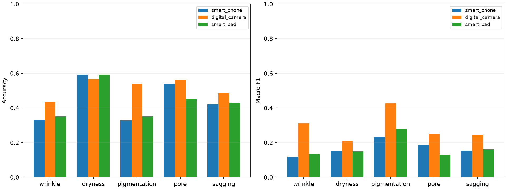
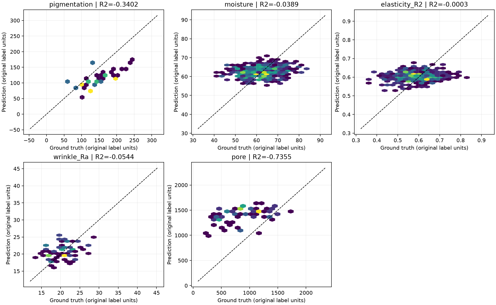

# 전체 피부 분석 모델 성능 평가 보고서

평가 기준일(KST): 2026-10-22. 대상: 기존 NIA 모델 10개와 현재 선택한 여드름 모델 1개.
학습·가중치 변경·테스트 임계값 조정 없이 현재 가중치를 평가했습니다.
평가량: NIA 24,886건의 모델·ROI 평가(제외 2,882건), 여드름 438장. NIA의 같은 사진·인물이 항목과 기기에 걸쳐 반복될 수 있어 고유 사진 수와 다릅니다.

## 판단 요약

- 스마트폰 NIA 분류 5종 중 5종의 Accuracy가 같은 평가셋의 최빈 정답 상수 비교값보다 높지 않았습니다. Macro F1과 등급별 Recall을 함께 보아야 합니다.
- 스마트폰 NIA 회귀 5종 중 5종의 R²가 0 이하였습니다. 현재 평가 조건에서 개인별 상태 차이를 설명하는 성능이 부족합니다.
- 여드름의 높은 합성 평가 점수는 실사 정확도를 보장하지 않습니다. 네 항목의 입력 계약 선정과 실제 추천에 필요한 품질 검증을 구분합니다.

## 평가 범위와 해석

- NIA: 제공된 seed-1 공식 Test 중 파일과 ROI가 유효한 부분집합, 스마트폰·디지털카메라·태블릿 3종.
- 여드름: 감사 manifest의 내부 Test 및 공식 Validation을 보존한 추가 평가. 두 데이터셋 모두 합성 정면 이미지입니다.
- NIA는 정답 bbox와 기존 NIA 전처리로 평가했습니다. 테스트 페이지의 자동 비율 ROI나 임의 사용자 사진의 정확도 평가가 아닙니다.
- NIA 입력은 공개 평가 코드의 256px 설정을 따릅니다. 아카이브 가중치의 학습 당시 해상도·전처리와의 완전한 일치는 미확인입니다. 낮은 성능의 원인을 모델 자체나 전처리 중 하나로 단정하지 않습니다.
- 표본 수는 부위 이미지(ROI) 수입니다. 같은 인물의 여러 각도·부위·기기가 있으므로 독립 인물 수로 해석하지 않습니다.
- 인물 중복은 제공된 같은 항목의 Train/Validation 분할 목록을 기준으로 계산했습니다. 가중치의 전체 학습 이력이 이 목록과 정확히 대응하는지까지 검증한 것은 아닙니다.
- Macro는 체크포인트의 전체 등급을 동등하게 평균하고, 정답·예측이 없는 등급의 P/R/F1은 0으로 둡니다. 등급별 support와 Weighted 평균도 함께 보세요.
- 모델마다 등급 수·라벨 정의·측정 단위·평가 인물이 다릅니다. 지표를 하나의 전체 Accuracy로 합치거나 항목 간 단순 순위로 해석하지 않습니다.
- 회귀 Accuracy는 사전 합의한 허용 오차가 없어 산출하지 않았습니다. MAE·RMSE는 원래 라벨 단위, MSE는 그 제곱 단위입니다. 서로 다른 타깃의 오차 크기를 직접 순위화하지 않습니다.
- Accuracy는 전체 정답 비율입니다. Precision은 해당 등급으로 예측한 것 중 실제 정답 비율, Recall은 실제 해당 등급 중 찾아낸 비율, F1은 Precision과 Recall의 조화평균입니다. 낮은 Recall은 해당 상태를 놓칠 가능성이 크다는 뜻입니다.
- MAE는 절대 오차 평균, MSE는 제곱 오차 평균, RMSE는 MSE의 제곱근입니다. 모두 낮을수록 좋고 MSE·RMSE는 큰 오차에 더 민감합니다. Weighted 평균은 등급별 정답 수로 가중하므로 흔한 등급의 영향이 큽니다.
- R²는 1이 최선, 0은 해당 평가셋 정답 평균을 항상 예측하는 수준, 음수는 그 평균 예측보다 나쁜 제곱 오차를 뜻합니다. 표본 2개 미만·상수 정답이면 정의 불가로 표시합니다.
- 추가 지표는 **RMSE**, **±1등급 정확도** 두 개뿐입니다. ±1등급 정확도는 순서형 NIA 분류에만 적용하며 이진 여드름에는 적용하지 않습니다.
- ±1등급 정확도가 높아도 특정 중간 등급에 예측이 몰릴 수 있습니다. 정확 일치 Accuracy·Macro F1·등급별 Recall을 함께 해석해야 합니다.
- 평가셋의 최빈 정답만 고르는 상수 Accuracy는 불균형 해석용 비교값입니다. 테스트셋에서 정한 값이므로 학습으로 만든 배포 가능한 기준 모델의 성능은 아닙니다.

## 스마트폰 주요 결과

### 분류

| 항목 / 기기 | ROI 수 | Accuracy | Precision(Macro) | Recall(Macro) | F1(Macro) | ±1등급 정확도 |
|---|---:|---:|---:|---:|---:|---:|
| 주름 등급 | 1962 | 33.08% | 13.70% | 16.60% | 11.81% | 62.54% |
| 입술 건조 등급 | 585 | 59.32% | 12.20% | 19.60% | 15.04% | 93.16% |
| 색소침착 등급 | 1374 | 32.82% | 28.41% | 26.42% | 23.46% | 73.65% |
| 모공 등급 | 780 | 53.97% | 21.01% | 19.91% | 18.87% | 83.72% |
| 턱선 처짐 등급 | 606 | 42.08% | 17.48% | 18.73% | 15.38% | 62.87% |

### 회귀

| 항목 / 기기 | ROI 수 | Accuracy | MAE | MSE | RMSE | R² |
|---|---:|---|---:|---:|---:|---:|
| 색소침착 회귀 | 291 | 해당 없음 | 59.5846 | 5266.2525 | 72.5689 | -0.3402 |
| 수분 회귀 | 971 | 해당 없음 | 8.3099 | 107.2495 | 10.3561 | -0.0389 |
| 탄력 R2 회귀 | 953 | 해당 없음 | 0.0846 | 0.0109 | 0.1045 | -0.0003 |
| 눈가 주름 Ra 회귀 | 394 | 해당 없음 | 4.3693 | 32.9602 | 5.7411 | -0.0544 |
| 모공 회귀 | 374 | 해당 없음 | 510.8384 | 364129.6774 | 603.4316 | -0.7355 |





두 그림은 동일한 평가 결과의 시각화입니다. 회귀 그림은 개별점 대신 ROI가 3개 이상 모인 구간의 밀도를 표시합니다. 여드름 합성 결과를 NIA 실사 결과와 합치지 않았습니다.

## 모델별 상세 결과와 주의점

### 주름 등급 (`class/wrinkle`)

이마·미간·양쪽 눈가의 등급(0~6)입니다. 정확 일치와 ±1등급 일치를 구분해야 합니다.

가중치 SHA-256: `cc6402514bc3f72b962260875c5ff205868afd580f906bec66651406aae3bf45`.

| 항목 / 기기 | ROI 수 | Accuracy | Precision(Macro) | Recall(Macro) | F1(Macro) | ±1등급 정확도 |
|---|---:|---:|---:|---:|---:|---:|
| 스마트폰 | 1962 | 33.08% | 13.70% | 16.60% | 11.81% | 62.54% |
| 디지털카메라 | 1965 | 43.72% | 39.92% | 33.25% | 31.17% | 80.36% |
| 태블릿 | 1959 | 35.17% | 32.78% | 16.65% | 13.56% | 61.92% |

| 기기 | 공식 Test ROI | 평가 ROI | 제외 ROI | 평가 인물 | 제공 Train과 중복 | 제공 Val과 중복 | 양쪽 모두 미중복 인물 |
|---|---:|---:|---:|---:|---:|---:|---:|
| 스마트폰 | 2199 | 1962 | 237 | 494 | 478 | 111 | 3 |
| 디지털카메라 | 2200 | 1965 | 235 | 495 | 479 | 111 | 3 |
| 태블릿 | 2192 | 1959 | 233 | 495 | 479 | 111 | 3 |

스마트폰 부위별 결과:

| 항목 / 기기 | ROI 수 | Accuracy | Precision(Macro) | Recall(Macro) | F1(Macro) | ±1등급 정확도 |
|---|---:|---:|---:|---:|---:|---:|
| `forehead_wrinkle` | 591 | 35.70% | 24.72% | 16.00% | 10.42% | 61.76% |
| `glabellus_wrinkle` | 579 | 34.89% | 15.19% | 15.97% | 13.67% | 74.44% |
| `perocular_wrinkle` | 792 | 29.80% | 11.00% | 15.79% | 10.10% | 54.42% |

제공된 같은 모델의 학습·검증 분할과 인물이 겹치지 않는 스마트폰 부분집합:

| 항목 / 기기 | ROI 수 | Accuracy | Precision(Macro) | Recall(Macro) | F1(Macro) | ±1등급 정확도 |
|---|---:|---:|---:|---:|---:|---:|
| 인물 미중복 부분집합 | 30 | 20.00% | 6.43% | 21.43% | 9.89% | 50.00% |

분할 목록상 미중복일 뿐 체크포인트 전체 학습 이력과 임의 사용자 환경의 독립성을 확정하지 않습니다. 표본 수가 작으면 특히 불안정합니다.

가장 많이 예측한 등급은 1등급이며 1632/1962개입니다.
현재 Accuracy는 이 평가셋의 최빈 정답 상수 비교값보다 높지 않습니다. 다양한 등급을 구분하는 능력을 충분히 확보했다고 판단하지 않습니다.

스마트폰 Weighted Precision / Recall / F1: 19.56% / 33.08% / 21.47%.
같은 평가셋의 최빈 정답 상수 Accuracy(설명용): 36.70%.

| 등급 | 정답 수 | 예측 수 | Precision | Recall | F1 |
|---:|---:|---:|---:|---:|---:|
| 0 | 194 | 277 | 22.38% | 31.96% | 26.33% |
| 1 | 720 | 1632 | 35.42% | 80.28% | 49.15% |
| 2 | 322 | 3 | 0.00% | 0.00% | 0.00% |
| 3 | 286 | 31 | 19.35% | 2.10% | 3.79% |
| 4 | 148 | 3 | 0.00% | 0.00% | 0.00% |
| 5 | 160 | 16 | 18.75% | 1.88% | 3.41% |
| 6 | 132 | 0 | 0.00% | 0.00% | 0.00% |

혼동행렬(행=정답 등급, 열=예측 등급, 0등급부터 순서대로):

```json
[[62, 131, 0, 1, 0, 0, 0], [140, 578, 0, 2, 0, 0, 0], [25, 291, 0, 4, 0, 2, 0], [24, 253, 0, 6, 0, 3, 0], [14, 130, 0, 3, 0, 1, 0], [11, 138, 0, 7, 1, 3, 0], [1, 111, 3, 8, 2, 7, 0]]
```

### 입술 건조 등급 (`class/dryness`)

입술 건조 등급(0~4)입니다. 얼굴 전체의 건성 피부 또는 수분 부족으로 해석하면 안 됩니다. 추천 입력에서 제외했습니다.

가중치 SHA-256: `c2988c836b13c04d0c5cb6be0161cc5b7695be7d7a6cdaa8f170a994f5f0e3e3`.

| 항목 / 기기 | ROI 수 | Accuracy | Precision(Macro) | Recall(Macro) | F1(Macro) | ±1등급 정확도 |
|---|---:|---:|---:|---:|---:|---:|
| 스마트폰 | 585 | 59.32% | 12.20% | 19.60% | 15.04% | 93.16% |
| 디지털카메라 | 588 | 56.63% | 27.93% | 22.71% | 20.97% | 92.35% |
| 태블릿 | 588 | 59.35% | 12.03% | 19.72% | 14.95% | 93.54% |

| 기기 | 공식 Test ROI | 평가 ROI | 제외 ROI | 평가 인물 | 제공 Train과 중복 | 제공 Val과 중복 | 양쪽 모두 미중복 인물 |
|---|---:|---:|---:|---:|---:|---:|---:|
| 스마트폰 | 660 | 585 | 75 | 195 | 0 | 0 | 195 |
| 디지털카메라 | 660 | 588 | 72 | 196 | 0 | 0 | 196 |
| 태블릿 | 660 | 588 | 72 | 196 | 0 | 0 | 196 |

스마트폰 부위별 결과:

| 항목 / 기기 | ROI 수 | Accuracy | Precision(Macro) | Recall(Macro) | F1(Macro) | ±1등급 정확도 |
|---|---:|---:|---:|---:|---:|---:|
| `dryness` | 585 | 59.32% | 12.20% | 19.60% | 15.04% | 93.16% |

제공된 같은 모델의 학습·검증 분할과 인물이 겹치지 않는 스마트폰 부분집합:

| 항목 / 기기 | ROI 수 | Accuracy | Precision(Macro) | Recall(Macro) | F1(Macro) | ±1등급 정확도 |
|---|---:|---:|---:|---:|---:|---:|
| 인물 미중복 부분집합 | 585 | 59.32% | 12.20% | 19.60% | 15.04% | 93.16% |

분할 목록상 미중복일 뿐 체크포인트 전체 학습 이력과 임의 사용자 환경의 독립성을 확정하지 않습니다. 표본 수가 작으면 특히 불안정합니다.

가장 많이 예측한 등급은 2등급이며 569/585개입니다.
현재 Accuracy는 이 평가셋의 최빈 정답 상수 비교값보다 높지 않습니다. 다양한 등급을 구분하는 능력을 충분히 확보했다고 판단하지 않습니다.

스마트폰 Weighted Precision / Recall / F1: 36.90% / 59.32% / 45.50%.
같은 평가셋의 최빈 정답 상수 Accuracy(설명용): 60.51%.

| 등급 | 정답 수 | 예측 수 | Precision | Recall | F1 |
|---:|---:|---:|---:|---:|---:|
| 0 | 12 | 0 | 0.00% | 0.00% | 0.00% |
| 1 | 96 | 0 | 0.00% | 0.00% | 0.00% |
| 2 | 354 | 569 | 60.98% | 98.02% | 75.19% |
| 3 | 105 | 2 | 0.00% | 0.00% | 0.00% |
| 4 | 18 | 14 | 0.00% | 0.00% | 0.00% |

혼동행렬(행=정답 등급, 열=예측 등급, 0등급부터 순서대로):

```json
[[0, 0, 12, 0, 0], [0, 0, 93, 2, 1], [0, 0, 347, 0, 7], [0, 0, 99, 0, 6], [0, 0, 18, 0, 0]]
```

### 색소침착 등급 (`class/pigmentation`)

이마와 양쪽 볼의 시각적 등급(0~5)입니다. 전체 얼굴의 색소 측정 회귀값과 평가 대상이 다릅니다.

가중치 SHA-256: `e7757cb4806fdc249b91a1988a734f16360ab2b463eee92d5db53fe75d837d35`.

| 항목 / 기기 | ROI 수 | Accuracy | Precision(Macro) | Recall(Macro) | F1(Macro) | ±1등급 정확도 |
|---|---:|---:|---:|---:|---:|---:|
| 스마트폰 | 1374 | 32.82% | 28.41% | 26.42% | 23.46% | 73.65% |
| 디지털카메라 | 1374 | 53.93% | 44.12% | 41.61% | 42.55% | 90.83% |
| 태블릿 | 1374 | 35.15% | 31.11% | 30.03% | 27.97% | 76.49% |

| 기기 | 공식 Test ROI | 평가 ROI | 제외 ROI | 평가 인물 | 제공 Train과 중복 | 제공 Val과 중복 | 양쪽 모두 미중복 인물 |
|---|---:|---:|---:|---:|---:|---:|---:|
| 스마트폰 | 1544 | 1374 | 170 | 366 | 293 | 44 | 41 |
| 디지털카메라 | 1544 | 1374 | 170 | 366 | 293 | 44 | 41 |
| 태블릿 | 1544 | 1374 | 170 | 366 | 293 | 44 | 41 |

스마트폰 부위별 결과:

| 항목 / 기기 | ROI 수 | Accuracy | Precision(Macro) | Recall(Macro) | F1(Macro) | ±1등급 정확도 |
|---|---:|---:|---:|---:|---:|---:|
| `forehead_pigmentation` | 588 | 39.29% | 34.28% | 19.81% | 15.83% | 81.29% |
| `cheek_pigmentation` | 786 | 27.99% | 24.88% | 24.07% | 21.12% | 67.94% |

제공된 같은 모델의 학습·검증 분할과 인물이 겹치지 않는 스마트폰 부분집합:

| 항목 / 기기 | ROI 수 | Accuracy | Precision(Macro) | Recall(Macro) | F1(Macro) | ±1등급 정확도 |
|---|---:|---:|---:|---:|---:|---:|
| 인물 미중복 부분집합 | 287 | 35.54% | 26.70% | 26.76% | 21.35% | 71.78% |

분할 목록상 미중복일 뿐 체크포인트 전체 학습 이력과 임의 사용자 환경의 독립성을 확정하지 않습니다. 표본 수가 작으면 특히 불안정합니다.

가장 많이 예측한 등급은 1등급이며 541/1374개입니다.
현재 Accuracy는 이 평가셋의 최빈 정답 상수 비교값보다 높지 않습니다. 다양한 등급을 구분하는 능력을 충분히 확보했다고 판단하지 않습니다.

스마트폰 Weighted Precision / Recall / F1: 37.25% / 32.82% / 31.87%.
같은 평가셋의 최빈 정답 상수 Accuracy(설명용): 38.57%.

| 등급 | 정답 수 | 예측 수 | Precision | Recall | F1 |
|---:|---:|---:|---:|---:|---:|
| 0 | 140 | 494 | 17.41% | 61.43% | 27.13% |
| 1 | 530 | 541 | 48.24% | 49.25% | 48.74% |
| 2 | 308 | 176 | 29.55% | 16.88% | 21.49% |
| 3 | 256 | 87 | 47.13% | 16.02% | 23.91% |
| 4 | 92 | 53 | 15.09% | 8.70% | 11.03% |
| 5 | 48 | 23 | 13.04% | 6.25% | 8.45% |

혼동행렬(행=정답 등급, 열=예측 등급, 0등급부터 순서대로):

```json
[[86, 53, 1, 0, 0, 0], [212, 261, 41, 7, 5, 4], [93, 130, 52, 19, 8, 6], [64, 64, 57, 41, 23, 7], [27, 21, 19, 14, 8, 3], [12, 12, 6, 6, 9, 3]]
```

### 모공 등급 (`class/pore`)

볼의 시각적 모공 등급(0~5)입니다. 실제 모공 개수와 같은 값이 아니며 좌우 부위를 보존합니다.

가중치 SHA-256: `10146568126415c876726c5c0a9c98695a0a37a68909614cda21257234d1d4a8`.

| 항목 / 기기 | ROI 수 | Accuracy | Precision(Macro) | Recall(Macro) | F1(Macro) | ±1등급 정확도 |
|---|---:|---:|---:|---:|---:|---:|
| 스마트폰 | 780 | 53.97% | 21.01% | 19.91% | 18.87% | 83.72% |
| 디지털카메라 | 780 | 56.41% | 27.30% | 24.52% | 24.99% | 91.28% |
| 태블릿 | 780 | 45.13% | 12.09% | 15.28% | 13.09% | 77.95% |

| 기기 | 공식 Test ROI | 평가 ROI | 제외 ROI | 평가 인물 | 제공 Train과 중복 | 제공 Val과 중복 | 양쪽 모두 미중복 인물 |
|---|---:|---:|---:|---:|---:|---:|---:|
| 스마트폰 | 876 | 780 | 96 | 199 | 6 | 2 | 191 |
| 디지털카메라 | 876 | 780 | 96 | 199 | 6 | 2 | 191 |
| 태블릿 | 876 | 780 | 96 | 199 | 6 | 2 | 191 |

스마트폰 부위별 결과:

| 항목 / 기기 | ROI 수 | Accuracy | Precision(Macro) | Recall(Macro) | F1(Macro) | ±1등급 정확도 |
|---|---:|---:|---:|---:|---:|---:|
| `pore` | 780 | 53.97% | 21.01% | 19.91% | 18.87% | 83.72% |

제공된 같은 모델의 학습·검증 분할과 인물이 겹치지 않는 스마트폰 부분집합:

| 항목 / 기기 | ROI 수 | Accuracy | Precision(Macro) | Recall(Macro) | F1(Macro) | ±1등급 정확도 |
|---|---:|---:|---:|---:|---:|---:|
| 인물 미중복 부분집합 | 764 | 54.71% | 20.98% | 20.04% | 18.95% | 83.77% |

분할 목록상 미중복일 뿐 체크포인트 전체 학습 이력과 임의 사용자 환경의 독립성을 확정하지 않습니다. 표본 수가 작으면 특히 불안정합니다.

가장 많이 예측한 등급은 2등급이며 613/780개입니다.
현재 Accuracy는 이 평가셋의 최빈 정답 상수 비교값보다 높지 않습니다. 다양한 등급을 구분하는 능력을 충분히 확보했다고 판단하지 않습니다.

스마트폰 Weighted Precision / Recall / F1: 47.37% / 53.97% / 48.72%.
같은 평가셋의 최빈 정답 상수 Accuracy(설명용): 60.26%.

| 등급 | 정답 수 | 예측 수 | Precision | Recall | F1 |
|---:|---:|---:|---:|---:|---:|
| 0 | 26 | 5 | 0.00% | 0.00% | 0.00% |
| 1 | 134 | 59 | 44.07% | 19.40% | 26.94% |
| 2 | 470 | 613 | 62.97% | 82.13% | 71.28% |
| 3 | 102 | 27 | 11.11% | 2.94% | 4.65% |
| 4 | 40 | 76 | 7.89% | 15.00% | 10.34% |
| 5 | 8 | 0 | 0.00% | 0.00% | 0.00% |

혼동행렬(행=정답 등급, 열=예측 등급, 0등급부터 순서대로):

```json
[[0, 9, 17, 0, 0, 0], [3, 26, 88, 8, 9, 0], [2, 20, 386, 15, 47, 0], [0, 4, 82, 3, 13, 0], [0, 0, 33, 1, 6, 0], [0, 0, 7, 0, 1, 0]]
```

### 턱선 처짐 등급 (`class/sagging`)

턱 부위 처짐 등급입니다. 현재 체크포인트의 출력은 0~5이며 다른 논문의 등급 수로 바꾸지 않습니다. 추천 입력에서 제외했습니다.

가중치 SHA-256: `caf51346bae1aff7a8800e24c57d1a7aac990c9488dcf16deac9c3b3e317274b`.

| 항목 / 기기 | ROI 수 | Accuracy | Precision(Macro) | Recall(Macro) | F1(Macro) | ±1등급 정확도 |
|---|---:|---:|---:|---:|---:|---:|
| 스마트폰 | 606 | 42.08% | 17.48% | 18.73% | 15.38% | 62.87% |
| 디지털카메라 | 606 | 48.68% | 27.24% | 28.14% | 24.59% | 70.96% |
| 태블릿 | 606 | 43.07% | 20.61% | 19.14% | 16.16% | 64.69% |

| 기기 | 공식 Test ROI | 평가 ROI | 제외 ROI | 평가 인물 | 제공 Train과 중복 | 제공 Val과 중복 | 양쪽 모두 미중복 인물 |
|---|---:|---:|---:|---:|---:|---:|---:|
| 스마트폰 | 663 | 606 | 57 | 202 | 0 | 0 | 202 |
| 디지털카메라 | 663 | 606 | 57 | 202 | 0 | 0 | 202 |
| 태블릿 | 663 | 606 | 57 | 202 | 0 | 0 | 202 |

스마트폰 부위별 결과:

| 항목 / 기기 | ROI 수 | Accuracy | Precision(Macro) | Recall(Macro) | F1(Macro) | ±1등급 정확도 |
|---|---:|---:|---:|---:|---:|---:|
| `sagging` | 606 | 42.08% | 17.48% | 18.73% | 15.38% | 62.87% |

제공된 같은 모델의 학습·검증 분할과 인물이 겹치지 않는 스마트폰 부분집합:

| 항목 / 기기 | ROI 수 | Accuracy | Precision(Macro) | Recall(Macro) | F1(Macro) | ±1등급 정확도 |
|---|---:|---:|---:|---:|---:|---:|
| 인물 미중복 부분집합 | 606 | 42.08% | 17.48% | 18.73% | 15.38% | 62.87% |

분할 목록상 미중복일 뿐 체크포인트 전체 학습 이력과 임의 사용자 환경의 독립성을 확정하지 않습니다. 표본 수가 작으면 특히 불안정합니다.

가장 많이 예측한 등급은 0등급이며 471/606개입니다.
현재 Accuracy는 이 평가셋의 최빈 정답 상수 비교값보다 높지 않습니다. 다양한 등급을 구분하는 능력을 충분히 확보했다고 판단하지 않습니다.

스마트폰 Weighted Precision / Recall / F1: 31.40% / 42.08% / 32.73%.
같은 평가셋의 최빈 정답 상수 Accuracy(설명용): 46.04%.

| 등급 | 정답 수 | 예측 수 | Precision | Recall | F1 |
|---:|---:|---:|---:|---:|---:|
| 0 | 279 | 471 | 51.17% | 86.38% | 64.27% |
| 1 | 117 | 24 | 29.17% | 5.98% | 9.93% |
| 2 | 78 | 16 | 12.50% | 2.56% | 4.26% |
| 3 | 75 | 5 | 0.00% | 0.00% | 0.00% |
| 4 | 33 | 36 | 8.33% | 9.09% | 8.70% |
| 5 | 24 | 54 | 3.70% | 8.33% | 5.13% |

혼동행렬(행=정답 등급, 열=예측 등급, 0등급부터 순서대로):

```json
[[241, 8, 7, 3, 9, 11], [86, 7, 2, 0, 8, 14], [56, 5, 2, 0, 4, 11], [50, 2, 5, 0, 9, 9], [20, 2, 0, 1, 3, 7], [18, 0, 0, 1, 3, 2]]
```

### 색소침착 회귀 (`regression/pigmentation`)

전체 이미지 입력의 원래 장비 라벨 척도로 출력합니다(학습 정규화 역변환 ×350). 부위별 색소침착 등급과 직접 합치지 않습니다.

가중치 SHA-256: `79cffd8e95a2e76f7a457f4b835e94a5a98d4eb0838a28e371ab00cb714989e4`.

| 항목 / 기기 | ROI 수 | Accuracy | MAE | MSE | RMSE | R² |
|---|---:|---|---:|---:|---:|---:|
| 스마트폰 | 291 | 해당 없음 | 59.5846 | 5266.2525 | 72.5689 | -0.3402 |
| 디지털카메라 | 291 | 해당 없음 | 24.5450 | 993.8651 | 31.5256 | 0.7471 |
| 태블릿 | 291 | 해당 없음 | 54.0622 | 4835.3845 | 69.5369 | -0.2306 |

| 기기 | 공식 Test ROI | 평가 ROI | 제외 ROI | 평가 인물 | 제공 Train과 중복 | 제공 Val과 중복 | 양쪽 모두 미중복 인물 |
|---|---:|---:|---:|---:|---:|---:|---:|
| 스마트폰 | 321 | 291 | 30 | 97 | 0 | 0 | 97 |
| 디지털카메라 | 321 | 291 | 30 | 97 | 0 | 0 | 97 |
| 태블릿 | 321 | 291 | 30 | 97 | 0 | 0 | 97 |

스마트폰 부위별 결과:

| 항목 / 기기 | ROI 수 | Accuracy | MAE | MSE | RMSE | R² |
|---|---:|---|---:|---:|---:|---:|
| `pigmentation` | 291 | 해당 없음 | 59.5846 | 5266.2525 | 72.5689 | -0.3402 |

제공된 같은 모델의 학습·검증 분할과 인물이 겹치지 않는 스마트폰 부분집합:

| 항목 / 기기 | ROI 수 | Accuracy | MAE | MSE | RMSE | R² |
|---|---:|---|---:|---:|---:|---:|
| 인물 미중복 부분집합 | 291 | 해당 없음 | 59.5846 | 5266.2525 | 72.5689 | -0.3402 |

분할 목록상 미중복일 뿐 체크포인트 전체 학습 이력과 임의 사용자 환경의 독립성을 확정하지 않습니다. 표본 수가 작으면 특히 불안정합니다.

스마트폰 정답 범위 30.0000~316.0000, 예측 범위 -46.8889~215.0315.
정답 / 예측 표준편차: 62.6842 / 43.3066. 범위 압축 여부와 평균 근처 예측을 함께 확인하세요.
R²가 0 이하이므로 이 평가 조건에서는 정답 평균을 항상 예측하는 기준 이상의 설명력을 확인하지 못했습니다. 현재 회귀값을 추천 조건의 근거로 사용하지 않는 것이 타당합니다.
평가 정답은 모두 0 이상이지만 음수 예측이 관찰됐습니다. 회귀 출력에는 범위 제약이 없으며, 이번 평가는 0으로 보정하지 않은 원본 예측으로 계산했습니다.

### 수분 회귀 (`regression/moisture`)

이마·양쪽 볼·턱의 수분 장비값 추정입니다(×100). 학습 정규화 배율은 퍼센트나 최대값을 뜻하지 않습니다. 현재 추천 입력에서 제외했습니다.

가중치 SHA-256: `c0505e15c8a2eaa14506061c7821ebfdd081ab909c7f121f60bc2df1344c4d3a`.

| 항목 / 기기 | ROI 수 | Accuracy | MAE | MSE | RMSE | R² |
|---|---:|---|---:|---:|---:|---:|
| 스마트폰 | 971 | 해당 없음 | 8.3099 | 107.2495 | 10.3561 | -0.0389 |
| 디지털카메라 | 969 | 해당 없음 | 7.8527 | 96.3065 | 9.8136 | 0.0670 |
| 태블릿 | 971 | 해당 없음 | 8.3344 | 105.0018 | 10.2470 | -0.0172 |

| 기기 | 공식 Test ROI | 평가 ROI | 제외 ROI | 평가 인물 | 제공 Train과 중복 | 제공 Val과 중복 | 양쪽 모두 미중복 인물 |
|---|---:|---:|---:|---:|---:|---:|---:|
| 스마트폰 | 1070 | 971 | 99 | 330 | 328 | 84 | 1 |
| 디지털카메라 | 1070 | 969 | 101 | 330 | 328 | 84 | 1 |
| 태블릿 | 1070 | 971 | 99 | 330 | 328 | 84 | 1 |

스마트폰 부위별 결과:

| 항목 / 기기 | ROI 수 | Accuracy | MAE | MSE | RMSE | R² |
|---|---:|---|---:|---:|---:|---:|
| `forehead_moisture` | 291 | 해당 없음 | 7.9688 | 100.4718 | 10.0236 | -0.1171 |
| `cheek_moisture` | 386 | 해당 없음 | 8.7370 | 118.0258 | 10.8640 | -0.1085 |
| `chin_moisture` | 294 | 해당 없음 | 8.0869 | 99.8096 | 9.9905 | 0.0842 |

제공된 같은 모델의 학습·검증 분할과 인물이 겹치지 않는 스마트폰 부분집합:

| 항목 / 기기 | ROI 수 | Accuracy | MAE | MSE | RMSE | R² |
|---|---:|---|---:|---:|---:|---:|
| 인물 미중복 부분집합 | 10 | 해당 없음 | 5.4873 | 35.4937 | 5.9577 | -0.1746 |

분할 목록상 미중복일 뿐 체크포인트 전체 학습 이력과 임의 사용자 환경의 독립성을 확정하지 않습니다. 표본 수가 작으면 특히 불안정합니다.

스마트폰 정답 범위 32.3330~92.3330, 예측 범위 49.4720~74.8671.
정답 / 예측 표준편차: 10.1602 / 3.7652. 범위 압축 여부와 평균 근처 예측을 함께 확인하세요.
R²가 0 이하이므로 이 평가 조건에서는 정답 평균을 항상 예측하는 기준 이상의 설명력을 확인하지 못했습니다. 현재 회귀값을 추천 조건의 근거로 사용하지 않는 것이 타당합니다.
예측 표준편차가 정답의 절반 미만입니다. 서로 다른 실제 상태가 비슷한 예측값으로 압축되는 현상을 확인해야 합니다.

### 탄력 R2 회귀 (`regression/elasticity_R2`)

이마·양쪽 볼·턱의 장비 탄력 R2 라벨을 예측합니다(배율 1). 타깃 이름의 R2와 성능 지표인 결정계수 R²는 서로 다른 개념입니다. 추천 입력에서 제외했습니다.

가중치 SHA-256: `2a68a810b0f83d8104dbc68dc2d8b5950c9ac8abe18bd26a07a04cc80f54bea5`.

| 항목 / 기기 | ROI 수 | Accuracy | MAE | MSE | RMSE | R² |
|---|---:|---|---:|---:|---:|---:|
| 스마트폰 | 953 | 해당 없음 | 0.0846 | 0.0109 | 0.1045 | -0.0003 |
| 디지털카메라 | 956 | 해당 없음 | 0.0779 | 0.0097 | 0.0983 | 0.1188 |
| 태블릿 | 956 | 해당 없음 | 0.0897 | 0.0124 | 0.1113 | -0.1297 |

| 기기 | 공식 Test ROI | 평가 ROI | 제외 ROI | 평가 인물 | 제공 Train과 중복 | 제공 Val과 중복 | 양쪽 모두 미중복 인물 |
|---|---:|---:|---:|---:|---:|---:|---:|
| 스마트폰 | 1070 | 953 | 117 | 316 | 316 | 96 | 0 |
| 디지털카메라 | 1070 | 956 | 114 | 317 | 317 | 96 | 0 |
| 태블릿 | 1070 | 956 | 114 | 317 | 317 | 96 | 0 |

스마트폰 부위별 결과:

| 항목 / 기기 | ROI 수 | Accuracy | MAE | MSE | RMSE | R² |
|---|---:|---|---:|---:|---:|---:|
| `forehead_elasticity_R2` | 288 | 해당 없음 | 0.0878 | 0.0118 | 0.1084 | -0.0335 |
| `cheek_elasticity_R2` | 380 | 해당 없음 | 0.0787 | 0.0093 | 0.0962 | 0.0504 |
| `chin_elasticity_R2` | 285 | 해당 없음 | 0.0892 | 0.0123 | 0.1107 | -0.1000 |

제공된 학습·검증 분할과 인물이 겹치지 않는 평가 부분집합이 없습니다.

스마트폰 정답 범위 0.3230~0.9310, 예측 범위 0.4983~0.7575.
정답 / 예측 표준편차: 0.1044 / 0.0366. 범위 압축 여부와 평균 근처 예측을 함께 확인하세요.
R²가 0 이하이므로 이 평가 조건에서는 정답 평균을 항상 예측하는 기준 이상의 설명력을 확인하지 못했습니다. 현재 회귀값을 추천 조건의 근거로 사용하지 않는 것이 타당합니다.
예측 표준편차가 정답의 절반 미만입니다. 서로 다른 실제 상태가 비슷한 예측값으로 압축되는 현상을 확인해야 합니다.

### 눈가 주름 Ra 회귀 (`regression/wrinkle_Ra`)

양쪽 눈가의 주름 거칠기 Ra 라벨입니다(×50). 시각적 주름 등급으로 변환한 값이 아니며 물리 단위는 별도 근거 없이 단정하지 않습니다.

가중치 SHA-256: `afd7a9ec30d7556b1b7536f9fb293edf3869810271a010fac6f68cd284ee8edc`.

| 항목 / 기기 | ROI 수 | Accuracy | MAE | MSE | RMSE | R² |
|---|---:|---|---:|---:|---:|---:|
| 스마트폰 | 394 | 해당 없음 | 4.3693 | 32.9602 | 5.7411 | -0.0544 |
| 디지털카메라 | 396 | 해당 없음 | 3.3592 | 20.1351 | 4.4872 | 0.3529 |
| 태블릿 | 394 | 해당 없음 | 4.5865 | 33.6471 | 5.8006 | -0.0818 |

| 기기 | 공식 Test ROI | 평가 ROI | 제외 ROI | 평가 인물 | 제공 Train과 중복 | 제공 Val과 중복 | 양쪽 모두 미중복 인물 |
|---|---:|---:|---:|---:|---:|---:|---:|
| 스마트폰 | 428 | 394 | 34 | 187 | 157 | 20 | 10 |
| 디지털카메라 | 428 | 396 | 32 | 188 | 158 | 20 | 10 |
| 태블릿 | 425 | 394 | 31 | 188 | 158 | 20 | 10 |

스마트폰 부위별 결과:

| 항목 / 기기 | ROI 수 | Accuracy | MAE | MSE | RMSE | R² |
|---|---:|---|---:|---:|---:|---:|
| `perocular_wrinkle_Ra` | 394 | 해당 없음 | 4.3693 | 32.9602 | 5.7411 | -0.0544 |

제공된 같은 모델의 학습·검증 분할과 인물이 겹치지 않는 스마트폰 부분집합:

| 항목 / 기기 | ROI 수 | Accuracy | MAE | MSE | RMSE | R² |
|---|---:|---|---:|---:|---:|---:|
| 인물 미중복 부분집합 | 40 | 해당 없음 | 4.7126 | 36.5309 | 6.0441 | 0.1488 |

분할 목록상 미중복일 뿐 체크포인트 전체 학습 이력과 임의 사용자 환경의 독립성을 확정하지 않습니다. 표본 수가 작으면 특히 불안정합니다.

스마트폰 정답 범위 12.0180~45.2200, 예측 범위 13.0114~28.5163.
정답 / 예측 표준편차: 5.5910 / 2.9830. 범위 압축 여부와 평균 근처 예측을 함께 확인하세요.
R²가 0 이하이므로 이 평가 조건에서는 정답 평균을 항상 예측하는 기준 이상의 설명력을 확인하지 못했습니다. 현재 회귀값을 추천 조건의 근거로 사용하지 않는 것이 타당합니다.

### 모공 회귀 (`regression/pore`)

양쪽 볼의 연속형 장비 라벨을 예측합니다(×2600). 시각적 모공 등급과 척도가 다릅니다. 임의로 0~100점이나 등급으로 재구간화하지 않습니다.

가중치 SHA-256: `9d4232797f2e98367d73aeda6b102cdbfef0c7848c3f15b7f38f5bdc74844775`.

| 항목 / 기기 | ROI 수 | Accuracy | MAE | MSE | RMSE | R² |
|---|---:|---|---:|---:|---:|---:|
| 스마트폰 | 374 | 해당 없음 | 510.8384 | 364129.6774 | 603.4316 | -0.7355 |
| 디지털카메라 | 376 | 해당 없음 | 260.9099 | 111339.1794 | 333.6753 | 0.4681 |
| 태블릿 | 376 | 해당 없음 | 545.8349 | 416289.7029 | 645.2052 | -0.9886 |

| 기기 | 공식 Test ROI | 평가 ROI | 제외 ROI | 평가 인물 | 제공 Train과 중복 | 제공 Val과 중복 | 양쪽 모두 미중복 인물 |
|---|---:|---:|---:|---:|---:|---:|---:|
| 스마트폰 | 428 | 374 | 54 | 175 | 144 | 19 | 12 |
| 디지털카메라 | 428 | 376 | 52 | 176 | 145 | 19 | 12 |
| 태블릿 | 428 | 376 | 52 | 176 | 145 | 19 | 12 |

스마트폰 부위별 결과:

| 항목 / 기기 | ROI 수 | Accuracy | MAE | MSE | RMSE | R² |
|---|---:|---|---:|---:|---:|---:|
| `cheek_pore` | 374 | 해당 없음 | 510.8384 | 364129.6774 | 603.4316 | -0.7355 |

제공된 같은 모델의 학습·검증 분할과 인물이 겹치지 않는 스마트폰 부분집합:

| 항목 / 기기 | ROI 수 | Accuracy | MAE | MSE | RMSE | R² |
|---|---:|---|---:|---:|---:|---:|
| 인물 미중복 부분집합 | 48 | 해당 없음 | 555.3279 | 423463.3760 | 650.7406 | -1.8422 |

분할 목록상 미중복일 뿐 체크포인트 전체 학습 이력과 임의 사용자 환경의 독립성을 확정하지 않습니다. 표본 수가 작으면 특히 불안정합니다.

스마트폰 정답 범위 85.0000~2340.0000, 예측 범위 339.1546~1745.5438.
정답 / 예측 표준편차: 458.0567 / 252.5837. 범위 압축 여부와 평균 근처 예측을 함께 확인하세요.
R²가 0 이하이므로 이 평가 조건에서는 정답 평균을 항상 예측하는 기준 이상의 설명력을 확인하지 못했습니다. 현재 회귀값을 추천 조건의 근거로 사용하지 않는 것이 타당합니다.

### 여드름 이진 분류

가중치 SHA-256: `47d7879f267e8bd2e75fc4c36dfd02d9273392a940ee42e276ad95fe4bf43294`. 저장된 임계값 `0.5`를 고정했습니다.
현재 선택한 ImageNet 초기화 모델을 다시 추론했습니다. 정상 0 / 여드름 1이며 아래 P/R/F1의 양성은 여드름입니다.

| 합성 평가셋 | 이미지 수 | Accuracy | Precision(여드름) | Recall(여드름) | F1(여드름) | Macro F1 |
|---|---:|---:|---:|---:|---:|---:|
| test | 238 | 100.00% | 100.00% | 100.00% | 100.00% | 100.00% |
| official_audit | 200 | 98.50% | 100.00% | 97.00% | 98.48% | 98.50% |

test 혼동행렬(행=정답, 열=예측, 순서=정상 0/여드름 1):

```json
[[121, 0], [0, 117]]
```

official_audit 혼동행렬(행=정답, 열=예측, 순서=정상 0/여드름 1):

```json
[[100, 0], [3, 97]]
```

합성 원본·인물의 독립성은 미확인입니다. 감사 시 유사 이미지 그룹을 분리했지만 실사 일반화를 검증한 것은 아닙니다. 메타데이터 편향이 알려져 있으므로 높은 합성 점수를 실사 성능으로 해석하지 않습니다. 다른 피부질환을 정상으로 판정할 수 있다는 근거도 없습니다. 점수는 중증도나 보정된 확률이 아닙니다.

## 기능 개발 시 판단

여드름·모공·색소침착·주름 네 항목의 출력 계약을 선택한 것과 추천에 사용할 정확도를 확보한 것은 별개입니다. 이 보고서에서는 기능 입력 선정이나 모델 가중치를 변경하지 않았습니다.
스마트폰 모공·색소침착·주름 등급은 최빈 정답 상수 Accuracy와 등급별 Recall을 함께 검토해야 합니다. 현재 점수를 정확한 피부 상태로 단정해 추천 강도를 세분화할 근거는 부족합니다. 여드름도 합성 데이터 밖의 정상·여드름 실사 검증이 필요합니다.
다음 개선에서는 원본 학습 전처리·입력 해상도·ROI 계약과 체크포인트 대응을 먼저 확인하고, 인물 단위로 분리한 별도 실사 평가셋을 확보하세요. 모델이나 임계값은 Train/Validation에서 개선하고, 반복해서 확인한 이번 Test를 새로운 최종 검증셋처럼 취급하지 않습니다.

## 재현과 산출물

```powershell
uv run --project ml python -m server.nia.benchmark --output ml/runs/full-evaluation-새실행이름 --batch-size 16 --workers 4
uv run --project ml python -m server.nia.benchmark_report --input ml/runs/full-evaluation-새실행이름 --output reports/skin-analysis/full-performance-evaluation.md
```

이번 원본 결과: `ml/runs/full-evaluation-20261022-verified-splits`. 개별 예측 결과·가중치·개별 ROI ID는 Git에서 제외합니다.
`report.json`에는 전체 기기·부위·등급별 결과와 미중복 부분집합 결과가 있으며, task-device JSON에는 실제 정답·예측이 있습니다. 누락 ROI 수와 split 해시는 report의 audit에 보존했습니다.
공유 가능한 전체 집계는 [기기·부위·등급별 집계 JSON](full-performance-evaluation.metrics.json)에도 저장했습니다. 개별 인물·ROI 식별자와 사진은 포함하지 않습니다.
실행 설정: float32, batch 16, 전처리 worker 4. 장치: NVIDIA GeForce RTX 4070 Ti SUPER.
실행 시점 Git HEAD: `d274af1e9b2eab6c24e811bfdf32cd5c04481793`. 실제 실행 코드의 파일별 SHA-256은 `source_sha256`에 기록했습니다(커밋 전 변경도 식별 가능).

이번 평가는 성능 진단입니다. 운영 사용을 승인하는 판정이나 제품 추천 효과를 검증한 결과는 아닙니다. 모델·분할을 바꿔 개선할 경우 새 실행 폴더와 별도 결과를 만드세요.

지표 정의 참고: [scikit-learn 분류 P/R/F1](https://scikit-learn.org/stable/modules/generated/sklearn.metrics.precision_recall_fscore_support.html), [회귀 지표](https://scikit-learn.org/stable/modules/model_evaluation.html#regression-metrics), [R² 정의와 예외](https://scikit-learn.org/stable/modules/generated/sklearn.metrics.r2_score.html).

실측 정답·예측의 모든 기기별·부위별·미중복 부분집합·기기 통합 지표를 scikit-learn과 독립 대조했습니다. 120개 집계, 수치 3,081개 비교를 통과했습니다. 검증 범위와 결과는 집계 JSON의 `metric_verification`에 보존했습니다.
