# 피부 분석 모델 선정 근거와 실험 결과

작성일: 2026-10-30 
대상: develop 전달용 실험 기록. 10/27~30의 주요 모공 실험과 최종 네 모델의 선정 근거를 모았다. 수치는 검증된 운영 성능이 아니라 내부 탐색 결과다.

## 1. 전달하려는 모델

| 항목 | 모델과 출력 | 포함된 데이터 | 선택 epoch | Validation Macro-F1 | Test Macro-F1 | Test 정확도 | Test ±1등급 정확도 |
|---|---|---|---:|---:|---:|---:|---:|
| 모공 | MobileNetV3-Large, sigmoid×5, 반올림 0~5 | 실제 스마트폰 볼 ROI | 50 / 60 | 0.3524 | 0.3471 | 0.4908 | 0.9206 |
| 색소침착 | MobileNetV3-Large, sigmoid×5, 반올림 0~5 | 실제 스마트폰 이마·볼 ROI | 15 / 25 | 0.4406 | 0.4248 | 0.5049 | 0.9398 |
| 주름 | MobileNetV3-Large, sigmoid×6, 반올림 0~6 | 실제 스마트폰 이마·미간·눈가 ROI | 18 / 28 | 0.4256 | 0.3931 | 0.4120 | 0.9004 |
| 피부 타입 | MobileNetV3-Large, softmax 3개, 건성·중성·지성 | 실제 스마트폰 이마·볼 ROI | 20 / 30 | 0.4602 | 0.4698 | 0.4977 | 해당 없음 |

선택 epoch / 완료 epoch를 표시했다. 피부 타입의 Test 수치는 ROI 단위이며 인물 단위 성능은 6절에 따로 적었다. 현재 전달용 연구 번들은 위 네 모델을 포함한다.

±1등급 정확도는 반올림한 예측 등급과 실제 등급의 차이가 1 이하인 Test 표본의 비율이다. 피부 타입은 건성·중성·지성의 순서가 있는 등급이 아니므로 이 지표를 적용하지 않는다.

## 2. 데이터와 분할을 이렇게 쓴 이유

같은 인물의 정면·좌측·우측 사진과 여러 ROI는 서로 닮았으므로 학습과 평가에 같은 인물이 들어가지 않도록 인물·동일 사진 그룹을 분리했다. 실제 스마트폰 데이터의 고정 분할 seed는 42다. 이 분할의 모공 Train 4,112개 중 2등급은 2,486개, 5등급은 48개다. Validation과 Test의 5등급은 각각 6개 ROI·1명으로, 특정 인물에 결과가 크게 좌우된다.

| 항목 | Train | Validation | Test | 총계 |
|---|---:|---:|---:|---:|
| 모공 ROI | 4,112 | 816 | 819 | 5,747 |
| 색소침착 ROI | 6,182 | 1,230 | 1,230 | 8,642 |
| 주름 ROI | 6,975 | 1,393 | 1,386 | 9,754 |
| 피부 타입 ROI / 인물 | 4,368 / 488 | 874 / 98 | 852 / 95 | 6,094 / 681 |

피부 타입은 원본 메타데이터의 건성·중성·지성만 사용하고 복합건성·복합지성·심한 건성은 임의로 합치지 않았다. 이마·볼 ROI에 **인물 전체의 타입**을 연결했으며 해당 부위의 실제 유수분 정답이라는 뜻은 아니다. 라벨 판정 방법은 확인되지 않았다. ROI와 사진의 수를 독립 인물 수로 해석하지 않는다.

같은 Test를 여러 번 확인하고 모델 선택 논의에 참고했으므로 이 보고서의 Test는 탐색용이다. 새로운 독립 인물에서의 최종 성능으로 사용하지 않는다. 관련 기기별 데이터 규모는 [데이터 규모 보고서](Data_scale_chart.md)에 있다.

## 3. 백본과 최적화 선택 근거

### 3.1 MobileNetV3-Large

동일 분할·모공 학습 조건에서 백본 후보를 비교했다. 숫자는 최적 Validation Macro-F1 체크포인트의 결과다.

| 백본 | Validation Macro-F1 | Test Macro-F1 | Test MSE | Test 정확도 |
|---|---:|---:|---:|---:|
| ResNet-50 | 0.3483 | 0.3197 | 0.6260 | 0.5031 |
| EfficientNet-B3 | 0.3253 | 0.3219 | 0.7900 | 0.4408 |
| MobileNetV3-Large | **0.3524** | **0.3471** | 0.6893 | 0.4908 |

MobileNet은 이 비교에서 Validation과 Test Macro-F1이 가장 높고, 스마트폰 온디바이스 활용을 고려한 후보였다. 다만 ResNet의 Test MSE와 정확도가 더 좋았으므로 모든 지표에서 우위는 아니다. 백본별 ImageNet 가중치도 다르고 단일 분할·시드이므로 차이를 구조만의 효과나 재현된 우위로 단정하지 않는다. 실제 모바일 지연·메모리·전력은 이 결과에서 측정하지 않았다.

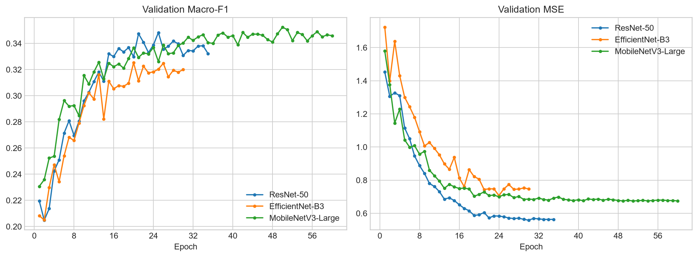

### 3.2 AdamW + SAM

MobileNet과 데이터·나머지 설정을 유지하고 SAM 내부 기본 옵티마이저만 비교했다.

| 조건 | Validation Macro-F1 | Test Macro-F1 | Test MSE |
|---|---:|---:|---:|
| AdamW + SAM | **0.3524** | **0.3471** | **0.6893** |
| RMSprop + SAM | 0.3257 | 0.3306 | 0.7572 |

이 조건에서는 AdamW를 유지할 근거가 있다. 두 실험 모두 SAM을 사용하므로 이 비교는 SAM 자체의 효과나 `ρ=0.05`의 최적값을 증명하지 않는다.

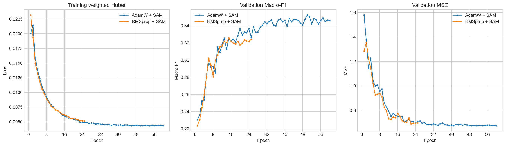

### 3.3 Full fine-tuning

같은 모공 기준과 부분 동결 비교에서 full fine-tuning의 Validation Macro-F1은 **0.3524**, 부분 동결은 **0.3360**이었다. Test Macro-F1은 각각 0.3471과 0.3233이었다. 부분 동결의 Validation MSE는 0.6279로 full의 0.6784보다 낮아 지표별 결과가 다르다. 선택 기준인 Macro-F1에서 기존 방식이 앞서 full fine-tuning을 유지했으며, 부분 동결이 모든 상황에서 열등하다는 뜻은 아니다.

## 4. 전처리와 학습 설정 선택 근거

### 4.1 고정 언샤프와 대비

같은 분할의 ResNet-50 모공 실험에서 전처리를 비교했다. 각 행은 Validation Macro-F1로 고른 epoch다.

| 고정 전처리 | Validation Macro-F1 | Validation MSE | Test Macro-F1 | Test MSE |
|---|---:|---:|---:|---:|
| 없음 | 0.3227 | 0.7199 | 0.3515 | 0.6645 |
| 언샤프 50% | **0.3262** | 0.7131 | **0.3571** | 0.6724 |
| 언샤프 75% + 대비 40% | 0.3207 | **0.6973** | 0.3439 | 0.6681 |

75%+40%는 미리보기에서 받아들일 만한 질감으로 선택하고 이후 기준 모델에서 유지한 설정이다. **Macro-F1이 가장 높아서 선택된 것은 아니다.** 언샤프와 대비를 동시에 변경해 각각의 효과도 분리할 수 없다. 이 비교는 ResNet 단일 분할 결과이며 MobileNet과 피부 타입에 같은 효과가 있다는 증거는 없다. 추론에서도 동일 전처리를 재현해야 한다.

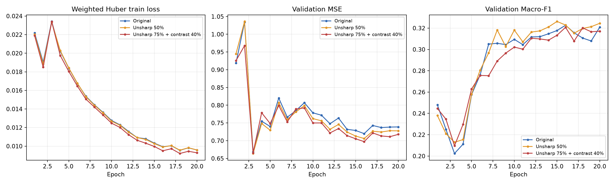

### 4.2 Dropout 0.2

분할 seed 88과 합성 4·5등급 ROI를 포함한 별도 모공 실험에서 Dropout만 비교했다. 0.2의 Validation Macro-F1은 **0.3404**, 0.4는 **0.3192**였다. Test Macro-F1은 각각 0.3148, 0.2745였고 5등급 Test Recall은 둘 다 0이었다. 따라서 0.4가 과적합 해소에 효과적이었다고 보기는 어렵다.

현재 번들의 모공은 **합성데이터를 제외한 seed 42의 0.2 모델**이다. 위 0.2 대 0.4 결과는 다른 데이터 조건에서 얻은 참고 근거이며, 해당 번들 조건에서 Dropout만 바꾼 검증 결과는 아니다. 색소·주름·피부 타입은 0.2를 모공 설정에서 이어받았다.

### 4.3 불균형 대응: 원본 전체 + 제곱근 추가 추출과 α=0.5

모공 기준 모델은 Train 원본 4,112 ROI를 모두 쓰고 희소 등급을 추가 추출해 epoch당 **6,587회** 노출한다. 예를 들어 5등급 48 ROI가 346회 노출된다. 반복은 새 인물 추가가 아니다. 손실에는 추가 추출 전 원본 빈도 기준의 제곱근 가중치 α=0.5를 적용했다.

| 모공 실험 | Validation Macro-F1 | Test Macro-F1 | Test 4등급 Recall | Test 5등급 Recall |
|---|---:|---:|---:|---:|
| 제곱근 추가 추출 + α=0.5 | 0.3524 | 0.3471 | **0.1905** | 0.0000 |
| 등급별 균등 노출 + 가중치 없음 | 0.3521 | **0.3678** | 0.0714 | 0.0000 |

균등 조건의 Test Macro-F1은 높았지만 4등급 Recall은 낮았고, 5등급은 두 조건 모두 0이었다. 샘플링·가중치·epoch당 업데이트가 함께 달라 원인을 분리할 수 없다. α=0.5나 제곱근 방식이 최적이라고 입증된 것은 아니며, 당시 희소 등급 보충과 과도한 반복 사이의 기준으로 정했다.

### 4.4 학습 예산과 평가 기준

#### Batch 16 선택: 이전 16·32 비교

과거 모공 **등급 직접 분류** 실험에서 ResNet-50, ImageNet V2, 원본 스마트폰 ROI, 동일한 인물 분할·seed 42, 가중 cross-entropy(상한 4), AdamW와 동일한 기본 학습 설정을 사용했다. 실제·유효 batch만 32에서 16으로 바꾼 비교다. Train 4,112 / Validation 816 ROI이며 Test는 이 비교에서 평가하지 않았다.

| Batch / 유효 batch | 선택 epoch | Validation Macro-F1 | Validation Accuracy |
|---|---:|---:|---:|
| 32 / 32 | 18 | 0.3142 | **0.5564** |
| 16 / 16 | 14 | **0.3329** | 0.5441 |

선택 기준인 Validation Macro-F1은 batch 16이 약 **1.88%p** 높아 이를 이후 기준으로 사용했다. 정확도는 batch 32가 높았다. Batch 크기에 따라 epoch당 업데이트 횟수가 달라지고, 이 비교는 단일 seed·분할의 ResNet 분류 실험이다. 이후 MobileNet 기반 등급 회귀에서 batch 16이 최적이라는 증거는 아니다.

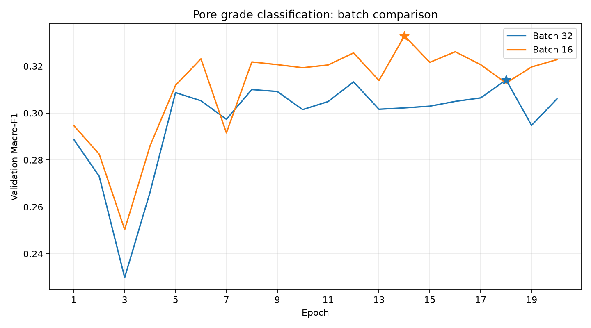

별도의 이후 실험에서는 배치의 등급 다양성 및 배치 순서를 보정한 뒤 **batch 4와 16**도 비교했다. ResNet-50·가중 CE·AdamW+SAM 조건의 Validation Macro-F1은 각각 **0.2540, 0.3602**였다. 위 16·32 실험과는 샘플러·손실 가중치·옵티마이저 조건이 다르므로 세 크기를 한 표에서 직접 비교하지 않는다.

#### Head-only 1 epoch 선택: 1·2·4 비교

Batch 16에서 backbone을 고정하고 head만 학습하는 기간을 1·2·4 epoch로 비교했다. ResNet-50, 동일 인물 분할과 seed 42, 등급 다양성 sampler, 가중 CE, AdamW+SAM을 사용했고 backbone 미세조정은 각각 최대 18 epoch였다.

| Head-only 기간 | 완료 / 선택 epoch | Validation Macro-F1 | Validation Accuracy |
|---:|---:|---:|---:|
| 1 epoch | 15 / 9 | **0.3665** | **0.6176** |
| 2 epoch | 18 / 12 | 0.3602 | 0.5858 |
| 4 epoch | 18 / 12 | 0.3595 | 0.5858 |

공통 첫 head epoch의 Validation Macro-F1은 **0.2427**, head만 계속 학습한 두 번째 epoch는 **0.2177**이었다. Head-only 1 epoch 조건은 전체 학습을 마친 뒤 선택된 최고 Validation Macro-F1도 가장 높아 초기 head 적응 후 미세조정을 시작하는 후보로 사용했다. 여기서 **1은 backbone을 동결하고 head만 학습한 기간**이며, 최고 체크포인트는 전체 미세조정 중인 **9 epoch**다. 단일 분할·시드의 분류 실험이므로 모든 모델에서 1 epoch가 최적이라고 단정할 수 없다.

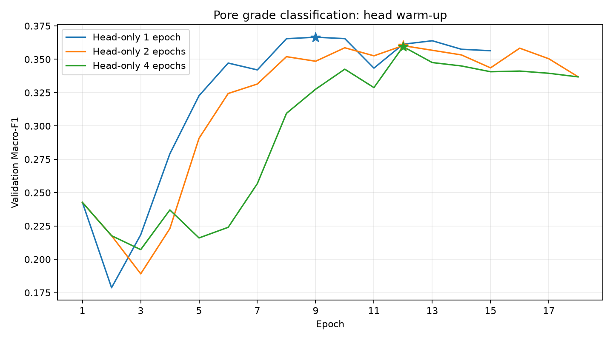

#### 최대 epoch, 손실 및 체크포인트 기준

| 설정 | 선택 이유와 확인 범위 |
|---|---|
| 최대 100 epoch | [한국인 피부상태 데이터 구축팀 논문](https://onlinelibrary.wiley.com/doi/full/10.1111/srt.70375)의 100 epoch 학습을 참고해 설정했다. 논문은 다른 모델·손실·분할도 사용하므로 이번 실험 전체를 논문 재현으로 볼 수 없다. 우리 설정은 head 1 + 전체 미세조정 최대 99 epoch다. |
| early stopping patience 10 | 최대 100 epoch의 **10%**를 개선 대기 기간으로 정한 실험 설정이다. 현재 등급 모델 코드는 전체 미세조정에서 Validation Macro-F1과 동률 시 MSE를 함께 고려한 선택 기준이 10 epoch 동안 개선되지 않으면 종료한다. 10%가 최적이라는 별도 검증이나 논문의 동일한 조기종료 규칙을 확인한 것은 아니다. |
| ReduceLROnPlateau factor 0.5, patience 2 | Validation Macro-F1이 정체될 때 학습률을 낮추려는 설정. 각각의 값이 최적이라는 통제 비교 근거는 없음. |
| 가중 Huber δ=0.2 | 정규화한 연속 등급의 오차가 작은 구간과 큰 구간을 다르게 처리한다. 모공·색소의 0~5등급에서는 경계가 **1등급**, 주름의 0~6등급에서는 **1.2등급** 차이다. δ=0.2 자체의 최적값은 검증되지 않았다. |
| Validation Macro-F1, 동률 시 MSE | 등급별 성능을 균등하게 보는 Macro-F1을 우선한다. 동률이면 연속 등급 점수와 정답의 **평균 제곱 오차**가 작은 checkpoint를 택해 큰 오차를 더 반영한다. 각 개별 예측이 모두 더 정확하다는 뜻은 아니다. Test는 선택에 사용하지 않도록 코드를 구성했으나 이전 반복 관찰로 독립성은 약하다. |

Huber의 δ는 **큰 오차를 더 급격하게 벌주기 시작하는 문턱이 아니다.** 정규화 오차가 δ 이하일 때는 제곱 형태, 그보다 클 때는 선형으로 증가한다. 예를 들어 가중치를 제외하고 모공에서 연속 점수가 정답과 1등급 차이이면 손실은 0.02, 2등급 차이이면 0.06이다. 오차가 클수록 손실은 커지지만, 해당 구간에서 제곱으로 증가하는 MSE보다 증가가 완만하다. 실제 학습 손실에는 등급 가중치도 적용된다.

예를 들어 정답이 2등급이고 연속 예측이 2.1과 2.4인 경우 둘 다 반올림하면 2등급이지만 제곱 오차는 각각 0.01과 0.16이다. Macro-F1이 같은 checkpoint라면 더 작은 MSE를 보조 기준으로 사용한다.

위 배치·head 비교의 epoch별 집계 값은 [재현용 집계 JSON](model-selection-settings-evidence-20261030.json), 그래프 생성 코드는 [plot-model-selection-settings-20261030.py](plot-model-selection-settings-20261030.py)에 수록했다.

피부 타입은 세 범주가 순서형 등급이 아니므로 sigmoid×등급 회귀 대신 **3개 출력 softmax와 가중 cross-entropy**를 사용했다. Validation Macro-F1 동률은 cross-entropy로 해소한다.

## 5. 색소침착·주름의 실제 결과

두 모델은 모공에서 선정한 조건을 적용한 후 각각 새로 학습했다. 모공에서 비교한 설정이 두 과제에도 최적이라는 별도 검증은 없다.

| 항목 | Validation Macro-F1 | Test Macro-F1 | Test 정확도 | Test ±1등급 정확도 | 고등급 Test Recall |
|---|---:|---:|---:|---:|---|
| 색소침착 | 0.4406 | 0.4248 | 0.5049 | 0.9398 | 4등급 0.5889 (90 ROI), 5등급 0.0556 (36 ROI) |
| 주름 | 0.4256 | 0.3931 | 0.4120 | 0.9004 | 5등급 0.5044 (113 ROI), 6등급 0.2947 (95 ROI) |

색소침착 5등급과 주름 6등급은 여전히 약하다. 해당 수치를 서비스에서 정확한 등급 판정으로 표현하기 어렵다.

## 6. 피부 타입: 전체 사진과 ROI 비교

동일 Test 인물 95명에 대해 해당 인물의 입력별 softmax 점수를 평균해 하나의 타입으로 결정했다.

| 입력 | 인물별 Macro-F1 | 인물별 정확도 | 건성 Recall | 중성 Recall | 지성 Recall |
|---|---:|---:|---:|---:|---:|
| 전체 사진 | 0.4366 | 0.4737 | 0.5814 | 0.1290 | **0.7619** |
| 이마·볼 ROI | **0.4769** | **0.5158** | **0.7209** | **0.2903** | 0.4286 |

ROI는 Macro-F1과 중성 Recall이 높았고 기존 ROI 파이프라인과 연결하기 쉬워 전달 후보로 선택했다. 반면 지성 Recall은 낮아졌다. 이미지 수·입력 영역·업데이트 수가 달라 ROI 자체의 순수 효과로 단정하지 않는다. 인물별 평균은 여러 입력이 준비된다는 가정이며 단일 ROI 성능과 다르다. ROI별 Test Macro-F1은 0.4698, 정확도 0.4977이었다.

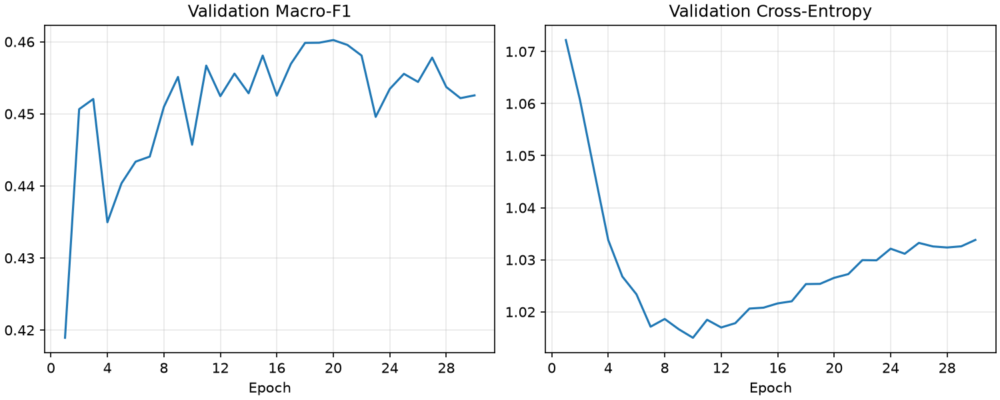

## 7. 개발 인계 시 확인 사항

- 현재 연구용 모델은 Python/PyTorch 체크포인트다. Expo Go 앱에 바로 동작하는 ONNX 등 모바일 자산이 아니며 전처리·출력의 모바일 수치 일치, 속도·메모리 검증도 필요하다.
- 원본 이미지·데이터·가중치와 `ml/runs/`는 Git에 포함되지 않는다. 이 문서의 표와 그래프는 Git에서 볼 수 있도록 필요한 실험 결과를 별도로 남겼다. 로컬 원본 보고서 경로는 아래와 같다.
- 개인별 테스트 이미지는 문서에 포함하지 않는다. 모델 가중치 공유·배포 권한은 원본 데이터 이용 조건을 확인해야 한다.
- 모공 5등급 Test Recall은 기준 분할에서 0이며, 라벨 일관성과 새로운 인물에 대한 일반화는 미해결이다. 피부 타입은 복합성에 대한 지원과 라벨 판정 근거가 없다.

### 원본 로컬 기록

아래 `ml/runs/`는 Git에서 제외되는 로컬 실험 경로다. 검토자가 해당 산출물을 별도 전달받지 않았다면 접근할 수 없으며, 핵심 수치는 위 본문에 재현했다.

- 백본·옵티마이저: `ml/runs/pore-backbone-original-20261028/report/`
- 전처리: `ml/runs/pore-unsharp75-contrast40-20261028/report/`
- Dropout: `ml/runs/pore-dropout04-seed88-20261030/report/`
- 균등 노출: `ml/runs/pore-uniform-original-20261029/report/`
- 부분 미세조정: `ml/runs/pore-partial-finetune-original-20261029/report/`
- 색소·주름: `ml/runs/mobilenet-skin-bundle-20261030/report/`
- 피부 타입 ROI 비교: `ml/runs/skin-type-roi-mobilenet-20261030/report/`

## 8. 모공 실험 세부 흐름: 10/27~29

이 절은 기존 주간 통합 보고서의 실험 세부 내용을 한 문서에 모은 것이다. 원래 절 번호 4~12를 유지한다. 같은 Test 인물이 반복 사용된 결과는 탐색용이다.

### 4. 초기 ResNet 실험: 분류와 회귀

#### 4.1 Batch·헤드·순서형 학습

스마트폰 원본 ROI, ResNet-50, AdamW+SAM, 인물 고정 분할에서 비교했다. WCE는 가중 교차엔트로피다.

| 비교 | 조건 | Validation Macro-F1 | 관찰 |
|---|---|---:|---|
| Batch | 4 / 16 | 0.2540 / 0.3602 | batch 16 후보 선정. |
| Head-only | 1 / 2 / 4 epoch | 0.3665 / 0.3602 / 0.3595 | 1 epoch가 단일 분할에서 소폭 높음. |
| 출력·손실 | WCE / CORAL / weighted CORAL α=0.5 | 0.3665 / 0.2492 / 0.2572 | 순서형 방식은 전체 Macro-F1이 낮았다. |
| 카메라 보충 | 스마트폰만 / DSLR 4·5등급 추가 | 0.3665 / 약 0.333 | Test는 약 0.3295→0.372; 같은 학습 인물의 다른 기기 사진이며 기기·등급이 함께 바뀜. |
| WCE 샘플링 | 원본 1회 / 제곱근 추가 추출 | 0.3665 / 0.2777 | 희소 등급 일부 Recall과 2등급 성능이 서로 바뀌었다. |

기존 스마트패드·카메라 결합 보충의 최초 실행은 업데이트 누락 결함으로 무효 처리했다. 위 DSLR 단독은 결함 수정 후 실행이다. 6-fold 시도는 두 fold만 끝나 평균을 산출하지 않았다. 자세한 세팅과 그래프는 위 4.4절의 배치·head 비교 참조.

#### 4.2 회귀와 ROI 선별

| 조건 | Validation Macro-F1 | Test Macro-F1 | 주의 |
|---|---:|---:|---|
| 가중 Huber α=0.5, 추가 추출 없음 | 0.2427 | 0.2273 | head 2 epoch, batch 16. |
| 가중 MSE α=0.5, 추가 추출 없음 | 0.2498 | 0.2307 | 가중 Huber와 손실 척도가 다름. |
| Huber α=0.2 + 제곱근 추가 추출 | 0.3227 | 0.3515 | 샘플링과 가중치가 함께 변경됨. |
| 선별 ROI Huber + 추가 추출 | 0.3597 | 0.3697 | **선별 평가 ROI** 기준이며 전체 ROI 결과와 직접 순위 비교 불가. |
| 선별 ROI Class-Balanced Focal 분류 | 0.3850 | 0.3439 | 회귀와 출력 방식이 다름. |

ROI 선별은 정면 양쪽 볼, 측면에서 방향상 보이는 볼을 남기는 규칙이다. 선별 데이터 규모는 Train 2,760 / Validation 552 / Test 548. 이후 전체 ROI로 돌아갔다. 희소 반복 샘플 강화 증강과 반사 패딩은 이번 비교에서 검증 Macro-F1을 높이지 못했다.

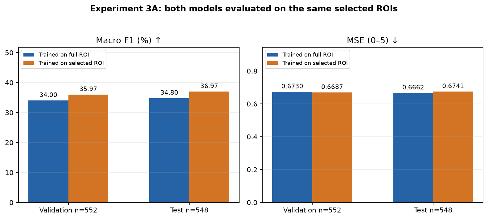

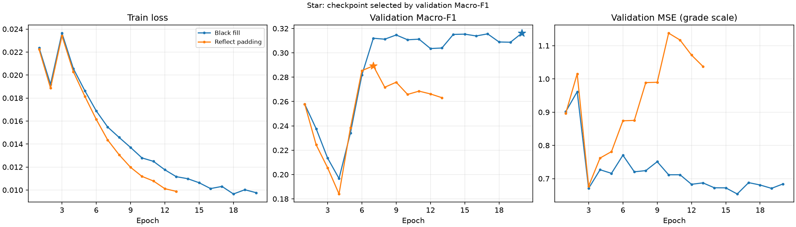

### 5. 분할·전처리·10만 건 증강

#### 5.1 반복 분할

기존 고정 분할과 인물 단위 7:1:2 반복 분할 4회(seed 42~45)를 ResNet 회귀 조건에서 비교했다. 반복 Test Macro-F1은 **0.3043 ± 0.0315**, Validation은 **0.3184 ± 0.0435**였다. 같은 인물이 여러 반복의 Test에 등장할 수 있어 독립 4-fold가 아닌 반복 그룹 홀드아웃이다. 5등급 Test Recall은 네 회차 모두 0이었다.

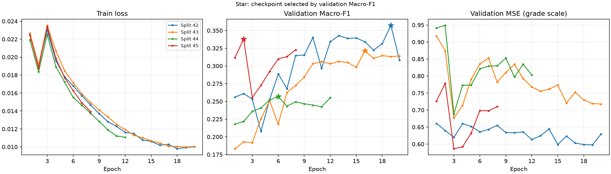

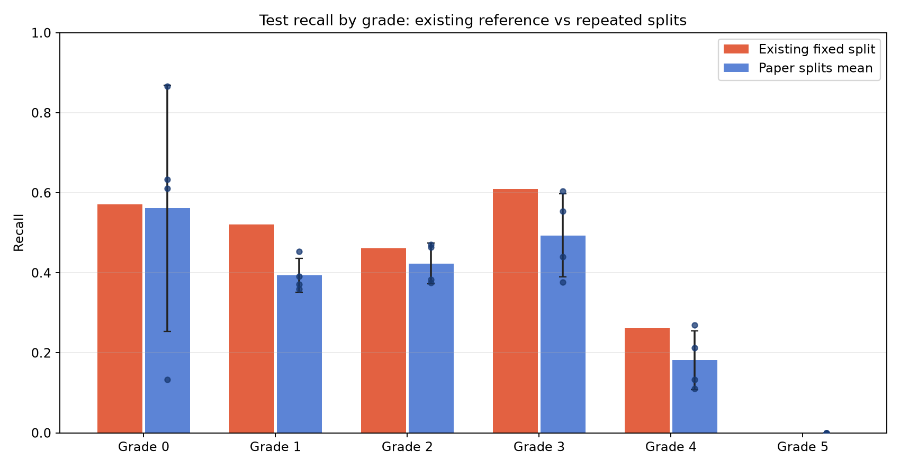

#### 5.2 입력 전처리

같은 고정 분할의 ResNet 회귀 비교. 언샤프 radius 1px·threshold 0이다.

| 전처리 | 선택 epoch | Validation Macro-F1 / MSE | Test Macro-F1 / MSE |
|---|---:|---:|---:|
| 원본 | 16 | 0.3227 / 0.7199 | 0.3515 / 0.6645 |
| 언샤프 50% | 15 | 0.3262 / 0.7131 | 0.3571 / 0.6724 |
| 언샤프 75% + 대비 factor 1.4 | 16 | 0.3207 / 0.6973 | 0.3439 / 0.6681 |

75%+40%에서는 언샤프와 대비가 함께 바뀌어 개별 효과는 분리할 수 없다. 언샤프 50%+대비 35%는 미리보기였고 학습 실험은 아니다. 후속 백본 비교는 75%+40%를 공통 적용했다.

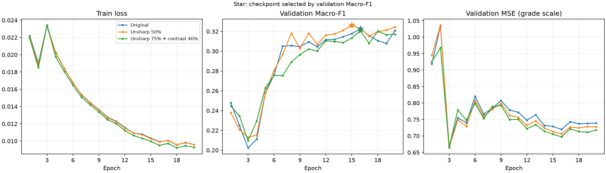

#### 5.3 약 10만 건 증강

기존 Train 4,112개와 변형본 95,888개를 합쳐 100,000개를 만들었다. 0~5등급 수는 **2,772 / 17,534 / 60,457 / 12,622 / 5,448 / 1,167**. 원래 690명의 ROI 변형으로 새로운 실제 인물이 추가된 것은 아니다.

| 조건 | 완료 / 선택 epoch | Validation F1 / MSE | Test F1 / MSE | 주요 차이 |
|---|---:|---:|---:|---|
| 원본 4,112 + 고정 전처리 | 20 / 16 | 0.3207 / 0.6973 | 0.3439 / 0.6681 | batch 16, epoch당 257 update. |
| 로컬 100k | 12 / 4 | 0.3579 / 0.5654 | 0.3133 / 0.6470 | batch 32, α=0.2, 추가 추출. 사용자 수동 중단. |
| RunPod 100k | 15 / 5 | 0.3443 / 0.5497 | 0.3267 / 0.6321 | batch 32, α=0.5, 모든 행 1회, Plateau 스케줄러. |

로컬 100k는 복원 추출로 첫 epoch에서 서로 다른 표본 77,297개를 사용했고 누적 12 epoch에 모두 방문했다. RunPod은 매 epoch 100,000행을 한 번씩 사용했다. 데이터·배치·샘플링·손실 가중치·스케줄러·업데이트 횟수가 달라 증강량 하나의 효과로 볼 수 없다. RunPod 조건의 Test 4·5등급 Recall은 모두 0이었다.

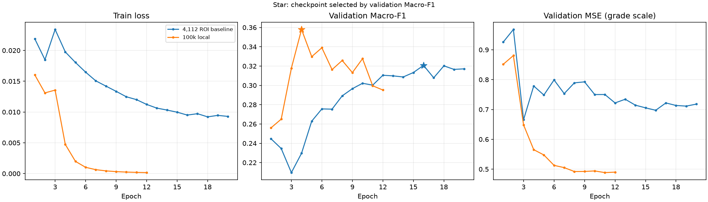

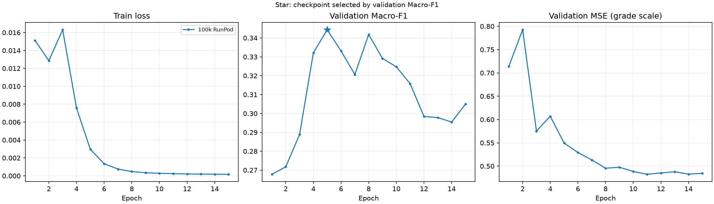

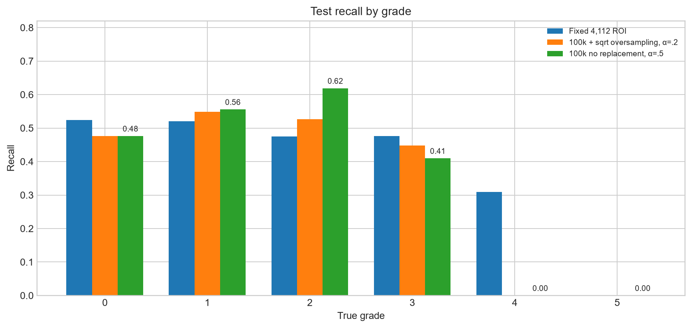

### 6. 원본 ROI 백본 선정과 옵티마이저

#### 6.1 공통 실험 설정

| 항목 | 설정 |
|---|---|
| 분할·입력 | 원본 스마트폰 ROI 4,112 / 816 / 819, RGB 256×256, seed 42 |
| 고정 전처리 | Unsharp radius 1, amount 75%, threshold 0, contrast 1.4, ImageNet 정규화 |
| Train 증강 | 약한 affine 회전 ±5°·이동 2%, 색상 변형; 평가에는 무작위 증강 없음 |
| 샘플링 | 원본 4,112개 전체 + 희소 등급 반복 2,475회 = 6,587회/epoch, 412 SAM update |
| 등급별 노출 | 0~5 순서 533 / 1,339 / 2,486 / 1,136 / 747 / 346 |
| 손실 | 등급/5에 대한 weighted Huber, δ=0.2, 원본 빈도 기반 α=0.5 |
| 학습 | batch 16, head-only 1 epoch + 전체 미세조정, 최대 100 epoch, early stopping patience 10 |
| 최적화 | AdamW weight decay 0.0001 + SAM ρ=0.05; head-only LR 0.001, 이후 head 0.0001 / backbone 0.00001 |
| 스케줄·선택 | ReduceLROnPlateau: Validation Macro-F1, factor 0.5, patience 2; 최고 Validation Macro-F1, 동률 MSE |

#### 6.2 모델 사양과 성능

| 모델 | ImageNet 가중치 | 회귀 head | 전체 파라미터 |
|---|---|---|---:|
| ResNet-50 | ImageNet1K V2 | 2,048 → 1 | 23,510,081 |
| EfficientNet-B3 | ImageNet1K V1 | Dropout 0.3 → 1,536 → 1 | 10,697,769 |
| MobileNetV3-Large | ImageNet1K V2 | 960 → 1,280 → Hardswish → Dropout 0.2 → 1 | 4,203,313 |

| 모델 | 완료 / 선택 epoch | Validation F1 / MSE | Test F1 / MSE | Test Accuracy | Test ±1등급 정확도 | Test 4 / 5 Recall |
|---|---:|---:|---:|---:|---:|---:|
| ResNet-50 | 35 / 25 | 0.3483 / 0.5791 | 0.3197 / 0.6260 | 0.5031 | 0.9316 | 0.0238 / 0 |
| EfficientNet-B3 | 30 / 20 | 0.3253 / 0.8065 | 0.3219 / 0.7900 | 0.4408 | 0.9072 | 0.3333 / 0 |
| MobileNetV3-Large | 60 / 50 | 0.3524 / 0.6784 | 0.3471 / 0.6893 | 0.4908 | 0.9206 | 0.1905 / 0 |

MobileNet은 이 비교의 Macro-F1과 모델 규모에서 유리했지만 ResNet은 MSE·Accuracy가 더 좋았다. 구조와 사전학습 가중치가 함께 다르다. 실제 스마트폰 지연·메모리는 측정하지 않았다. 전달용 MobileNet 단일 PyTorch 가중치 파일은 약 17 MB다.

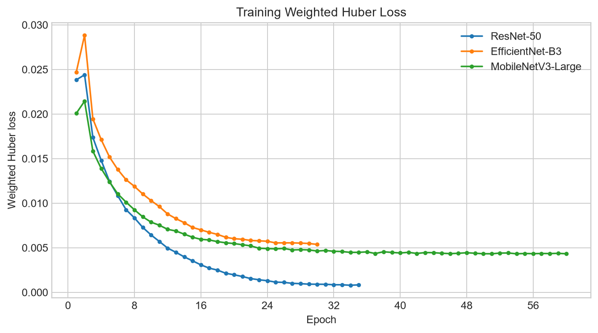

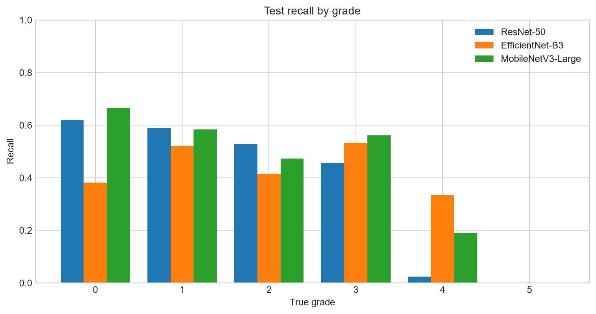

#### 6.3 AdamW와 RMSprop

MobileNet에서 SAM 내부 optimizer만 바꾼 비교다. RMSprop은 alpha 0.99, eps 1e-8, momentum 0, centered false다.

| Optimizer | 완료 / 선택 epoch | Validation F1 / MSE | Test F1 / MSE |
|---|---:|---:|---:|
| AdamW + SAM | 60 / 50 | 0.3524 / 0.6784 | 0.3471 / 0.6893 |
| RMSprop + SAM | 25 / 15 | 0.3257 / 0.7418 | 0.3306 / 0.7572 |

이번 학습률과 단일 seed에서는 AdamW가 유리했다. 다른 RMSprop 학습률까지 비교한 결론은 아니다.

### 7. 합성 이미지 보충

4등급·5등급 목표의 합성 얼굴 각 10장, 총 20장에서 양쪽 볼 후보를 잘라 총 40 ROI를 만들었다. 등급은 생성 목표이며 검증된 정답이 아니고, ROI도 실제 주석이 아닌 얼굴 검출·비율 규칙 기반이다. 두 볼은 같은 생성 얼굴에서 나왔으므로 40명의 독립 인물이 아니다.

기존 MobileNet 설정과 같은 총 6,587회 노출을 유지하면서, 실제 반복 추출분 중 등급별 20회씩을 합성 ROI로 대체했다. 즉 합성 데이터는 **매 epoch 40회**만 노출됐으므로 생성된 이미지의 가능한 모든 활용법을 평가한 것은 아니다.

| 조건 | 완료 / 선택 epoch | Validation F1 / MSE | Test F1 / MSE | Test 4 / 5 Recall |
|---|---:|---:|---:|---:|
| 실제 원본 + 반복 추출 | 60 / 50 | 0.3524 / 0.6784 | 0.3471 / 0.6893 | 0.1905 / 0 |
| 실제 원본 + 합성 ROI | 34 / 24 | 0.3653 / 0.6630 | 0.3593 / 0.6501 | 0.1905 / 0 |

전체 지표는 소폭 개선됐으나 4·5등급 Test Recall 개선은 확인되지 않았다. 단일 분할·seed, 낮은 합성 노출량, 생성 특유의 질감과 라벨 불확실성을 고려해야 한다. 지정된 참고 ROI 16장은 모두 Train에 속하는 것으로 확인됐다. 다만 생성에 다른 검증·테스트 이미지를 추가 참조했는지는 확인할 수 없고, 사용자의 초기 답변과 이후 구체화에 차이가 있어 평가 독립성을 확정할 수 없다.

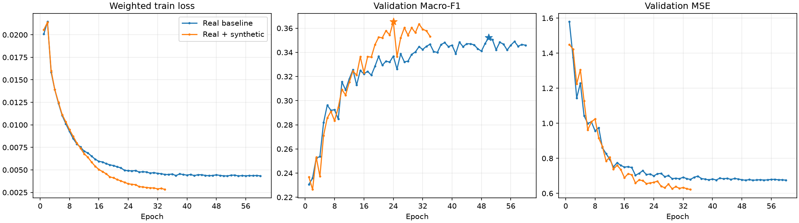

### 8. 균등 노출과 기존 제곱근 추가 추출

실제 원본만 사용하고 같은 인물 고정 분할로 비교했다. 균등 노출은 원본 전체를 포함하고 각 등급을 2,486회로 반복한다. 5등급 48 ROI는 평균 51.8회/epoch 노출된다.

| 항목 | 기존 제곱근 | 균등 노출 |
|---|---:|---:|
| 손실 가중치 | α=0.5 | 없음, α=0 |
| 전체 노출 / SAM update | 6,587 / 412 | 14,916 / 933 |
| 0~5등급 노출 | 533 / 1,339 / 2,486 / 1,136 / 747 / 346 | 각 2,486 |
| 완료 / 선택 epoch | 60 / 50 | 32 / 22 |
| Validation Macro-F1 / MSE | 0.3524 / 0.6784 | 0.3521 / 0.5660 |
| Test Macro-F1 / MSE | 0.3471 / 0.6893 | 0.3678 / 0.5823 |
| Test 4등급 / 5등급 Recall | 0.1905 / 0 | 0.0714 / 0 |

균등 조건은 Test 전체 Macro-F1·MSE가 좋았지만 4등급 Recall이 낮았다. 샘플링, 가중치, epoch당 update와 검증 주기가 함께 달라 단일 원인으로 해석하지 않는다. 검증 Macro-F1은 거의 같고 Test는 반복 확인됐으므로 이를 근거로 확정적 우열을 정하지 않는다.

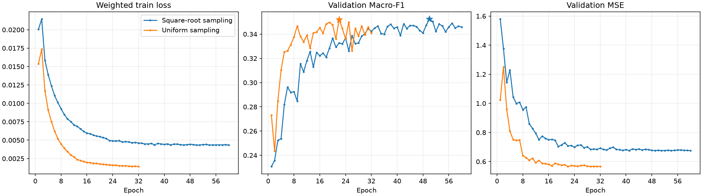

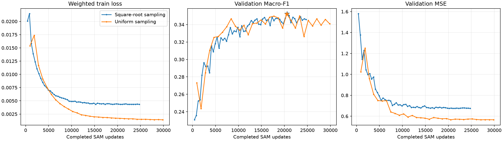

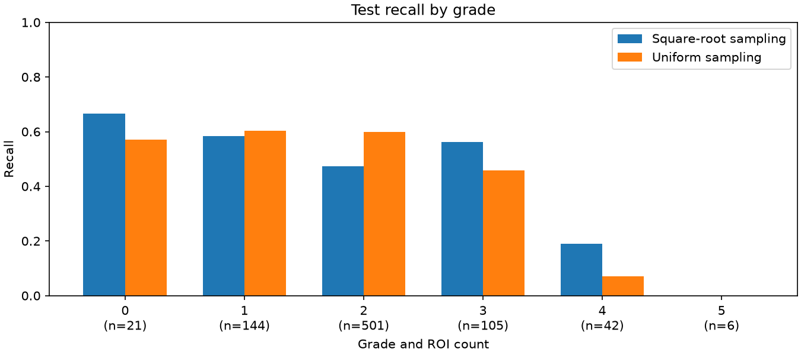

### 9. 5등급 일반화 진단

원본 ROI를 무작위 증강 없이 평가한 선택 checkpoint 기준이다.

| 모델 | Train 5등급 Precision / Recall | Validation Recall | Test Recall | 5등급 평균 점수 Train / Valid / Test |
|---|---:|---:|---:|---:|
| MobileNet 제곱근 | 0.9796 / 1.0000 | 0/6 | 0/6 | 4.925 / 2.894 / 2.601 |
| MobileNet 균등 | 0.9796 / 1.0000 | 0/6 | 0/6 | 4.981 / 2.583 / 2.371 |
| ResNet 제곱근 | 0.9796 / 1.0000 | 0/6 | 0/6 | 4.998 / 2.581 / 2.481 |

세 모델 모두 선택 checkpoint에서 Train 5등급을 49번 예측해 48번 정답이었다. 검증 5등급 Recall은 해당 학습 기록의 **첫 epoch부터 끝까지 0**이었다. 중간 epoch의 Train Recall은 초기 두 실행에 기록되지 않아 재구성할 수 없다.

고정 검증·테스트 5등급은 모두 2 또는 3등급으로 예측됐다. 특징 벡터에서도 보류 5등급의 평균은 학습 5등급 중심보다 학습 2등급 중심에 더 가깝다. PCA는 전체 특징의 2차원 투영이므로 원인 증명이 아니다. 일부 ROI에 피부 외 영역이 있거나 축소 후 모공이 뚜렷하지 않은 사례도 관찰됐다. 원본 라벨 지침·ROI 품질과 인물·촬영 조건을 함께 검토해야 한다.

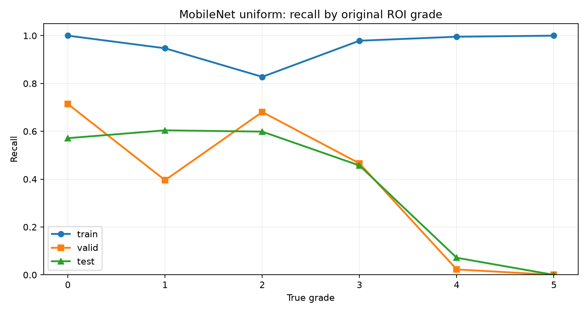

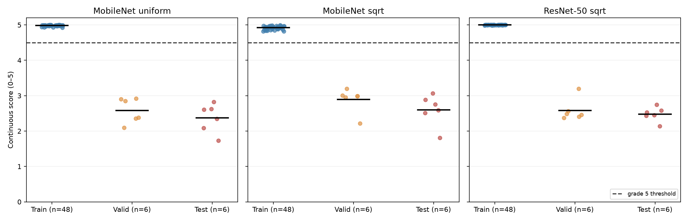

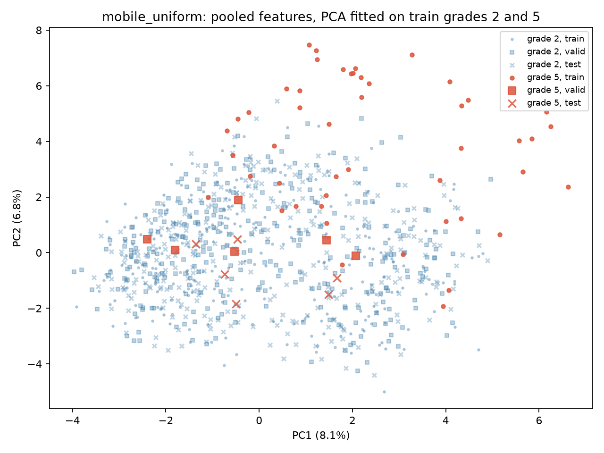

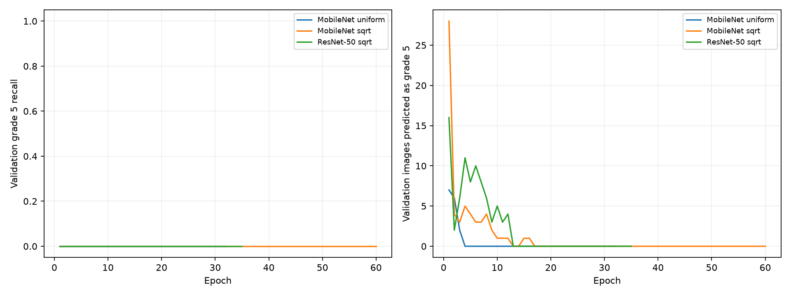

### 10. 5-fold 인물 교차검증과 클래스 가중치

고정 7-fold 실험과 분할이 다르다. 전체 실제 스마트폰 모공 5,747 ROI를 5개의 인물 fold로 나누고 각 회차에 3개 Train, 1개 Validation, 1개 Test를 사용했다. 5등급 인물 10명을 fold당 2명으로 배치해 매 회차 6 / 2 / 2명이다. 각 ROI는 한 번 Test에 포함된다.

| 설정 | 내용 |
|---|---|
| 모델 | MobileNetV3-Large, ImageNet1K V2, 회귀 head 960 → 1280 → 1 |
| 공통 | 실제 ROI만 사용; 오버샘플링 없음; 각 Train ROI 매 epoch 1회; batch 16, seed 42 |
| 비교 | Weighted Huber δ=0.2: α=0 무가중 vs α=0.5 |
| 최적화 | AdamW+SAM ρ=0.05, head-only 1, 최대 100 epoch, early-stop 10, Plateau factor 0.5·patience 2 |
| 선택 | Validation Macro-F1 우선, 동률 MSE 최소; 각 조건 5회, 총 10회 |
| 장비 | RunPod RTX 5090; CPU 전처리와 평가 로더가 병목으로 작용 |

| 조건 | Validation Macro-F1 평균 ± SD | Test Macro-F1 평균 ± SD | Test MSE 평균 ± SD | Pooled Test 5등급 Recall |
|---|---:|---:|---:|---:|
| α=0 | 0.2586 ± 0.0335 | 0.2427 ± 0.0283 | 0.5323 ± 0.0258 | 0/60 |
| α=0.5 | 0.3183 ± 0.0610 | 0.3057 ± 0.0324 | 0.5926 ± 0.0553 | 0/60 |

α=0.5는 5개 fold 모두 Macro-F1을 높였지만 Test MSE와 Accuracy는 평균적으로 악화됐다. Pooled Test 4등급 Recall은 0→0.0323, 5등급은 0으로 유지됐다. fold 평균과 전체 예측을 합친 pooled 지표는 계산 방법이 다르다. 학습 크기와 평가 인물이 고정 분할과 달라 6·8절 점수와 단순 순위를 매기지 않는다.

각 epoch의 Train·Validation·Test 지표는 요청에 따라 기록했다. Test는 checkpoint·스케줄러·early stopping에 사용하지 않았지만 반복 관찰 이력은 독립 평가의 한계다. 그래프 뒷부분은 이미 종료된 fold가 제외되어 평균에 참여하는 fold 수가 줄어든다.

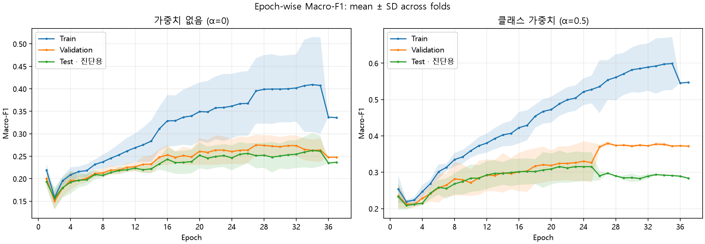

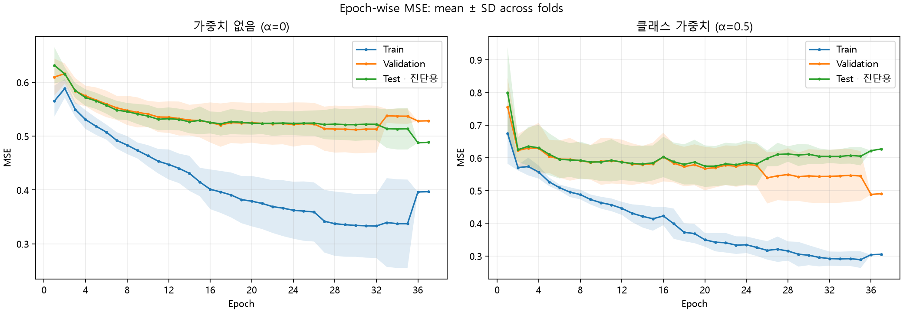

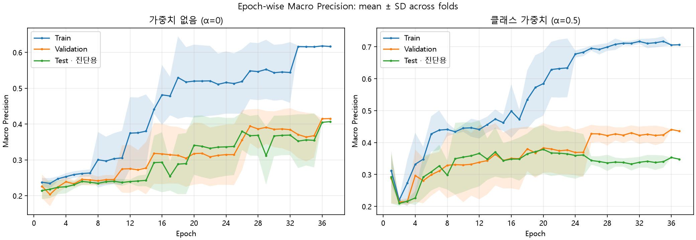

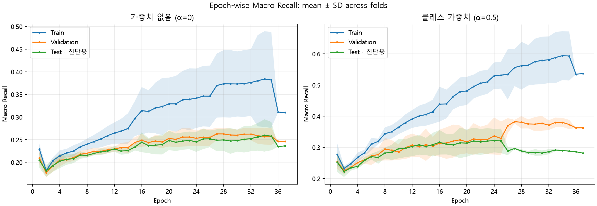

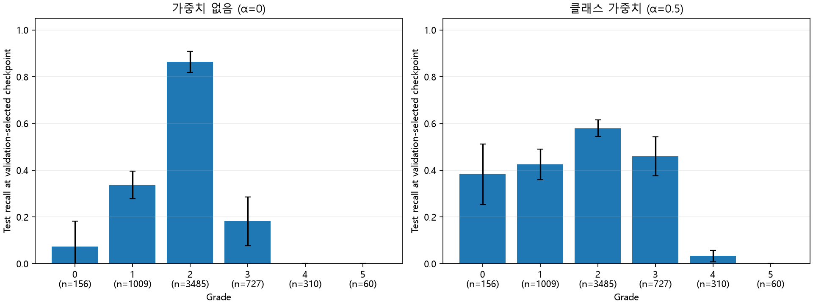

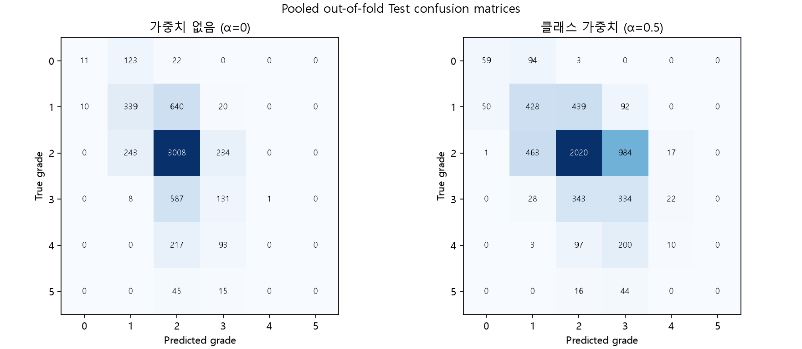

### 11. Partial Fine-tuning

기준은 교차검증 전 선정한 **전체 미세조정 + 제곱근 추가 추출 + α=0.5**다. 동일 분할·전처리·sampling·loss·optimizer를 유지하며 `features[0:13]`과 해당 BatchNorm을 고정하고 `features[13:17]`과 classifier를 학습했다. 전체 4,203,313개 중 3,410,825개(81.15%)를 학습했다. 로컬 RTX 4070 Ti SUPER, 학습 batch 16, 최대 100, patience 10.

| 조건 | 완료 / 선택 epoch | Train F1 / MSE | Validation F1 / MSE | Test F1 / MSE |
|---|---:|---:|---:|---:|
| Full SAM | 60 / 50 | 0.7423 / 0.3186 | 0.3524 / 0.6784 | 0.3471 / 0.6893 |
| Partial SAM | 36 / 26 | 0.7702 / 0.2856 | 0.3360 / 0.6279 | 0.3233 / 0.6937 |

Full Train 수치는 선택 checkpoint 원본 Train 재평가다. Partial은 Validation MSE가 낮아졌으나 Macro-F1은 낮았고 Train–Validation 격차가 컸다. Train 5등급 Recall 100%, Validation·Test 0%다. 단일 seed에서 일반화 개선은 확인되지 않았다. 결과 JSON의 workers 설정 필드와 실제 runtime 기록이 다르며 실제 Train/Eval workers는 4/4였다. 자세한 사항은 원본 보고서 참조.

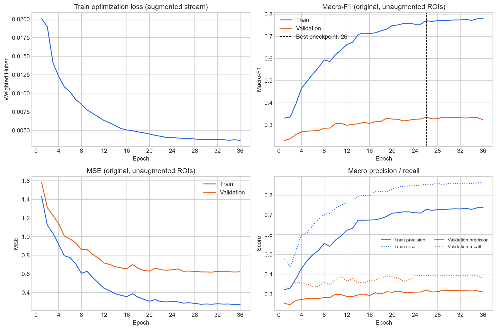

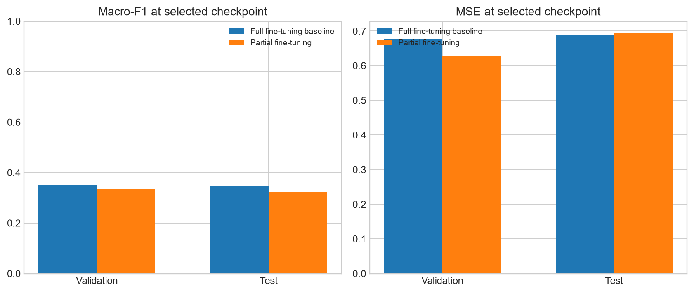

### 12. Full SAM → Full ImbSAM

Partial 모델이 아닌 6절의 기존 **Full SAM**을 기준으로 했다. 원본 Train 250개 이하인 0·4·5등급을 tail로 두고 tail gradient를 활용하는 ImbSAM을 회귀 Huber+AdamW에 맞게 적용했다. 이 250 기준은 실험 설정이며 논문의 고정 권장값이 아니다. 원 논문의 기본 예시와 달리 추가 tail 배율은 1이다.

데이터·고정 분할·모델·제곱근 추가 추출·α=0.5·batch 16 등 주요 조건을 유지했다. RTX 4070 Ti SUPER에서 **30 epoch 완료 후 사용자 요청으로 수동 중단**했으며 자동 early stopping이 아니다. 진행 중이던 미완료 epoch는 제외했다.

| 조건 | 완료 / 선택 epoch | Train F1 / MSE | Validation F1 / MSE | Test F1 / MSE |
|---|---:|---:|---:|---:|
| 기존 Full SAM | 60 / 50 | 0.7423 / 0.3186 | 0.3524 / 0.6784 | 0.3471 / 0.6893 |
| Full ImbSAM | 30 / 26 | 0.7314 / 0.3391 | 0.3394 / 0.7605 | 0.3175 / 0.7800 |

ImbSAM 선택 checkpoint의 Train 5등급 Precision / Recall은 0.96 / 1.00, Validation과 Test Recall은 각각 0/6이다. Validation 5등급 Recall은 첫 epoch부터 0이었고 Train 지표가 개선되는 동안 Validation은 대체로 정체됐다. 과적합 징후와 함께 처음부터 존재하는 인물 간 일반화 실패가 관찰된다. 단일 실행과 수동 중단 결과로 모든 ImbSAM 설정을 평가했다고 볼 수 없다.

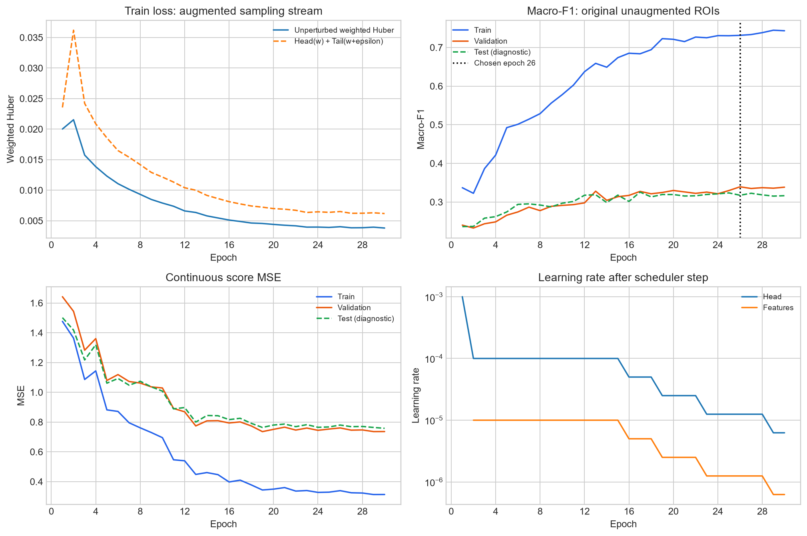

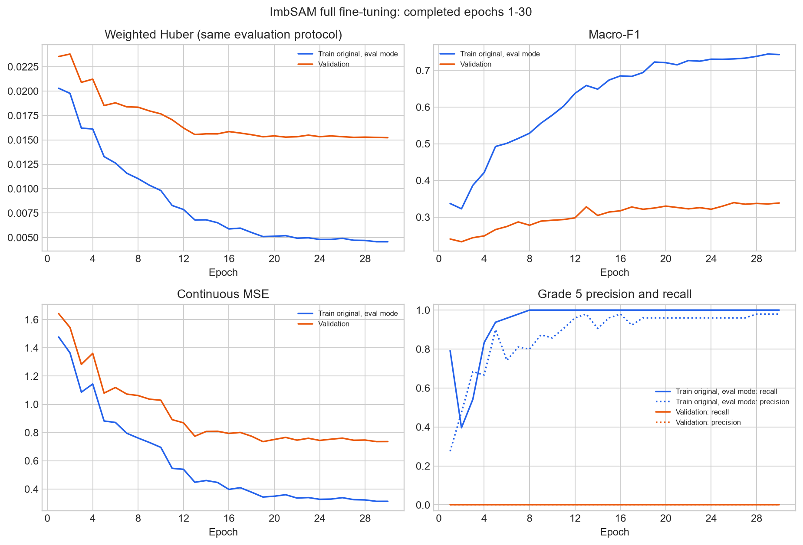

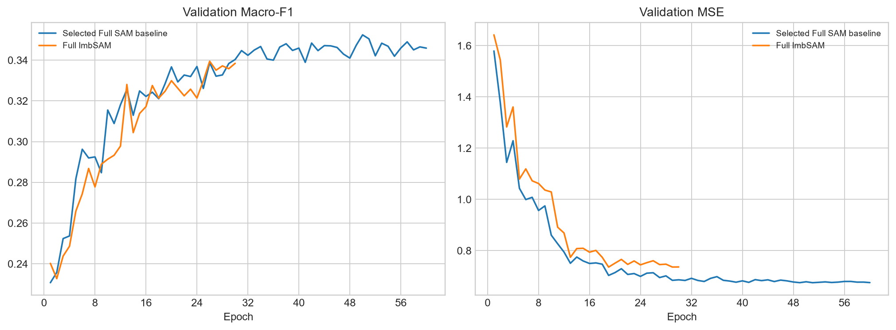

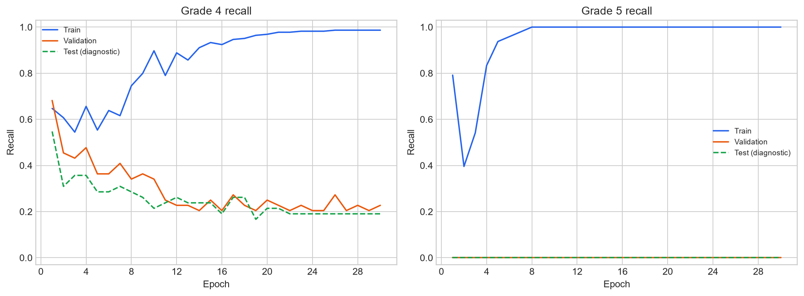

## 9. 10/30 모공 추가 실험: 분할·합성·장비값

### 9.1 합성 ROI와 분할 seed

4·5등급 합성 얼굴 각 50장으로 만든 볼 ROI 각 100개를 Train에만 포함했다. 목표 등급은 검증된 실제 라벨이 아니다. 참고 자료의 이미지별 연결이 확인되지 않았고 seed 88에서는 참고 ROI 일부가 Validation·Test 인물에 속해 누출 가능성이 있다. seed 42 실행은 21 epoch 후 수동 중단됐다. 두 seed는 실제 평가 인물과 학습 분포가 다르므로 분할만의 인과 효과나 독립 성능으로 단정할 수 없다.

| 조건 | 완료 / 선택 epoch | Validation Macro-F1 / MSE | Test Macro-F1 / MSE | Test 4 / 5등급 Recall |
|---|---:|---:|---:|---:|
| 실제 ROI 기준 seed 42 | 60 / 50 | 0.3524 / 0.6784 | 0.3471 / 0.6893 | 0.1905 / 0 |
| 실제 + 합성 ROI seed 42 | 21 / 20 | 0.3562 / 0.6575 | 0.3458 / 0.6727 | 0.1905 / 0 |
| 실제 + 합성 ROI seed 88 | 54 / 44 | 0.3404 / 0.6163 | 0.3148 / 0.5878 | 0.0238 / 0 |

### 9.2 실제 모공 장비값 회귀

등급 점수가 아니라 원본 JSON의 실측 장비값을 예측했다. 두 실험 모두 seed 88, 실제 ROI Train / Validation / Test 4,109 / 819 / 819, MobileNetV3-Large, dropout 0.4, batch 16, AdamW+SAM, 최고 100 epoch와 patience 10을 사용했다. Validation MSE로 checkpoint를 선택했다. 장비값 척도와 시각 등급 척도는 다르다. Test는 매 epoch 진단에 기록되고 반복 관찰돼 탐색용이다.

| 조건 | 완료 / 선택 epoch | Train MAE | Validation MAE | Test MAE | Test RMSE | Test R² |
|---|---:|---:|---:|---:|---:|---:|
| 가중 Huber + 제곱근 추가 추출 | 54 / 44 | 183.91 | 261.35 | 229.60 | 297.61 | 0.4855 |
| 가중치·추가 추출 없음, MSE | 43 / 33 | 157.23 | 259.52 | 224.91 | 289.75 | 0.5123 |

MSE 조건의 지표가 이 분할에서 더 낮았지만 손실·샘플링·가중치가 함께 변경됐다. 원인별 효과는 분리할 수 없고 Train과 Validation의 오차 격차도 남았다. 아래 그래프의 예측값은 장비 단위다.

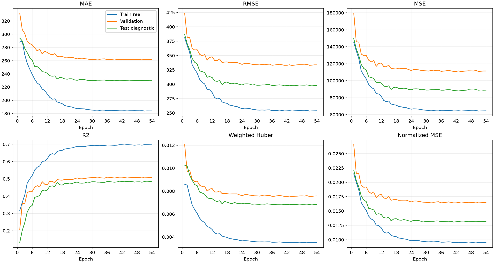

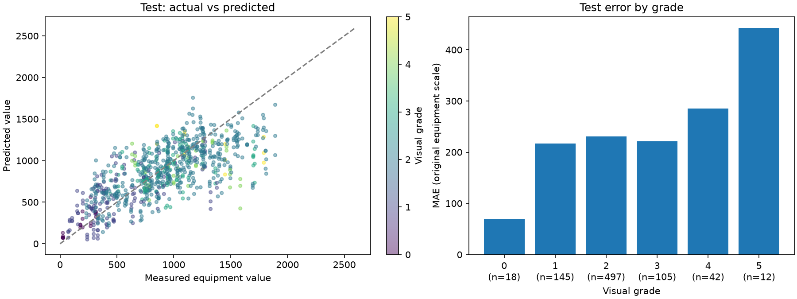

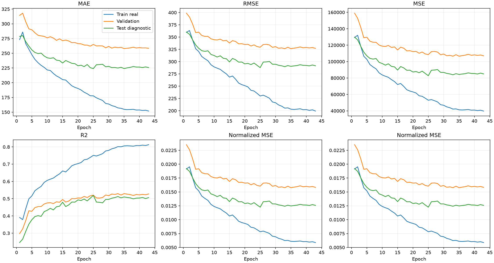

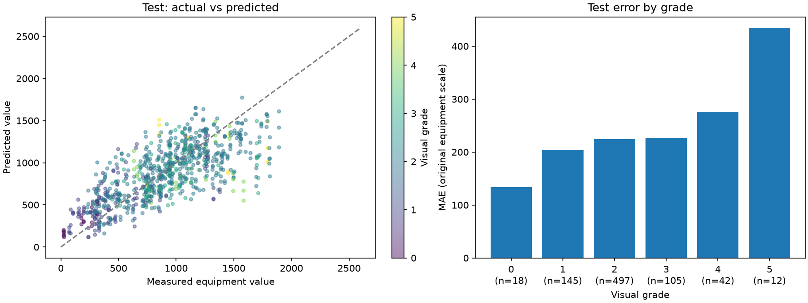
