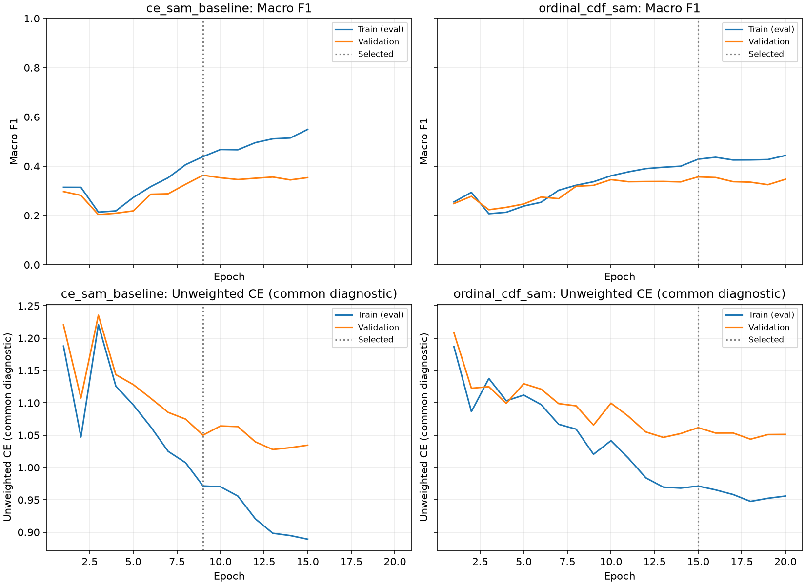

# 모공 순서형 CDF 손실 + AdamW + SAM 실험

## 사전에 고정한 비교

직전 **가중 CE + AdamW + SAM**을 주 비교 기준으로 사용하고 손실함수만
**가중 순서형 CDF 손실**로 교체합니다. 별도 보존된 CE+AdamW는 참고 행으로 비교합니다.
CORAL 실험을 반복하지 않고, 같은 ResNet-50의 6개 softmax 출력과 argmax 판정을 유지합니다.
전문의 라벨과 기존 인물 분리·ROI·증강은 유지하며 외부/생성 데이터는 추가하지 않습니다.

이번 손실은 비정규화 Ranked Probability Score(RPS), 즉 등급별 누적분포의 제곱 차이를
합산하는 방식입니다. 예측 확률을 `p`, 정답 등급을 `y`라고 할 때:

```text
CDF_p(k) = sum(p_j, j <= k)
CDF_y(k) = 1[y <= k]
L_i = sum((CDF_p(k) - CDF_y(k))^2, k=0..K-2)
L = sum(weight[y_i] * L_i) / sum(weight[y_i])
```

기존 inverse-square-root 빈도 가중치와 cap 4를 그대로 사용합니다. CE 항을 혼합하거나
추가 계수를 탐색하지 않습니다. 정규화 RPS의 `1/(K-1)` 상수는 적용하지 않습니다.
각 경계의 비용은 1로 둡니다. 확률이 하나의 오답에 집중될 때 1등급 차이의 손실은 1,
4등급 차이는 4입니다. 이것은 등급 번호에 수치 회귀 MSE를 적용하는 방식이 아니며,
실제 피부 심각도가 등급마다 같은 물리량만큼 증가한다는 가정도 아닙니다.
CDF 손실의 softmax 포화 구간에서는 gradient가 작아질 수 있으며 CE와 수치 스케일도 다릅니다.

공통 조건: ImageNet V2 신규 초기화, seed 42, 256px, 물리/유효 batch 16, head 2 +
전체 미세조정 최대 18 epoch, patience 6, head LR 1e-3 → 1e-4, backbone LR 1e-5,
weight decay 1e-4, 기존 cosine scheduler·AMP·SAM rho 0.05입니다. SAM의 두 계산·BN
통계 복원·AMP 재시도 구현도 직전 CE+SAM과 같습니다. 기존 피부 가중치에서 이어 학습하지 않습니다.

학습 690명/4,112 ROI, 검증 138명/816 ROI. 분리 fingerprint:
`6ac903796d100a2ee4f66e3e1936548dfa618c9b448a90985ff9ffbb0c13d793`.
최종 테스트셋은 평가하지 않고, 같은 검증 macro-F1로 선택하며 동률이면 unweighted CE로
판정합니다. 손실만 비교하기 위해 checkpoint 선택/추론 규칙도 유지합니다.

## 평가와 산출물

Accuracy, macro/weighted Precision·Recall·F1, 등급별 지표·혼동행렬·MAE·±1등급 적중률,
4·5등급 pooled 정확 분류 Recall을 같은 FP32 eval mode에서 비교하고 sklearn과 대조합니다.
특히 직전 SAM에서 나빠진 3등급 Recall과 여전히 낮은 4·5등급 Recall을 함께 확인합니다.
고등급 pooled Recall은 4↔5 혼동도 오답으로 셉니다. 5등급 검증은 1명/6 ROI입니다.

학습 로그 `train_loss`는 각 모델의 실제 가중 학습 손실입니다. `valid_loss`와
`train_eval_loss`는 공통 진단값인 **unweighted CE**이며 새 모델의 최적화 목적과 다릅니다.
학습 곡선은 이 공통 CE와 macro-F1을 사용합니다. 서로 다른 손실의 원시 크기를 비교해
일반화 차이를 판단하지 않습니다. 같은 최대 epoch의 비교이며 동일 계산량 보장은 없습니다.

기존 서비스 설정·추천 묶음·모든 기존 모델은 해시로 보존하고 후보는 별도 저장합니다.
실제 사진은 로컬에서만 읽습니다. 개별 예측·인물 ID·사진은 Git으로 공유하지 않습니다.
단일 seed·고정 손실의 결과이며 같은 검증셋의 반복 사용으로 선택 편향이 생길 수 있습니다.
이번 실험으로 순서형 손실 전체의 우열이나 최종 배포 성능을 확정하지 않습니다.

저장소 루트에서 실행합니다:

```powershell
uv run --project ml python -m ml.scripts.report_ordinal_loss --phase preflight
uv run --project ml python -u -m skin_analysis.smartphone.train --config ml/configs/nia_smartphone_ordinal_cdf_sam.toml --task pore
uv run --project ml python -m ml.scripts.report_ordinal_loss --phase evaluate
uv run --project ml python -m ml.scripts.report_ordinal_loss --phase publish
```

로컬 산출물: `ml/runs/nia-smartphone-ordinal-cdf-sam-seed-42/`.
기존 폴더는 덮어쓰지 않습니다. 테스트 페이지 교체나 다른 항목 확대는 자동 진행하지 않습니다.

참고: [Squared EMD 손실](https://arxiv.org/abs/1611.05916),
[순서형 CDF 제곱 손실 수식](https://link.springer.com/article/10.1007/s00357-021-09406-4).
여기서는 위에 명시한 CDF 수식만 구현하며 논문의 다른 거리행렬 학습이나 전체 실험을 재현하지 않습니다.

## 결론과 적용 판단

2026-10-23, **가중 순서형 CDF 손실 + AdamW + SAM** 학습·검증 완료.
**평균 등급 오차와 3등급 Recall은 개선됐지만 4등급 누락이 크게 늘어 새 후보를 채택하지
않습니다.** 비교 기준은 직전 **CE+SAM**입니다. 서비스 설정·추천 묶음·테스트 페이지는
교체하지 않았고, 다른 항목에도 확대하지 않았습니다.

20 epoch를 모두 실행했고 조기 종료로 끝난 것이 아닙니다. 검증 macro-F1 기준으로
**epoch 15**를 선택했습니다. 프로세스 실행 시간은 약 **802초(13분 22초)**이며
초기화·cache 확인·worker 시작·train-eval·체크포인트 저장을 포함합니다.
완료 후 세 모델을 별도로 재평가한 시간은 포함하지 않습니다.

| 주 비교 지표 | CE+SAM | 순서형 CDF+SAM | 변화 |
|---|---:|---:|---:|
| Accuracy | 63.11% (515/816) | 62.99% (514/816) | -0.12%p |
| macro Precision | 42.06% | 36.82% | -5.24%p |
| macro Recall | 36.70% | 37.50% | +0.80%p |
| macro F1 | 36.34% | 35.68% | -0.66%p |
| MAE | 0.4534 | 0.4301 | -0.0233 |
| ±1등급 적중률 | 92.77% | 94.61% | +1.84%p |
| 3등급 Recall | 3.88% (4/103) | 23.30% (24/103) | +19.42%p |
| 4등급 Recall | 22.73% (10/44) | 2.27% (1/44) | -20.45%p |
| 5등급 Recall | 0% (0/6) | 0% (0/6) | 동일 |
| 4·5등급 pooled Recall | 20% (10/50) | 2% (1/50) | -18%p |

Accuracy 차이는 1 ROI, macro-F1 차이는 0.66%p로 단일 seed에서 작습니다.
반면 같은 검증 고등급 50 ROI에서 정확히 맞힌 수가 10 → 1로 줄었으므로,
고등급을 구분하려는 목적에 이번 후보가 더 적합하다고 볼 근거는 없습니다.
다만 인물 단위 신뢰구간 검정이나 새 데이터 재검증을 수행한 것은 아닙니다.

### 오류가 어떻게 바뀌었는가

3등급 예측 수는 10 → 62 ROI로 늘고 Recall/F1이 개선됐습니다. 반면 4등급 예측은
25 → 8 ROI로 줄었고 5등급은 아예 예측하지 않았습니다. **실제 4등급 44 ROI 중
27개는 2등급, 16개는 3등급, 1개만 4등급으로 분류**했습니다. 실제 5등급 6 ROI는
5개가 2등급, 1개가 3등급이었습니다. 고등급을 주로 아래 등급으로 판단한 결과입니다.

0등급 Recall도 66.67% → 80.95%로 개선됐지만 1등급 Recall은 40.97% → 33.33%로
낮아졌습니다. weighted F1은 58.28% → 59.18%로 소폭 올라도 macro-F1과 고등급
Recall은 나빠졌으므로, 분포를 가중한 전체 지표만 보고 채택하지 않습니다.

±1등급을 넘는 오류는 59 → 44 ROI로 줄었습니다. 이 이득과 고등급 식별 악화는 동시에
존재합니다. CDF 손실에서 먼 오차를 줄이는 목적과 모든 등급을 정확히 구분하는 목적이
항상 일치하는 것은 아닙니다. 이번 관측을 모든 순서형 손실의 필연적 특성으로 일반화하지 않습니다.

선택 모델의 학습/검증 F1은 CE+SAM 43.89% / 36.34%, 순서형 후보
42.86% / 35.68%입니다. 차이는 7.55%p → 7.18%p로 작아졌지만 검증 F1도 낮아졌으므로
그 차이만으로 일반화가 좋아졌다고 주장하지 않습니다. 마지막 epoch 20은 학습 F1 44.35%,
검증 F1 34.69%였습니다.

CE+AdamW 참고 모델보다 높은 전체 지표는 **SAM까지 포함한 조합 비교**입니다.
이를 순서형 손실 단독의 개선 효과로 해석하지 않습니다. 이번 범위에서는 pure CDF 손실의
고정 설정 하나만 시험했으며, CE 혼합·다른 순서형 손실·다중 seed·별도 학습률 탐색은 하지 않았습니다.

## 검증과 보존

- 주 비교의 데이터·초기화·증강·학습률·class weights·SAM rho·BN/AMP 처리·모델 구조·
  checkpoint 선택·softmax argmax가 같고 손실 및 출력 폴더만 다름을 검증했습니다.
- 후보의 SHA·유한 텐서·`best.pt`와 export 일치를 확인했습니다. 최종 checkpoint의
  53개 BN counter 증분은 미세조정 첫 forward **4,626회**, AdamW도 같은 횟수였고,
  epoch마다 **257회** 업데이트했습니다. AMP 재시도 1회에서 배치나 통계를 추가 누적하지 않았습니다.
- 순서형 손실의 수식·gradient를 독립 계산과 대조하고, 오답의 등급 거리에 따른 비용,
  가중 평균·가중치 스케일 불변성·이진 경우·FP16 유한값·잘못된 입력·실험 조건을 검사했습니다.
  실제 GPU에서도 head/미세조정의 SAM 이중 계산을 합성 입력으로 확인했습니다.
- 세 모델의 학습/검증 Accuracy·P/R/F1·혼동행렬을 sklearn과 대조했습니다. 검증 지표가
  선택 epoch의 학습 이력과 같고, 기존 두 모델의 이전 평가도 재현됨을 확인했습니다.
- 기존 엄격한 서비스 로더로 후보를 읽어 유한한 `[1,6]` 더미 출력을 확인했습니다.
  실제 얼굴 사진은 서버로 전송하지 않았습니다.
- 기존 설정·추천 묶음·모든 이전 비교 가중치 **13개 파일**의 해시가 사전 기록과 같습니다.
  후보는 `ml/runs/nia-smartphone-ordinal-cdf-sam-seed-42/pore/inference.bin`에 저장했습니다.
- ML pytest **131 passed**, ML Ruff 통과, `server/nia` unittest **34 passed**,
  앱 `npm run check -- -- --runInBand` 통과(타입 검사·린트·**48 tests**).
- 구현 커밋: `e02643a62`. [집계 JSON](ordinal-cdf-experiment.metrics.json)에 학습 이력·
  등급별/가중 지표·혼동행렬·보존/로더 검사 결과를 기록했습니다. 개인별 예측은 로컬 run에만 보존합니다.

## 실제 비교 결과

동일 검증 138명/816 ROI, 증강 없는 FP32 평가입니다.

| 모델 | epoch / 실행 | Acc | macro P | macro R | macro F1 | MAE | ±1등급 | 고등급 Recall |
|---|---:|---:|---:|---:|---:|---:|---:|---:|
| ce_adamw_reference | 14 / 20 | 54.41% | 31.56% | 38.45% | 33.29% | 0.5674 | 90.81% | 20.00% |
| ce_sam_baseline | 9 / 15 | 63.11% | 42.06% | 36.70% | 36.34% | 0.4534 | 92.77% | 20.00% |
| ordinal_cdf_sam | 15 / 20 | 62.99% | 36.82% | 37.50% | 35.68% | 0.4301 | 94.61% | 2.00% |

| 모델 | 학습 F1 | 검증 F1 | 차이(%p) |
|---|---:|---:|---:|
| ce_adamw_reference | 60.23% | 33.29% | 26.94 |
| ce_sam_baseline | 43.89% | 36.34% | 7.55 |
| ordinal_cdf_sam | 42.86% | 35.68% | 7.18 |

| 모델 | 등급 | 실제 ROI | 예측 ROI | Precision | Recall | F1 |
|---|---:|---:|---:|---:|---:|---:|
| ce_adamw_reference | 0 | 21 | 49 | 36.73% | 85.71% | 51.43% |
| ce_adamw_reference | 1 | 144 | 150 | 36.67% | 38.19% | 37.41% |
| ce_adamw_reference | 2 | 498 | 495 | 69.90% | 69.48% | 69.69% |
| ce_adamw_reference | 3 | 103 | 82 | 18.29% | 14.56% | 16.22% |
| ce_adamw_reference | 4 | 44 | 36 | 27.78% | 22.73% | 25.00% |
| ce_adamw_reference | 5 | 6 | 4 | 0.00% | 0.00% | 0.00% |
| ce_sam_baseline | 0 | 21 | 23 | 60.87% | 66.67% | 63.64% |
| ce_sam_baseline | 1 | 144 | 140 | 42.14% | 40.97% | 41.55% |
| ce_sam_baseline | 2 | 498 | 617 | 69.37% | 85.94% | 76.77% |
| ce_sam_baseline | 3 | 103 | 10 | 40.00% | 3.88% | 7.08% |
| ce_sam_baseline | 4 | 44 | 25 | 40.00% | 22.73% | 28.99% |
| ce_sam_baseline | 5 | 6 | 1 | 0.00% | 0.00% | 0.00% |
| ordinal_cdf_sam | 0 | 21 | 30 | 56.67% | 80.95% | 66.67% |
| ordinal_cdf_sam | 1 | 144 | 112 | 42.86% | 33.33% | 37.50% |
| ordinal_cdf_sam | 2 | 498 | 604 | 70.20% | 85.14% | 76.95% |
| ordinal_cdf_sam | 3 | 103 | 62 | 38.71% | 23.30% | 29.09% |
| ordinal_cdf_sam | 4 | 44 | 8 | 12.50% | 2.27% | 3.85% |
| ordinal_cdf_sam | 5 | 6 | 0 | 0.00% | 0.00% | 0.00% |



가중치 SHA-256:

- ce_adamw_reference: `9dcfe1bd137742281af1ff87cf6c8b12c840a8e4fb20f7114ef08dfbc59b3f92`
- ce_sam_baseline: `18c5ddd6c921c22a1bf55010a437e32f682470cfce41a9d6a7d2295f75e77644`
- ordinal_cdf_sam: `b4762918a18860fb999031cd9cd26f667c5c4323f44a40268111ea703aaa71bf`
