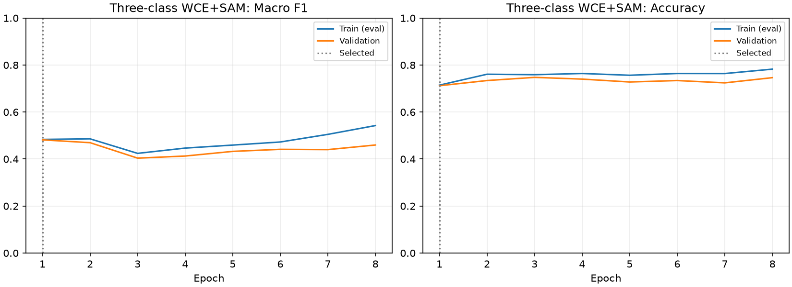

# 모공 3등급 WCE + AdamW + SAM 학습

## 범위와 사전 결정

[분류층 균형 재학습](classifier-retraining.md)은 6등급에서 전체 Accuracy·Macro-F1이
하락했고, 3등급으로 묶은 분류층 단독 재학습도 오탐과 정확도 손실이 컸다.
이에 사용자 지시의 후속 단계로 분류 목표를 `0·1 / 2·3 / 4·5`의 3개로 바꾸고,
기존 가장 높은 전체 정확도를 기록한 **WCE + AdamW + SAM 전층 학습**을 적용한다.
직접 3출력을 학습하는 모델이며 기존 6등급의 예측을 단순히 표시만 바꾸는 모델과 구분한다.

원본 라벨·인물별 분할·이미지·ROI를 수정하지 않고 dataset 접근 시 목표 라벨만
매핑한다. 원본 0~5등급은 별도로 보존한다. 3출력 체크포인트에는 `pore_coarse`,
`grades=[0,1,2]`, `original_grades=[0,1,2,3,4,5]`,
`original_to_target=[0,0,1,1,2,2]`를 명시한다.

ImageNet ResNet-50에서 새로 시작한다. 6등급의 학습된 특징 추출기를 고정하는
cRT 실험과 달리 여기서는 head warmup 2 epoch 후 전체 네트워크를 최대 18 epoch
미세조정한다. 원래 WCE+SAM과 비교해 목표 등급 수·그에 따른 WCE 가중치만 바꾼다.
자연 분포 shuffle을 사용하며 균형 복원 샘플링을 사용하지 않는다.

배치 16, seed 42, SAM rho=0.05, patience 6, AMP, head LR 0.001,
미세조정 head LR 0.0001·backbone LR 0.00001, weight decay 0.0001,
cosine 감소와 기존 약한 증강을 유지한다. 검증 Macro-F1 최댓값·CE 동률 기준으로
체크포인트를 선택한다. 설정은 `ml/configs/nia_smartphone_pore_coarse_sam.toml`이다.

**전층 학습 전 고정한 통과 조건**: 기존 6등급 모델의 두 가지 3등급 해석 방식
(① 확률을 두 등급씩 합산 후 argmax, ② 원본 argmax 등급을 두 개씩 묶기)보다
Accuracy 유지 이상, Macro-F1 증가, 높음 Recall 증가를 모두 충족한다.
각 지표별 두 기준선의 큰 값을 넘는지 확인한다. 이는 운영 선택 기준이며 통계적
유의성 검정은 아니다. 기준선 ①은 Accuracy 74.88%·F1 44.96%·높음 Recall 0%,
②는 74.39%·53.84%·20%였다. 같은 데이터의 3등급 분류끼리 비교한다.

학습 690명·4,112 ROI와 검증 138명·816 ROI만 사용한다. 목표별 ROI 수는
학습 `[835,3005,272]`, 검증 `[165,601,50]`이다. 테스트는 이번 탐색에서 평가하지 않는다.
WCE 가중치는 매핑된 학습 빈도로 다시 계산한다. 등급 이름 낮음·중간·높음은
추천용 임시 구간이며 피부과 중증도 등급을 뜻하지 않는다.

## 실행 및 인계

저장소 루트에서 실행한다. 기존 run은 덮어쓰지 않으며 일반 학습 실행기는 동일
소스·환경·설정의 `last.pt` 재개를 지원한다.

```powershell
uv run --project ml python -m ml.scripts.pore_coarse_experiment --phase preflight
uv run --project ml python -m ml.scripts.pore_coarse_experiment --phase train
uv run --project ml python -m ml.scripts.pore_coarse_experiment --phase evaluate
uv run --project ml python -m ml.scripts.pore_coarse_experiment --phase publish
```

중단된 학습 재개는 다음 명령으로 한다. 완료 뒤 `wall-time.json`은 처음부터 끝까지
실행한 경우에만 생성되므로 재개했다면 실제 실행 시간을 별도로 기록해야 한다.

```powershell
uv run --project ml python -m skin_analysis.smartphone.train --config ml/configs/nia_smartphone_pore_coarse_sam.toml --task pore --resume ml/runs/nia-smartphone-pore-coarse-sam-seed-42/pore/last.pt
```

읽을 때는 먼저 SHA-256을 확인하고 안전한 tensor 로딩과 전용 계약 검사를 사용한다.

```python
import torch
from skin_analysis.smartphone.pore_coarse import load_model

checkpoint = torch.load("inference.bin", map_location="cpu", weights_only=True)
model = load_model(checkpoint)  # strict shape + original-to-target mapping
```

입력은 기존과 같은 로컬 256px 정사각 ROI·RGB·ImageNet 정규화다. 셀카 전체를
그대로 넣거나 사진을 외부 서버로 전송하는 사용법은 이 실험 범위에 포함하지 않는다.
실제 서비스 연결 시 API·UI·추천 값의 3등급 계약을 함께 반영해야 한다.

## 실제 결과

동일 검증 138명·816 ROI, FP32·증강 없음. 사전 통과 조건: **미달**.

| 방법 | Accuracy | Macro P | Macro R | Macro F1 | 높음 P | 높음 R | MAE |
|---|---:|---:|---:|---:|---:|---:|---:|
| six_probability_pooling | 74.88% | 44.33% | 45.76% | 44.96% | 0.00% | 0.00% | 0.2537 |
| six_argmax_mapping | 74.39% | 57.42% | 52.24% | 53.84% | 38.46% | 20.00% | 0.2623 |
| three_frozen_balanced | 59.80% | 48.37% | 58.05% | 49.02% | 16.46% | 52.00% | 0.4203 |
| three_wce_sam | 71.20% | 50.46% | 48.88% | 48.16% | 23.53% | 8.00% | 0.2917 |

선택 epoch 1 / 실행 8, 학습 345.3초.

선택 단계: `head`. 전체 미세조정 단계의 최고 검증 Macro-F1은 epoch 8의 45.97%였다.

| 목표 | 정답 ROI | 예측 ROI | Precision | Recall | F1 |
|---|---:|---:|---:|---:|---:|
| 낮음(원본 0·1) | 165 | 208 | 46.63% | 58.79% | 52.01% |
| 중간(원본 2·3) | 601 | 591 | 81.22% | 79.87% | 80.54% |
| 높음(원본 4·5) | 50 | 17 | 23.53% | 8.00% | 11.94% |

| 방법 | 학습 F1 | 검증 F1 | 차이(%p) |
|---|---:|---:|---:|
| six_probability_pooling | 54.86% | 44.96% | 9.90 |
| six_argmax_mapping | 61.82% | 53.84% | 7.97 |
| three_frozen_balanced | 64.94% | 49.02% | 15.92 |
| three_wce_sam | 48.35% | 48.16% | 0.19 |

3등급 WCE+SAM 검증 혼동행렬(행=정답, 열=예측):

```text
[97, 67, 1]
[109, 480, 12]
[2, 44, 4]
```

높음 정답 50개 중 4개를 맞혔고, 높음 예측 17개 중 13개는 실제 낮음·중간이다.

가중치: `ml/runs/nia-smartphone-pore-coarse-sam-seed-42/pore/inference.bin`

SHA-256: `01e274bd8c57a328378db6f35b6f718384968e6ae17a2e633c3ad70ed01fb342`

이 run은 전체 네트워크 미세조정까지 실행했지만 최종 선택 가중치는 ImageNet 특징 추출기를 고정했던 warmup 단계다. 이 결과를 피부 데이터로 특징 추출기까지 개선된 모델로 설명해서는 안 된다. 정해진 patience 6 기준으로 종료했으며 모든 미세조정 가능성을 소진했다는 뜻도 아니다.

현재 검증 결과로는 새 3출력 학습 모델을 기존 WCE+SAM보다 낫다고 채택할 근거가 없다. 비교 방법 중 검증 Macro-F1이 가장 높은 방식은 `six_argmax_mapping`이다. 확률을 합산해 argmax하는 방식은 높음을 거의 내지 못했다. 등급 수를 줄인 것과 피부 상태를 더 정확히 판별하는 것은 별개다.

현재 3단계 추천 구간을 사용한다면 기존 6등급 WCE+SAM 가중치를 유지하고 예측 등급을 `0·1 / 2·3 / 4·5`로 매핑하는 방식을 우선 후보로 삼을 수 있다. 이를 직접 구현하면 `recommendation_grade = original_grade // 2`이다. 단순 등급 병합이며 새 3등급 모델을 학습해 성능이 개선된 것은 아니다.



검증셋을 반복 사용한 탐색 결과다. 높음의 검증 인물은 9명이며 원본 5등급은 1명이다. 3등급으로 묶어도 인물 다양성 부족은 남는다. 낮음/중간/높음은 임시 추천 구간이며 임상 중증도 기준이 아니다. 원본 4와 5를 구분하는 성능은 이 모델에서 평가할 수 없다.

기존 6등급 Accuracy와 직접 비교할 수 없다. 테스트셋은 평가하지 않았고 기존 모델·서비스 설정 17개 파일은 보존했다. CPU 합성 입력의 3출력과 엄격한 체크포인트 로딩을 확인했으며 분류 지표는 sklearn과 교차 검산했다.
기존 6등급 서비스 로더는 이 후보를 출력층 크기 불일치로 거절하는 것을 확인했다.

테스트 페이지에는 자동 적용하지 않았다. 연결하려면 `pore_coarse.load_model`과 명시적 매핑을 사용하고 API·UI·추천 입력의 등급 계약을 함께 변경해야 한다.
