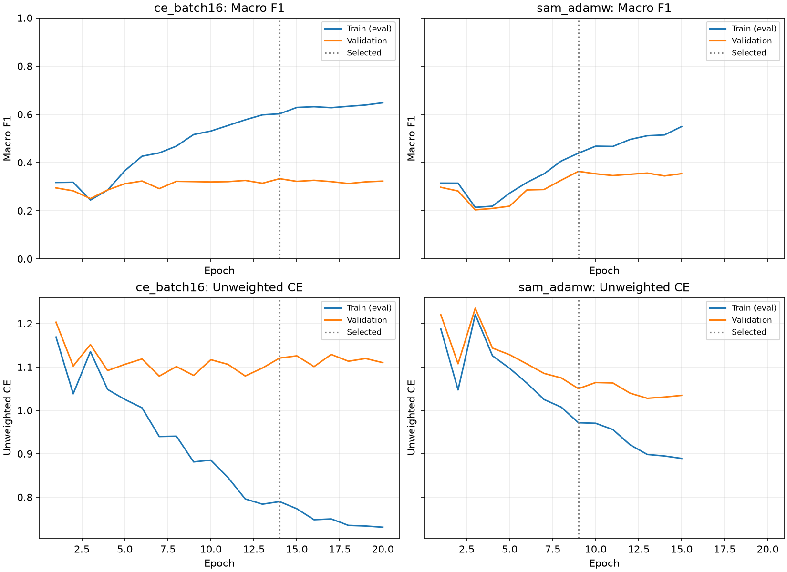

# 모공 SAM-AdamW 비교 실험

## 사전에 고정한 조건

기존 CE 배치 16을 기준으로 SAM만 추가합니다. 기반 optimizer는 AdamW를 유지하고,
일반 L2 SAM의 반경 `ρ=0.05`를 고정합니다. ASAM이나 반경 탐색은 이번 범위에 포함하지
않습니다. head와 전체 backbone 미세조정 두 단계 모두 SAM을 사용합니다.

공통 조건은 seed 42, ImageNet V2 ResNet-50 신규 초기화, 가중 CE, 물리/유효 batch 16,
head 2 + 미세조정 최대 18 epoch, patience 6, head LR 1e-3 → 1e-4, backbone LR 1e-5,
weight decay 1e-4, 기존 cosine scheduler·AMP·256px 전처리·약한 증강입니다.
BN 통계 고정이나 layer4 제한을 함께 적용하지 않습니다. 전문의 라벨과 데이터는 유지합니다.
기존 피부 모델을 이어 학습하지 않고, 같은 검증 macro-F1 및 동률 시 unweighted CE로 선택합니다.

인물 분리 fingerprint:
`6ac903796d100a2ee4f66e3e1936548dfa618c9b448a90985ff9ffbb0c13d793`.
학습 690명/4,112 ROI, 검증 138명/816 ROI를 사용하며 최종 테스트셋은 평가하지 않습니다.

## 구현과 평가 기준

같은 증강 배치에서 첫 gradient `g`로 `ε = ρg/(||g||₂+1e-12)`를 만들고, 임시로 `w+ε`에서
두 번째 gradient를 계산합니다. 원래 파라미터를 복사해 정확히 복원한 다음 두 번째 gradient에
global norm 1 clipping을 적용하고 AdamW로 한 번 갱신합니다. weight decay는 optimizer
update마다, scheduler는 미세조정 epoch마다 기존처럼 한 번 적용됩니다.
두 번째 backward에서 perturbation의 미분은 계산하지 않습니다.

미세조정 첫 forward에서만 BN running 통계를 영구 갱신하고, 두 번째 forward도 학습 배치
통계를 사용하되 running mean/variance/count는 첫 forward 이후 값으로 복원합니다.
head 단계에서는 기존과 같이 backbone과 BN을 동결합니다. AMP는 첫 gradient를 수동으로
unscale하고 두 번째 gradient에서만 `GradScaler.unscale_`을 사용합니다. gradient overflow는
scale을 절반으로 줄여 같은 배치를 재시도하며 파라미터·BN·torch RNG를 복원합니다.
동일한 증강 입력과 stochastic mask를 두 계산에서 재사용합니다.

Accuracy, macro/weighted Precision·Recall·F1, 등급별 지표와 혼동행렬, MAE·±1등급 적중률을
기록합니다. 고등급 Recall은 실제 4·5등급 총 50 ROI 중 **자기 등급으로 정확히 분류한 비율**이며
이진 고등급 검출 Recall과 다릅니다. 지표는 scikit-learn과 대조하고 학습 지표는 증강 없는 FP32
eval mode로 측정합니다. 5등급 검증은 1명/6 ROI이므로 작은 변화도 일반화해 해석하지 않습니다.

학습량은 같은 최대 epoch로 제한하지만 SAM은 배치당 forward/backward가 두 번이므로
동일 계산량 비교는 아닙니다. 한 seed·고정 반경의 비교이므로 SAM 전체의 유효성을 확정하거나
부정할 수 없습니다. 기존 모델·추천 묶음·테스트 페이지는 보존하고 후보는 별도로 저장합니다.

## 재현

저장소 루트에서 실행합니다. 기존 run은 덮어쓰지 않습니다.

```powershell
uv run --project ml python -m ml.scripts.report_sam_experiment --phase preflight
uv run --project ml python -u -m skin_analysis.smartphone.train --config ml/configs/nia_smartphone_sam.toml --task pore
uv run --project ml python -m ml.scripts.report_sam_experiment --phase evaluate
uv run --project ml python -m ml.scripts.report_sam_experiment --phase publish
```

후보 가중치·체크포인트·학습 이력·개별 예측은 `ml/runs/nia-smartphone-sam-seed-42/`에
로컬 저장합니다. 이 보고서와 집계 JSON·학습 곡선만 Git으로 공유합니다.

참고: [SAM 원 논문](https://arxiv.org/abs/2010.01412),
[PyTorch AMP 예제](https://docs.pytorch.org/docs/2.14/notes/amp_examples.html).
AMP 문서 링크는 현재 공개 문서이며 실제 실행 버전은 lockfile의 torch 2.13.0입니다.

## 결론과 적용 판단

2026-10-23 학습·재평가 완료. **이번 SAM 설정은 정확도와 macro-F1을 개선했지만,
3등급 Recall 악화와 고등급 한계가 있어 모든 등급에서 좋아진 모델은 아닙니다.**
모공 후보로 별도 보존하며 다른 항목 확대나 테스트 페이지 교체는 진행하지 않았습니다.

15 epoch에서 patience 6으로 조기 종료됐고 epoch 9를 선택했습니다. 같은 검증셋에서
Accuracy는 54.41% → **63.11%(+8.70%p)**, macro-F1은 33.29% →
**36.34%(+3.05%p)**, MAE는 0.5674 → **0.4534**로 개선됐습니다.
macro Precision은 31.56% → 42.06%로 높아졌지만 macro Recall은
38.45% → 36.70%로 낮아졌습니다. 최종 테스트 성능을 의미하지 않습니다.

선택 모델의 학습/검증 F1 차이는 26.94%p → **7.55%p**입니다.
학습 F1 자체는 60.23% → 43.89%로 낮아졌지만 검증 F1이 올랐으므로, 단순히
학습을 못해 차이만 작아진 결과로 해석하지 않습니다. 다만 마지막 epoch 15에는
학습 F1 54.94% / 검증 F1 35.38%로 차이가 다시 19.56%p로 커졌습니다.
과적합이 완전히 해결된 것은 아닙니다.

### 등급별로 남은 문제

- 2등급 Recall은 69.48% → 85.94%로 높아졌습니다. 실제 498 ROI에 대해 예측 2등급은
  495 → **617 ROI**로 늘어났으므로 정확도 향상과 함께 2등급으로 치우치는 경향도 봐야 합니다.
- 3등급 Recall은 **14.56%(15/103) → 3.88%(4/103)**, F1은 16.22% → 7.08%로
  낮아졌습니다. 3등급을 예측한 수는 82 → 10 ROI이며 주로 2등급으로 오분류합니다.
- 4등급 Recall은 **22.73%(10/44)**로 같고 Precision은 27.78% → 40.00%로 좋아졌습니다.
  5등급 Recall은 두 모델 모두 **0%(0/6)**입니다. 4·5등급 pooled Recall도 **20%(10/50)**로
  같으므로, 사용자가 해결하려던 고등급 누락 문제는 해결되지 않았습니다.
- 0등급도 Precision/F1은 높아졌지만 Recall은 85.71% → 66.67%로 낮아졌습니다.
  macro-F1 상승만으로 각 등급의 검출력이 모두 개선됐다고 판단하지 않습니다.

따라서 SAM을 전체 지표의 개선 후보로 유지하되, 현재 결과만으로 다른 모델에 확대하거나
추천용 모델을 교체하지 않습니다. 향후 비교에서도 3등급·고등급 Recall을 함께 확인해야 합니다.

### 계산 비용과 비교의 한계

SAM 학습 프로세스 전체는 약 **598초(9분 58초)**였습니다. 이 시간에는 초기화·cache 검증·
worker 시작·추가 train-eval·체크포인트 저장이 포함되며, 완료 후 별도 재평가는 포함하지 않습니다.
미세조정 epoch의 기록된 시간 중앙값은 CE 11.89초 / SAM 31.80초로 이번 실행에서 약
**2.67배**였습니다. 이 epoch 시간은 train-eval과 체크포인트 IO를 제외한 학습+검증 구간입니다.
실행 시점의 부하가 다른 관측값이며 동일 계산량으로 맞춘 벤치마크가 아닙니다.

추가 구현 차이도 기록합니다. 기존 CE loop는 AMP 실패 재시도에서도 BN running 통계를
갱신합니다. 선택 epoch 14의 정상 forward 3,084회 외에 재시도 2회의 통계가 추가됐습니다.
SAM loop는 실패한 시도의 BN 통계를 복원합니다. SAM 선택 epoch 9의 통계 갱신은 정상
forward 1,799회이며, 최종 epoch 15에서는 3,341회입니다. 모두 ImageNet 초기 counter를
뺀 값이며 53개 BN에서 확인했습니다. 따라서 이 비교는 **기존 구현 대비 SAM 후보 비교**이고,
AMP/BN 재시도 처리까지 완전히 통제한 SAM 단독 인과 효과 실험은 아닙니다.

한 seed·한 반경이며 같은 검증셋을 여러 실험에서 반복 사용했습니다. 향상 수치의 통계적
유의성이나 새로운 인물에서의 성능은 확정할 수 없습니다. 최종 테스트셋은 이번 선택에
사용하지 않았습니다. 생성 이미지나 외부 라벨을 추가하지 않았습니다.

## 검증과 보존

- 모델 SHA와 `best.pt`/export의 텐서 일치·유한값·데이터/초기화/패키지 일치를 확인했습니다.
- 53개 BN의 영구 counter는 정상 첫 forward 수와 일치했고, AdamW는 epoch당 257회
  갱신됐습니다. 두 번째 SAM forward나 AMP 재시도가 추가 optimizer step으로 계산되지 않았습니다.
- AMP 재시도는 총 3회였으며 배치를 버리지 않았습니다. 단위 테스트는 두 gradient의 독립
  수식 대조, rho 0의 기존 AdamW 일치, 누적/마지막 배치, 두 단계 overflow 재시도,
  예외 시 파라미터/BN 복원, optimizer/scaler 체크포인트 복원을 포함합니다.
- 로컬 서비스의 엄격한 SHA/shape 로더에서 읽고 더미 입력으로 유한한 `[1,6]` 출력을
  확인했습니다. 실제 얼굴 사진을 서버로 보내지 않았습니다.
- 기존 서비스 설정·추천 묶음·기존/비교 모델 12개 파일의 SHA가 사전 기록과 일치합니다.
  후보는 `ml/runs/nia-smartphone-sam-seed-42/pore/inference.bin`에 저장됐습니다.
- `npm run check -- -- --runInBand` 통과(타입 검사·린트·48 tests), ML pytest **116 passed**,
  ML Ruff 통과, `server/nia` unittest **34 passed**. 검사는 실제 학습/검증 평가와 별개입니다.
- 구현 커밋: `3b09751ed`. 공개 [집계 JSON](sam-experiment.metrics.json)에 등급별 지표·
  혼동행렬·학습 곡선 원자료·보존/로더 검증 결과를 함께 기록했습니다.

## 실제 비교 결과

동일 인물 분리의 검증 138명/816 ROI 결과입니다.

| 모델 | epoch / 실행 | Acc | macro P | macro R | macro F1 | MAE | ±1등급 | 고등급 Recall |
|---|---:|---:|---:|---:|---:|---:|---:|---:|
| ce_batch16 | 14 / 20 | 54.41% | 31.56% | 38.45% | 33.29% | 0.5674 | 90.81% | 20.00% |
| sam_adamw | 9 / 15 | 63.11% | 42.06% | 36.70% | 36.34% | 0.4534 | 92.77% | 20.00% |

| 모델 | 학습 F1 | 검증 F1 | 차이(%p) |
|---|---:|---:|---:|
| ce_batch16 | 60.23% | 33.29% | 26.94 |
| sam_adamw | 43.89% | 36.34% | 7.55 |

| 모델 | 등급 | 실제 ROI | 예측 ROI | Precision | Recall | F1 |
|---|---:|---:|---:|---:|---:|---:|
| ce_batch16 | 0 | 21 | 49 | 36.73% | 85.71% | 51.43% |
| ce_batch16 | 1 | 144 | 150 | 36.67% | 38.19% | 37.41% |
| ce_batch16 | 2 | 498 | 495 | 69.90% | 69.48% | 69.69% |
| ce_batch16 | 3 | 103 | 82 | 18.29% | 14.56% | 16.22% |
| ce_batch16 | 4 | 44 | 36 | 27.78% | 22.73% | 25.00% |
| ce_batch16 | 5 | 6 | 4 | 0.00% | 0.00% | 0.00% |
| sam_adamw | 0 | 21 | 23 | 60.87% | 66.67% | 63.64% |
| sam_adamw | 1 | 144 | 140 | 42.14% | 40.97% | 41.55% |
| sam_adamw | 2 | 498 | 617 | 69.37% | 85.94% | 76.77% |
| sam_adamw | 3 | 103 | 10 | 40.00% | 3.88% | 7.08% |
| sam_adamw | 4 | 44 | 25 | 40.00% | 22.73% | 28.99% |
| sam_adamw | 5 | 6 | 1 | 0.00% | 0.00% | 0.00% |



가중치 SHA-256:

- ce_batch16: `9dcfe1bd137742281af1ff87cf6c8b12c840a8e4fb20f7114ef08dfbc59b3f92`
- sam_adamw: `18c5ddd6c921c22a1bf55010a437e32f682470cfce41a9d6a7d2295f75e77644`
