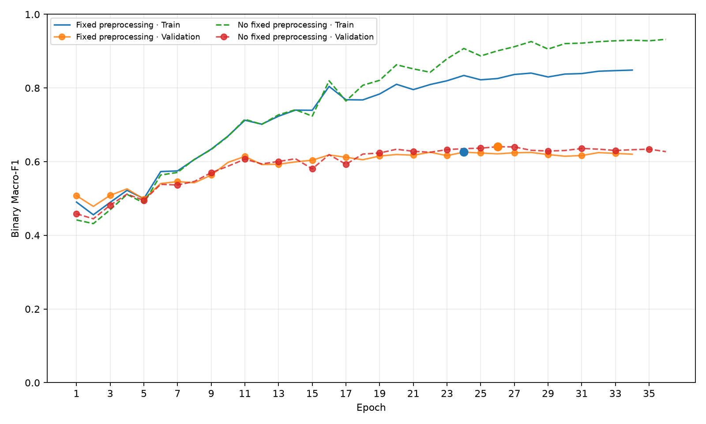
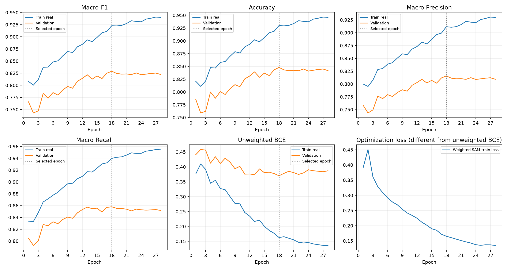
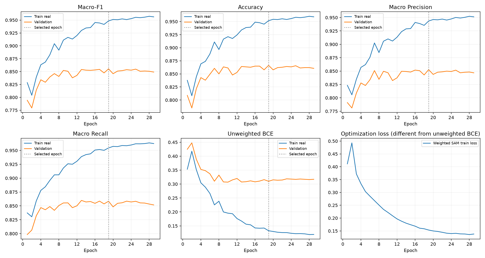
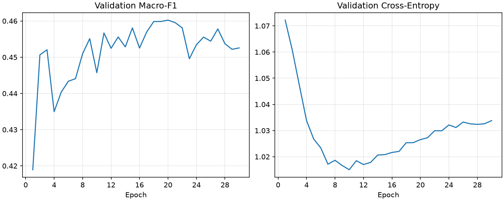

# 4모델 통합 성능 문서

각 모델의 고정 Test에서 얻은 지표다. 서로 다른 정답과 ROI를 합쳐 단일 정확도나 다중출력 전체 정답률로 해석하지 않는다.

| 모델 | Test ROI | Accuracy | Macro P | Macro R | Macro-F1 | BCE |
|---|---:|---:|---:|---:|---:|---:|
| pore | 822 | 0.7336 | 0.6364 | 0.6880 | 0.6459 | 0.5149 |
| pigmentation | 1245 | 0.8217 | 0.7925 | 0.8287 | 0.8030 | 0.4119 |
| wrinkle | 1410 | 0.8809 | 0.8661 | 0.8819 | 0.8724 | 0.2630 |

피부타입의 ROI Test Macro-F1은 0.4698, Accuracy 0.4977이다. 기존 인물별 평균 평가에서는 Macro-F1 0.4769 / Accuracy 0.5158이었다.

## 이진 클래스 및 원본 등급 분석

### pore

양호 Recall 0.7620, 유의 Precision 0.3804, 유의 Recall 0.6139, 4등급 이상 놓침률 0.3208.
혼동행렬(행=정답/열=예측, 양호/유의): `[[506, 158], [61, 97]]`

| 원본 등급 | Test 수 | 유의 예측률 |
|---:|---:|---:|
| 0 | 24 | 0.0000 |
| 1 | 143 | 0.0699 |
| 2 | 497 | 0.2978 |
| 3 | 105 | 0.5810 |
| 4 | 47 | 0.6383 |
| 5 | 6 | 1.0000 |

0~2등급의 유의 예측률은 오탐률, 3등급 이상은 유의 Recall이다.

[개별 보고서](reports/pore/report.md)

### pigmentation

양호 Recall 0.8108, 유의 Precision 0.6612, 유의 Recall 0.8466, 4등급 이상 놓침률 0.0161.
혼동행렬(행=정답/열=예측, 양호/유의): `[[703, 164], [58, 320]]`

| 원본 등급 | Test 수 | 유의 예측률 |
|---:|---:|---:|
| 0 | 108 | 0.0000 |
| 1 | 405 | 0.0148 |
| 2 | 354 | 0.4463 |
| 3 | 254 | 0.7795 |
| 4 | 76 | 0.9737 |
| 5 | 48 | 1.0000 |

0~2등급의 유의 예측률은 오탐률, 3등급 이상은 유의 Recall이다.

[개별 보고서](reports/pigmentation/report.md)

### wrinkle

양호 Recall 0.8784, 유의 Precision 0.7985, 유의 Recall 0.8853, 4등급 이상 놓침률 0.0375.
혼동행렬(행=정답/열=예측, 양호/유의): `[[802, 111], [57, 440]]`

| 원본 등급 | Test 수 | 유의 예측률 |
|---:|---:|---:|
| 0 | 141 | 0.0000 |
| 1 | 537 | 0.0428 |
| 2 | 235 | 0.3745 |
| 3 | 204 | 0.7745 |
| 4 | 100 | 0.9500 |
| 5 | 72 | 0.9167 |
| 6 | 121 | 1.0000 |

0~2등급의 유의 예측률은 오탐률, 3등급 이상은 유의 Recall이다.

[개별 보고서](reports/wrinkle/report.md)

## 피부타입

[기존 ROI 평가 보고서](reports/skin_type_roi/report.md)

피부타입은 이전 분할이므로 번들 전체의 공통 인물 평가 성능은 미측정이다. 모공 Test 5등급은 한 사람의 6 ROI라 해당 Recall의 일반화 해석은 제한된다.
