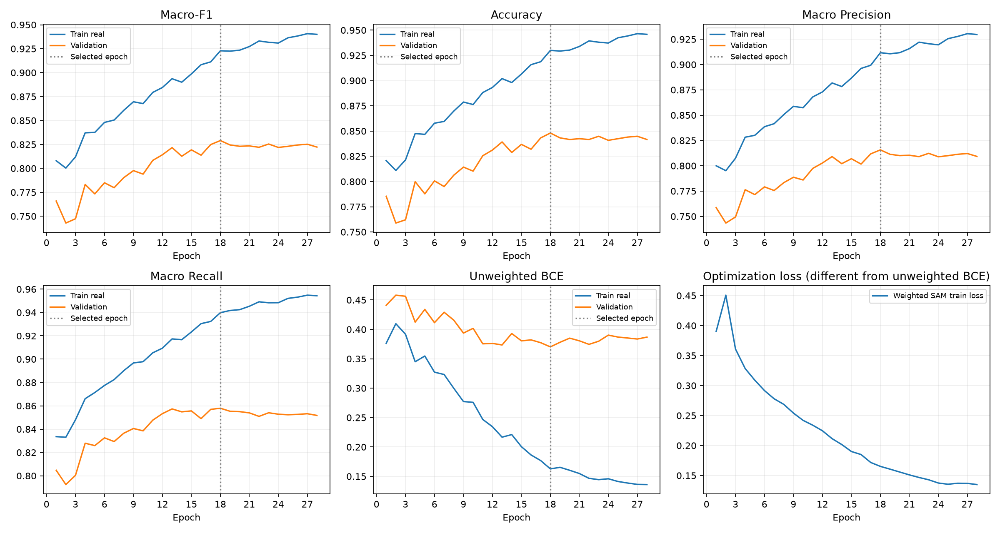

# pigmentation 직접 이진 모델 실험

## 데이터 규모

| Split | 인물 | ROI | 원본 등급별 ROI | 양호 / 유의 |
|---|---:|---:|---|---|
| train | 687 | 6153 | [531, 2215, 1416, 1304, 485, 202] | [4162, 1991] |
| valid | 139 | 1244 | [108, 478, 295, 265, 77, 21] | [881, 363] |
| test | 139 | 1245 | [108, 405, 354, 254, 76, 48] | [867, 378] |

## 설정

```json
{
  "schema": "skin-binary-expansion-v1",
  "task": "pigmentation",
  "architecture": "mobilenet_v3_large",
  "initialization": "IMAGENET1K_V2",
  "head": "960 -> 1280 -> Hardswish -> Dropout(0.2) -> 1 logit -> sigmoid",
  "label_mapping": [
    0,
    0,
    0,
    1,
    1,
    1
  ],
  "classes": [
    "양호",
    "유의"
  ],
  "threshold": 0.5,
  "settings": {
    "seed": 42,
    "batch_size": 16,
    "effective_batch": 16,
    "train_workers": 1,
    "eval_workers": 0,
    "freeze_epochs": 1,
    "finetune_epochs": 99,
    "patience": 10,
    "head_lr": 0.001,
    "finetune_head_lr": 0.0001,
    "backbone_lr": 1e-05,
    "weight_decay": 0.0001,
    "amp": true,
    "sam_rho": 0.05,
    "scheduler_factor": 0.5,
    "scheduler_patience": 2,
    "scheduler_threshold": 0.0001,
    "scheduler_min_lr": 1e-07
  },
  "preprocessing": {
    "radius": 1.0,
    "percent": 75,
    "threshold": 0,
    "contrast_factor": 1.4
  },
  "preprocessing_baked_in_cache": true,
  "random_train_augmentation": {
    "degrees": 5,
    "translate": 0.02,
    "brightness": 0.1,
    "contrast": 0.1,
    "saturation": 0.05,
    "horizontal_flip": false
  },
  "sampling": "every original row + sqrt additional draws by original grade; diverse-grade batches",
  "original_grade_counts": [
    531,
    2215,
    1416,
    1304,
    485,
    202
  ],
  "draws_by_original_grade": [
    1085,
    2215,
    1771,
    1700,
    1037,
    669
  ],
  "draws_per_epoch": 8477,
  "steps_per_epoch": 530,
  "class_weights": [
    0.7391878904372897,
    1.5452034153691612
  ],
  "loss": "binary-original-frequency inverse-weighted BCEWithLogitsLoss; exponent=1; no Huber or original-grade alpha weight",
  "checkpoint_selection": "Validation binary Macro-F1 maximum, unweighted BCE minimum on tie",
  "test_policy": "explicit evaluate action only after Validation checkpoint selection; no Test-based tuning",
  "splits": {
    "train": {
      "roi": 6153,
      "subjects": 687,
      "grades": [
        531,
        2215,
        1416,
        1304,
        485,
        202
      ],
      "binary": [
        4162,
        1991
      ]
    },
    "valid": {
      "roi": 1244,
      "subjects": 139,
      "grades": [
        108,
        478,
        295,
        265,
        77,
        21
      ],
      "binary": [
        881,
        363
      ]
    },
    "test": {
      "roi": 1245,
      "subjects": 139,
      "grades": [
        108,
        405,
        354,
        254,
        76,
        48
      ],
      "binary": [
        867,
        378
      ]
    }
  },
  "manifest_fingerprint": "98f56f3fd13895a85c1afecfc55f5c552b041a14be8ea70291932da2ca96a7d6",
  "cache_sha256": "e048a32d9dbafe3558ba50443d0396e5d86aa07b60b3fb14341a3f110172d5fd",
  "pore_subject_split_fingerprint": "70e095553bf9d413a7b8e4353537af006d5a796f48f51e0b58c445a678970753",
  "exclusion_scope": "0427 excluded for pore only; retained in Test for this task",
  "areas": {
    "forehead_pigmentation": [
      1
    ],
    "cheek_pigmentation": [
      5,
      6
    ]
  },
  "code_sha256": {
    "experiment.py": "ae45cdb05c2c32fc4fd6206b092160cbae1670bfac1c23062de9d6f2b68c04cb",
    "pore_reference.py": "5fb7b5879e83106c37de1b8593128f5bee4e92fd499c1ac8fa76ce54c1135b9b"
  }
}
```

종료 28 epoch, 선택 18 epoch. Validation Macro-F1 우선, 동률 시 BCE 최소. Test는 checkpoint 선택에 사용하지 않았다.

## 최적 checkpoint 지표

| Split | Accuracy | Macro P | Macro R | Macro-F1 | BCE |
|---|---:|---:|---:|---:|---:|
| Train real | 0.9300 | 0.9117 | 0.9398 | 0.9228 | 0.1627 |
| Validation | 0.8481 | 0.8157 | 0.8579 | 0.8290 | 0.3702 |
| Test | 0.8217 | 0.7925 | 0.8287 | 0.8030 | 0.4119 |



## Test 클래스 지표

| 클래스 | 표본 | Precision | Recall | F1 |
|---|---:|---:|---:|---:|
| 양호 | 867 | 0.9238 | 0.8108 | 0.8636 |
| 유의 | 378 | 0.6612 | 0.8466 | 0.7425 |

혼동행렬 (행=정답, 열=예측; 양호/유의): `[[703, 164], [58, 320]]`

## 원본 등급별 유의 예측률

0~2등급에서는 유의로 잘못 예측한 비율이며, 3등급 이상에서는 유의 Recall이다.

| 원본 등급 | 표본 | 유의 예측률 |
|---:|---:|---:|
| 0 | 108 | 0.0000 |
| 1 | 405 | 0.0148 |
| 2 | 354 | 0.4463 |
| 3 | 254 | 0.7795 |
| 4 | 76 | 0.9737 |
| 5 | 48 | 1.0000 |

결과는 원본 인물 라벨과 현재 고정 분할에 대한 탐색 지표다. 같은 인물의 여러 ROI는 독립된 인물 표본이 아니다.
