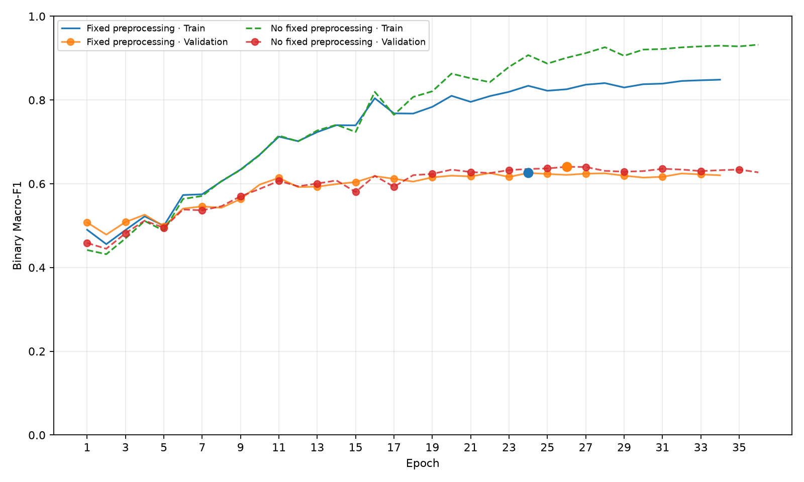
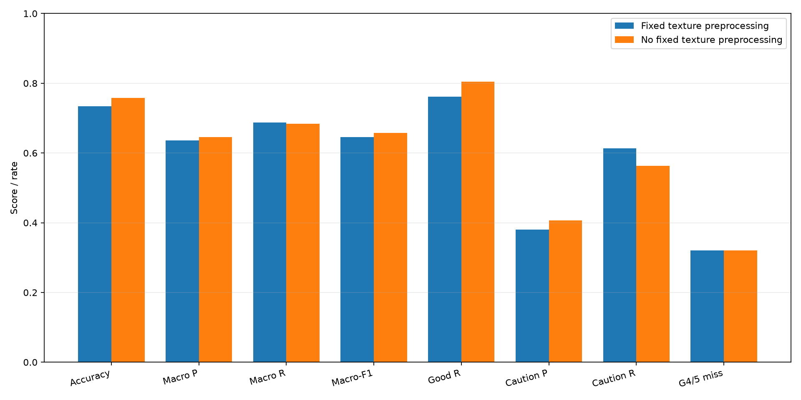

# 모공 이진 모델: 고정 전처리 비교

두 모델 모두 0427번 제외 후 만든 동일한 사람 단위 seed 42 분할로 ImageNet V2에서 새로 학습했다. 차이는 고정 Unsharp/Contrast 적용 유무뿐이다. 기존 무작위 Train 증강, 데이터 추출, 모델·optimizer·seed 조건은 같다.

## 데이터 분할

| Split | 인물 | ROI | Grade 0 / 1 / 2 / 3 / 4 / 5 | 5등급 인물 |
|---|---:|---:|---|---:|
| Train | 687 | 4092 | 108 / 721 / 2491 / 517 / 219 / 36 | 6 |
| Valid | 139 | 827 | 24 / 145 / 497 / 105 / 44 / 12 | 2 |
| Test | 138 | 822 | 24 / 143 / 497 / 105 / 47 / 6 | 1 |

## 학습 곡선 및 체크포인트

| 조건 | best epoch | 실제 Train Macro-F1 | Validation Macro-F1 | Train−Validation | Validation BCE | 종료 epoch |
|---|---:|---:|---:|---:|---:|---:|
| 고정 전처리 적용 | 24 | 0.8340 | 0.6259 | +0.2081 | 0.5896 | 34 |
| 고정 전처리 제거 | 26 | 0.9009 | 0.6405 | +0.2604 | 0.6241 | 36 |

## 최종 Test 비교

| 지표 | Unsharp 75% + 대비 40% | 고정 전처리 없음 | 변화(없음−적용) |
|---|---:|---:|---:|
| Accuracy | 0.7336 | 0.7579 | +0.0243 |
| Macro Precision | 0.6364 | 0.6460 | +0.0096 |
| Macro Recall | 0.6880 | 0.6838 | -0.0042 |
| Macro-F1 | 0.6459 | 0.6575 | +0.0116 |
| BCE | 0.5149 | 0.5065 | -0.0084 |
| 양호 Recall | 0.7620 | 0.8042 | +0.0422 |
| 유의 Precision | 0.3804 | 0.4064 | +0.0260 |
| 유의 Recall | 0.6139 | 0.5633 | -0.0506 |
| 4·5등급 놓침률 | 0.3208 | 0.3208 | +0.0000 |

### 원본 등급별 유의 Recall

| 등급 | 표본 수 | 전처리 적용 | 전처리 제거 |
|---:|---:|---:|---:|
| 0 | 24 | 0.0000 | 0.0000 |
| 1 | 143 | 0.0699 | 0.0839 |
| 2 | 497 | 0.2978 | 0.2374 |
| 3 | 105 | 0.5810 | 0.5048 |
| 4 | 47 | 0.6383 | 0.6383 |
| 5 | 6 | 1.0000 | 1.0000 |

두 조건 모두 Test를 checkpoint 선택에 쓰지 않았다. test 5등급은 6 ROI·1명이고, 기존 고정 분할을 반복 관찰해온 상태이므로 외부 일반화 성능으로 해석하지 않는다.

Test Macro-F1은 전처리 제거 조건이 0.0116 높았고 Test BCE도 0.0084 낮았다. 반면 유의(3–5등급) Recall은 0.0506 낮아졌고, 4·5등급 합산 놓침률은 양쪽 모두 32.1%였다. 즉 전처리 제거가 전체 Macro-F1을 조금 높였지만 4·5등급 포착은 개선하지 않았다. Test 5등급은 한 사람의 6 ROI이므로 이 등급의 Recall 100%는 해당 인물에 대한 결과다.

## 학습 조건

MobileNetV3-Large/ImageNet1K V2; head 960→1280→Hardswish→Dropout(0.2)→1 sigmoid; weighted BCEWithLogitsLoss; square-root 추가 추출; batch 16; seed 42; head-only 1 epoch; 최대 100 epoch/patience 10; AdamW+SAM ρ=0.05; ReduceLROnPlateau factor 0.5/patience 2. Validation Macro-F1 최고, 동률이면 비가중 BCE가 낮은 checkpoint를 선택했다.

## 해석 제한

새 Test에도 5등급 인물은 1명뿐이다. 고정 전처리 비교 결과는 이번 고정 분할 안에서의 관찰이며, 레이블의 정확성이나 새 인물에 대한 일반화를 확정하지 않는다.
