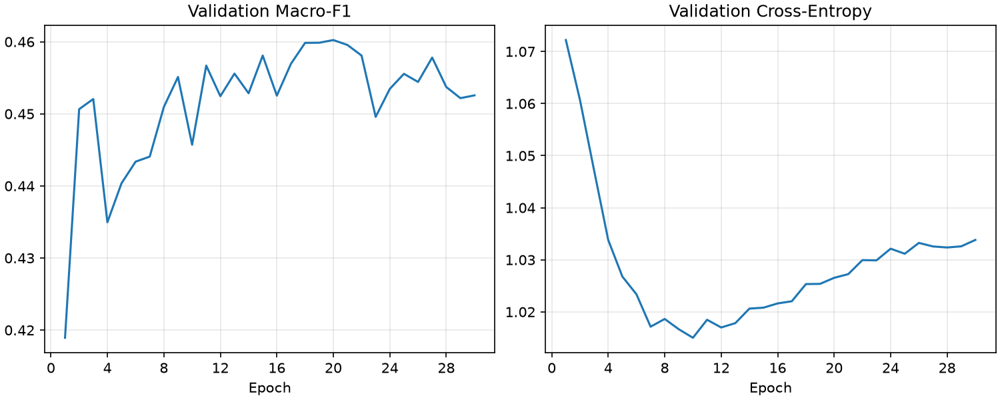

# ROI 기반 피부 타입 분류 비교

ROI 모델: 완료 30 epoch, 선택 20 epoch, Validation Macro-F1 0.4602.

실제 스마트폰 정면·좌측·우측 사진에서 이마와 양 볼 ROI 사용. 원본의 인물 단위 seed 42 분할 유지. Train 488명/4,368 ROI, Validation 98명/874 ROI, Test 95명/852 ROI. 건성·중성·지성 원본 라벨만 사용. 같은 인물에 속하는 부위마다 동일한 인물 타입 라벨을 부여하므로 해당 부위 자체의 유수분 라벨은 아니다.

MobileNetV3-Large ImageNet V2, dropout 0.2, 960→1280→3, 가중 cross entropy α=.5, 전체 샘플 + 희소 등급 제곱근 추가 추출, AdamW+SAM, batch16, 1 epoch head-only, 최대100, patience10, Validation Macro-F1 선택. 고정 언샤프 75%·대비 1.4 적용.

| 비교 | Test 이미지/ROI 수 | Macro-F1 | 정확도 |
|---|---:|---:|---:|
| 전체 사진 | 285 | 0.3914 | 0.4246 |
| ROI | 852 | 0.4698 | 0.4977 |

## 인물별 평균 확률 비교

각 인물의 Test 이미지 또는 ROI별 softmax 점수를 평균해 인물당 하나의 타입을 결정한 탐색 결과. 전체 사진과 ROI의 입력 수와 영역이 다르므로 입력 방식 외에도 차이가 있다.

| 비교 | 인물 수 | Macro-F1 | 정확도 | 건성 Recall | 중성 Recall | 지성 Recall |
|---|---:|---:|---:|---:|---:|---:|
| 전체 사진 | 95 | 0.4366 | 0.4737 | 0.5814 | 0.1290 | 0.7619 |
| ROI | 95 | 0.4769 | 0.5158 | 0.7209 | 0.2903 | 0.4286 |

## ROI별 Test Recall

| 타입 | ROI 수 | Precision | Recall | F1 |
|---|---:|---:|---:|---:|
| 건성 | 385 | 0.6528 | 0.6545 | 0.6537 |
| 중성 | 279 | 0.3308 | 0.3082 | 0.3191 |
| 지성 | 188 | 0.4175 | 0.4574 | 0.4365 |

Test는 이전 실험에서 반복 사용된 탐색용 평가다. 사진·ROI는 인물 단위 독립 표본이 아니다. 피부 타입 라벨의 판정 방식은 미확인이고 복합성·심한 건성은 이번 학습에서 제외했다.
