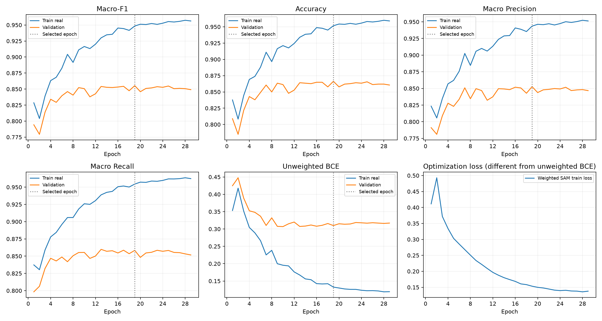

# wrinkle 직접 이진 모델 실험

## 데이터 규모

| Split | 인물 | ROI | 원본 등급별 ROI | 양호 / 유의 |
|---|---:|---:|---|---|
| train | 687 | 6931 | [720, 2567, 1127, 959, 524, 588, 446] | [4414, 2517] |
| valid | 139 | 1413 | [127, 523, 260, 202, 103, 113, 85] | [910, 503] |
| test | 139 | 1410 | [141, 537, 235, 204, 100, 72, 121] | [913, 497] |

## 설정

```json
{
  "schema": "skin-binary-expansion-v1",
  "task": "wrinkle",
  "architecture": "mobilenet_v3_large",
  "initialization": "IMAGENET1K_V2",
  "head": "960 -> 1280 -> Hardswish -> Dropout(0.2) -> 1 logit -> sigmoid",
  "label_mapping": [
    0,
    0,
    0,
    1,
    1,
    1,
    1
  ],
  "classes": [
    "양호",
    "유의"
  ],
  "threshold": 0.5,
  "settings": {
    "seed": 42,
    "batch_size": 16,
    "effective_batch": 16,
    "train_workers": 1,
    "eval_workers": 0,
    "freeze_epochs": 1,
    "finetune_epochs": 99,
    "patience": 10,
    "head_lr": 0.001,
    "finetune_head_lr": 0.0001,
    "backbone_lr": 1e-05,
    "weight_decay": 0.0001,
    "amp": true,
    "sam_rho": 0.05,
    "scheduler_factor": 0.5,
    "scheduler_patience": 2,
    "scheduler_threshold": 0.0001,
    "scheduler_min_lr": 1e-07
  },
  "preprocessing": {
    "radius": 1.0,
    "percent": 75,
    "threshold": 0,
    "contrast_factor": 1.4
  },
  "preprocessing_baked_in_cache": true,
  "random_train_augmentation": {
    "degrees": 5,
    "translate": 0.02,
    "brightness": 0.1,
    "contrast": 0.1,
    "saturation": 0.05,
    "horizontal_flip": false
  },
  "sampling": "every original row + sqrt additional draws by original grade; diverse-grade batches",
  "original_grade_counts": [
    720,
    2567,
    1127,
    959,
    524,
    588,
    446
  ],
  "draws_by_original_grade": [
    1360,
    2567,
    1701,
    1569,
    1160,
    1229,
    1070
  ],
  "draws_per_epoch": 10656,
  "steps_per_epoch": 666,
  "class_weights": [
    0.7851155414589941,
    1.3768375049662296
  ],
  "loss": "binary-original-frequency inverse-weighted BCEWithLogitsLoss; exponent=1; no Huber or original-grade alpha weight",
  "checkpoint_selection": "Validation binary Macro-F1 maximum, unweighted BCE minimum on tie",
  "test_policy": "explicit evaluate action only after Validation checkpoint selection; no Test-based tuning",
  "splits": {
    "train": {
      "roi": 6931,
      "subjects": 687,
      "grades": [
        720,
        2567,
        1127,
        959,
        524,
        588,
        446
      ],
      "binary": [
        4414,
        2517
      ]
    },
    "valid": {
      "roi": 1413,
      "subjects": 139,
      "grades": [
        127,
        523,
        260,
        202,
        103,
        113,
        85
      ],
      "binary": [
        910,
        503
      ]
    },
    "test": {
      "roi": 1410,
      "subjects": 139,
      "grades": [
        141,
        537,
        235,
        204,
        100,
        72,
        121
      ],
      "binary": [
        913,
        497
      ]
    }
  },
  "manifest_fingerprint": "c69d93d6291a7eab2c22e4a63ca620801ec74f267753627d7b41fb8a4de77506",
  "cache_sha256": "e048a32d9dbafe3558ba50443d0396e5d86aa07b60b3fb14341a3f110172d5fd",
  "pore_subject_split_fingerprint": "70e095553bf9d413a7b8e4353537af006d5a796f48f51e0b58c445a678970753",
  "exclusion_scope": "0427 excluded for pore only; retained in Test for this task",
  "areas": {
    "forehead_wrinkle": [
      1
    ],
    "glabellus_wrinkle": [
      2
    ],
    "perocular_wrinkle": [
      3,
      4
    ]
  },
  "code_sha256": {
    "experiment.py": "ae45cdb05c2c32fc4fd6206b092160cbae1670bfac1c23062de9d6f2b68c04cb",
    "pore_reference.py": "5fb7b5879e83106c37de1b8593128f5bee4e92fd499c1ac8fa76ce54c1135b9b"
  }
}
```

종료 29 epoch, 선택 19 epoch. Validation Macro-F1 우선, 동률 시 BCE 최소. Test는 checkpoint 선택에 사용하지 않았다.

## 최적 checkpoint 지표

| Split | Accuracy | Macro P | Macro R | Macro-F1 | BCE |
|---|---:|---:|---:|---:|---:|
| Train real | 0.9517 | 0.9435 | 0.9545 | 0.9484 | 0.1325 |
| Validation | 0.8662 | 0.8527 | 0.8584 | 0.8553 | 0.3099 |
| Test | 0.8809 | 0.8661 | 0.8819 | 0.8724 | 0.2630 |



## Test 클래스 지표

| 클래스 | 표본 | Precision | Recall | F1 |
|---|---:|---:|---:|---:|
| 양호 | 913 | 0.9336 | 0.8784 | 0.9052 |
| 유의 | 497 | 0.7985 | 0.8853 | 0.8397 |

혼동행렬 (행=정답, 열=예측; 양호/유의): `[[802, 111], [57, 440]]`

## 원본 등급별 유의 예측률

0~2등급에서는 유의로 잘못 예측한 비율이며, 3등급 이상에서는 유의 Recall이다.

| 원본 등급 | 표본 | 유의 예측률 |
|---:|---:|---:|
| 0 | 141 | 0.0000 |
| 1 | 537 | 0.0428 |
| 2 | 235 | 0.3745 |
| 3 | 204 | 0.7745 |
| 4 | 100 | 0.9500 |
| 5 | 72 | 0.9167 |
| 6 | 121 | 1.0000 |

결과는 원본 인물 라벨과 현재 고정 분할에 대한 탐색 지표다. 같은 인물의 여러 ROI는 독립된 인물 표본이 아니다.
