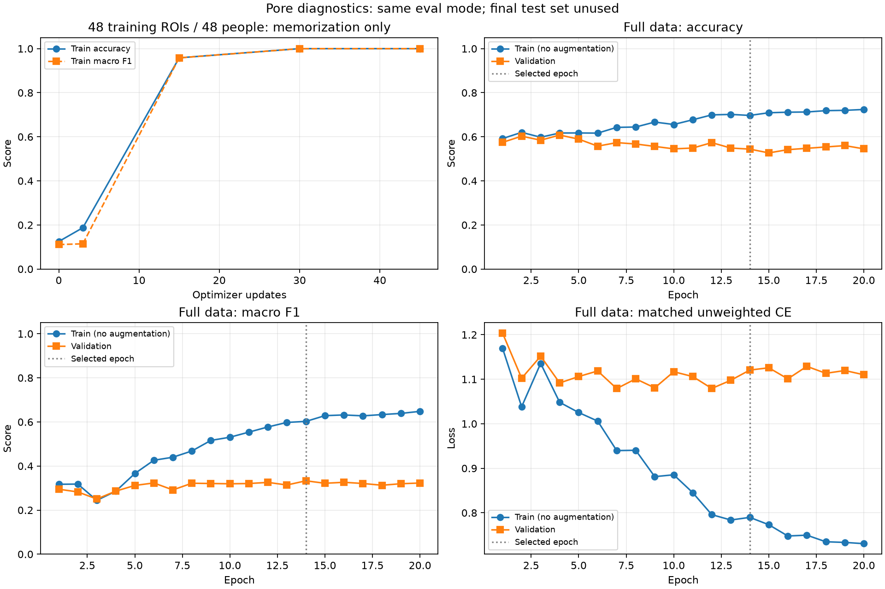

# 모공 학습 파이프라인 진단

## 사전에 고정한 범위

시드·최적 하이퍼파라미터를 탐색하기 전에 소량 데이터 암기와 학습/검증 성능 차이를
확인합니다. 학습은 로컬 GPU에서만 실행하고 기존 가중치·서비스 설정·추천 묶음을 보존합니다.
새 데이터 수집·라벨 변경·최종 평가셋 조회·테스트 페이지 교체는 하지 않습니다.

데이터는 기존 인물 분리 seed 42, fingerprint
`6ac903796d100a2ee4f66e3e1936548dfa618c9b448a90985ff9ffbb0c13d793`을 유지합니다.
모공 학습 690명/4,112 ROI, 검증 138명/816 ROI입니다.

1. **소량 암기:** 학습셋에서 등급별 8개, 전체 48명/48 ROI를 선택합니다.
   희소 등급부터 선택하고 전 등급에 걸쳐 인물이 중복되지 않게 합니다.
   증강 없이 같은 48개를 반복하고, ImageNet V2 ResNet-50 전체를 FP32로 학습합니다.
   배치 16, head LR 0.001, backbone LR 0.0001, AdamW decay 0, 일반 CE,
   최대 100 epoch(300 업데이트), 5 epoch마다 평가합니다(초기와 epoch 1도 평가).
   두 번 연속 eval-mode Accuracy와 macro-F1이 모두 99% 이상이면 통과입니다.
   이는 일반화 성능 실험이 아니며 검증셋을 선택/학습/종료에 사용하지 않습니다.
2. **전체 학습 곡선:** 기존 배치 16 CE 학습을 별도 경로에서 재실행합니다.
   학습 조건·증강·선택 기준·최대 20 epoch·patience 6은 유지합니다.
   `record_train_metrics=true`로 매 epoch의 증강 없는 학습셋 지표를 추가합니다.
   학습/검증 모두 FP32, eval mode, unweighted CE와 동일 분류 지표로 비교합니다.
   추가 평가는 BN 버퍼를 갱신하지 않고 학습 RNG·loader generator 상태를 복원합니다.
3. **기존 모델 대조:** CE 배치 32·16, CB Focal, CORAL, 이번 진단 CE의 선택 가중치를
   동일한 학습/검증셋에서 평가합니다. 개별 예측은 Git 제외 경로에만 보관합니다.
   CORAL의 손실은 threshold BCE이므로 CE 모델의 손실과 직접 비교하지 않습니다.

구현의 자동 테스트만으로 사진/등급의 임상적 정합성이나 전처리의 정보 보존을 검증했다고
간주하지 않습니다. 작은 데이터 암기에 성공해도 라벨 품질이나 일반화를 보장하지 않습니다.

## 재현

```powershell
uv run --project ml python -u -m skin_analysis.smartphone.diagnostics --phase tiny
uv run --project ml python -u -m skin_analysis.smartphone.train --config ml/configs/nia_smartphone_diagnostics.toml --task pore
uv run --project ml python -u -m skin_analysis.smartphone.diagnostics --phase gaps
uv run --project ml python -m ml.scripts.report_training_diagnostics
```

설정은 `ml/configs/nia_smartphone_diagnostics.toml`, 산출물은
`ml/runs/nia-smartphone-diagnostics-seed-42/`입니다. 기존 run을 덮어쓰지 않습니다.
`tiny-ce/`는 진단 전용 모델이며 추천용 가중치가 아닙니다.
`full-ce-batch16/pore/history.json`에 학습·검증 곡선 원시 집계를 보관합니다.

참고: [작은 배치 암기 및 입력 진단](https://karpathy.github.io/2019/04/25/recipe/),
[Google 연구팀 학습 진단 가이드](https://github.com/google-research/tuning_playbook).

## 결론과 다음 판단

2026-10-23 진단 완료. **작은 표본을 학습할 수 있으며, CE에서는 학습/검증의 일반화
격차가 확인됐습니다.** 현재 CORAL은 학습셋 성능부터 낮아 CE와 다른 양상입니다.

- 소량 48개는 epoch 10과 15의 두 평가에서 Accuracy·macro-F1이 모두 100%였습니다.
  15 epoch/45 업데이트로 사전에 정한 암기 검사를 통과했습니다. 표본은 48개의 서로 다른
  인물·중복 그룹·원본 사진·crop이며 전부 학습셋입니다. 전혀 학습되지 않는 파이프라인은
  아니지만, 잘못된 라벨도 외울 수 있으므로 라벨 정합성이나 일반화를 검증한 것은 아닙니다.
- CE 배치 16의 선택 epoch 14: 학습 Accuracy 69.70%/macro-F1 60.23%,
  검증 Accuracy 54.41%/macro-F1 33.29%. F1 차이는 **26.94%p**입니다.
  학습·검증 unweighted CE는 각각 0.7897/1.1206입니다.
- epoch 20에는 학습 F1 64.80%, 검증 F1 32.28%, CE 0.7307/1.1100이었습니다.
  학습 적합도만 높아지고 검증 개선이 따라오지 않는 과적합 양상입니다. 단순히 epoch나
  은닉층을 늘리는 것이 우선이라는 근거는 없습니다. 학습셋에도 오류는 남아 있으므로
  모든 문제를 과적합 하나로 설명하지 않습니다.
- CORAL의 선택 epoch 2: 학습 F1 26.27%, 검증 F1 24.86%로 모두 낮습니다.
  학습셋 적합도부터 낮은 현재 설정에 CE와 같은 과적합 설명만 적용할 수 없습니다.
  출력층 학습 기간·임계값 학습·모델 가정의 적합성 등을 별도로 진단할 여지가 있습니다.
  이 결과가 CORAL 자체의 한계를 입증하지는 않습니다.

### 데이터와 지표에서 알아야 할 점

| 등급 | 학습 인물 수 | 검증 인물 수 |
|---|---:|---:|
| 0 | 19 | 4 |
| 1 | 126 | 25 |
| 2 | 425 | 85 |
| 3 | 90 | 18 |
| 4 | 39 | 8 |
| 5 | 8 | 1 |

한 인물이 여러 등급에 기여할 수 있어 위 열의 합은 전체 인물 수와 다를 수 있습니다.
특히 5등급 검증은 **1명/6 ROI**에 불과합니다. ROI 수를 독립적인 인물 수로 간주하지 않습니다.
CE 배치 16의 5등급 Recall은 학습 37.50%(18/48), 검증 0%(0/6)입니다.
등급별 데이터 다양성과 불균형이 어떤 영향을 주는지 추가 확인이 필요합니다.

학습셋의 최다 등급인 2등급만 예측해도 검증 Accuracy는 61.03%지만 macro-F1은
12.63%입니다. CE 배치 16의 macro-F1은 이 기준보다 높습니다. 따라서 정확도가
최다 등급 기준보다 낮다는 이유만으로 학습 효과가 없다고 해석하지 않습니다.

다음 우선 작업은 **고등급을 2등급으로 예측한 실제 256px 입력과 원본 ROI의 비교,
등급 라벨 일관성, 인물·촬영 조건별 오류 검수**입니다. 이번에는 이 시각적/전문가 검수까지
수행하지 않았습니다. 증거를 확인한 뒤 정규화·미세조정 범위·촬영 도메인 대응을 결정하는
편이 합리적이며, 현 단계에서 새 손실 함수나 더 깊은 모델을 자동으로 추가하지 않습니다.

### 보존과 실행 검증

- 진단 재학습의 20개 epoch 모두 기존 배치 16 실행과 학습 손실·검증 손실·지표·
  선택 여부·AMP 재시도 횟수가 완전히 일치했습니다. 선택 모델의 모든 텐서도 일치했습니다.
  아래 `diagnostic_ce_batch16` 행은 별도의 독립 성능 근거가 아니라 동일 학습을 관측한 결과입니다.
- 기존 가중치·서비스 설정·추천 묶음 등 9개 파일의 실행 전후 SHA-256이 일치했습니다.
  테스트 페이지는 기존 모델을 유지합니다. 최종 평가셋 조회와 이미지 전송은 하지 않았습니다.
- ML 테스트 101개(신규 진단 테스트 5개 포함), Ruff 검사 통과.
  `npm run check -- -- --runInBand`의 typecheck·lint·앱 테스트 48개 통과.
- 집계 JSON과 그림 생성 도구는 검증된 원시 결과를 재사용하며 개별 식별자나 이미지를
  공개 보고서로 내보내지 않습니다. 파이프라인 진단과 별개로 임상적 유효성은 평가하지 않았습니다.

## 실제 진단 결과

### 소량 암기 검사

통과: **True**. 15 epoch / 45 업데이트에서 Accuracy 100.00%, macro-F1 100.00%, unweighted CE 0.000262.

### 선택 가중치의 학습/검증 차이

| 모델 | epoch | 학습 Accuracy | 검증 Accuracy | 학습 macro F1 | 검증 macro F1 | F1 차이(%p) |
|---|---:|---:|---:|---:|---:|---:|
| ce_batch32 | 18 | 67.80% | 55.64% | 55.74% | 31.42% | 24.33 |
| ce_batch16 | 14 | 69.70% | 54.41% | 60.23% | 33.29% | 26.94 |
| cb_focal | 9 | 62.57% | 54.29% | 49.75% | 30.89% | 18.86 |
| coral | 2 | 51.82% | 52.94% | 26.27% | 24.86% | 1.41 |
| diagnostic_ce_batch16 | 14 | 69.70% | 54.41% | 60.23% | 33.29% | 26.94 |

### 학습 곡선



선택 epoch 14, 실제 실행 20 epoch.

개별 예측과 인물 식별자는 공개 보고서에 포함하지 않습니다. 전체 혼동행렬·등급별 집계는 [집계 JSON](training-diagnostics.metrics.json)에 있습니다.
