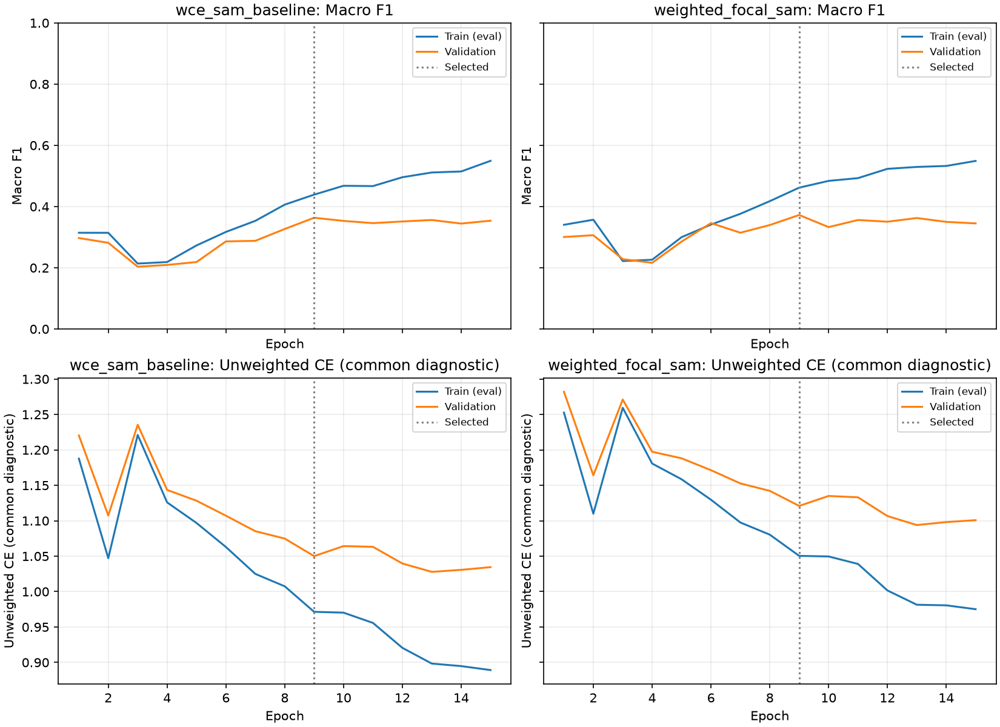

# 모공 WFL(Weighted Focal Loss) + AdamW + SAM 실험

## 사전에 고정한 비교

이번 문서에서 WFL은 **Weighted Focal Loss**를 뜻합니다. 직전의 가중 순서형 CDF 손실을
대체하고, **기존 WCE + AdamW + SAM**을 주 비교 기준으로 사용합니다. WCE는 앞선 보고서에서
CE라고 줄여 쓴 weighted cross entropy입니다. WCE+AdamW는 참고 행으로 따로 비교합니다.

WFL은 기존 WCE의 클래스 가중치 `alpha`를 유지하고 Focal 항만 추가합니다:

```text
CE_i = -log(softmax(logits_i)[y_i])  # class weight를 곱하기 전 CE
p_t = exp(-CE_i)
L = sum(alpha[y_i] * (1 - p_t)^gamma * CE_i) / sum(alpha[y_i])
gamma = 2.0
```

`p_t`를 `exp(-weighted_CE)`로 계산하지 않습니다. Focal 항도 함께 미분하며 detach하지 않습니다.
계산은 AMP 안에서도 FP32로 수행합니다. `gamma=0`에서 기존 WCE의 값과 gradient를
회복하는지 검사합니다. 이번에는 gamma 탐색·새 샘플링·새 클래스 가중치를 도입하지 않습니다.

클래스 가중치는 기존 cap 4의 정규화된 inverse-square-root 빈도 가중치입니다.
정규화 전 `sqrt(N/n_grade)`이며, 이후 학습 분포에 대한 가중 평균이 1이 되도록 정규화하고
cap을 적용합니다. 아래 값은 학습 라벨에서만 계산합니다.

| 등급 | 학습 ROI | alpha (WCE와 동일) |
|---|---:|---:|
| 0 | 114 | 2.916177 |
| 1 | 721 | 1.159574 |
| 2 | 2486 | 0.624476 |
| 3 | 519 | 1.366729 |
| 4 | 224 | 2.080378 |
| 5 | 48 | 4.000000 |

### 이전 CB Focal과의 차이

기존 CB Focal은 effective number `((1-beta^n)/(1-beta))`의 역수를 이용해 클래스별
가중치를 정했습니다(beta 0.999). 이번 WFL은 **WCE와 동일한 sqrt 빈도 가중치**를 사용합니다.
과거 CB Focal은 batch 32·AdamW, 이번 WFL은 batch 16·AdamW+SAM이므로, 두 결과를
비교해 alpha 계산 방식 하나의 인과 효과라고 주장하지 않습니다. 주 비교는 WCE+SAM입니다.
공유 Focal 계산부를 사용하되 기존 CB Focal의 값·gradient·가중치가 그대로인지 검사합니다.
두 구현 모두 서로 배타적인 6개 등급의 softmax 방식이며, 원 논문의 전체 detector나
sigmoid one-vs-all 구현을 재현한 것은 아닙니다.

## 공통 조건과 평가

ImageNet V2 ResNet-50 신규 초기화, seed 42, 256px ROI, 물리/유효 batch 16,
head 2 + 전체 미세조정 최대 18 epoch, patience 6, head LR 1e-3 → 1e-4,
backbone LR 1e-5, weight decay 1e-4, 기존 cosine scheduler·AMP·SAM rho 0.05를 유지합니다.
같은 약한 증강·전문의 라벨을 사용하며 기존 피부 가중치에서 이어 학습하지 않습니다.
WCE+SAM 대비 변경은 손실 종류·focal gamma 추가·출력 폴더입니다.

학습 690명/4,112 ROI, 검증 138명/816 ROI. 인물 분리 fingerprint:
`6ac903796d100a2ee4f66e3e1936548dfa618c9b448a90985ff9ffbb0c13d793`.
최종 테스트셋을 조회하지 않고 검증 macro-F1로 checkpoint를 선택합니다.
동률은 공통 unweighted CE로 판정하며 출력층·softmax argmax도 유지합니다.

Accuracy, macro/weighted Precision·Recall·F1, 등급별 지표·혼동행렬, MAE·±1등급 적중률,
4·5등급 pooled 정확 분류 Recall을 같은 FP32 eval mode에서 측정하고 sklearn과 대조합니다.
고등급 pooled Recall은 실제 고등급을 자기 등급으로 정확히 맞힌 비율로, 4↔5 혼동도 오답입니다.
특히 3등급·4등급 Recall과 1명/6 ROI인 5등급의 한계를 함께 기록합니다.

로그 `train_loss`는 WFL 최적화 손실입니다. `valid_loss`와 `train_eval_loss`는 모델 간
공통 진단값인 **unweighted CE**입니다. Focal 손실이 작아진 수치 자체를 성능 향상으로
해석하지 않습니다. 그림은 공통 CE 및 macro-F1을 비교합니다.

같은 검증셋을 반복 사용한 단일 seed·고정 gamma 실험입니다. 통계적 우월성·다른 장비나
새 인물에서의 성능을 확정하지 않습니다. 모공만 학습하고 기존 서비스·추천 묶음·테스트 페이지는
보존합니다. 외부/생성 데이터나 새 라벨을 추가하지 않고 얼굴 사진을 서버에 전송하지 않습니다.

## 재현과 산출물

저장소 루트에서 실행합니다. 기존 실험 폴더는 덮어쓰지 않습니다.

```powershell
uv run --project ml python -m ml.scripts.report_weighted_focal --phase preflight
uv run --project ml python -u -m skin_analysis.smartphone.train --config ml/configs/nia_smartphone_weighted_focal_sam.toml --task pore
uv run --project ml python -m ml.scripts.report_weighted_focal --phase evaluate
uv run --project ml python -m ml.scripts.report_weighted_focal --phase publish
```

후보 체크포인트·export·학습 이력·개별 예측:
`ml/runs/nia-smartphone-weighted-focal-sam-seed-42/`.
개별 예측·인물 ID·이미지는 로컬에만 보존하고 공개 집계·학습 곡선만 Git으로 공유합니다.

참고: [Focal Loss 원 논문](https://arxiv.org/abs/1708.02002),
[Class-Balanced Loss 원 논문](https://arxiv.org/abs/1901.05555).

## 결론과 적용 판단

2026-10-23 학습·재평가 완료. **WFL+SAM은 macro-F1에서 작은 이득을 보였지만,
정확도·평균 등급 오차·weighted F1은 악화됐습니다.** 고등급 Recall 상승도 검증 50 ROI 중
정답 1개 증가이므로 큰 개선으로 해석하지 않습니다. 전체적으로 우월한 후보라고 판단하지 않고
비교용 가중치로 보존합니다. 다른 항목 확대나 기존 서비스·테스트 페이지 교체는 하지 않았습니다.

15 epoch에서 patience 6으로 조기 종료됐고 **epoch 9**를 선택했습니다.
주 비교 기준 WCE+SAM도 같은 15 epoch 종료 / epoch 9 선택입니다.
WFL 프로세스 전체 시간은 약 **602초(10분 2초)**로, 초기화·cache 확인·worker 시작·
train-eval·체크포인트 IO를 포함합니다. 완료 후 별도 재평가 시간은 포함하지 않습니다.

| 주 비교 지표 | WCE+SAM | WFL+SAM | 변화 |
|---|---:|---:|---:|
| Accuracy | 63.11% (515/816) | 61.15% (499/816) | -1.96%p |
| macro Precision | 42.06% | 40.16% | -1.90%p |
| macro Recall | 36.70% | 37.10% | +0.41%p |
| macro F1 | 36.34% | 37.24% | +0.90%p |
| weighted F1 | 58.28% | 57.82% | -0.46%p |
| MAE | 0.4534 | 0.4792 | +0.0257 |
| ±1등급 적중률 | 92.77% | 92.16% | -0.61%p |
| 3등급 Recall | 3.88% (4/103) | 7.77% (8/103) | +3.88%p |
| 4등급 Recall | 22.73% (10/44) | 25.00% (11/44) | +2.27%p |
| 5등급 Recall | 0% (0/6) | 0% (0/6) | 동일 |
| 4·5등급 pooled Recall | 20% (10/50) | 22% (11/50) | +2%p |

변화량은 반올림 전 값의 차이로 계산했습니다. 단일 seed·같은 검증셋의 관측이며
통계적 유의성이나 새로운 인물에 대한 우월성을 검정한 것은 아닙니다.

### 어느 등급에서 달라졌는가

- 3등급의 정답 수가 4 → 8로 늘고 F1은 7.08% → 12.50%로 좋아졌습니다.
  그래도 실제 103 ROI 중 8개만 맞혔으므로 3등급 구분이 해결됐다고 볼 수 없습니다.
- 4등급 정답은 10 → 11이지만 4등급 예측 수는 25 → 34로 늘었습니다.
  Precision은 40.00% → 32.35%, F1은 28.99% → 28.21%로 낮아졌습니다.
  따라서 고등급 Recall 상승은 false positive 증가와 함께 해석해야 합니다.
- 5등급을 예측한 3 ROI는 모두 실제 3등급이었습니다. 실제 5등급 6 ROI는
  기존 WCE+SAM과 똑같이 5개가 2등급, 1개가 3등급으로 분류됐습니다.
  5등급은 여전히 검증 1명뿐이고 새 모델도 정확히 찾아내지 못했습니다.
- 2등급 정답이 428 → 406으로 줄었습니다(Recall 85.94% → 81.53%).
  1등급 정답 +1, 3등급 +4, 4등급 +1로 얻은 6개보다 2등급에서 잃은 22개가 커
  전체 정답 수는 16개 줄었습니다. 0등급 정답 수는 14개로 같지만 예측 수가 줄어 F1이 올랐습니다.

선택 모델의 학습/검증 F1 차이는 WCE+SAM 43.89% / 36.34%(7.55%p),
WFL+SAM 46.17% / 37.24%(8.93%p)입니다. Focal이 학습/검증 차이를 줄인 결과는 아닙니다.
마지막 epoch 15는 학습 F1 54.90% / 검증 F1 34.50%로 차이가 20.41%p로 커졌습니다.
이 설정에서 Focal이 과적합을 해소했다고 주장하지 않습니다.

직전 순서형 CDF 후보의 고등급 Recall 2%보다 높지만, 그 비교만으로 WFL의 우월성을
판단하지 않습니다. 주 기준 WCE+SAM 대비에는 Recall 2%p 이득과 Accuracy·MAE 악화가
동시에 있습니다. 과거 CB Focal보다 나은 숫자 역시 배치·SAM 등 조건이 달라 가중치 방식
하나의 효과로 볼 수 없습니다. 이번 gamma 2 설정의 결과를 WFL 전체의 한계로 일반화하지 않습니다.

## 검증과 보존

- WCE+SAM과 데이터·초기화·6개 출력·추론·학습률·배치·예산·클래스 가중치·SAM rho·
  BN/AMP 처리·checkpoint 선택이 같음을 확인했습니다. 변경은 focal 항과 출력 폴더입니다.
- WFL의 `gamma=0` 값·gradient를 WCE와 대조했고, gamma 2는 독립 softmax 수식 및
  전체 gradient와 대조했습니다. weighted CE에서 `p_t`를 구하는 잘못된 계산을 막는 검사를
  포함합니다. 극단 FP16·가중치 스케일·invalid alpha/gamma·설정 변경도 검사했습니다.
- CB Focal은 이전 effective-number 가중치와 수식의 loss/gradient가 정확히 일치했습니다.
  실제 GPU의 head/미세조정 단계에서도 합성 입력으로 WFL+SAM을 실행해 유한값을 확인했습니다.
- 후보 SHA·유한 텐서·best/export 일치·WCE와 동일한 alpha를 검증했습니다.
  53개 BN의 최종 counter 증분과 AdamW step은 미세조정 **3,341회**, epoch당 **257회**입니다.
  AMP 재시도 총 3회는 추가 step이나 추가 BN 누적으로 계산되지 않았습니다.
- 세 모델을 같은 train/valid에서 FP32로 재평가하고 sklearn 지표를 대조했습니다.
  기존 두 모델의 이전 수치가 재현됐고 선택 epoch와 재평가 값이 일치했습니다.
- 엄격한 서비스 SHA/shape 로더로 후보를 읽어 유한한 `[1,6]` 더미 출력을 확인했습니다.
  기존 설정·추천 묶음·모든 이전 비교 가중치 **14개 파일**의 해시가 사전 기록과 같습니다.
- 후보는 `ml/runs/nia-smartphone-weighted-focal-sam-seed-42/pore/inference.bin`에 저장했습니다.
  개인별 예측은 로컬 run에만 보존하며 공개 [집계 JSON](weighted-focal-experiment.metrics.json)은
  등급별/가중 지표·혼동행렬·학습 이력·보존/로더 검사만 포함합니다.
- ML pytest **146 passed**, ML Ruff 통과, `server/nia` unittest **34 passed**,
  `npm run check -- -- --runInBand` 통과(타입 검사·린트·앱 **48 tests**).
- 구현 커밋: `42ac58bc4`. 최종 테스트셋·외부/생성 이미지·새 라벨은 사용하지 않았습니다.

## 실제 비교 결과

동일 검증 138명/816 ROI, 증강 없는 FP32 평가입니다.

| 모델 | epoch / 실행 | Acc | macro P | macro R | macro F1 | MAE | ±1등급 | 고등급 Recall |
|---|---:|---:|---:|---:|---:|---:|---:|---:|
| wce_adamw_reference | 14 / 20 | 54.41% | 31.56% | 38.45% | 33.29% | 0.5674 | 90.81% | 20.00% |
| wce_sam_baseline | 9 / 15 | 63.11% | 42.06% | 36.70% | 36.34% | 0.4534 | 92.77% | 20.00% |
| weighted_focal_sam | 9 / 15 | 61.15% | 40.16% | 37.10% | 37.24% | 0.4792 | 92.16% | 22.00% |

| 모델 | 학습 F1 | 검증 F1 | 차이(%p) |
|---|---:|---:|---:|
| wce_adamw_reference | 60.23% | 33.29% | 26.94 |
| wce_sam_baseline | 43.89% | 36.34% | 7.55 |
| weighted_focal_sam | 46.17% | 37.24% | 8.93 |

| 모델 | 등급 | 실제 ROI | 예측 ROI | Precision | Recall | F1 |
|---|---:|---:|---:|---:|---:|---:|
| wce_adamw_reference | 0 | 21 | 49 | 36.73% | 85.71% | 51.43% |
| wce_adamw_reference | 1 | 144 | 150 | 36.67% | 38.19% | 37.41% |
| wce_adamw_reference | 2 | 498 | 495 | 69.90% | 69.48% | 69.69% |
| wce_adamw_reference | 3 | 103 | 82 | 18.29% | 14.56% | 16.22% |
| wce_adamw_reference | 4 | 44 | 36 | 27.78% | 22.73% | 25.00% |
| wce_adamw_reference | 5 | 6 | 4 | 0.00% | 0.00% | 0.00% |
| wce_sam_baseline | 0 | 21 | 23 | 60.87% | 66.67% | 63.64% |
| wce_sam_baseline | 1 | 144 | 140 | 42.14% | 40.97% | 41.55% |
| wce_sam_baseline | 2 | 498 | 617 | 69.37% | 85.94% | 76.77% |
| wce_sam_baseline | 3 | 103 | 10 | 40.00% | 3.88% | 7.08% |
| wce_sam_baseline | 4 | 44 | 25 | 40.00% | 22.73% | 28.99% |
| wce_sam_baseline | 5 | 6 | 1 | 0.00% | 0.00% | 0.00% |
| weighted_focal_sam | 0 | 21 | 21 | 66.67% | 66.67% | 66.67% |
| weighted_focal_sam | 1 | 144 | 148 | 40.54% | 41.67% | 41.10% |
| weighted_focal_sam | 2 | 498 | 585 | 69.40% | 81.53% | 74.98% |
| weighted_focal_sam | 3 | 103 | 25 | 32.00% | 7.77% | 12.50% |
| weighted_focal_sam | 4 | 44 | 34 | 32.35% | 25.00% | 28.21% |
| weighted_focal_sam | 5 | 6 | 3 | 0.00% | 0.00% | 0.00% |



가중치 SHA-256:

- wce_adamw_reference: `9dcfe1bd137742281af1ff87cf6c8b12c840a8e4fb20f7114ef08dfbc59b3f92`
- wce_sam_baseline: `18c5ddd6c921c22a1bf55010a437e32f682470cfce41a9d6a7d2295f75e77644`
- weighted_focal_sam: `efaaa94ae082eb98f4aeb486be4692efe12459d636d74079b8c078bcd72c8459`
